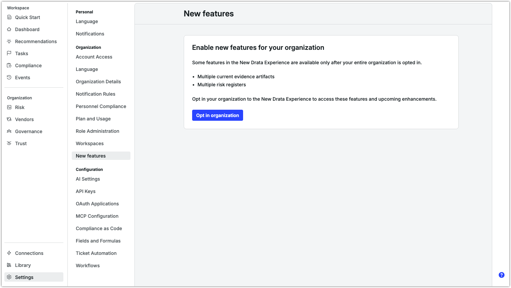

# Evidence Library: Multiple Artifacts & Multi-File Upload (New Experience)

Source: https://help.drata.com/en/articles/15694170-evidence-library-multiple-artifacts-multi-file-upload-new-experience
Collection: Understand the Drata Platform › Evidence
Updated: 2026-11-10
Fetched: 2026-11-22

## Article text

## What is the Multiple Artifacts feature?

Evidence Library now supports multiple artifacts per evidence item. Instead of uploading one file at a time and maintaining a single current artifact, you can upload several files, URLs, or tickets in a single session — and keep all of them as current evidence simultaneously.

This is especially useful when a single control requires multiple screenshots, documents, or links to fully demonstrate compliance. Rather than zipping files together or repeating the upload flow for each artifact, you can attach everything at once.

---

### Prerequisites

- Navigate to the **Settings > New features** page and enable this feature. Until the organization enables the New Features setting, users will not see the multiple artifacts feature regardless of their role.
   - 
- **RBAC roles**: Admin, Guest Admin, Information Security Lead, DevOps Engineer, Control Manager
- **Workspace awareness**: This feature is workspace-aware.

---

## What can I do here?

### Add multiple artifacts in a single upload

When adding artifacts to an evidence item, you can now select and upload multiple files, URLs, or tickets in one step.

- The **Add Artifacts modal** uses a "shopping cart" style experience — each artifact you select is queued in a preview panel on the right before you confirm.
- The **Add Files form** (inline in the evidence panel) lists each new artifact below the input as you add them, similar to the existing experience but now supporting multiple entries.
- If you include a file type that isn't supported, Drata will add the supported files and skip the unsupported ones — it won't block the entire upload.
- Each artifact displays its **source name** (the file name, URL, or ticket reference) with an icon to distinguish file, URL, and ticket types.
- You can optionally set an **Artifact Name** for each artifact; if left blank, it defaults to the source name.

### Manage current artifacts

The **Current Artifacts** list can now hold multiple items instead of a single one.

- All current artifacts are downloadable or directly linkable from the list.
- The action menu for each artifact lets you **Open URL**, **Open Ticket**, or **View File** depending on artifact type.
- You can now also **delete current artifacts** directly — previously this was only available for past artifacts.
- When an evidence item has multiple artifacts of different types, the Source column in the Evidence table will reflect that multiple sources are attached.

### Control what goes to your auditors: current vs. past artifacts

You now have full control over which artifacts are shown to auditors and which are stored as historical records.

- Adding a new artifact **does not automatically move existing artifacts to past** — all artifacts stay current until you explicitly move them.
- To archive an artifact, select **Mark as Past Artifact** from its menu. Past artifacts can also be moved back to current by selecting **Mark as Current Artifact**.
- The only exception is the **Renew Evidence** flow: when you renew, current artifacts are automatically moved to past and replaced with the new artifacts you upload.
- Past artifacts are retained indefinitely until you manually select **Delete Artifact** — they are not removed automatically. These records are important for audit history (typically 7+ years).
- The date an artifact was moved to past is recorded, so you can tell which audit period each artifact was associated with.

### Download evidence

Downloading an evidence item now packages all artifacts together:

- Files are bundled into a zip archive.
- URLs and tickets are included as links in a PDF.

---

## Use cases / Best practices

### Evidence requires multiple proof points

Some controls can't be demonstrated with a single file. For example, proving MFA is enforced on an infrastructure console might require four separate screenshots — each one is a contributing artifact for the same piece of evidence, not a standalone item. Multiple artifacts lets you represent that accurately without workarounds like zipping files.

### Renewal date is on the evidence, not the artifact

The renewal date has moved from the individual artifact level to the **evidence item** itself. This reflects that artifacts don't expire independently — the evidence as a whole has a renewal cadence. When the renewal date passes, the entire set of current artifacts is moved to past and you upload fresh ones.

### Viewing evidence with multiple artifacts

When you select **View Evidence** on an item:

- If there is only **one artifact**: the action label reflects the type ("Open URL", "Open Ticket", "View File").
- If there are **multiple artifacts**: the label always shows "View evidence" and opens a modal listing all artifacts. URLs and tickets are shown inline; unsupported file types show a download prompt.

### Archiving outdated evidence before an audit

Before sharing evidence with an auditor, review your current artifacts and move any outdated or irrelevant files to past. This ensures only the relevant, current proof is presented — without permanently deleting anything you may need later.

## Images

- [image 01] ../../images/ux/settings/evidence-library-multiple-artifacts-multi-file-upload-new-experience--01.png

## Related articles

- [Evidence Overview](evidence-overview.md)
- [Create Evidence](create-evidence.md)
- [Evidence Renewal Date](evidence-renewal-date.md)
- [Add Jira Tickets as Evidence](add-jira-tickets-as-evidence.md)
- [Bulk Import Evidence](bulk-import-evidence.md)
