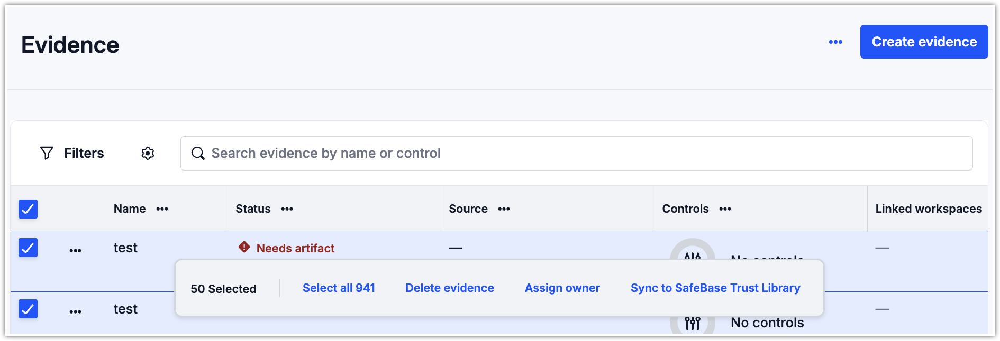

# Evidence Overview

Source: https://help.drata.com/en/articles/13404035-evidence-overview
Collection: Understand the Drata Platform › Evidence
Updated: 2026-11-09
Fetched: 2026-11-22
Description: Centralize, manage, and track audit-ready evidence across controls with Drata's Evidence Library.

## Article text

The **Evidence page** is a centralized workspace for managing all evidence used to support your controls. It helps you streamline evidence collection, maintain version history, and ensure control readiness across audits.

Evidences can be mapped to one or more controls, updated over time, and reused across frameworks. Keeping evidence current and correctly mapped reduces audit gaps and improves overall readiness.

**Note:** Pre-mapped evidence is available only to SOC 2 or ISO 27001:2022 customers who joined Drata after August 27, 2024.

## Access the Evidence page

Go to **Compliance > Evidence**. This page shows all evidence in your workspace.

From here, you can:

- Select an evidence item to view details or add an artifact
- Select multiple evidence items to take bulk actions, including:
   - Delete evidence
   - Assign or update an evidence owner
   - Sync evidence to the SafeBase Trust Library (if enabled)
   

Use this page as your starting point when investigating why a control is not ready or preparing for an audit.

## Evidence Status and Readiness Impact

Each evidence item has a status that indicates whether it needs attention and how it affects control readiness.

- **Needs artifact** — The evidence does not have an artifact. Can negatively impact control readiness. Recommended action: Upload an artifact.
- **Needs renewal** — The evidence has an artifact, but the renewal date has passed. Can negatively impact control readiness. Recommended action: Update the artifact.
- **Upcoming renewal** — The evidence has an artifact, and the renewal date is within the next two months. Can positively impact control readiness. Recommended action: Plan to update soon.
- **Ready** — The evidence has a current artifact, or valid test evidence exists. Can positively impact control readiness. No immediate action needed.
- **Error** — The associated test is in an error state. Does not impact control readiness. Recommended action: Review the related test.

## Evidence Sources

Each evidence item has a source that indicates how the artifact is provided.

- **File:** Upload a file from your computer or cloud storage. Maximum size: 50 MB per file. Zipped files are automatically unzipped and validated.
- **URL:** Use a link for web-based or sensitive evidence.
- **Ticket:** Link evidence from a connected [ticketing system](https://help.drata.com/en/collections/16504775-ticketing-guidance).
- **Test:** Test evidence is automatically generated from monitoring tests and appears with the source labeled **Test**.

## Evidence owner on artifact templates

Each artifact (evidence item) in Drata's Evidence Library has its own **Evidence Owner** field. This is separate from the **control owner** field on the mapped DCF control. This separation is intentional because the person responsible for collecting and maintaining evidence may be different from the person who owns the control.

### How evidence owner differs from control owner

In practice:

- The **control owner** is assigned at the DCF/control level and is responsible for the control overall.
- The **evidence owner** is assigned at the artifact level and is responsible for uploading and maintaining that specific piece of evidence.

These owners can, and often do, belong to different people, especially in larger or decentralized organizations.

### Evidence owner on artifact templates

Artifact templates in the Evidence Library include an **Evidence Owner** field. This field is distinct from the control owner and designates who is specifically responsible for evidence collection and maintenance for that artifact.

This separation helps teams:

- Align control ownership with overall accountability for the control.
- Assign evidence collection and maintenance to the right individual or team member.
- Support decentralized compliance processes where contributors manage only the evidence they own.

## Images

- [image 01] ../../images/ux/evidence/evidence-overview--01.png

## Related articles

- [Create Evidence](create-evidence.md)
- [Evidence Renewal Date](evidence-renewal-date.md)
- [Manually Export Evidence Data from Drata](manually-export-evidence-data-from-drata.md)
- [Managing Evidence in Drata Training Video (New Experience)](managing-evidence-in-drata-training-video-new-experience.md)
- [Section 5: Evidence Owners](section-5-evidence-owners.md)
