# Exclusion labels within GCP

Source: https://help.drata.com/en/articles/5539469-exclusion-labels-within-gcp
Collection: Understand the Drata Platform › Monitoring
Updated: 2026-08-05
Fetched: 2026-11-22
Description: Implementing exclusion labels for specific resources

## Article text

You may have resources within GCP that should always be ignored by Drata's compliance automation tests. Sometimes these are new resources that spin up each day. The exclusion label functionality will allow you to exclude these resources with a label within GCP.

Exclusion labels currently apply to the following resource types. Drata will continue to expand the use of exclusion labels.

- Buckets
- Virtual machines
- Kubernetes clusters
- CloudSQL DBs
- GCP Projects

## Prerequisites

Before applying exclusion labels in GCP:

- [GCP Infrastructure connection](gcp-integration-guide-script-setup.md) must be connected to Drata
- Drata must be actively monitoring GCP resources

Exclusion labels are only evaluated by Drata after the infrastructure connection is established.

## Exclude GCP Buckets with labels

To exclude **GCP Buckets** with labels:

1. Select the bucket you wish to exclude in [Cloud Storage](https://console.cloud.google.com/storage/browser?project=drata-acme&prefix=).
   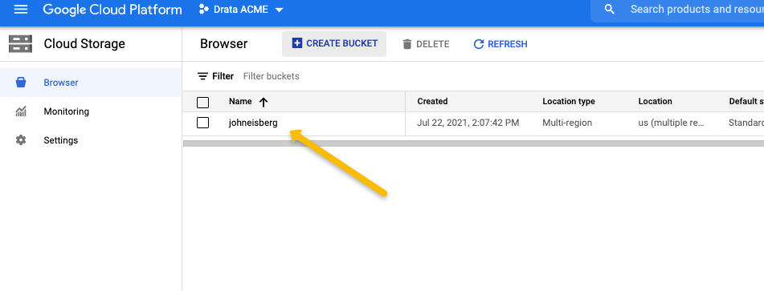
2. Select the **Configuration **tab.
   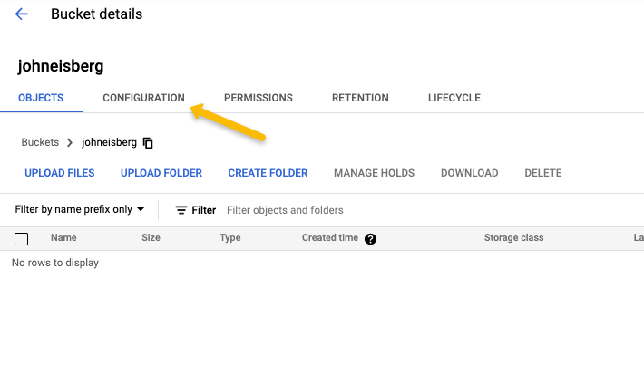
3. Scroll down to the **Labels **field under the Configuration tab and select the edit icon.
   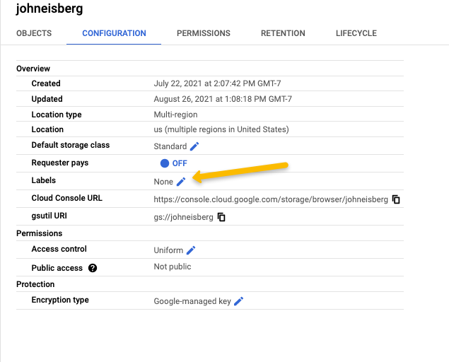
4. Enter the following values:
   - **Key**: `drataexclude`
   - **Value**: <Enter the rationale behind excluding this bucket. Ensure that there are no spaces.>
      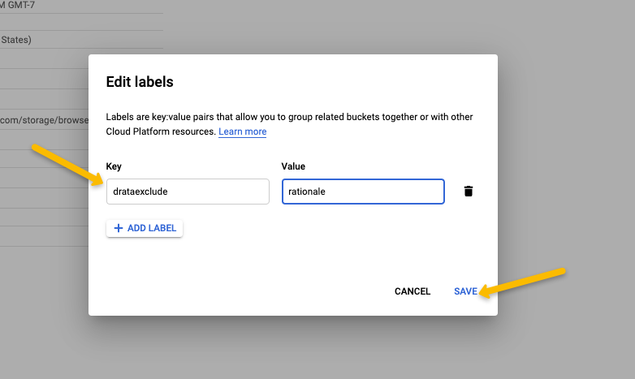
5. Save your changes.

## Exclude VM instances with labels

To exclude **VM instances** with labels:

1. Select the Instance you wish to exclude in the [Compute Engine](https://console.cloud.google.com/compute/instances?project=drata-acme) workflow.
   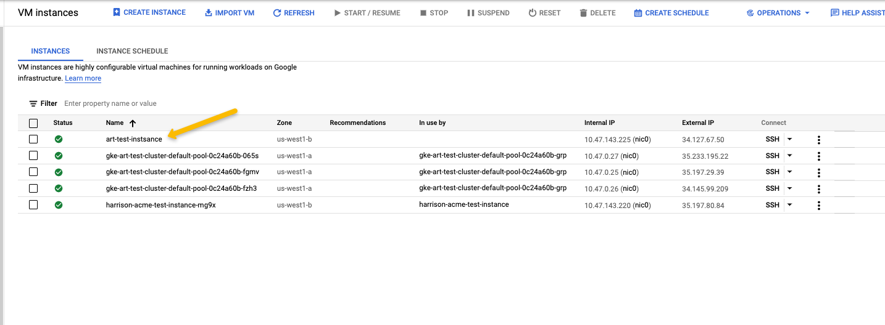
2. Select the Edit tab.
   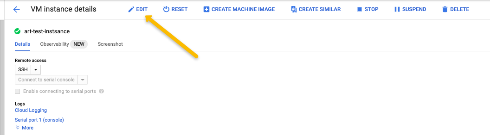
3. Scroll down and select **Add label**.
   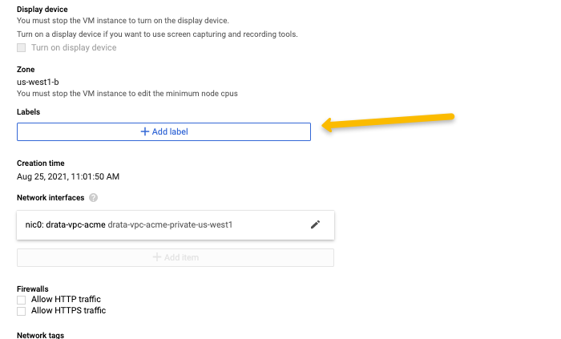
4. Enter the following values:
   - **Key**: `drataexclude`
   - **Value**: <Enter the rationale behind excluding this bucket. Ensure that there are no spaces.>
      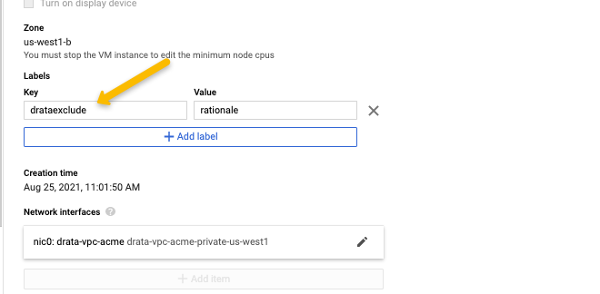
5. Save your changes.

## Exclude Kubernetes Clusters with labels

> **⚠️ Limitation**: When labeling **Kubernetes** clusters, the exclude label takes about an hour to propagate to the node level. If **Test 118 - Infrastructure Instance CPU Monitored** is run before the label propagates to the node level, the test will fail.
>
> 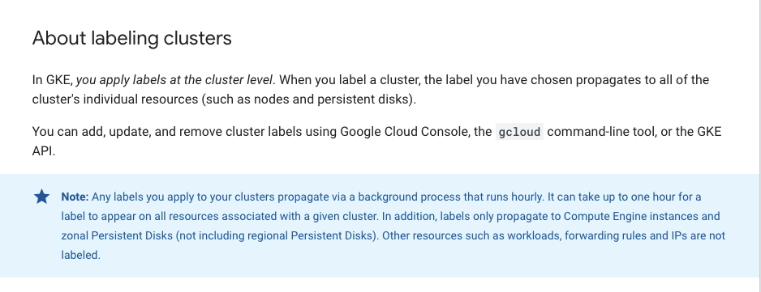

To exclude **Kubernetes Clusters **with labels:

1. Select the cluster you wish to exclude in the [Kubernetes Engine](https://console.cloud.google.com/kubernetes/list?project=drata-acme) workflow.
   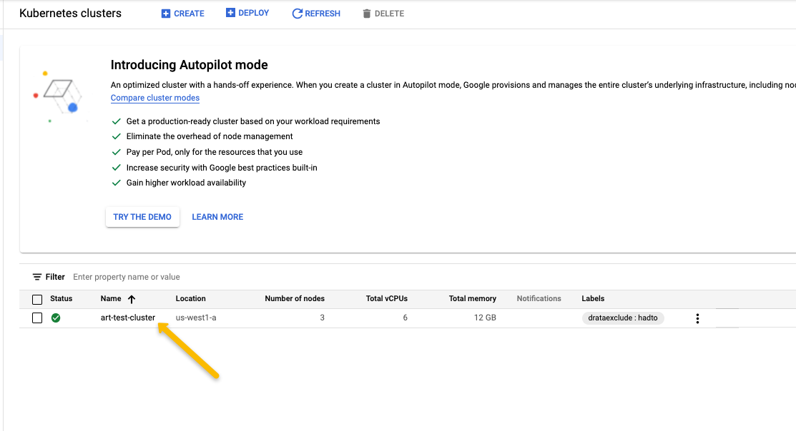
2. Under the **Metadata **section, scroll down and select the edit icon for **Labels**.
   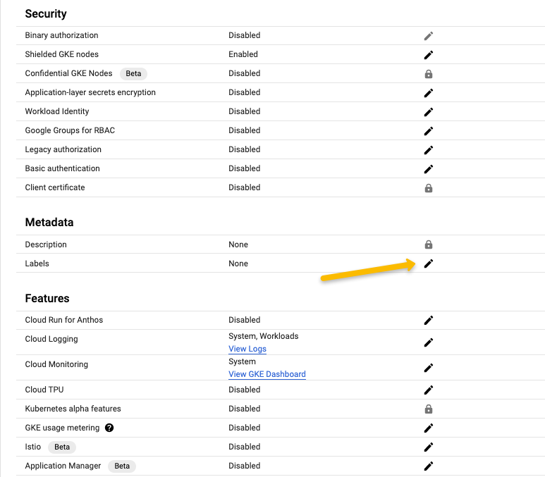
3. Select Add Label and enter the following values:
   - **Key**: `drataexclude`
   - **Value**: <Enter the rationale behind excluding this bucket. Ensure that there are no spaces.>
      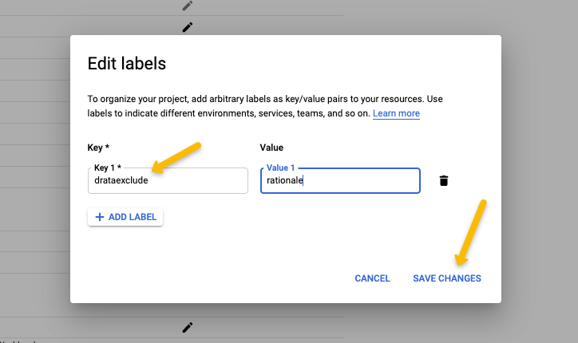
4. Save your changes.

## Exclude CloudSQL DBs

To exclude CloudSQL DBs:

1. Select the SQL button and the DB name you want to exclude.
   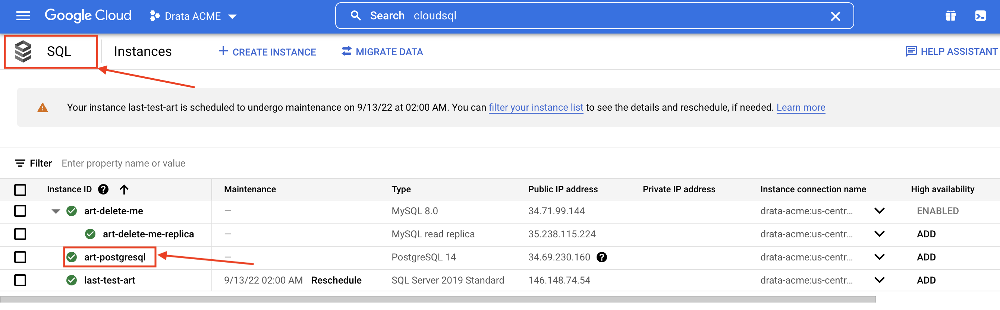
2. Select the edit button.
   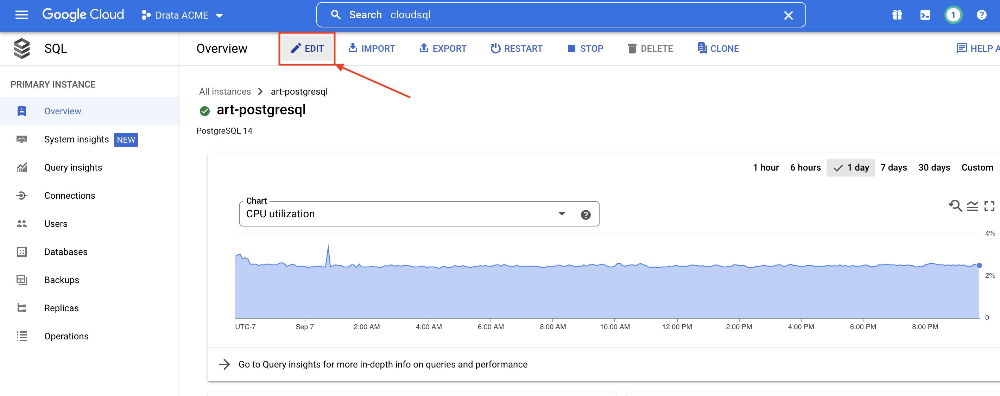
3. Expand the Labels section and then select **Add Label.**
   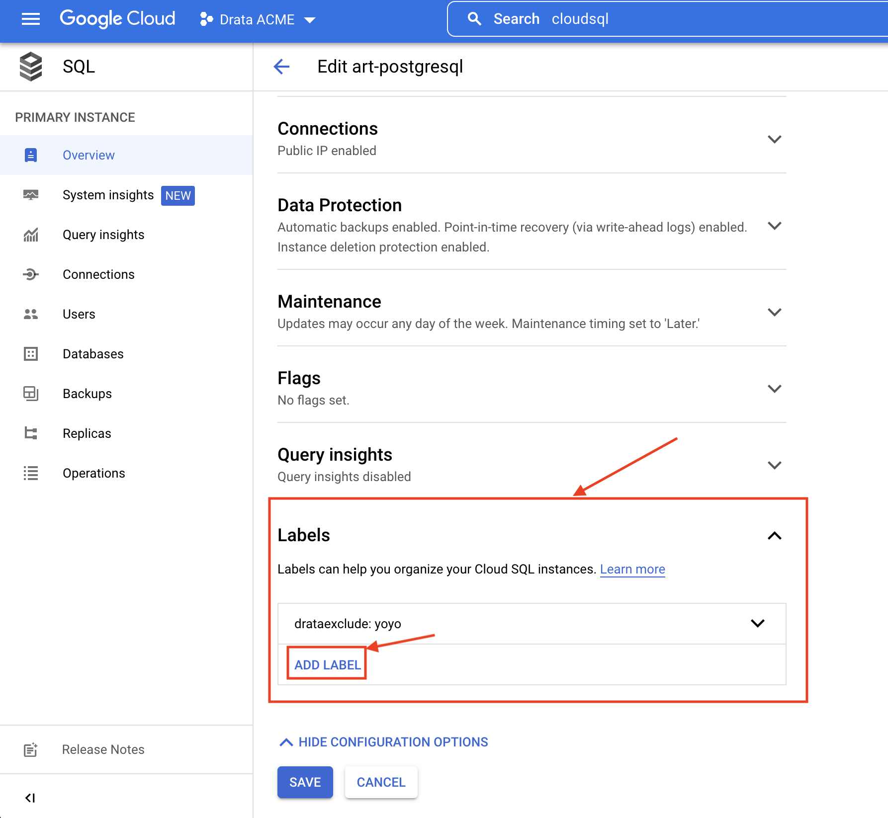
4. Enter the following values and select Done.
   - **Key**: `drataexclude`
   - **Value**: <Enter the rationale behind excluding this bucket. Ensure that there are no spaces.>
      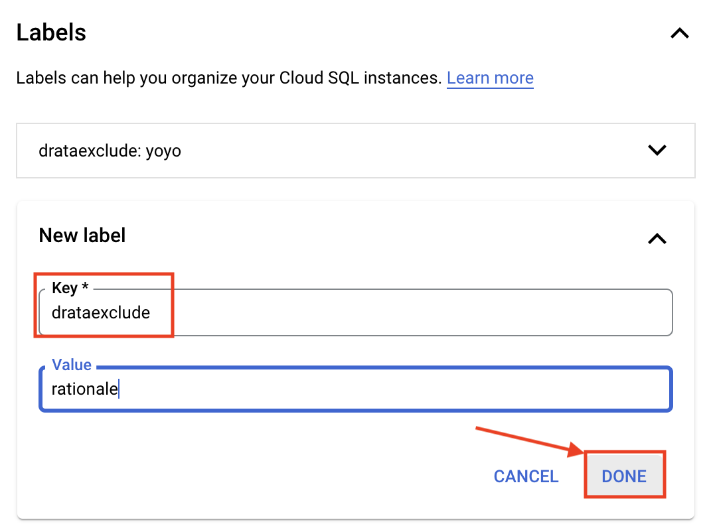
5. Then, ensure to save your changes.

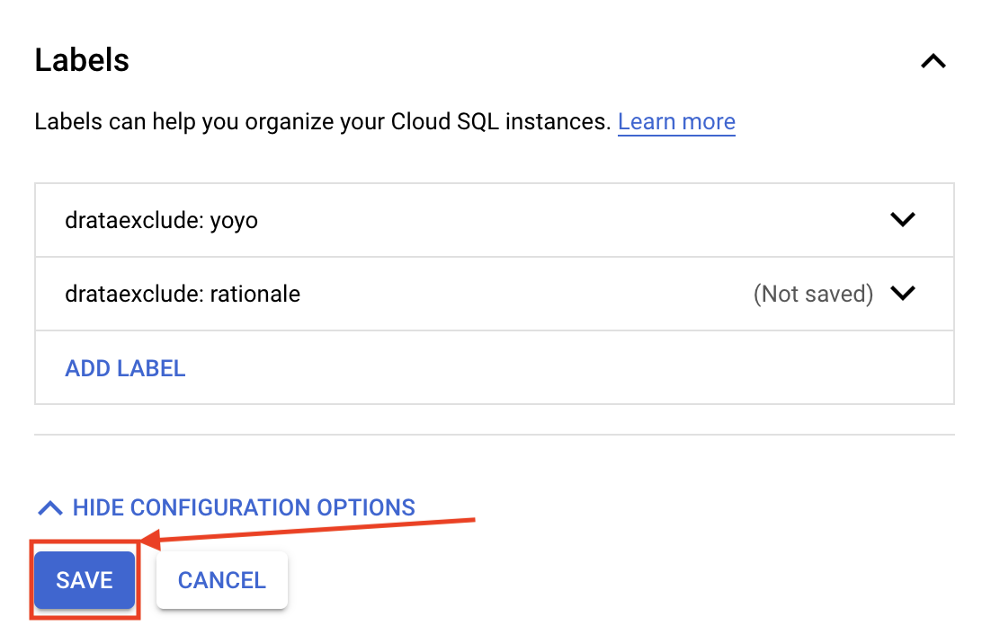

## Exclude GCP Projects

> **⚠️ Limitation**: If a change is made to the GCP web page, you may have to wait 3 to 4 minutes between each test run for the changes to be reflected correctly.

To exclude entire projects, follow these steps:

1. Navigate to the GCP website and select the project you want to exclude.
2. In the **Labels** section, select **Add Label **button.
3. Enter the following values and select done.
   - **Key**: `drataexclude`
   - **Value**: <Enter the rationale behind excluding this bucket. Ensure that there are no spaces.>
      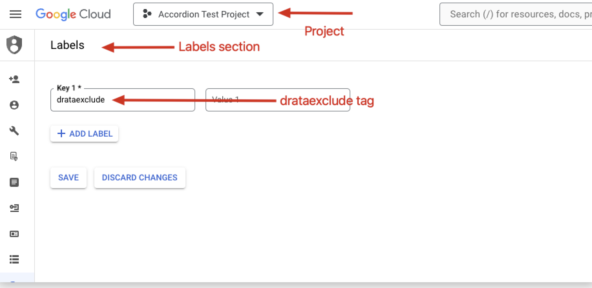
4. Save your changes.

## Images

- [image 01] ../../images/integrations/gcp/exclusion-labels-within-gcp--01.png
- [image 02] ../../images/integrations/gcp/exclusion-labels-within-gcp--02.png
- [image 03] ../../images/integrations/gcp/exclusion-labels-within-gcp--03.png
- [image 04] ../../images/integrations/gcp/exclusion-labels-within-gcp--04.png
- [image 05] ../../images/integrations/gcp/exclusion-labels-within-gcp--05.png
- [image 06] ../../images/integrations/gcp/exclusion-labels-within-gcp--06.png
- [image 07] ../../images/integrations/gcp/exclusion-labels-within-gcp--07.png
- [image 08] ../../images/integrations/gcp/exclusion-labels-within-gcp--08.png
- [image 09] ../../images/integrations/gcp/exclusion-labels-within-gcp--09.png
- [image 10] ../../images/integrations/gcp/exclusion-labels-within-gcp--10.png
- [image 11] ../../images/integrations/gcp/exclusion-labels-within-gcp--11.png
- [image 12] ../../images/integrations/gcp/exclusion-labels-within-gcp--12.png
- [image 13] ../../images/integrations/gcp/exclusion-labels-within-gcp--13.png
- [image 14] ../../images/integrations/gcp/exclusion-labels-within-gcp--14.png
- [image 15] ../../images/integrations/gcp/exclusion-labels-within-gcp--15.png
- [image 16] ../../images/integrations/gcp/exclusion-labels-within-gcp--16.png
- [image 17] ../../images/integrations/gcp/exclusion-labels-within-gcp--17.png
- [image 18] ../../images/integrations/gcp/exclusion-labels-within-gcp--18.png

## Related articles

- [Exclusion tags within AWS](exclusion-tags-within-aws.md)
- [Exclusion tags within Azure](exclusion-tags-within-azure.md)
- [GCP Virtual Assets](gcp-virtual-assets.md)
- [Excluding Infrastructure resources](excluding-infrastructure-resources.md)
- [Personnel exclusions](personnel-exclusions.md)
