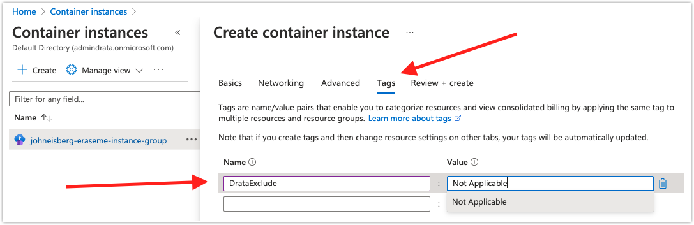
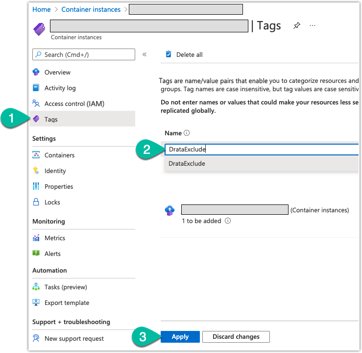
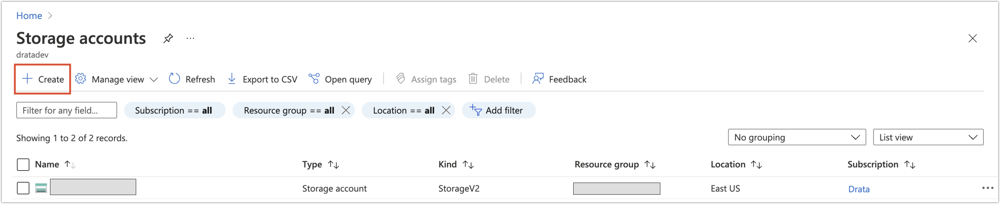
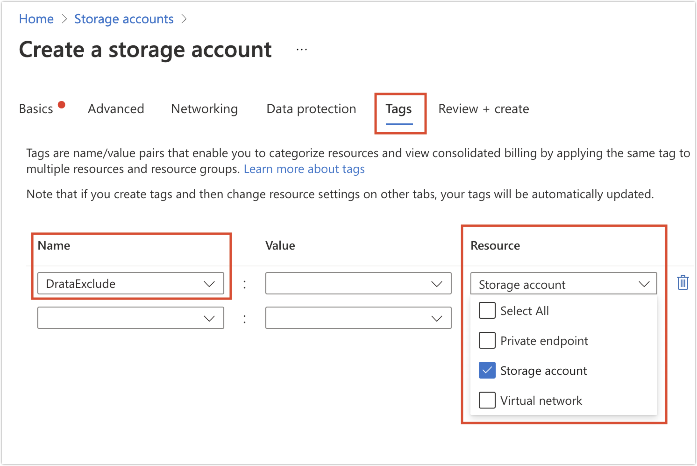
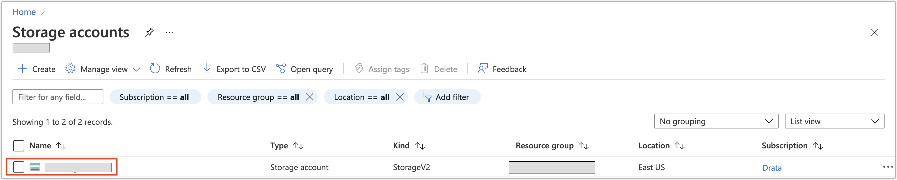
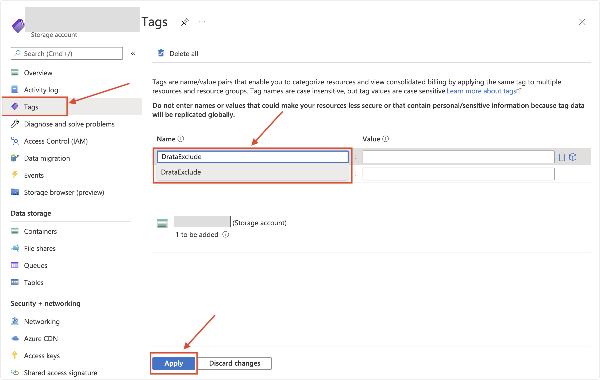
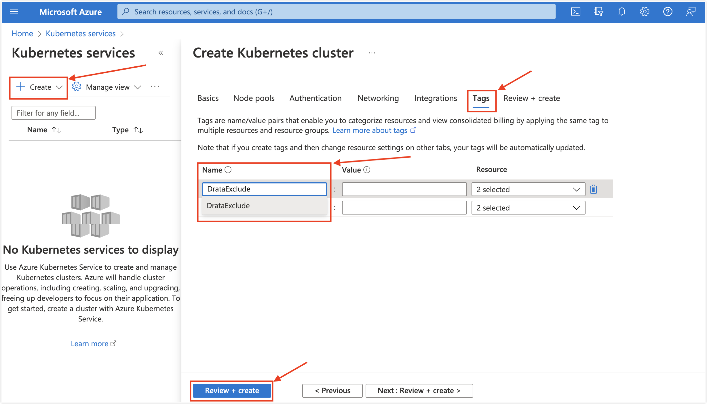
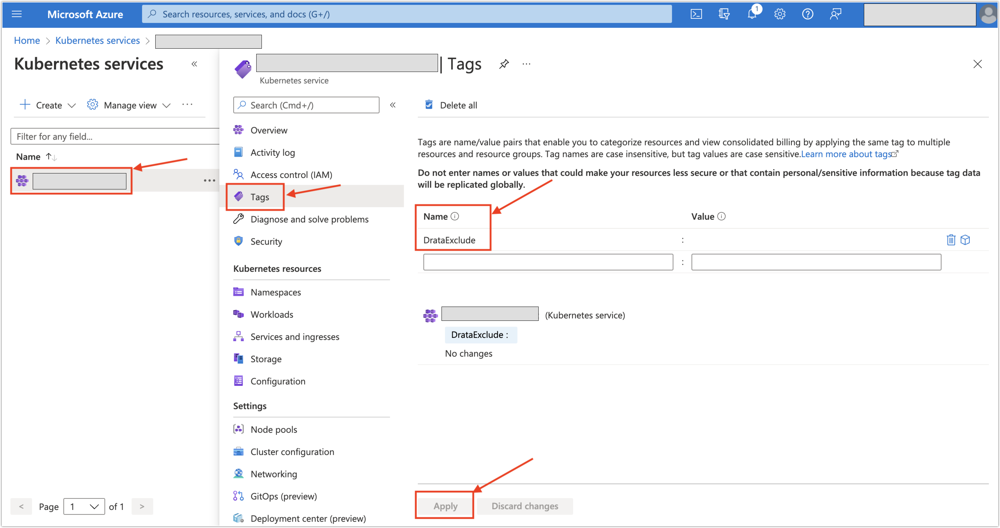
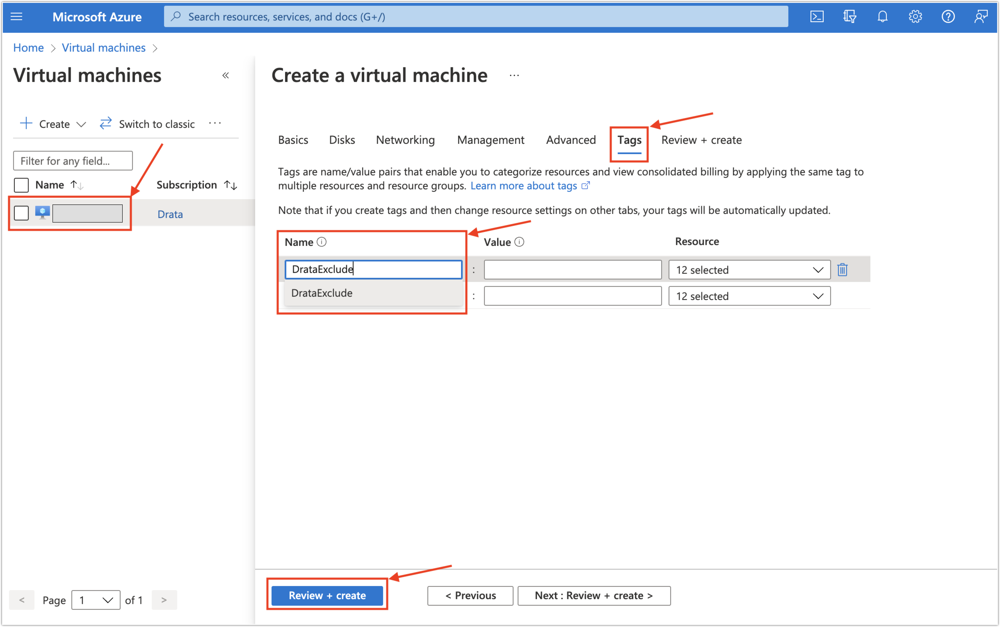
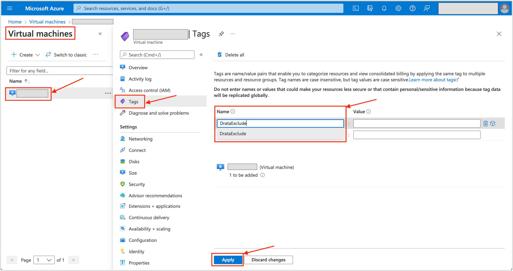

# Exclusion tags within Azure

Source: https://help.drata.com/en/articles/5352047-exclusion-tags-within-azure
Collection: Understand the Drata Platform › Monitoring
Updated: 2026-08-05
Fetched: 2026-11-22
Description: Implementing exclusion tags for specific resources

## Article text

## Overview

You may have resources within Azure that should always be ignored by Drata's compliance automation tests. Sometimes these are new resources that spin up each day. The exclusion tag functionality allows you to exclude these resources using a tag within Azure.

## Prerequisites

- [Azure infrastructure connection](azure-integration-guide.md) must be connected to Drata
- Drata must be actively monitoring Azure resources

Exclusion labels are only evaluated by Drata after the infrastructure connection is established.

### Supported Azure Resources

Drata currently supports tag-based exclusion **only** for the following Azure resource types:

- Container Instances
- Storage Accounts
- Kubernetes Clusters
- Virtual Machines

At this time, **Azure database services**, including **Azure SQL**, **PostgreSQL Flexible Server**, do not support the DrataExclude tag. Applying the tag to these resources will not exclude them from monitoring.

## Create Exclusion Tags

We support tag-based exclusion of Azure resources from Drata's monitors. In Azure, these tags should have a `Name` field of `DrataExclude`. **This is case-sensitive; `drataexclude` will not pass.**

### Container Instances

**Option 1: Add a Tag During Storage Account Creation**

1. Select **Create** to begin. This opens the full configuration flow.
2. Navigate to the **Tags** section and enter the following information:
   - **Name field**: Enter `DrataExclude`
   - **Value field**: Not Applicable.
3. Continue through the configuration and select **Review + Create**.

**Option 2: Add a Tag to an Existing Storage Account**

1. From the [Container Instances](https://portal.azure.com/#blade/HubsExtension/BrowseResource/resourceType/Microsoft.ContainerInstance%2FcontainerGroups) dashboard, choose the resource, then navigate to its **Tags** menu.
2. Add a tag with the name **DrataExclude**
   
3. Then click **Apply**

### Storage Accounts

**Option 1: Add a Tag During Storage Account Creation**

1. Select **Create** to begin setting up a new Storage Account. This opens the full configuration flow.

2. Navigate to the **Tags** section.

- In the **Name** field, enter:
   **`DrataExclude`**
- Ensure the **resource type** includes **Storage Accounts**.

3. Continue through the configuration and select **Review + Create**.

**Option 2: Add a Tag to an Existing Storage Account**

1. In Azure, go to [Storage Accounts](https://portal.azure.com/#blade/HubsExtension/BrowseResource/resourceType/Microsoft.Storage%2FStorageAccounts) and select the account you want to edit.
   
2. In the left-hand menu, open the **Tags** section.
3. Add a new tag:
   - **Name:** `DrataExclude`
      
4. Select **Apply**.

### Kubernetes Clusters

**Option 1: Add a Tag During Storage Account Creation**

1. In Azure, go to Kubernetes services.
2. Click + Create, then navigate to the Tags tab.
3. Enter DrataExclude for the name.

**Option 2: Add a Tag to an Existing Storage Account**

1. From the [Kubernetes services dashboard](https://portal.azure.com/#blade/HubsExtension/BrowseResource/resourceType/Microsoft.ContainerService%2FmanagedClusters), choose the desired resource, then navigate to its `Tags` menu.
2. Add a tag with the name `DrataExclude`, then click `Apply` or `Review + create` to save your changes.

### Virtual Machines

**Option 1: Add a Tag During Storage Account Creation**

1. You can add a tag during the initial configuration of a virtual machine.
2. In Azure, go to **Virtual machines** → **+ Create** → **Tags** tab.
   

**Option 2: Add a Tag to an Existing Storage Account**

1. You can also add tags to existing VMs. From [Virtual machines](https://portal.azure.com/#blade/HubsExtension/BrowseResource/resourceType/Microsoft.Compute%2FVirtualMachines) navigate to the **Tags** menu and select the desired resource.
2. Add a tag with the name **DrataExclude**, then click **Apply** or **Review + create**.
   

## Images

- [image 01] ../../images/integrations/azure/exclusion-tags-within-azure--01.png
- [image 02] ../../images/integrations/azure/exclusion-tags-within-azure--02.png
- [image 03] ../../images/integrations/azure/exclusion-tags-within-azure--03.png
- [image 04] ../../images/integrations/azure/exclusion-tags-within-azure--04.png
- [image 05] ../../images/integrations/azure/exclusion-tags-within-azure--05.png
- [image 06] ../../images/integrations/azure/exclusion-tags-within-azure--06.png
- [image 07] ../../images/integrations/azure/exclusion-tags-within-azure--07.png
- [image 08] ../../images/integrations/azure/exclusion-tags-within-azure--08.png
- [image 09] ../../images/integrations/azure/exclusion-tags-within-azure--09.png
- [image 10] ../../images/integrations/azure/exclusion-tags-within-azure--10.png

## Related articles

- [Exclusion tags within AWS](exclusion-tags-within-aws.md)
- [Exclusion labels within GCP](exclusion-labels-within-gcp.md)
- [Azure Virtual Asset](azure-virtual-asset.md)
- [Test 253: Azure Storage Accounts Accessed Via Private Endpoints](test-253-azure-storage-accounts-accessed-via-private-endpoints.md)
- [Understanding Azure Permissions and How Drata Integrates with Azure (Concept Guide)](understanding-azure-permissions-and-how-drata-integrates-with-azure-concept-guide.md)
