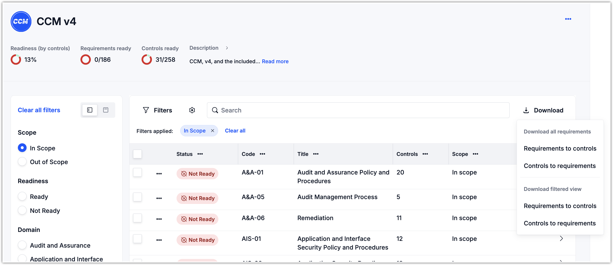

# Export Control-to-Requirement Mappings

Source: https://help.drata.com/en/articles/13381891-export-control-to-requirement-mappings
Collection: Understand the Drata Platform › Controls
Updated: 2026-11-09
Fetched: 2026-11-22

## Article text

Auditors and internal teams often request a clear view of how controls map to framework requirements. Drata allows you to **export control and requirement mappings** as a CSV file, making it easy to share, review, or include in audit documentation.

## Export control mappings

To download a CSV file with your control and requirement mappings:

1. Go to the **Frameworks** page.
2. Select a framework to open.
3. Select **Downloads**.
4. Choose one of the following export options:
   - **Requirements to controls**
   - **Controls to requirements**

## Export options explained

### Requirements to controls

This export starts from the **framework requirements** (for example, SOC 2 Trust Services Criteria).

- Each requirement appears as a separate row
- Mapped controls are listed for each requirement
- A single control may appear multiple times if it maps to multiple requirements

This format is useful when auditors want to review coverage starting from the framework.

### Controls to requirements

This export starts from the **Drata Control Framework**.

- Each control appears once
- All mapped requirements are listed for that control

This format is useful when reviewing how individual controls support compliance requirements.

### Download all requirements

**What it does: **Downloads **every requirement in the framework**, regardless of any filters you currently have applied.

**Use this when:**

- An auditor asks for the *full framework mapping*
- You want a complete, authoritative export
- You’re preparing for an audit or external review

### Download filtered view

**What it does: **Downloads **only the requirements** based on your applied filters.

**Use this when:**

- You’re reviewing a subset of requirements
- You want to share only what’s relevant (for example, out-of-scope exclusions, specific domains, or statuses)
- You don’t need the full framework

## What’s included in the export

- The file downloads as a **CSV**
- Only **in-scope controls** are included
- Controls marked **Out of Scope** are excluded from the export

## When to use this export

Use control mapping exports when you need to:

- Share control coverage with auditors
- Perform internal compliance reviews
- Validate mappings across frameworks
- Support audit preparation and evidence requests

## Key takeaways

- Control mappings can be exported at any time
- Two export formats support different audit and reporting needs
- Out-of-scope controls are automatically excluded
- CSV exports make sharing and review simple

## Images

- [image 01] ../../images/ux/frameworks/export-control-to-requirement-mappings--01.png

## Related articles

- [Custom Framework](custom-framework.md)
- [Pre-Audit Checklist: How to Prepare for Your Audit with Drata](pre-audit-checklist-how-to-prepare-for-your-audit-with-drata.md)
- [Mark Controls In or Out of Scope](mark-controls-in-or-out-of-scope.md)
- [Pre-audit evidence packages in Drata (New Experience)](pre-audit-evidence-packages-in-drata-new-experience.md)
- [Section 5: Drata for Auditors](section-5-drata-for-auditors.md)
