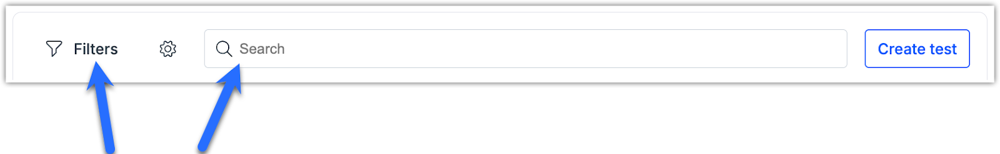

# Filter and search tests in Monitoring (New Experience)

Source: https://help.drata.com/en/articles/13392089-filter-and-search-tests-in-monitoring-new-experience
Collection: Understand the Drata Platform › Monitoring
Updated: 2026-01-14
Fetched: 2026-11-22
Description: Learn how to filter, search, and narrow tests in Drata’s Monitoring page to quickly find results, review findings, and resolve compliance gaps.

## Article text

The Monitoring table includes filters and a search bar that help you focus on specific test results. Use filters to review failing tests, troubleshoot specific systems, confirm readiness by framework, or locate unmapped tests.

## Search tests

Use the search bar to find a specific test by name, system, or keyword.

**Examples**

- Search **MFA** to find MFA-related tests
- Search **Okta** to see Okta-based identity tests
- Search **IAM** to view AWS IAM access tests

Search works in both the **Production** and **Codebase** tabs.

## Filter Tests by Result

Use the **Result** filter to focus on test outcomes.

### Passed

Drata has captured all necessary data and determined the required conditions are being met.

**What it means**

- If mapped: Contributes positively to the linked control’s readiness.
- If unmapped: The test passes but does not affect readiness.

**What to do in Drata**

- No immediate action is required.

### Failed

Drata has captured all necessary data and determined the required conditions are not being met.

**What it means**

- If mapped: The linked control is not ready, and your readiness score reflects the gap.
- If unmapped: The test fails but does not affect readiness. You can still use findings for visibility.

**What to do in Drata**

1. Select the failed test in the Monitoring table.
2. Open the **Findings** tab in the test details drawer.
3. Review the failing items (for example, users without MFA enabled).
4. Assign remediation:
   - If ticketing integration is enabled, select **Create Ticket** and assign it to the responsible owner.
5. After remediation, re-run the test to confirm it passes.

### Error

The test ran into an issue that prevented Drata from capturing necessary data, hence a determination cannot be made if the required conditions are being met.

**What it means**

- If mapped: The linked control cannot be evaluated until the error is resolved.
- If unmapped: The error does not affect readiness but may still highlight coverage gaps.

**What to do in Drata**

1. Select the errored test in the Monitoring table.
2. Review the error message in the test details drawer.
3. Check common issues such as expired API tokens, revoked permissions, or missing connection data.
4. Select **Test Now** to re-run and confirm resolution.

## Filter Tests by Status

Use the **Status** filter to understand which tests are running:

| **Test Status** | **Mapping** | **Runs?** | **Affects readiness?** | **Why** |
|---|---|---|---|---|
| **Enabled** | Mapped to a control | Yes (daily with Autopilot or manually) | Yes | Test is active and contributes to control and framework readiness |
| **Enabled** | Not mapped to a control | Yes (daily with Autopilot or manually) | No | Provides visibility only because it is not mapped to a control |
| **Disabled** | Mapped to a control | No | No | Disabled tests never run and contribute nothing until re-enabled |
| **Disabled** | Not mapped to a control | No | No | Disabled tests have no effect until enabled and mapped |
| **Unused (Mapped or Unmapped)** | Setup incomplete (for example, missing connection or draft policy) | No | No | A connection that is required to run this test is missing, or no policy drafts have been started, thus the test can not be used. |

## Filter Tests by Framework, Control, or Connection

Use these filters to focus on compliance readiness from different perspectives:

### Framework

Check readiness for a specific compliance framework such as SOC 2, ISO 27001, or HIPAA.

- Why it matters: Frameworks roll up multiple controls and tests, so filtering by framework lets you see all test results that affect that certification.
- Example: Select **SOC 2**, then filter by **Failed results** to review what needs remediation before an audit.

### Control

View tests that are mapped to a specific control.

- Why it matters: Controls are the building blocks of readiness. Filtering by control helps you troubleshoot readiness at a granular level.
- Example: Filter by **Control = Access Control (CC6.1)** to confirm which tests support it, such as MFA enforcement.

### Connection

Focus on tests tied to a specific integration, such as Okta, AWS, or Google Workspace.

- Why it matters: If an integration has issues, you can isolate all related tests to quickly diagnose the impact.
- Example: If your AWS integration token expired, filter by **Connection = AWS** to see all tests that are affected.

## Additional Filters

You can refine test results further with these filters:

- **Category:** Device, Identity Provider, Infrastructure, Observability, Policy, Version Control, Ticketing, or In Drata
- **Type:** Drata tests, Custom (published), Custom (draft)
- **Exclusion:** Show tests that include excluded findings. Use this to confirm gaps that were intentionally excluded from readiness scoring.
   - You can exclude specific findings if they are not applicable.
- **Tickets:** Show tests with linked tickets that are in progress or done. This helps track remediation through integrations such as Jira.

## Monitoring Table Column Overview

The test table lists all available tests. Each column provides key details:

### Name

Displays the test name. Labels may appear:

- **New**: Recently released Drata test (highlighted for 45 days).
- **Draft**: Custom test not yet published.

### Status

Shows whether the test is Enabled, Disabled, or Unused.

### Category

Indicates the compliance area or system the test monitors:

- Device, Identity Provider, Infrastructure, Observability, Policy, Version Control, Ticketing, or In Drata.

### Connections

Lists the integrations the test depends on, such as AWS, Okta, or Jira. If a connection fails, all dependent tests may error.

## Images

- [image 01] ../../images/ux/monitoring/filter-and-search-tests-in-monitoring-new-experience--01.png

## Related articles

- [Monitoring Overview](monitoring-overview.md)
- [View and Manage Test Details (New Experience)](view-and-manage-test-details-new-experience.md)
- [Map Tests to Controls](map-tests-to-controls.md)
- [Drata Controls (DCFs) Training Video (New Experience)](drata-controls-dcfs-training-video-new-experience.md)
- [Understanding Monitoring in Drata Training Video (New Experience)](understanding-monitoring-in-drata-training-video-new-experience.md)
