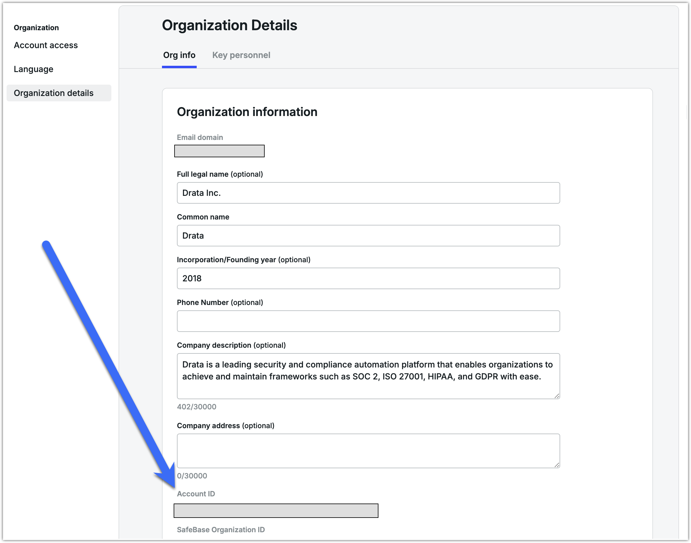

# Find your Account ID

Source: https://help.drata.com/en/articles/13755424-find-your-account-id
Collection: Settings
Updated: 2026-11-09
Fetched: 2026-11-22

## Article text

Your **Account ID** uniquely identifies your Drata account and is commonly required when configuring integrations, working with Drata Support, or referencing your environment in automation workflows.

1. Select **Settings**.
2. Open **Organization details** page. Ensure you are on the **Org** tab.
3. Scroll down and locate the **Account ID**.

 (links to https://downloads.intercomcdn.com/i/o/am69aeco/2005924403/228059764bf752dd3e0dc463a6a0/image.png?expires=1771632000&signature=d71e6cd33b9161567223e54091c4a00bab08368b3dc68b6e01597034c23d0ee8&req=diAnE8B8mYVfWvMW3Hu4gfpvZqeTUVYQayZZHAdb9dXNs53PtjhrqCNMGl7j%0Aqw%3D%3D%0A)

## Things to be careful about

- Updating organization details can impact automated tests and audit readiness.
- Changing the email domain or legal identifiers without coordination can cause integration or evidence issues.
- Some fields, including Account ID and data residency, are read-only and cannot be modified.

## Images

- [image 01] ../../images/ux/settings/find-your-account-id--01.png

## Related articles

- [Trello Integration Guide](trello-integration-guide.md)
- [Aikido Integration Guide](aikido-integration-guide.md)
- [Set up OAuth for the Drata API](set-up-oauth-for-the-drata-api.md)
- [Organization settings: Organization Details (New Experience)](organization-settings-organization-details-new-experience.md)
- [Organization settings: Human Resources Settings (New Experience)](organization-settings-human-resources-settings-new-experience.md)
