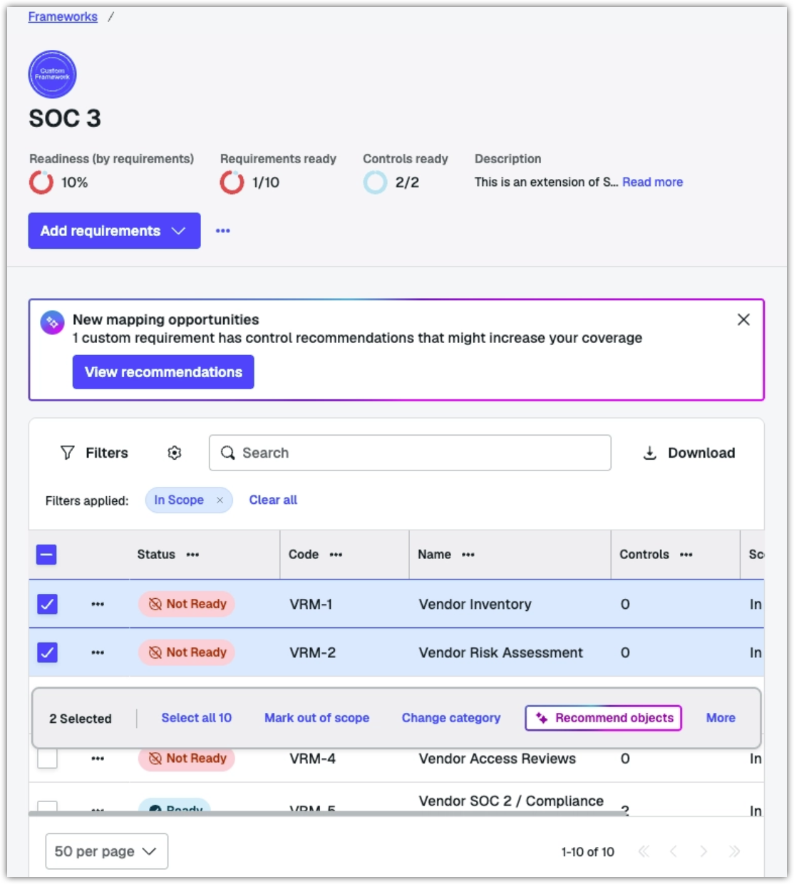
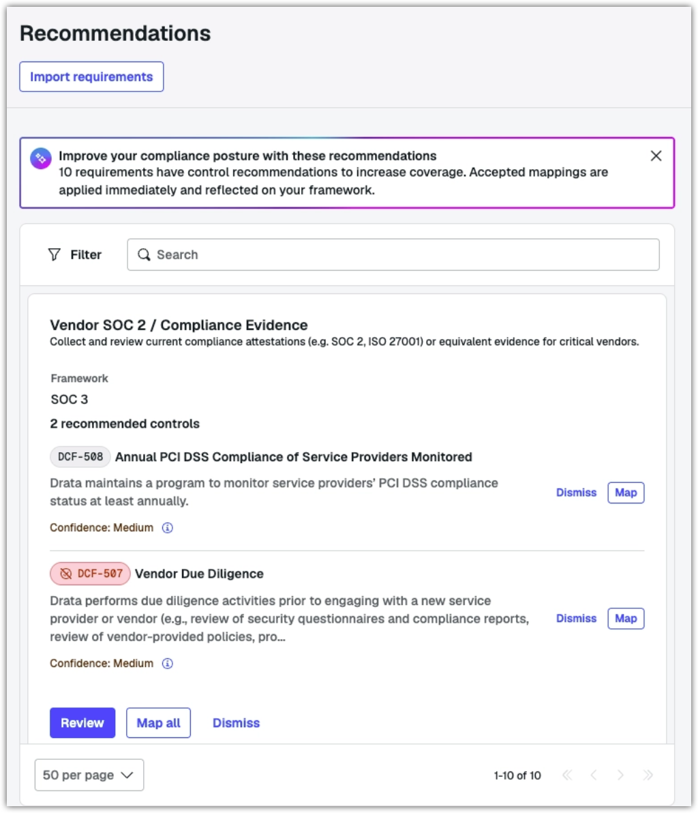
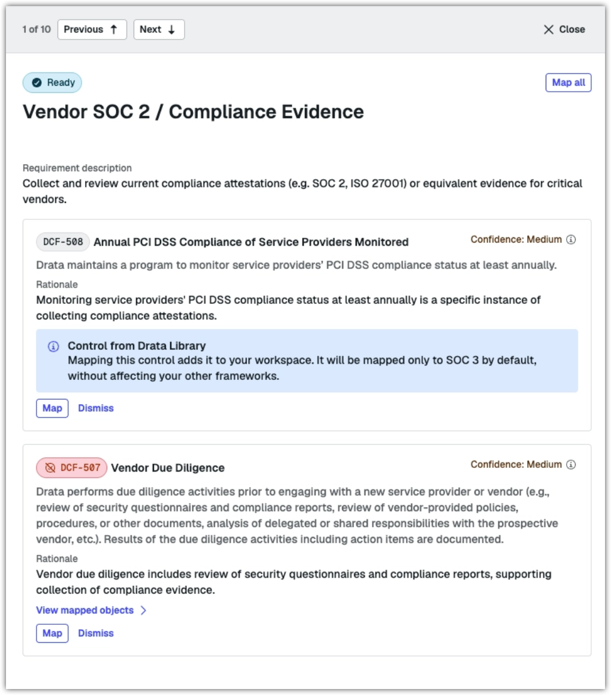

# Framework Mapping Agent: AI-Assisted Control Mapping for Custom Frameworks

Source: https://help.drata.com/en/articles/16630433-framework-mapping-agent-ai-assisted-control-mapping-for-custom-frameworks
Collection: Framework Information › Custom Frameworks
Updated: 2026-09-02
Fetched: 2026-11-22

## Article text

The Framework Mapping Agent uses AI to recommend control mappings when you bring a custom or unsupported compliance framework into Drata. Instead of manually reading every requirement and matching it to a control yourself, you upload your framework and the Agent suggests mappings — pulling from the DCF controls already active in your workspace, your own custom controls, and the full DCF control library.

Each recommendation comes with a confidence indicator, so you know which suggestions are safe to accept quickly and which deserve a closer look. You stay in control the whole time — nothing is added to your compliance program until you accept it.

This is especially useful when you're onboarding a framework Drata doesn't natively support, such as a regional regulation, an industry-specific standard, or a proprietary framework requested by a customer or auditor.

---

## Prerequisites

- **Custom Framework add-on required**: Your organization must have the Custom Framework add-on. There is no additional cost to use the Agent's mapping recommendations.
- **RBAC roles**: Admin and Information Security Leads
- **Workspace awareness**: This feature is workspace-aware.

---

## What can I do here?

### Import your framework and generate recommendations

- From the custom framework creation flow, upload a CSV of your framework's requirements.
- Once the framework is created, Drata automatically generates control mapping recommendations for each requirement.
- Recommendations are drawn from three sources: DCF controls already active in your workspace, custom controls you've created, and the broader DCF control library — not just the small set of controls provisioned to your account.

### Review AI-suggested mappings

- Open the review queue to see every requirement awaiting a decision.
- Select a requirement to see its details alongside the suggested control(s) and a confidence indicator for each suggestion.
- **Accept** a suggestion to map it to your program, or **dismiss** it if it isn't a good match.
- The queue shows loading, empty, and completed states, and you can filter it to focus on what's left to review.
- Your progress is saved as you go, so you can leave the review and pick up where you left off.

### Review low or medium-confidence or unmatched requirements

- Some requirements won't have a strong match — the Agent will flag these as low or medium-confidence or leave them unmatched rather than force a guess.
- For these, search the existing controls directly or create a new custom control, then map the requirement to it yourself.

### Apply bulk decisions

- Apply multiple recommendations at once for a single requirements and accept or dismiss them together instead of reviewing one at a time.
- Bulk actions are reflected immediately in your review progress.

---

## Use cases / Best practices

### Onboarding a framework Drata doesn't support natively

If a customer, auditor, or regulator asks you to demonstrate compliance with a framework outside Drata's standard library — a regional regulation, a sector-specific standard, or an internal proprietary framework — upload it as a custom framework and let the Agent generate a starting set of mappings instead of matching every requirement by hand.

### Let confidence guide your review effort

Treat confidence indicators as a prioritization tool: spend your review time on lower-confidence and unmatched requirements, and move quickly through high-confidence suggestions that clearly match an existing control.

### You're always the final decision-maker

Accepting a recommendation is the only way it's applied to your live compliance program. If a suggestion doesn't reflect your control environment accurately, dismiss it and map the requirement manually — nothing is auto-approved on your behalf.

### Pick up where you left off

Large frameworks can mean dozens or hundreds of requirements to review. You don't need to finish in one sitting — the review queue preserves your progress, so you can return and continue later.

## Images

- [image 01] ../../images/ux/frameworks/framework-mapping-agent-ai-assisted-control-mapping-for-custom-frameworks--01.png
- [image 02] ../../images/ux/frameworks/framework-mapping-agent-ai-assisted-control-mapping-for-custom-frameworks--02.png
- [image 03] ../../images/ux/frameworks/framework-mapping-agent-ai-assisted-control-mapping-for-custom-frameworks--03.png

## Related articles

- [Custom Framework](custom-framework.md)
- [Introduction to the Drata Control Framework (DCF)](introduction-to-the-drata-control-framework-dcf.md)
- [Apply Default Mappings for Controls](apply-default-mappings-for-controls.md)
- [Map audit requests to DCF controls with AI](map-audit-requests-to-dcf-controls-with-ai.md)
- [AI-Assisted Custom Control Mapping to GRC Objects](ai-assisted-custom-control-mapping-to-grc-objects.md)
