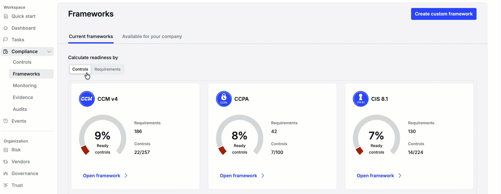
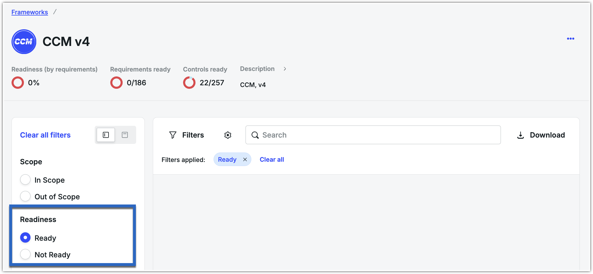

# Framework Readiness

Source: https://help.drata.com/en/articles/13765790-framework-readiness
Collection: Framework Information › General
Updated: 2026-11-09
Fetched: 2026-11-22
Description: Understand how framework readiness is calculated and what you can do to keep your frameworks on track.

## Article text

## What framework readiness shows

Framework readiness shows the current status of each **in-scope** framework in your environment. It reflects whether the requirements and controls in that framework meet the conditions for being **Ready**.

Use readiness to:

- Track progress toward compliance
- Identify gaps in evidence or approvals
- Focus efforts on what's needed to reach audit readiness

Readiness is layered:

- A **framework** is ready when its requirements or controls are ready (depending on how you choose to measure)
- A **requirement** is ready when all its mapped controls are ready
- A **control** is ready when all of its readiness conditions are met

---

## View framework readiness

You can measure readiness by **Controls** or **Requirements**:

- **Controls (default):** Based on the number of in-scope controls that are Ready
- **Requirements:** Based on the number of in-scope requirements that are Ready

To switch the readiness view:

1. Go to **Frameworks**.
2. Use the **Controls / Requirements** toggle at the top of the page.
3. Choose how you want to measure readiness: **Controls** or **Requirements**.

 (links to https://downloads.intercomcdn.com/i/o/am69aeco/2083544590/d36ea8735caa0e7be4c3c5342a0a/requirmentsvscontrols%2B-281-29.gif?expires=1780120800&signature=05c8fe4dd1060c48622f4da3f97a561fba2f80776920e03e8065a7b5b8100b97&req=diAvFcx6mYRWWfMW3nq%2BgbftgjSzC6%2F0ri4ilvEjp2MJr3YtI5b1YmYdN9xu%0AcEWG18BjcipCp0zYuWEzCaEcCo0%3D%0A)

Your selection applies only to **your** user account; it does not affect other users.

---

## When a requirement is Ready

A requirement is considered **Ready** when **all** of its mapped controls are ready. If any mapped control is not ready—or if there are no mapped controls—the requirement is **Not Ready**.

 (links to https://downloads.intercomcdn.com/i/o/am69aeco/2083570976/c38cbaa8adf07a036e89f815125b/image.png?expires=1780120800&signature=e4b251177626a3b59ac908b63d9baf6f66aca0d34fe87c7ade54dcdae2deaeb3&req=diAvFcx5nYhYX%2FMW3nq%2BgRxTxixRSJ2d83GWEmYsS7L4bh%2BquDQXFeGajiNo%0AfHQWV%2BH7Y6lH5GF5aFU4wehlkdc%3D%0A)

Only **in-scope** requirements contribute to framework readiness. Out-of-scope requirements are excluded from readiness calculations.

---

## When a control is Ready

A control is considered **Ready** when it meets **all** required approval conditions, its mapped evidence is **valid**, and it is **in scope** for at least one in-scope requirement.

---

## SOC 2 readiness

SOC 2 readiness uses the same readiness logic but is often more sensitive to how you choose to measure. When measuring by **Requirements**, a requirement is Not Ready if **any** of its mapped controls are Not Ready, which can significantly lower the score. Use the toggle on the **Frameworks** page to compare both views.

## Images

- [image 01] ../../images/ux/frameworks/framework-readiness--01.gif
- [image 02] ../../images/ux/frameworks/framework-readiness--02.png

## Related articles

- [Framework Requirements](framework-requirements.md)
- [Custom Framework](custom-framework.md)
- [CMMC Framework Updates](cmmc-framework-updates.md)
- [Marking Requirements In and Out of Scope](marking-requirements-in-and-out-of-scope.md)
- [Frameworks in Drata: Understanding Requirements and Control Readiness Training Video (New Experience)](frameworks-in-drata-understanding-requirements-and-control-readiness-training-video-new-experience.md)
