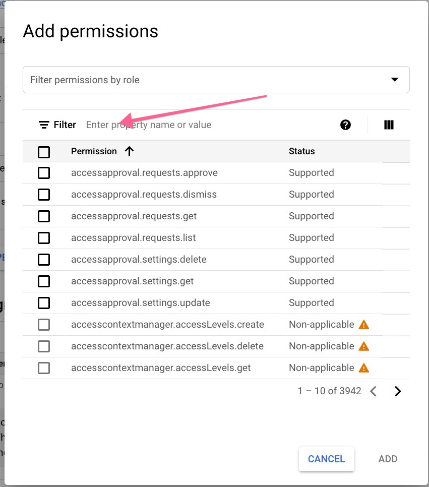

# GCP Integration Guide (Manual)

Source: https://help.drata.com/en/articles/4994112-gcp-integration-guide-manual
Collection: Connection Support › Infrastructure Guidance
Updated: 2026-08-05
Fetched: 2026-11-22
Description: How to manually connect GCP to Drata.

## Article text

**Note**: There are two ways to connect your GCP to Drata. You can either connect using a script or connect manually. It is recommended to connect using a script. To learn how to connect through a script, go to [Connect (GCP) Google Cloud Platform to Drata](gcp-integration-guide-script-setup.md).

---

The **Google Cloud Platform (GCP)** integration enables **Engineering, DevOps, and Security teams** to automate evidence collection and continuously monitor infrastructure security controls for compliance. It connects Drata to **GCP** to pull read-only data from your projects and organization-level resources.

## Key Capabilities

- **Infrastructure monitoring:** Continuously validates GCP configurations and controls for compliance.
- **IAM and MFA monitoring:** Collects and verifies identity and access configurations across users.
- **Cloud asset evidence collection:** Gathers resource, storage, and compute metadata for automated testing.

## Prerequisites & Data Access

- You can connect each GCP project individually or connect the GCP organization.
   1. When connecting each GCP project individually, ensure that each project belongs to an organization. For more information on migrating projects to an organization, go to[Moving a project](https://cloud.google.com/resource-manager/docs/moving-projects-folders).
   2. It is recommended to connect a GCP organization over an individual project, if possible.
- Ensure the user account that is performing the setup for this GCP connection has the following roles/privileges:
   1. GCP Owner role ([Basic -> Owner](https://cloud.google.com/iam/docs/understanding-roles#basic-definitions)) at the project and organization levels.
   2. GCP[Organization Administrator](https://cloud.google.com/resource-manager/docs/access-control-org#resourcemanager.organizationAdmin) (resourcemanager.organizationAdmin).
- If the[VPC Firewall Rules Enabled](https://cloud.google.com/firewall/docs/using-firewalls#creating_firewall_rules) setting is enabled in the GCP environment, this might prohibit Drata’s API calls. To learn how to ensure you have created an allow list entry for Drata’s IP address, go to[Dratabot](dratabot.md).
- You must use a service account to complete this connection.

### Permissions Required to Sync GCP Users & MFA

- When a GCP organization is created, a companion Google Workspace account is automatically provisioned by Google. The IAM users you provision in GCP will source their MFA from this Google Workspace account. Drata will use the Organization Administrator role to make calls to the Google Workspace Admin SDK API to read the MFA status of these IAM users' matching emails in Google Workspace. Three things must be in place for this to work:
   1. You must[grant the GCP service account access](https://developers.google.com/identity/protocols/oauth2/service-account#delegatingauthority) to your connected Google Workspace account through domain-wide delegation.
   2. Further, ensure that the Google Workspace[Super Admin](https://support.google.com/a/answer/2405986#super_admin) account email matches the GCP Organization Administrator email.
   3. These users must[set up MFA in Google Workspace](https://myaccount.google.com/signinoptions/two-step-verification).
- This Google Workspace account does not need to be connected to Drata as your IdP. Regardless of your connected IdP, Drata needs all three steps above to be completed; otherwise, Drata cannot retrieve MFA on your GCP IAM users. This will cause Test 88 - MFA on Infrastructure Console to fail.
- For the purposes of syncing IAM users, Drata supports pulling individual emails as listed from the IAM entries in your GCP organization and the single project in which the service account was created. If you want IAM users from all projects to be synced, please reach out to our Technical Support team.
- Drata does not support pulling members within groups (i.e. we will sync the group's email as if it were an individual IAM entry).

## Step-by-Step Setup

NOTE: It is critical to follow these instructions exactly as described and in order. Skipping ahead can result in an incomplete connection that will force you to delete your roles and service account and start over.

### Single Project Connections

- Ensure specific APIs are enabled in the project.
- Create the Service Account and apply the permissions.
- Provision a Domain-wide delegation client in Google Workspace.

### Organization-Wide Connection to Sync All Projects

- Ensure specific APIs are enabled in the project.
- Create the Service Account and apply the permissions.
- Apply the Organization Role to the same Service Account.
- Provision a Domain-wide delegation client in Google Workspace.

---

### Step 1: Enable Required APIs

These are the GCP APIs that Drata will use for evidence collection automation. These APIs only need to be enabled on the project where the service account is created.

1. Go to the[API & Services Dashboard](https://console.cloud.google.com/apis/dashboard) and verify that the project you want to connect to Drata is selected (in the top menu bar next to the GCP logo).
2. Verify that the APIs are enabled and already in the list of available APIs & Services. If not, go to the[API Library](https://console.cloud.google.com/apis/library), search and enable them.

If you do not enable these APIs, this does not prevent connection, but various monitoring tests are unable to source relevant data causing the tests to fail.

- Compute Engine API
- Cloud Resource Manager API
- Admin SDK API
- Cloud SQL Admin API
- Cloud Monitoring API (or "Stackdriver Monitoring API")
- Cloud Asset API (used to pull GCP Assets)

---

### Step 2: Create a Service Account and Apply Permissions

Please select one of the following options to apply the recommended permission set or a reduced permission set.

### Option 1: Recommended Permissions (Standard Setup)

This is the mechanism that Drata utilizes to gain read-only access to your GCP account.

- Open your [Google Cloud console](https://console.cloud.google.com/).
- Within the same project, under the main navigation menu (in the left sidebar), go to the[Service Accounts page](https://console.cloud.google.com/iam-admin/serviceaccounts) through "IAM & Admin → Service Accounts", to create a new service account.
- Select the CREATE SERVICE ACCOUNT button on the top of the page, and copy and paste the fields below onto the form from the first step and then select Create.
   - **Service Account Name:** Drata Service Account
      - (Note: the service account ID will auto-fill)
   - **Service Account Description: **Service Account with read-only access for Drata Autopilot

### Select and Apply Permissions

Select the Select a role select box, hover over Basic and in the Quick access sub-section, select the following in the fly-out menu:

- Add the following roles to the service account:
   - Monitoring Viewer
   - Compute Viewer
   - Cloud Asset Viewer
   - Browser

### Complete Service Account Creation

- Click Continue, and then Done to complete the creation of the service account.
- If you are connecting all Projects in the Organization, copy and save the email that is shown in the row for the newly created Service Account. The email will be used in the[Apply the Organization Role to an IAM account](#h_fec8249363) section.

### Option 2: Reduced Permissions (Custom Role Setup)

These are the minimum viable permissions to make an active connection. Create a custom project role and assign these ‘non-excess’ permissions required to complete the connection. Note that some tests may be in an errored state due to an inability to complete API requests as a result of the reduced permissions.

### Create a custom Project Role for Drata

- Create a custom project role to allow Drata to read metadata on your buckets that are scoped outside the general project.
   - Under the project or organization dropdown in the header, select your main GCP project.
   - In the main navigation menu (in the left sidebar), go to the[Roles page](https://console.cloud.google.com/iam-admin/roles) through "IAM & Admin → Roles", to create a custom project role.
   - Select the CREATE ROLE button on the top of the page, copy and paste the fields below into the form on the page, and set the Role launch stage to "General Availability".
      - **Title: **Drata Read-Only Project Role
      - **Description: **Service Account for Drata Autopilot to get read access to all project resources
      - **ID: **DrataReadOnlyProjectRole

### Add Permissions to the Custom Role

- Select the Add Permissions button to open the permissions modal to select the required permissions:
   - cloudsql.instances.list
   - compute.firewalls.list
   - compute.forwardingRules.list
   - compute.instances.list
   - compute.securityPolicies.list
   - compute.urlMaps.list
   - container.clusters.list
   - datastore.entities.get
   - datastore.entities.list
   - datastore.statistics.get
   - datastore.statistics.list
   - memcache.instances.list
   - monitoring.alertPolicies.list
   - monitoring.notificationChannels.get
   - pubsub.topics.list
   - redis.instances.list
   - resourcemanager.projects.get
   - resourcemanager.projects.getIamPolicy
   - resourcemanager.organizations.getIamPolicy
   - storage.buckets.list
   - storage.buckets.get
   - storage.buckets.getIamPolicy
   - iam.roles.get
   - iam.serviceAccounts.get
   - iam.serviceAccounts.list



### Create the Drata Service Account

This is the mechanism that Drata utilizes to gain read-only access to your GCP account.

- Open your [Google Cloud console](https://console.cloud.google.com/).
- Within the same project, under the main navigation menu (in the left sidebar), go to the[Service Accounts page](https://console.cloud.google.com/iam-admin/serviceaccounts) through "IAM & Admin → Service Accounts", to create a new service account.
- Select the CREATE SERVICE ACCOUNT button on the top of the page, and copy and paste the fields below onto the form from the first step and then select Create.
   - **Service Account Name:** Drata Service Account
      - (Note: the service account ID will auto-fill)
   - **Service Account Description: **Service Account with read-only access for Drata Autopilot

### Add the Custom Role to the Service Account

- To add a custom Read-Only Project Role, select the ADD ROLE button.
- Select a role, and filter for "drata" to select the "Drata Read-Only Project Role" Role.

### Complete Service Account Creation

- Click Continue, and then Done to complete the creation of the service account.
- If you are connecting all Projects in the Organization, copy and save the email that is shown in the row for the newly created Service Account. The email will be used in the[Apply the Organization Role to an IAM account](#h_fec8249363) section.

---

### Step 3: Create the JSON Key for Drata

The key and details generated in this process will be required to complete the connection detail in the Drata GCP connections tab to finalize the connection creation.

1. Select the ellipse button in the right column and select **Manage Key** then **Add Key**. In the modal, make sure JSON is selected as the Key type and then create. This will download a JSON file to your machine (you will need it to complete the connection).
2. Select the name of the Service Account to go to its detail page, then select the Details tab on the top.
3. Copy and save the Unique ID that was generated. The ID is used in the[Provision a Domain wide delegation client in Google Workspace](#h_670ae7280e) section.

---

### Step 4: (Organization-Wide Setup Only) Apply the Organization Role

Now we can also grant your new service account access to your organization with automatic project discovery. Please note, it will not be possible to assign this role to the IAM account if the user who is creating the account does not have the 'Owner' role (mentioned in the prerequisites section at top of article).

- Ensure you are still in your organization from the project selector in the header.
- In the main navigation menu (in the left sidebar), go to the[IAM page](https://console.cloud.google.com/iam-admin/iam) via "IAM & Admin → IAM", so we can create the IAM account.
- Click on the GRANT ACCESS button towards the top of the page and in the New members text field, enter the email of the project-level service account (which you saved from a step above).
- Assign the following roles:
   - [Compute Viewer](https://cloud.google.com/compute/docs/access/iam#compute.viewer)
   - Monitoring Viewer
   - Cloud Asset Viewer
   - Organization Viewer
   - Note: The Browser role is only required in the default project of the service account.
- Select the Save button.

---

### Step 5: Provision Domain-Wide Delegation in Google Workspace

We need to[grant the GCP service account access to your connected Google Workspace account](https://developers.google.com/identity/protocols/oauth2/service-account#delegatingauthority). This permission set enables Drata to access user directory data, groups within the directory and MFA configuration details. This step is recommended, however if this is not completed, monitors in Drata related to GCP user tacking and MFA will not function. Many of the infrastructure monitors will be functional without this advanced permission set, however the GCP managed accounts page will remain blank.

1. Please login to your[Google Admin console](https://admin.google.com/) with an account that has Super Admin privileges, then go to "Security → Access and data control → API controls." Scroll to the bottom to get to Domain wide delegation.
2. In the Domain wide delegation section, click on Manage Domain Wide Delegation button.
   - Note: If you are using Google Workspace as your IdP and you have[already connected it to Drata](google-workspace-integration-guide.md), you will see another entry in the Domain Wide Delegation list. It's OAuth scope will be:
      - [https://www.googleapis.com/auth/admin.directory.user.readonly](https://www.googleapis.com/auth/admin.directory.user.readonly)
   - Ensure this entry remains intact so as not to break your IdP connection.
3. Click on the Add new button.
4. Enter the numeric client ID (unique ID - not the service account email address) (which you saved from a step above)
5. Leave the Overwrite existing client ID checkbox un-checked.
6. Copy and paste the below Cloud Platform Scope into the OAuth scopes (comma-delimited) text field.
   - Comma-delimited Scopes:
      [https://www.googleapis.com/auth/admin.directory.user.readonly,https://www.googleapis.com/auth/admin.directory.group.readonly,https://www.googleapis.com/auth/admin.directory.group.member.readonly](https://www.googleapis.com/auth/admin.directory.user.readonly,https://www.googleapis.com/auth/admin.directory.group.readonly,https://www.googleapis.com/auth/admin.directory.group.member.readonly)
7. Once done, click on the AUTHORIZE button.

For improved readability, the previously displayed scopes are listed without commas and separated by spaces:

```
https://www.googleapis.com/auth/admin.directory.user.readonly
https://www.googleapis.com/auth/admin.directory.group.readonly
https://www.googleapis.com/auth/admin.directory.group.member.readonly
```

---

🎉 You have just successfully set up proper read-only access for Drata! 🎉

## Additional Resources

- [Summary of Monitor Tests Associated per each Permission](gcp-integration-guide-script-setup.md#h_5f13f4bdf8)

## Images

- [image 01] ../../images/integrations/gcp/gcp-integration-guide-manual--01.jpg

## Related articles

- [Google Workspace Integration Guide](google-workspace-integration-guide.md)
- [GCP Integration Guide (Script Setup)](gcp-integration-guide-script-setup.md)
- [GCP Virtual Assets](gcp-virtual-assets.md)
- [Identify and Add Missing GCP Permissions for Drata](identify-and-add-missing-gcp-permissions-for-drata.md)
- [Understanding GCP Permissions and How Drata Integrates with GCP (Concept Guide)](understanding-gcp-permissions-and-how-drata-integrates-with-gcp-concept-guide.md)
