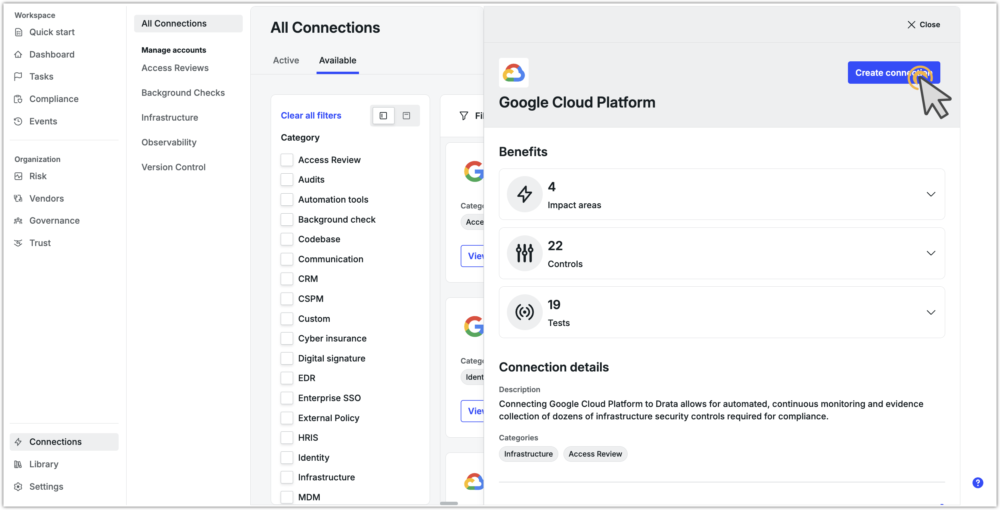
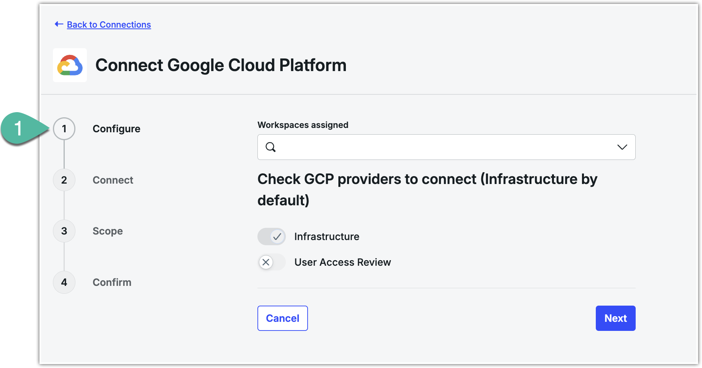
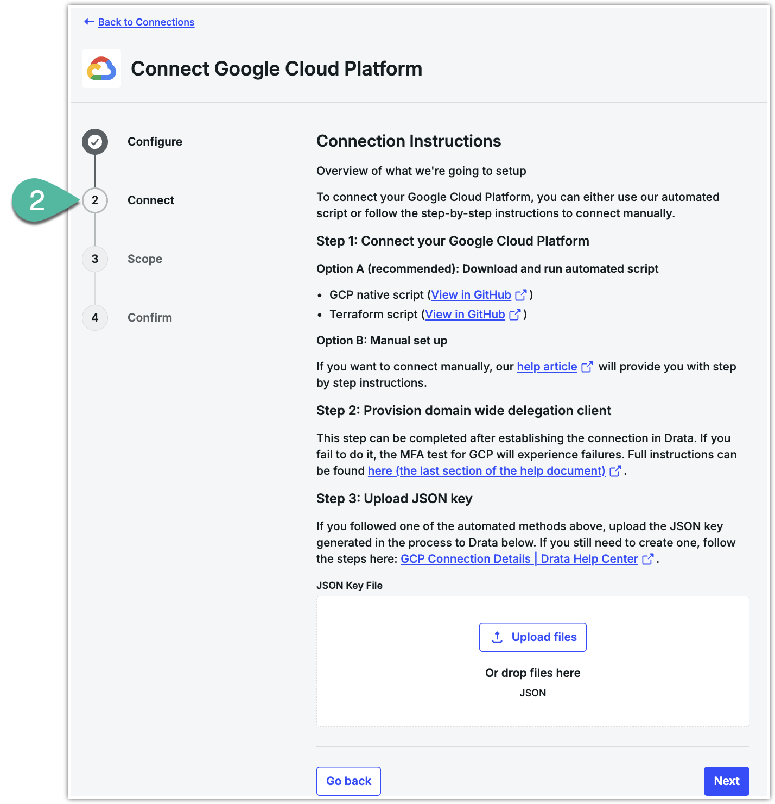
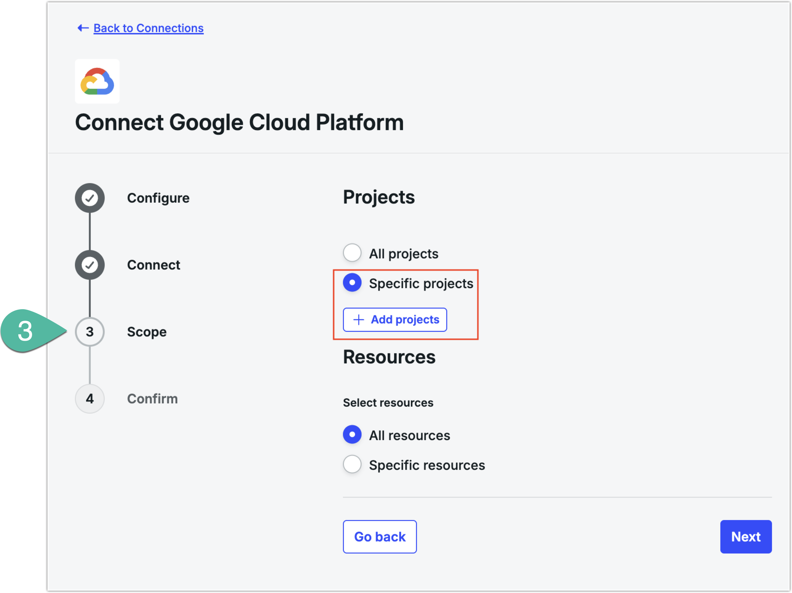
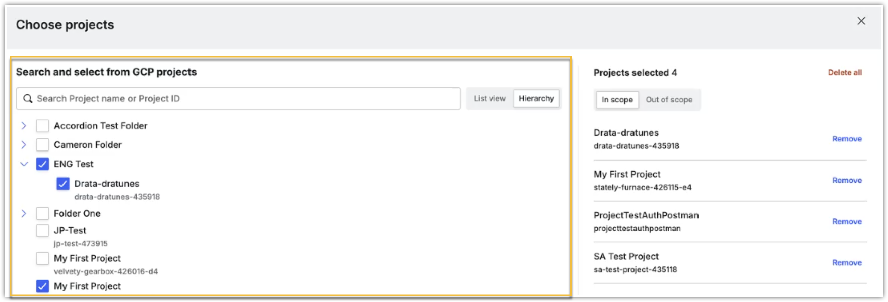
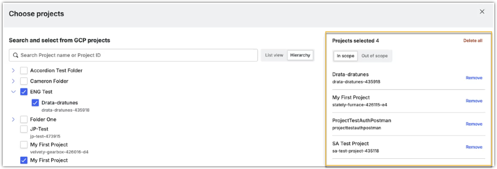

# GCP Integration Guide (Script Setup)

Source: https://help.drata.com/en/articles/4663373-gcp-integration-guide-script-setup
Collection: Connection Support › Infrastructure Guidance
Updated: 2026-11-14
Fetched: 2026-11-22
Description: Use Drata’s automated script to connect GCP for access reviews and infrastructure monitoring.

## Article text

## At-a-Glance

- **What it does:** Connects GCP with Drata to sync IAM users for Access Reviews and automate infrastructure monitoring/evidence collection.
- **Who it’s for:** Security, compliance, and IT administrators managing GCP IAM and infrastructure.
- **Directionality:** One-way (GCP → Drata). Drata only imports IAM users and infrastructure evidence.

## Prerequisites & Data Access

1. **Google Workspace account (user):** Must be a Super Admin.
   - Used in Step 2 to grant domain-wide delegation so Drata can read MFA status.
2. **GCP account (user running the script): Must have the following roles granted**
   - Organization Administrator
   - Organization Policy Administrator
   - Organization Role Administrator
   - Service Account Admin
   - Service Account Key Admin
   - Service Usage Admin
3. **Scope decision: Organization vs. Project level**
   - When running the script or Terraform, you’ll be asked whether the service account should connect at the **organization level (recommended)** or the **project level**.
      - **Organization level**: One setup covers all projects.
      - **Project level**: You’ll need to repeat the setup for each project.
4. Estimated setup time: ~30–45 minutes.

### Permissions & Data Table

| **Permission / Scope** | **Why It’s Needed (and When)** | **Data Accessed (Read Only)** |
|---|---|---|
| Compute Engine API | Monitors SSH access, firewall rules, load balancers, VM usage (Step 1). | VM configs, firewall rules, load balancer data |
| Cloud Resource Manager API | Reads IAM principals and org/project structure for Access Reviews (Step 1). | Org/project metadata, IAM principals |
| Admin SDK API (Workspace) | Verifies MFA status of IAM users (Step 2; required for Test 88). | MFA status, user/group directory info |
| Cloud SQL Admin API | Checks database encryption and backup settings (Step 1).<br>**Note**: Enabled by the setup script by default. Only used if your org runs Cloud SQL. | DB configs, encryption/backup settings |
| Cloud Monitoring API | Collects resource metrics (CPU, I/O, storage utilization, queue age) (Step 1).<br>**Note**: Enabled by the setup script by default. Only used if Infrastructure monitoring is enabled in Drata. | Monitoring metrics |
| Cloud Storage API | Ensures encryption and versioning for storage buckets (Step 1). | Storage configs, encryption, versioning |

## Enable (GCP) Google Cloud Platform

1. Go to Drata’s Connections page. Then, search and select for GCP.
2. Choose a connection type:
   - **Access Review:** Sync IAM users.
   - **Infrastructure:** Enable monitoring tests.
   - You can enable Access Review and/or Infrastructure later during the connection process in Drata as well.

### Step 1: Connect your Google Cloud Platform (GCP)

You have two ways to connect your GCP. You can either connect using a script or connect manually. It is recommended to connect using a script.

1. Script (Recommended)
   - **GCP native script instructions: **[https://github.com/drata/gcp-shell-drata-setup](https://github.com/drata/gcp-shell-drata-setup)
   - **Terraform script instructions: **[https://github.com/drata/gcp-terraform-drata-setup](https://github.com/drata/gcp-terraform-drata-setup)
2. Connect manually
   - Go to [Manually connect GCP](gcp-integration-guide-manual.md) for step by step instructions.

### Step 2: Provision domain wide delegation client in Google Workspace

We need to [grant the GCP service account access to your connected Google Workspace account](https://developers.google.com/identity/protocols/oauth2/service-account#delegatingauthority).

1. Please login to your [Google Admin console](https://admin.google.com/) with an account that has **Super Admin** privileges, then go to **"Security → Access and data control → API controls."** Scroll to the bottom to get to **Domain wide delegation**.
2. In the Domain wide delegation section, click on **Manage Domain Wide Delegation** button.
   - **Note: **If you are using Google Workspace as your IdP and you have [already connected it to Drata](google-workspace-integration-guide.md), you will see another entry in the **Domain Wide Delegation** list. It's **OAuth scope** will be:
      - [`https://www.googleapis.com/auth/admin.directory.user.readonly`](https://www.googleapis.com/auth/admin.directory.user.readonly)
   - Ensure this entry remains intact so as not to break your IdP connection.
3. Click on the **Add new** button.
   - Enter the numeric client ID (unique ID - not the service account email address). For those that utilized the script or terraform, you can pull the client ID from the newly created "drata-key-file.json".
4. Leave the Overwrite existing client ID checkbox unchecked.
5. Copy and paste the **Cloud Platform Scope** into the **OAuth scopes (comma-delimited)** text field.
   - **Cloud Platform Scope:**
      ```
https://www.googleapis.com/auth/admin.directory.user.readonly,https://www.googleapis.com/auth/admin.directory.group.readonly,https://www.googleapis.com/auth/admin.directory.group.member.readonly,https://www.googleapis.com/auth/cloud-identity.groups.readonly
      ```
   - **For improved readability, the same scopes are listed without commas and separated by spaces: **
      ```
https://www.googleapis.com/auth/admin.directory.user.readonly
https://www.googleapis.com/auth/admin.directory.group.readonly
https://www.googleapis.com/auth/admin.directory.group.member.readonly
https://www.googleapis.com/auth/cloud-identity.groups.readonly
      ```
6. Once done, click on the **AUTHORIZE** button.

In Drata, upload the **JSON key** generated by the script (`drata-key-file.json`).

This step can be completed after establishing the connection in Drata. If you fail to do it, the MFA test for GCP will fail.

### Step 3: Finalizing the Connection & Scoping Projects

After running your scripts and setting up Google Workspace, return to Drata to upload your credentials and define exactly which GCP projects are monitored.

**Initialize the Connection**

- Navigate to the **Connections** page in Drata.
- Search for and select **Google Cloud Platform (GCP)**.
- Start the connection process.
- A **four-step wizard** guides you through the entire connection process.



#### Step 1: Configure

- Select your **Workspace** within Drata.
- Toggle **User Access Reviews (UAR)** on or off.



#### Step 2: Connect

Enter/upload the **JSON key file** (`drata-key-file.json`) generated by your script (Step 2: Provision domain wide delegation client in Google Workspace).



#### Step 3: Scope

The **Scope** stage determines which GCP projects Drata will audit. You can choose to monitor your entire organization or pick and choose specific projects.



#### Selecting and Syncing Specific Projects

If you prefer not to monitor your entire organization, you can manually refine your project scope.

Choose** Specific Projects** > **Add Projects** to open the selection modal. The modal is designed to help you find and select projects quickly. It is divided into two primary sections:

1. **The Selection Pane (Left Side)** Choose between two views to find your projects:
   - **List View:** A flat, alphabetical list of all detected GCP projects. Use the **search bar** to quickly locate a project by its **Name** or **Project ID**.
   - **Hierarchy View:** Displays projects according to your GCP folder structure.
      - **Expand/Collapse:** Use the arrows to drill down into specific folders.
      - **Bulk Selection:** Selecting a folder automatically includes **all current and future projects** within that folder.
      - **Individual Selection:** You can select specific projects within a folder without including the entire group.
   
2. **The Review Pane (Right Side)** This acts as your "summary" or "shopping cart":
   - **Selection Summary:** View every project you have picked from the left side in one consolidated list.
   - **Select the status for the selected projects**
      - **In Scope:** Drata will actively run all automated tests and collect evidence for these projects.
      - **Out of Scope:** Drata will ignore these projects. They will appear in your connection settings but will not impact your compliance scores.
   

#### Step 4: Confirm & Finalize

The final step is a summary of your entire setup.

1. **Review the Connection Summary:** Verify that the Service Account is active and that the count of **In Scope** projects matches your expectations.
2. **Finish:** Click **Confirm** to establish the final link. Drata will begin its initial sync and monitoring tests immediately.

## Important Notes & Edge Cases

- Drata never writes back to GCP. All access is read-only.
- Service account JSON keys should be rotated regularly.
- Domain-wide delegation is required for MFA checks (Test 88).
- Removing Workspace scopes breaks MFA checks.
- If MFA is not enabled for IAM users, Test 88 will fail.
- Duplicate users may appear if connected across multiple projects.

## Images

- [image 01] ../../images/integrations/gcp/gcp-integration-guide-script-setup--01.png
- [image 02] ../../images/integrations/gcp/gcp-integration-guide-script-setup--02.png
- [image 03] ../../images/integrations/gcp/gcp-integration-guide-script-setup--03.png
- [image 04] ../../images/integrations/gcp/gcp-integration-guide-script-setup--04.png
- [image 05] ../../images/integrations/gcp/gcp-integration-guide-script-setup--05.png
- [image 06] ../../images/integrations/gcp/gcp-integration-guide-script-setup--06.png

## Related articles

- [Google Workspace Integration Guide](google-workspace-integration-guide.md)
- [Test 88: MFA on Infrastructure Console](test-88-mfa-on-infrastructure-console.md)
- [GCP Integration Guide (Manual)](gcp-integration-guide-manual.md)
- [GCP Virtual Assets](gcp-virtual-assets.md)
- [Understanding GCP Permissions and How Drata Integrates with GCP (Concept Guide)](understanding-gcp-permissions-and-how-drata-integrates-with-gcp-concept-guide.md)
