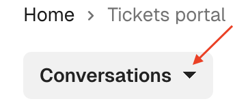
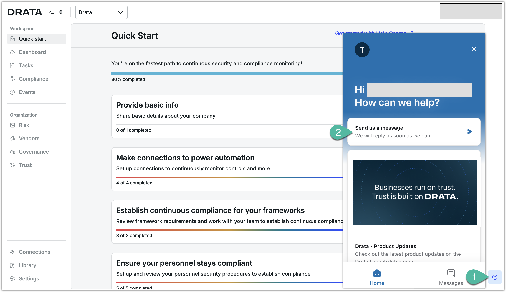
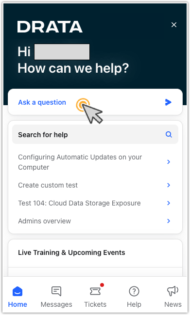
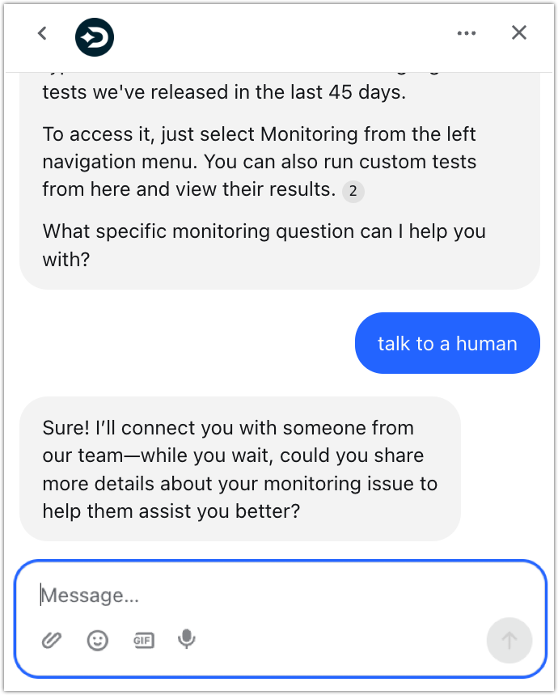

# Get support from Drata

Source: https://help.drata.com/en/articles/13604132-get-support-from-drata
Collection: Getting Started › Helpful Resources › How to Get Support at Drata
Updated: 2026-11-09
Fetched: 2026-11-22
Description: Contact support and review assistance options.

## Article text

Our team is dedicated to helping you unblock compliance hurdles and navigate the Drata platform. This guide outlines our operating hours, contact channels, and how to grant remote access for advanced troubleshooting.

## Support Hours

**24 hours a day, 5 days a week**

We provide global support coverage from **Monday through Friday**, ensuring help is available whenever you need it during the business week.

**Observed Holidays**

Drata Support observes certain [company holidays](observed-holidays.md) during the year. During these times, support availability may be limited or unavailable. The list of observed holidays and support coverage may be updated periodically and is subject to change.

## Track Your Requests

You can view the status of your open conversations at any time through the [Drata Ticket Portal](https://help.drata.com/tickets-portal) by filtering on **Conversations**. To switch between **Conversations** and **Tickets**, simply click the dropdown menu and select the view you’d like to see.

**Note**: Every ticket begins as a conversation, but not every conversation becomes a ticket. Tickets are reserved for ongoing issues that require follow-up over multiple days and are created when a conversation is escalated to a human agent, at the agent’s discretion. Both conversations and tickets can be viewed at any time through your [Ticket Portal.](https://help.drata.com/tickets-portal)

---

## How to reach Drata Support

### Option 1: In-app support (fastest)

For the quickest help, contact Support directly from within Drata. Select the **Question mark icon** in the Drata app.

### Step 1: Starting with Dratanaut

Once you open the support widget, Dratanaut is your first point of contact and can instantly resolve over 80% of support inquiries.

### Step 2: Connecting to a human

If Dratanaut cannot resolve your issue, or if you prefer to speak with a human, simply ask to "talk to a human". Dratanaut will route your conversation to our Support Team’s inbox.

---

## Option 2: Email support

If you prefer email, contact us at **[support@drata.com]()**.

What to expect:

- Receive an immediate acknowledgment and response from our AI assistant, Dratanaut.
- If Dratanaut is unable to resolve your inquiry, or if you’d prefer to speak with a person, simply reply with “talk to a human” and your conversation will be routed to a member of our support team.
- Responses will be delivered via email and will also be reflected in your [ticket portal.](https://help.drata.com/tickets-portal)

---

## Granting Remote Access for Support

Remote Access allows the Drata Support team to troubleshoot your account more effectively by viewing your instance as you see it, helping us investigate and resolve issues more efficiently.

Learn how to [Grant Remote Access](grant-remote-access-to-drata-support.md).

## Images

- [image 01] ../../images/ux/tickets/get-support-from-drata--01.png
- [image 02] ../../images/ux/home/get-support-from-drata--02.png
- [image 03] ../../images/ux/other/get-support-from-drata--03.png
- [image 04] ../../images/ux/other/get-support-from-drata--04.png

## Related articles

- [Understanding Connections in Drata](understanding-connections-in-drata.md)
- [Identify and Add Missing Azure Permissions for Drata](identify-and-add-missing-azure-permissions-for-drata.md)
- [Grant remote access to Drata Support](grant-remote-access-to-drata-support.md)
- [Drata Support: Conversations vs. Tickets](drata-support-conversations-vs-tickets.md)
- [Troubleshooting Login Issues: Browser, Cache & Session Problems](troubleshooting-login-issues-browser-cache-session-problems.md)
