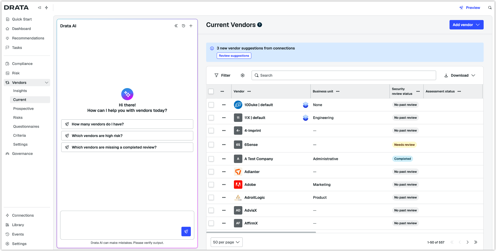
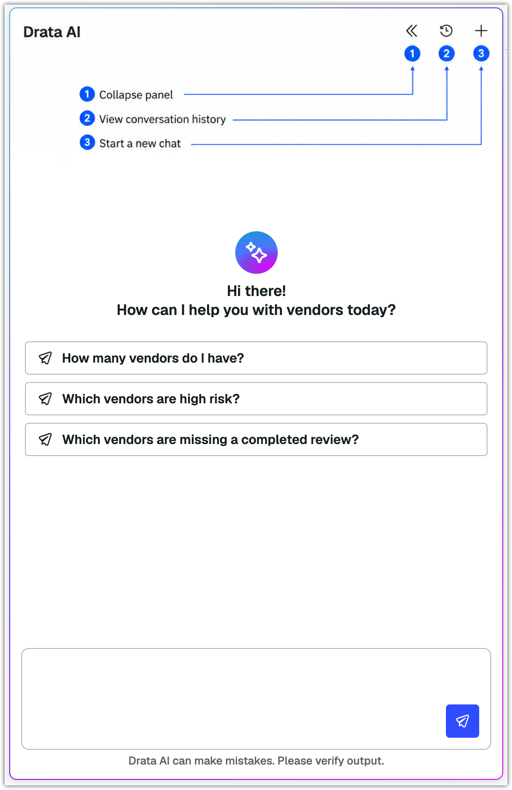
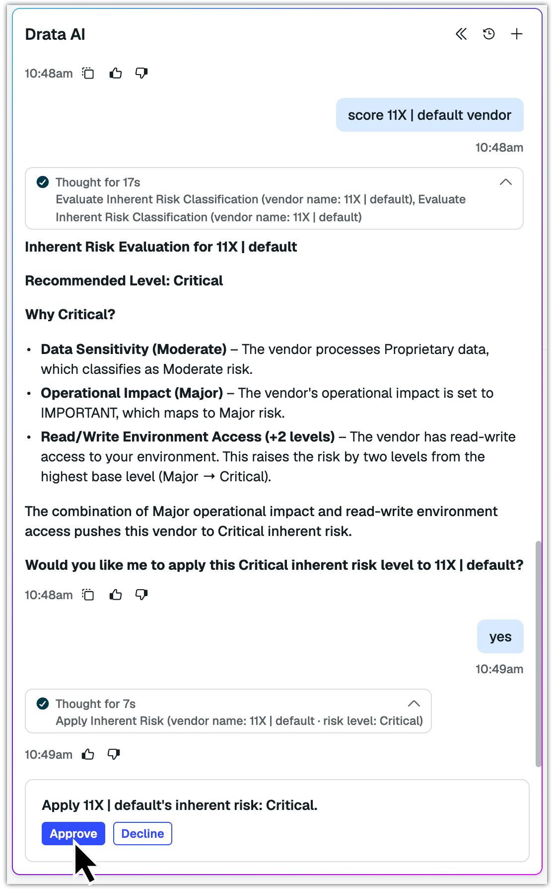

# Getting started with the TPRM Agent

Source: https://help.drata.com/en/articles/16880143-getting-started-with-the-tprm-agent
Collection: Understand the Drata Platform › Vendors › TPRM Agent
Updated: 2026-09-09
Fetched: 2026-11-22
Description: Learn how to use the Drata AI chat panel to ask questions about your vendor portfolio and take action on vendors, reviews, criteria, and risks — in plain language.

## Article text

This article explains how to use Drata AI within third-party risk management: where to find it, how conversations work, and the kinds of things you can ask it to do.

Drata AI is a chat panel available throughout the Vendors experience. You type what you want in ordinary language, and it works against your live Drata data — your actual vendors, reviews, criteria, documents, and risks. It can answer questions that would otherwise mean filtering several pages and cross-referencing them by hand, and it can carry out work for you: creating vendors, starting security reviews, running impact assessments, overriding statuses, and writing risks to your register.

This matters because most TPRM questions worth asking span more than one screen. A chat panel that already knows your data turns them into a sentence. Drata AI is grounded in your account. It isn't a general-purpose assistant — it answers from your records rather than from general knowledge, and it stays inside third-party risk management.

After following this article, you'll be able to:

- Open Drata AI and start a conversation about your vendors
- Understand the difference between asking a question and asking the agent to do something
- Find and reuse earlier conversations
- Recognize the range of tasks the agent supports, from portfolio queries to writing risks
- Know what the agent won't do, and why

---

## Drata AI Chat Overview

Drata AI is available on all the Vendors pages of Drata.

When you open a new conversation, the panel greets you with **How can I help you with vendors today?** and three starter prompts you can select instead of typing:

- *How many vendors do I have?*
- *Which vendors are high risk?*
- *Which vendors are missing a completed review?*

Type your question in the “Ask a question…” box at the bottom of the panel, then send it.

You can also select the buttons at the top of the panel to collapse it, view your conversation history, or start a new chat.

---

## How conversations work

The chat handles two types of requests:

1. **Questions** read your data and provide answers. For example, “How many active vendors do we have, and how many are high inherent risk?” returns a live count from your account—not an estimate.
2. **Tasks** make changes. For example, “Create a risk: Vendor lacks MFA. Impact: high. Likelihood: moderate.” creates a record in your risk register.
   - After you approve a task, Drata saves the change immediately. If you’re already on the page, you may need to refresh it or navigate away and return to see the updated information.

**Before the agent takes an action that changes your data, it tells you what it's about to do and waits for your approval. **You'll see a summary of the proposed action with an option to approve it. Nothing is written until you confirm.

Note: This applies to one-off tasks you give the agent. If you're starting a security review, check your TPRM Agent autonomy settings in Vendors settings first—they decide whether the agent completes each step of the review on its own or pauses for your approval.

The agent also shows its reasoning. Where it draws a conclusion from a document, it cites what it used, so you can check the source rather than take the answer on faith.

**Expected outcome:** Questions return answers drawn from your live account data. Task requests produce an approval prompt describing the action before anything is created, updated, or changed.

---

## Example Prompts

**These are examples, not a menu.** Drata AI is open-ended — you type in your own words, and it handles far more than what's listed here. The prompts below are meant to show the *range* of what's possible so you know where to start. Phrase things however feel natural; you don't need to match this wording.

### Your vendor portfolio

- How many active vendors do we have, and how many are high inherent risks?
- Which vendors store PII but don't have a SOC 2 on file?
- Show me vendors by business unit / lifecycle status / relationship type.
- Add Acme Corp as a prospective vendor — data processor for Sales.
- Offboard Zendesk and archive its records.

### A specific vendor

- What's the status, owner, and next review date for Stripe?
- Summarize this vendor's security posture in three sentences.
- What data does this vendor access and what's its operational impact?
- Has this vendor had open risks or failed criteria historically?
- Set the internal security owner to me and move to Under Review.

### Inherent risk assessments

- What inherent risk did we assign this vendor and what drove it?
- Which vendors are unscored and need an impact assessment?
- If this vendor gains prod access, how does its inherent risk change?
- Run an impact assessment: customer PII, normal op impact, no env access.
- Override the recommended inherent risk to Major and explain why.
- Re-score these five vendors now that they handle sensitive data.

### Security reviews

- Start a security review for this vendor and pull docs from SafeBase.
- Run the assessment using only criteria mapped to High inherent risk.
- Which criteria came back Not Met or Inconclusive, and what's the evidence?
- Summarize the agent's findings and the top three concerns.
- Where in the SOC 2 did the agent find encryption-at-rest?
- Which reviews are due soon or overdue across my portfolio?
- Log an observation on this review for follow-up.

### Criteria

- What criteria do we evaluate for AI vendors?
- What requirements sit under our 'Data Encryption' criterion?
- Add a requirement: vendors must disclose subprocessors.
- Map all AI-governance criteria to Major and Critical inherent risk.
- Restore Drata's default criteria.

### Documents

- What documents do we have for this vendor?
- Pull the latest docs from this vendor's SafeBase Trust Center.
- Upload this SOC 2 and attach it to the open review.

### Vendor risks

- What are the open risks for this vendor and their treatment status?
- Show all untreated or overdue vendor risks, sorted by score.
- What's our highest residual-risk third party right now?
- Create a risk: vendor lacks MFA. Impact high, likelihood moderate.
- Set treatment to Mitigate, assigned to me, due in 60 days.
- Accept this risk with a rationale and close it.
- Add a residual risk assessment now that the vendor remediated.

### Program reporting

- How many reviews are overdue and who owns them?
- Give me the distribution of vendors by residual risk for the board deck.

### Getting oriented

- What needs my attention?

**Expected outcome:** A question returns an answer grounded in your account data, with sources cited where the answer came from a document. A task request produces an approval prompt, and once approved, the change appears on the relevant vendor, review, or risk record.

---

## Guardrails

Drata AI is deliberately scoped. It's built to work on your third-party risk program and nothing else, and it's designed to refuse rather than improvise when a request falls outside that.

In practice this means:

- **It stays on topic.** Requests unrelated to vendor management are declined rather than answered.
- **It stays inside your account.** It can only see your organization's data, and it won't retrieve or discuss another organization's records.
- **It pushes back on unsafe bulk actions.** Broad, destructive, or sweeping requests — approving or deleting many records at once — aren't carried out silently. The agent asks you to confirm, narrows the scope, or declines.
- **It protects sensitive personal information.** Requests for personal data about individuals are refused.

These behaviors are intentional. If the agent declines something you believe is in scope, rephrasing with more specificity usually helps.

---

## Tips for better results

- **Be specific about the vendor.** Naming the vendor, or opening the panel from that vendor's profile, avoids ambiguity when several records could match.
- **Say what you want done, not just what you want to know.** *Creating a risk for this and assigning it to me* gets further than *this looks risky*.
- **Include the details a record needs.** When creating a risk or running an impact assessment, supplying impact, likelihood, or data-handling details in your prompt saves a round trip.
- **Check the approval prompt before confirming.** It's the last checkpoint before something is written.
- **Use one conversation per topic.** It keeps chat history readable and gives the agent cleaner context.
- **Follow up in the same thread.** The agent keeps context, so *now summarize that for my auditor* works after a question.

---

## FAQ

**Does Drata AI use my data to answer, or general knowledge?** Your data. It reads live records from your Drata account. It isn't a general-purpose assistant, and it won't answer from outside knowledge.

**Can it change things without asking me?** No. Actions that create or modify records surface an approval prompt first. What the agent does automatically elsewhere in the review workflow is governed separately — see [TPRM Agent Autonomy Settings](legacy-tprm-agent-create-a-criteria.md).

**Can it see other organizations' vendors?** No. It's limited to your account's data.

**Are my conversations saved?** Yes. Every conversation is kept in chat history, searchable and grouped by recency.

**Do I have to phrase prompts exactly as listed in this article?** No. The examples above are illustrative. Ask in your own words — the list exists to show the range of what's supported, not to constrain you.

**What if the agent can't answer?** It will tell you rather than guess. Try naming the vendor explicitly, narrowing the question, or checking whether the underlying data exists in Drata.

## Images

- [image 01] ../../images/ux/ai/getting-started-with-the-tprm-agent--01.png
- [image 02] ../../images/ux/ai/getting-started-with-the-tprm-agent--02.png
- [image 03] ../../images/ux/ai/getting-started-with-the-tprm-agent--03.png

## Related articles

- [Terminology Updates: Inherent and Residual Risk in Vendor Risk Management](terminology-updates-inherent-and-residual-risk-in-vendor-risk-management.md)
- [TPRM Agent Autonomy Settings](tprm-agent-autonomy-settings.md)
- [Add a vendor or prospective vendor](add-a-vendor-or-prospective-vendor.md)
- [TPRM Agent: Create a Criteria](tprm-agent-create-a-criteria.md)
