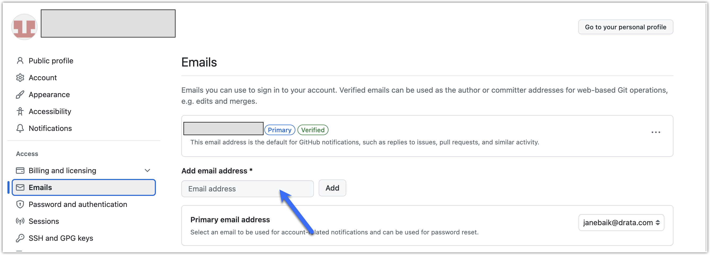
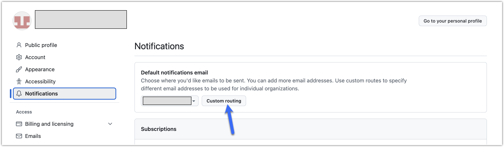

# GitHub Access: Should I use my personal account or a new company account?

Source: https://help.drata.com/en/articles/4798202-github-access-should-i-use-my-personal-account-or-a-new-company-account
Collection: Understand the Drata Platform › Connections
Updated: 2026-08-05
Fetched: 2026-11-22
Description: Use your personal GitHub account, but add your work email and set proper notification routing

## Article text

### Overview

If your organization uses GitHub, you may wonder whether employees should use personal GitHub accounts or create new company-specific accounts.

You can allow employees and contractors to use their personal GitHub accounts, while enforcing appropriate security controls such as multi-factor authentication (MFA) and access reviews.

This approach aligns with how GitHub is designed to work and helps avoid duplicate or unmanaged accounts.

## Prerequisites

Before setting up organization notification routing:

- The user must be a member of the GitHub organization
- The company email address must be added to the user’s GitHub account
- The email address must be **verified** in GitHub

## Route organization notifications to a work email

1. Sign in to your GitHub account.
2. Open **Settings**.
3. Under **Emails**, add your work email address and complete the verification process.
   
4. Go to **Notifications** in GitHub settings. Then select **Custom routing.**
   
5. Select your work email address as the destination for notifications related to that organization.
6. Save your changes.

Once saved, **all notifications for that organization** will be sent to the selected work email, while other GitHub notifications continue going to the user’s default email.

## Images

- [image 01] ../../images/integrations/github/github-access-should-i-use-my-personal-account-or-a-new-company-account--01.png
- [image 02] ../../images/integrations/github/github-access-should-i-use-my-personal-account-or-a-new-company-account--02.png

## Related articles

- [ISO 27001:2022 Example ISMS Plan](iso-27001-2022-example-isms-plan.md)
- [Example Evidence for Not Monitored Controls (NIST 800-53r5)](example-evidence-for-not-monitored-controls-nist-800-53r5.md)
- [Signing In to Drata (New Experience)](signing-in-to-drata-new-experience.md)
- [Section 2: GRC Roles & Responsibilities](section-2-grc-roles-responsibilities.md)
- [Section 4: Team Briefs & Email Templates](section-4-team-briefs-email-templates.md)
