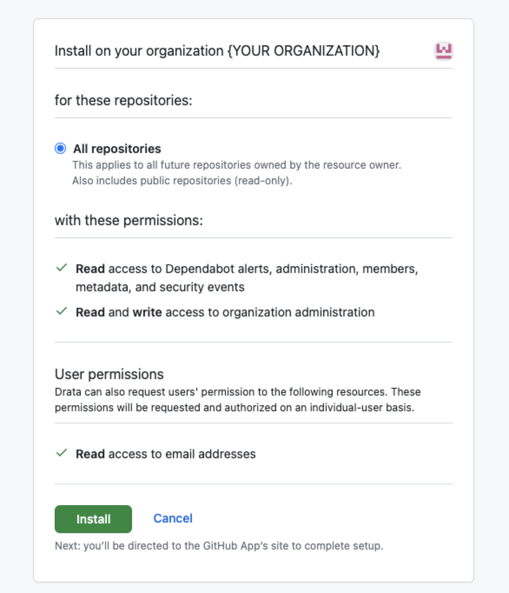

# GitHub Enterprise Server Integration Guide

Source: https://help.drata.com/en/articles/9265902-github-enterprise-server-integration-guide
Collection: Connection Support › Version Control Guidance
Updated: 2026-09-15
Fetched: 2026-11-22

## Article text

The GitHub Enterprise Server integration enables security and compliance teams to validate software development lifecycle (SDLC) controls. It connects Drata to your on-premises GitHub Enterprise Server so your team can automatically collect evidence from repositories, users, and development workflows to support compliance requirements.

## Key Capabilities

- SDLC compliance verification: Validate repository and development workflow controls
- Repository monitoring: Review repositories and project configurations
- Automated evidence collection: Gather SDLC evidence from GitHub Enterprise Server

This integration is used to automate tests related to secure development lifecycle practices, helping prove compliance with software development lifecycle policies.

## Prerequisites & Data Access

- **Admin access** to your GitHub Enterprise Server instance
- Ability to create and install a **GitHub Application**
- A **publicly accessible DNS hostname or IP address** for your GitHub Enterprise Server instance
- Network configuration allowing Drata to reach your instance (if it is not publicly accessible)
- Required Drata Role with Write access: Admin, Workspace Managers, DevOps Engineer
- Access Reviewers (Access Reviewers can only Read the connection page they can’t make changes)

If your GitHub Enterprise Server instance is not publicly accessible, your network device must allow inbound traffic on **port 443** from the following Drata IP addresses.

---

### Network Allowlist IP Addresses

### North America

- 54.190.125.76
- 35.83.232.49
- 35.164.233.77
- 44.230.111.50
- 3.132.55.182
- 3.16.197.217
- 3.18.141.25
- 35.83.80.119
- 18.119.62.253

### Europe

- 18.196.253.2
- 3.73.237.1
- 3.64.113.104
- 46.51.157.29
- 52.50.71.20
- 52.211.226.244
- 18.193.229.148
- 52.210.236.236

### APAC

- 13.239.191.9
- 3.105.164.211
- 54.66.177.145
- 16.51.144.163
- 16.51.96.18
- 16.26.10.156
- 13.210.104.129
- 16.50.132.11

Your IT team may need to configure these IP addresses depending on your internal network layout.

---

### Permissions & Data Table

| Permission/Scope | Why It’s Needed |
|---|---|
| GitHub Enterprise Server admin access | Allows creation and installation of the Drata GitHub application |
| Network allowlisting (port 443) | Allows Drata to securely connect to your on-premises GitHub instance |
| GitHub Application installation | Grants Drata access to repositories, users, and project metadata for compliance validation |

## Step-by-Step Setup

### Step 1: Configure Network Access (If Needed)

If your GitHub Enterprise Server instance is not publicly accessible:

1. Configure your network device to allow inbound traffic on **port 443**.
2. Allowlist the Drata IP addresses listed above based on your region.
3. Work with your **IT team** to configure the correct firewall or security group settings.

Expected outcome: Drata can securely reach your GitHub Enterprise Server instance.

### Step 2: Identify Your GitHub Enterprise Hostname

1. Locate the **publicly accessible DNS hostname or IP address** for your GitHub Enterprise Server instance.
2. Ensure the correct protocol is included when entering the value (for example, `https://hostname`).

Expected outcome: You have the hostname required to configure the integration.

### Step 3: Connect GitHub Enterprise Server in Drata

1. Log in to **Drata** → go to the **Connections** page.
2. Navigate to your **Available Connections**.
3. Search for and start the **GitHub Enterprise Server** connection process.
4. Enter your **hostname** for the GitHub Enterprise Server instance.
5. Select **Create GitHub Application**.

Expected outcome: A GitHub application named **Drata** is created for your instance.

### Step 4: Install the GitHub Application

1. Select **Install GitHub Application**.
2. You will be redirected to the **GitHub organization installation page**.
3. Verify the **Drata GitHub application** is being installed.
4. Select the organization where the application should be installed.
5. Enable **All repositories**.
   
6. Complete the installation.

Expected outcome: The Drata GitHub application is installed and authorized to access your organization’s repositories.

### Step 5: Verify the Connection

1. Return to the **Connections** page in Drata.
2. Search for **GitHub Enterprise Server**.
3. Confirm the connection status shows **Active**.

Expected outcome: GitHub Enterprise Server is successfully connected and Drata begins collecting SDLC evidence.

## Important Notes

- If an error occurs after creating the GitHub application, it is safe to **delete the application and recreate it**.
- If your organization uses **GitHub Organizational Rulesets**, you may need to manually update permissions after installing the Drata application.
- Ensure the GitHub application is installed on the **correct organization** and configured for **All repositories** to allow Drata to validate SDLC evidence.
- Network access must allow traffic on **port 443** from the listed IP addresses for on-premises environments.

## Images

- [image 01] ../../images/integrations/github-enterprise-server/github-enterprise-server-integration-guide--01.png

## Related articles

- [GitHub Integration Guide](github-integration-guide.md)
- [GitHub Issues Integration Guide](github-issues-integration-guide.md)
- [Azure Repos (DevOps) Integration Guide](azure-repos-devops-integration-guide.md)
- [GitHub Rulesets](github-rulesets.md)
- [GitHub Issues Enterprise Integration Guide](github-issues-enterprise-integration-guide.md)
