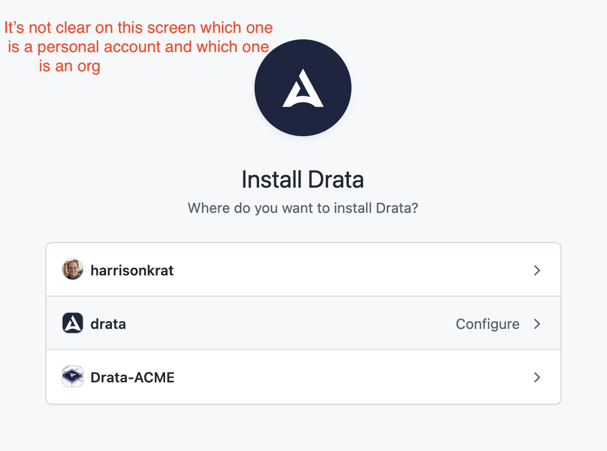
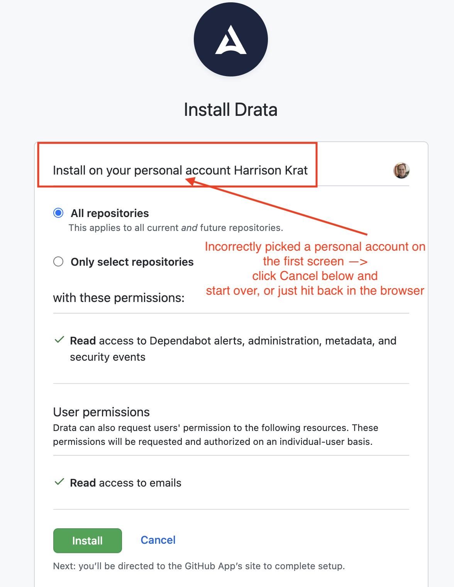
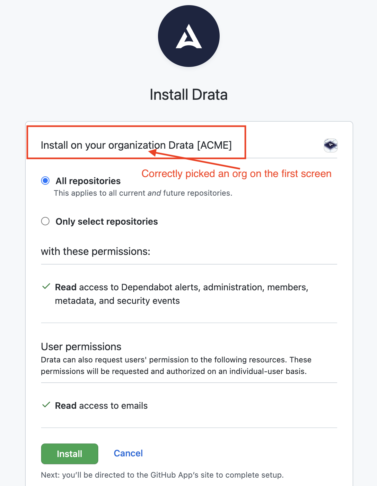
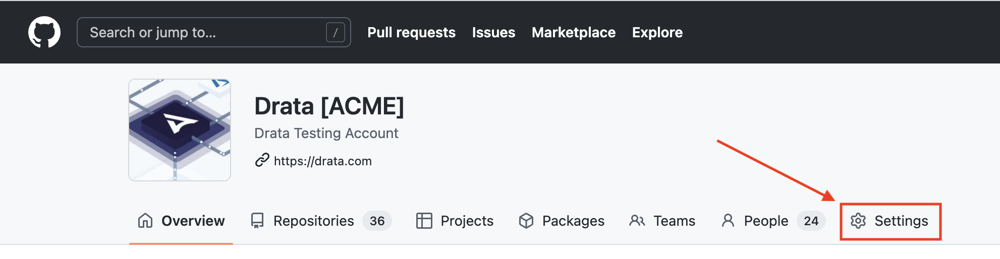
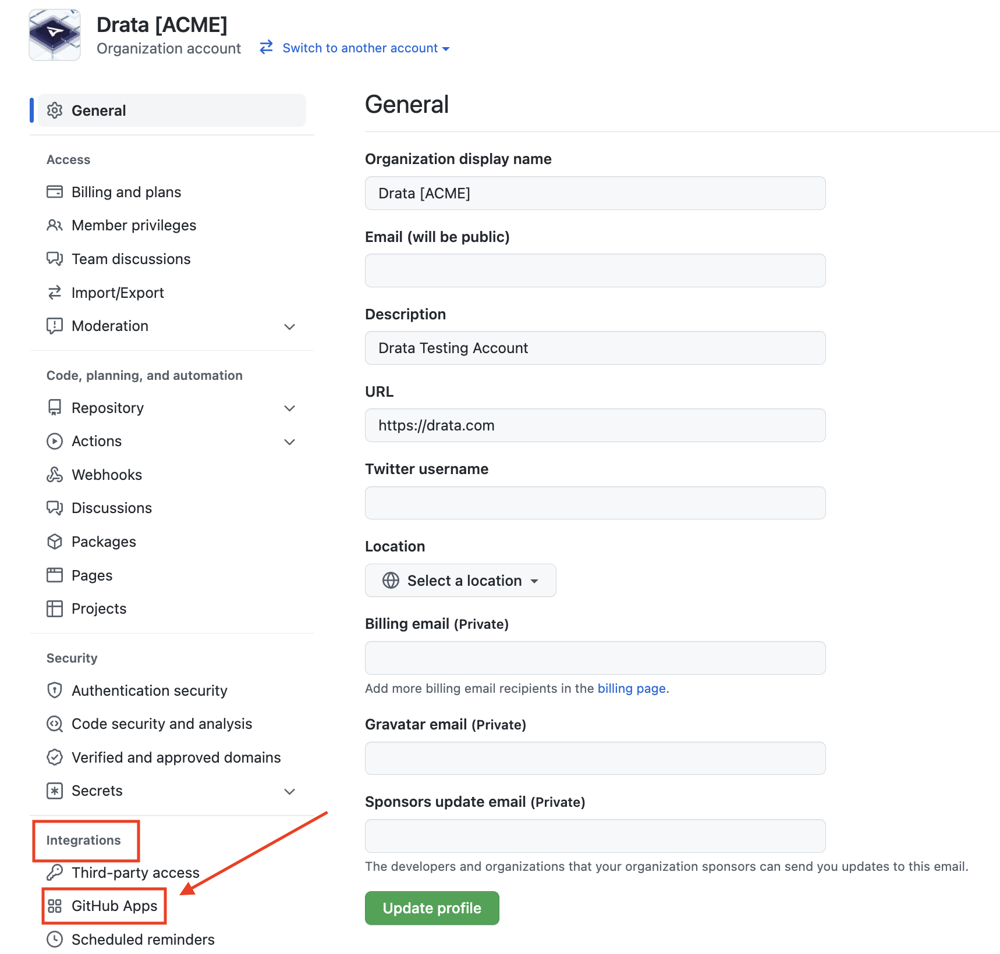
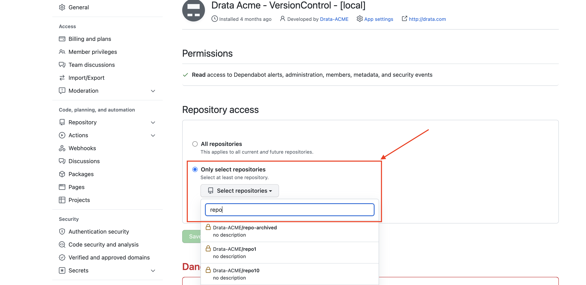
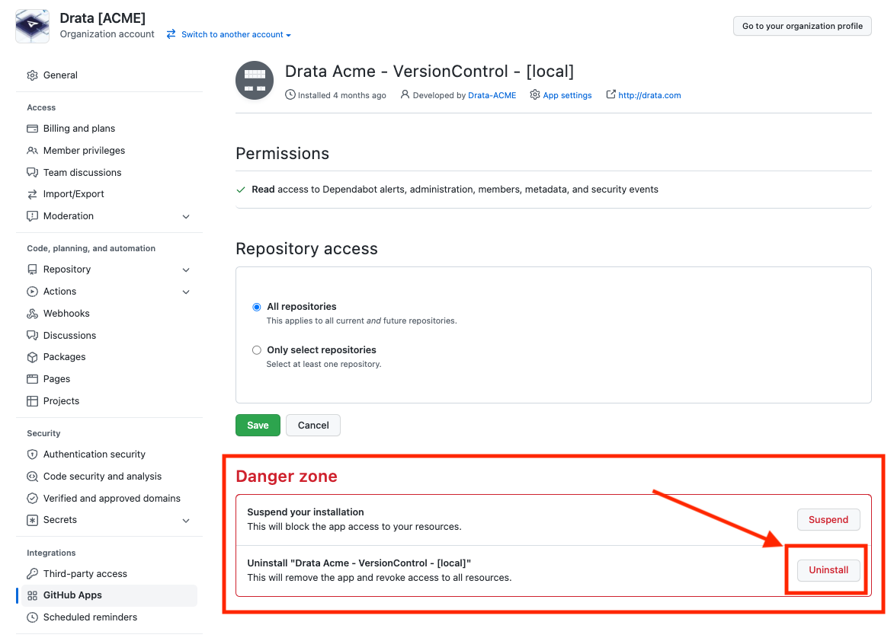

# GitHub Integration Guide

Source: https://help.drata.com/en/articles/4663377-github-integration-guide
Collection: Connection Support › Version Control Guidance
Updated: 2026-10-20
Fetched: 2026-11-22
Description: Making the initial connection to GitHub

## Article text

The **GitHub integration** enables **Engineering and Security teams** to automate evidence collection for software development lifecycle (SDLC) controls. It connects Drata to your **GitHub organization** to continuously validate access control, code review, and change management practices for compliance.

## Key Capabilities

- **Automated SDLC monitoring:** Verifies repository access, code reviews, and change restrictions.
- **Evidence collection:** Gathers audit-proof evidence showing adherence to secure development policies.- **Remediation Pull Requests:** Automatically creates pull requests with proposed fixes for compliance issues, streamlining workflows.
- **Ruleset Analysis:** Accesses GitHub ruleset information to ensure adherence to compliance standards.

## Prerequisites & Data Access

- Must have permission to **install GitHub Apps** on your organization’s GitHub account.
- **Do not install the Drata app in a personal GitHub account.**

- GitHub users must have public email visibility for Drata to match accounts correctly.

### Email Matching Requirements

Each GitHub user must:

1. Uncheck **“Keep my email addresses private”** under [GitHub Email Settings](https://github.com/settings/emails).
2. Select a **Public email** under [GitHub Profile Settings](https://github.com/settings/profile).

Drata syncs public emails nightly to match GitHub users to Drata personnel based on email and username.

Upon each nightly sync of the GitHub connection, Drata will check for and pull collaborators' public emails. Drata will use those emails and GitHub usernames to attempt email-based and fuzzy matching to Drata personnel (IdP) emails.

## Step-by-Step Setup

### Step 1: Connect GitHub in Drata

Navigate to your available connections on the Connections page. Search and connect to GitHub.

### Step 2: Verify Installation Scope

Drata recommends that you set the scope of the GitHub app to allow read access to all repos (this covers current and future repos). If you need to reduce the selection of apps Drata will monitor, you can select those at connection time, or once the app has been installed in your organization.

This reduction in scope will apply to the "Formal Code Review Process" monitoring test, where Drata looks for your branch protection rules. It will not reduce the scope of collaborators Drata attempts to find, or their permissions on all repos in your organization. Collaborator permissions are evaluated in the "Only Authorized Employees Change Code" and "Production Code Changes Restricted" monitoring tests.

1. Go to your GitHub organization
2. Click on the "Settings" tab
3. Click on "GitHub Apps" (under "Integrations") in the left sidebar
4. Click the "Configure" button next to the installed Drata app
5. Under "Repository Access," select the radio option for "Only select repositories"
6. Use the "Select repositories" dropdown to select your in-scope repos, and click "Save"
7. The following are the read permission scopes: Repository permissions

- Administration
- Code scanning alerts
- Dependabot alerts
- Metadata

1. Organization permissions

- Members

1. Account permissions

- Email addresses4. Write Access to Repositories: Required for automatically creating remediation pull requests (PRs) to address compliance issues.

1. Organization-level Administration: Read-only permission is necessary to access modern GitHub ruleset information for compliance monitoring.

Rerun the "Formal Code Review Process" monitoring test to evaluate the new results

***NOTE: This will require you to manually add future repos you want to monitor to the app's repos selection going forward.***

## Disconnect the Drata App

If you ever need to disconnect GitHub from Drata, you will need to do so on the [Drata connections page](https://app.drata.com/account-settings/connections) and within GitHub under "GitHub Apps." Click "Uninstall" for the Drata app.

## Images

- [image 01] ../../images/integrations/github/github-integration-guide--01.png
- [image 02] ../../images/integrations/github/github-integration-guide--02.png
- [image 03] ../../images/integrations/github/github-integration-guide--03.png
- [image 04] ../../images/integrations/github/github-integration-guide--04.png
- [image 05] ../../images/integrations/github/github-integration-guide--05.png
- [image 06] ../../images/integrations/github/github-integration-guide--06.png
- [image 07] ../../images/integrations/github/github-integration-guide--07.png

## Related articles

- [GitHub Issues Integration Guide](github-issues-integration-guide.md)
- [Azure Repos (DevOps) Integration Guide](azure-repos-devops-integration-guide.md)
- [GitHub Enterprise Server Integration Guide](github-enterprise-server-integration-guide.md)
- [GitHub Rulesets](github-rulesets.md)
- [GitHub Issues Enterprise Integration Guide](github-issues-enterprise-integration-guide.md)
