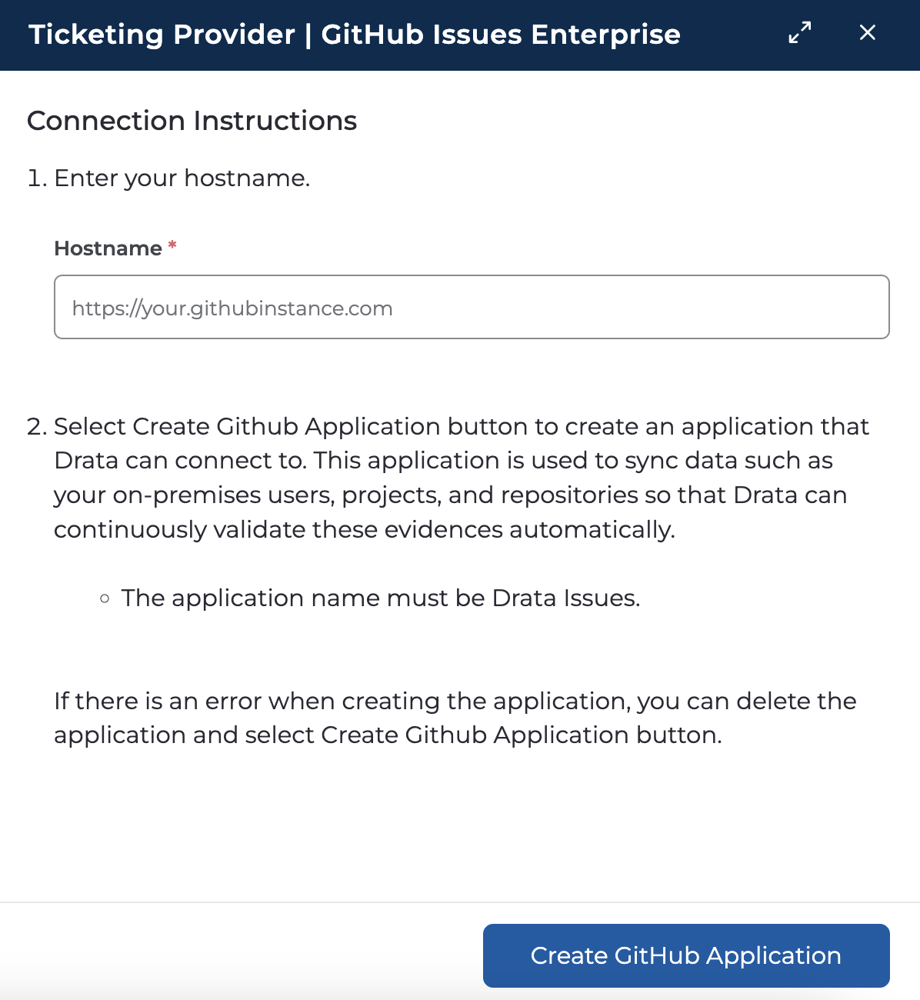

# GitHub Issues Enterprise Integration Guide

Source: https://help.drata.com/en/articles/10003287-github-issues-enterprise-integration-guide
Collection: Connection Support › Ticketing Guidance
Updated: 2026-08-17
Fetched: 2026-11-22
Description: Making the initial connection to GitHub Issues Enterprise

## Article text

The **GitHub Issues Enterprise integration** enables **Engineering and Security teams** to automate vulnerability tracking and evidence collection. It connects Drata to your **GitHub Enterprise Issues instance**, allowing Drata to continuously verify adherence to your **vulnerability management policy**.

## Key Capabilities

- **Vulnerability tracking:** Automatically validates open and resolved vulnerability issues.
- **Evidence collection:** Gathers proof that vulnerabilities are remediated in line with company policy.
- **Secure enterprise connection:** Integrates directly with your self-hosted GitHub Enterprise instance.

## Prerequisites & Data Access

- Must have **Owner access** to your organization’s **GitHub Issues Enterprise account**.
- Must have access to create and configure **GitHub applications** within your GitHub Enterprise instance.
- Must know the **hostname** where your GitHub Enterprise server is hosted (e.g., `https://github.example.com`).

### Permissions & Data Table

| **Permission/Scope** | **Why It’s Needed** | **Data Accessed (Read Only)** |
|---|---|---|
| Hostname (Enterprise URL) | Identifies your GitHub Enterprise instance | Connection routing to your private GitHub server |
| GitHub Application | Authorizes Drata to read issue and repository data | Issue metadata, status, and labels |

## Step-by-Step Setup

### Step 1: Confirm Access

Before connecting, confirm that you:

- Have **Owner** privileges in your GitHub Enterprise organization.
- Have permission to create **GitHub Applications**.

## Complete the Connection

In Drata’s **Connections** page, enter the following information:

| **Drata Field** | **GitHub Issues Enterprise Value** |
|---|---|
| Hostname | The URL where your GitHub Enterprise instance is hosted (`https://github.example.com`) |

For steps on accessing and using the Connections page in Drata, refer to [The Connections Page in Drata](https://help.drata.com/en/articles/12305645-the-connections-page-in-drata).

### Create Github Application

After entering the required values, you are redirected to GitHub to create and connect an application. This application is used to sync data such as your on-premises users, projects, and repositories so that Drata can continuously validate these evidences automatically.

1. You will be redirected to GitHub.
2. Log in to your GitHub Enterprise account (if prompted).
3. When creating the app, ensure the **Application Name** is **“Drata Issues.”**

## Important Notes

- Ensure the **application name** in GitHub Enterprise is **exactly “Drata Issues”**.
- Only **read-only access** is required; Drata will not modify or create issues.
- The integration supports **self-hosted GitHub Enterprise environments** only. GitHub Cloud users should use the standard **GitHub Issues** connection instead.
- Drata’s autopilot automatically checks for vulnerability ticket updates and collects evidence of timely resolution.

## Images

- [image 01] ../../images/integrations/github-issues-enterprise/github-issues-enterprise-integration-guide--01.png

## Related articles

- [GitHub Integration Guide](github-integration-guide.md)
- [GitHub Issues Integration Guide](github-issues-integration-guide.md)
- [GitLab Issues Integration Guide](gitlab-issues-integration-guide.md)
- [GitHub Enterprise Server Integration Guide](github-enterprise-server-integration-guide.md)
- [GitLab Issues (Self-Managed) Integration Guide](gitlab-issues-self-managed-integration-guide.md)
