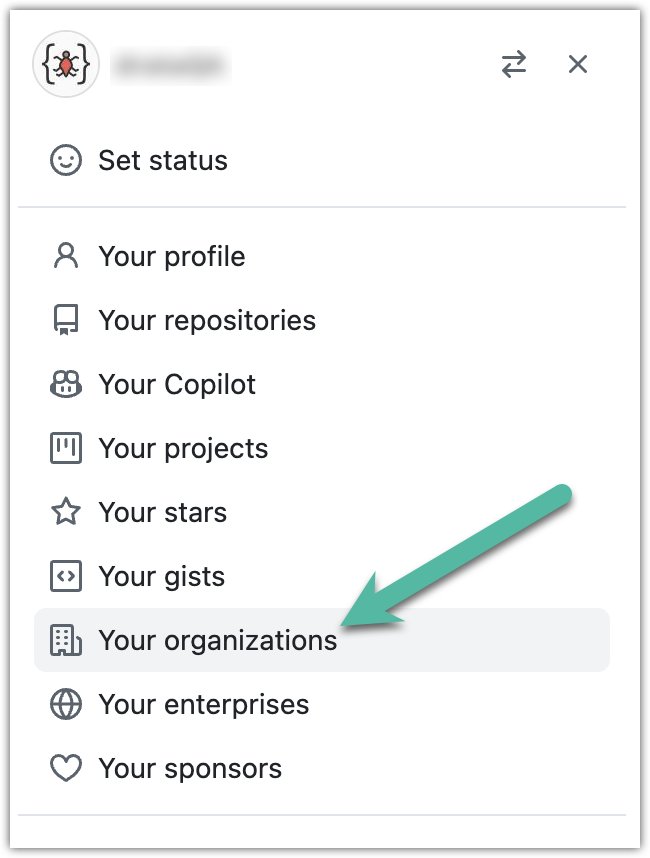
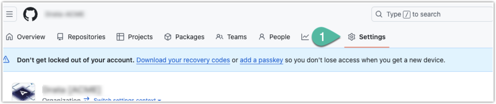
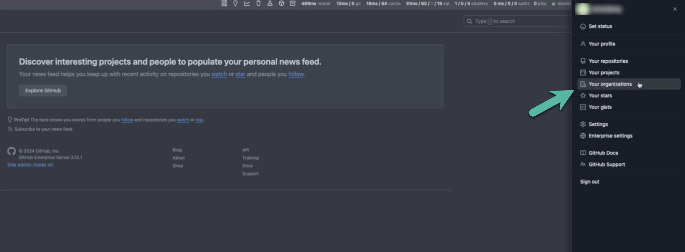
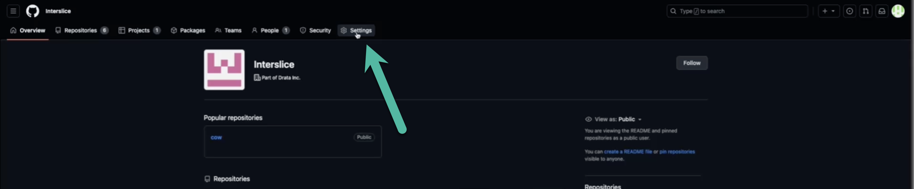
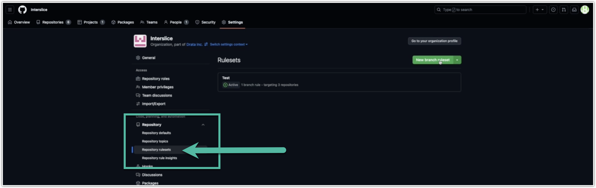
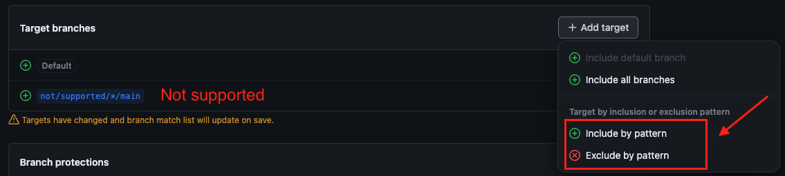

# GitHub Rulesets

Source: https://help.drata.com/en/articles/9755132-github-rulesets
Collection: Understand the Drata Platform › Connections
Updated: 2026-09-28
Fetched: 2026-11-22
Description: How does Drata support GitHub rulesets

## Article text

Drata now supports [GitHub organizational rulesets](https://docs.github.com/en/enterprise-cloud@latest/repositories/configuring-branches-and-merges-in-your-repository/managing-rulesets/about-rulesets) in our [GitHub integration for Version Control](github-integration-guide.md). Follow these steps to enable the Drata Autopilot system access to your organizational rulesets and apply these rulesets to the **Formal Code Review Process** test.

**Note:** Due to recent GitHub updates, Drata can now access both organizational and repository rulesets with **Read-only permissions**, eliminating the need for elevated access. Organization and repository rulesets are supported.

## Prerequisite

To use GitHub rulesets, ensure your setup meets the following requirements:

- Use a GitHub Enterprise Cloud, [GitHub Enterprise Server](github-enterprise-server-integration-guide.md).
   - Drata supports both organization and repository rulesets.
- You must include **ALL** branches or the **Default Branch**. Default branches must be directly targeted, as paths are not supported.
- **One or more approvers** must be specified.
- Grant **Administration Read **permissions under **Organization permissions**.

## Grant Administration Read permissions

To grant **Administration Read **permissions under **Organization permissions, **you must be a GitHub Organization Owner or Admin and the Drata GitHub integration must already be installed in the organization

1. **Log in to GitHub** as an organization owner or admin.
2. Select **Your organizations**, then choose the relevant organization.
   
3. Select **Settings** in the organization navigation.
   
4. In the left sidebar, navigate to **GitHub Apps. **In some orgs, this appears as **Integrations → GitHub Apps**.
5. Find **Drata** in the list of installed GitHub Apps and select **Configure**.
6. **Review Organization permissions**
   - Scroll to **Organization permissions**.
   - Locate **Administration**.
   - Set **Administration** to **Read-only**.
7. **Save changes**

## Set up organizational rulesets in GitHub

To configure organizational:

1. **Log in as an Admin** in GitHub and select **Your organizations**.
   
2. Select the relevant organization.
3. Navigate to **Settings**.
   
4. Expand **Repository** and select **Repository rulesets**.
   

Here, you can start to configure your rulesets.

### Create a repository ruleset

To create or edit a ruleset:

1. Select the **New branch ruleset** or select an existing ruleset to edit.
2. Enter a **Ruleset Name**.
3. Set **Enforcement Status** to **Active**.
4. **Bypass list** is optional.
5. Choose **Target repositories **to be one of the following:
   - **All repositories**
   - **Dynamic list by name**
   - **Select repositories**
      - If selected, continue and add specific repositories.
   ---
   **Note**: Some configurations, such as Target: Dynamic list by property, are currently not supported.
   ---
6. Under **Target branches**, choose **Include default branch** or **Include all branches**.
   - **Note:** Default branches **must **be directly targeted. Paths (such as `/not/supported/*/main`) are not supported.
      
7. Configure **Branch protections**:
   - Require a pull request before merging.
   - Specify **Required approvals** (must be 1 or more).
8. **Save changes**.

### Troubleshooting

If issues arise, use the JSON results from the **Formal Code Review** monitoring test to identify any failed repositories. Only repositories with failures are displayed; passing repositories will not appear in this list.

## Images

- [image 01] ../../images/integrations/github/github-rulesets--01.png
- [image 02] ../../images/integrations/github/github-rulesets--02.png
- [image 03] ../../images/integrations/github/github-rulesets--03.png
- [image 04] ../../images/integrations/github/github-rulesets--04.png
- [image 05] ../../images/integrations/github/github-rulesets--05.png
- [image 06] ../../images/integrations/github/github-rulesets--06.png

## Related articles

- [GitHub Integration Guide](github-integration-guide.md)
- [Test 9: Production Code Changes Restricted](test-9-production-code-changes-restricted.md)
- [GitHub Issues Integration Guide](github-issues-integration-guide.md)
- [GitHub Enterprise Server Integration Guide](github-enterprise-server-integration-guide.md)
- [GitHub Issues Enterprise Integration Guide](github-issues-enterprise-integration-guide.md)
