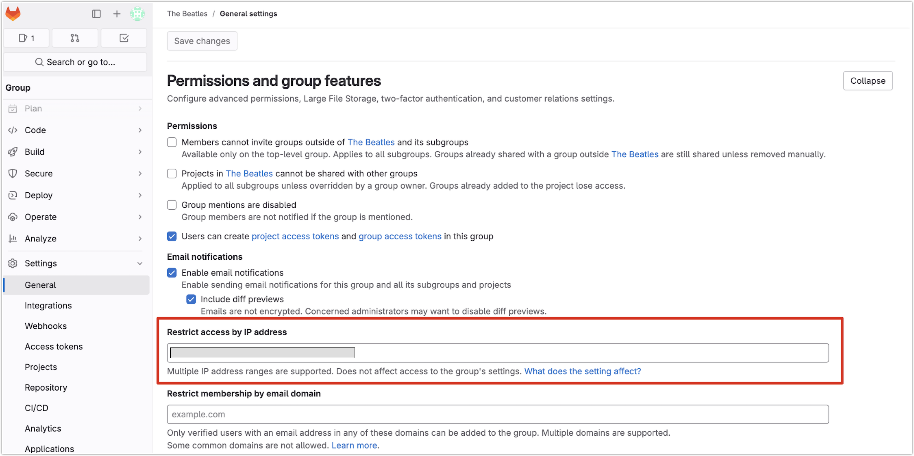

# GitLab Integration Guide

Source: https://help.drata.com/en/articles/5188769-gitlab-integration-guide
Collection: Connection Support › Version Control Guidance
Updated: 2026-08-05
Fetched: 2026-11-22
Description: Learn how to connect GitLab to Drata.

## Article text

The **GitLab integration** enables security, compliance, and engineering teams to monitor version control access and development workflow practices. It connects Drata to your GitLab environment so your team can automatically collect evidence and validate that software development lifecycle procedures follow compliance requirements.

## Key Capabilities

- **User Access Monitoring:** Track GitLab users and group memberships to ensure only authorized employees have access to version control
- **Repository & Project Visibility:** Monitor projects and contributors to validate development activity and access controls
- **Branch Protection Monitoring:** Verify branch protection settings used to restrict production code changes

This integration is used to automate tests such as **Only Authorized Employees Access Version Control** and **Formal Code Review Process**, helping prove compliance with **secure development lifecycle and access control policies**.

---

## Prerequisites & Data Access

Before connecting GitLab to Drata, ensure the following requirements are met:

- **GitLab access level:** The GitLab account used to connect Drata must have admin access to your company’s GitLab account, including the in-scope Groups and Projects you want Drata to monitor.
- **GitLab subscription (optional):** If you use **GitLab Premium or Ultimate**, you can restrict group access by IP address.
   
- **IP allowlisting (if enabled):** If group access is restricted by IP address, you must allowlist **Dratabot’s IP addresses**. Refer to the [Dratabot help article](dratabot.md) for the latest IP addresses.
- **Multi-Factor Authentication configuration:** If your organization enforces MFA, ensure it is properly configured in GitLab. Refer to your GitLab MFA configuration guidance if needed.
- **Required Drata Role with Write access:**
   - Admin
   - Workspace Managers
   - DevOps Engineer
- **Access Reviewers:** Access Reviewers can view the connection page but cannot modify connection settings.

### Permissions & Data Table

| Permission/Scope | Why It’s Needed |
|---|---|
| View Groups | Allows Drata to retrieve GitLab group information |
| View Users | Allows Drata to retrieve user accounts for monitoring |
| View Projects | Allows Drata to monitor repositories and project activity |
| View Project Members | Allows Drata to verify which users have access to projects |
| Branch protection settings | Allows Drata to verify branch protection controls |
| read_api (PAT option) | Allows Drata to retrieve GitLab API data |
| read_user (PAT option) | Allows Drata to retrieve GitLab user information |

---

## Step-by-Step Setup

### Step 1: Verify GitLab Access

1. Log in to your **GitLab** account.
2. Verify that you have access to the **Groups and Projects** that should be monitored by Drata.

Expected outcome:
Your GitLab account has the required permissions to authorize the integration.

---

### Step 2: Configure IP Allowlisting (If Enabled)

If your GitLab organization restricts group access by IP address:

1. Locate the **Dratabot IP addresses** listed in the Dratabot help article.
2. Add these IP addresses to your **GitLab group IP allowlist**.

Expected outcome:
Drata can access GitLab if IP restrictions are enabled.

---

### Step 3: Review MFA Configuration

If MFA is enforced in your GitLab environment, verify that it is configured correctly.

Important considerations:

- If a user belongs to a group **without MFA enabled**, the user will appear as **not having MFA enabled** in the **Manage Connected Version Control Accounts** page in Drata.
- This will cause the user to fail **Test 87 – MFA on Version Control System**.

If MFA is enforced at the **parent group level** and subgroups cannot define their own MFA settings:

- Remove the user’s **direct membership** from the subgroup.
- Ensure the user remains a member through **inherited membership from the parent group**.
- After the next user sync, the MFA status should update correctly.

This behavior occurs because the **GitLab API may incorrectly report subgroup MFA status**, even when MFA is inherited from a parent group.

Expected outcome:
GitLab users are correctly reported with MFA enabled in Drata.

---

### Step 4: Verify Direct Group Membership

Drata syncs **only users with direct group membership**.

Users who are only direct members of **projects** or members through **inherited group membership **may not sync correctly.

To verify group membership:

1. Navigate to the relevant **Project** in GitLab.
2. In the left-hand menu, select **Manage → Members**.
3. Review the **Source** column in the member list.
4. Confirm whether membership is listed as **Direct** or **Inherited**.

Expected outcome:
Users that should be monitored by Drata have **direct membership in the appropriate group**.

---

### Step 5: Connect GitLab in Drata

1. Log in to **Drata** → go to the **Connections** page.
2. Navigate to your available connections.
3. Search for and start the **GitLab **connection process.

Expected outcome:
Your GitLab environment is successfully connected to Drata.

---

### Step 6: Choose an Authentication Method

### OAuth (Recommended)

OAuth is the primary way to connect GitLab to Drata. It grants read-only access to the following data:

- Groups
- Users
- Projects
- Project members
- Branch protection settings

### Personal Access Token (Optional)

Alternatively, you can connect using a **Personal Access Token (PAT)**. This option is **disabled by default**.

If you want to use PAT authentication:

1. Contact **Drata Support** to enable the PAT authentication method.
2. Generate a **Personal Access Token** in GitLab with the following permissions:
   - `read_api`
   - `read_user`
3. Enter the token when completing the connection in Drata.

Expected outcome:
GitLab authenticates successfully with Drata.

---

## Important Notes

- **User sync behavior:** Drata syncs only users with **direct group membership**, not users who are only project members or users with inherited-only membership.
- **GitLab API limitation:** GitLab’s REST API may incorrectly report that MFA is disabled for subgroups even when MFA is inherited from the parent group.
- **MFA configuration edge case:** If subgroups are allowed to define their own MFA settings, ensure **MFA is enabled on every subgroup**. Any direct member of a subgroup without MFA will appear as not having MFA enabled in Drata.

## Images

- [image 01] ../../images/integrations/gitlab/gitlab-integration-guide--01.png

## Related articles

- [GitLab Issues Integration Guide](gitlab-issues-integration-guide.md)
- [GitLab MFA configurations](gitlab-mfa-configurations.md)
- [GitLab self-managed Integration Guide](gitlab-self-managed-integration-guide.md)
- [GitLab Issues (Self-Managed) Integration Guide](gitlab-issues-self-managed-integration-guide.md)
- [GitLab VMS Integration Guide](gitlab-vms-integration-guide.md)
