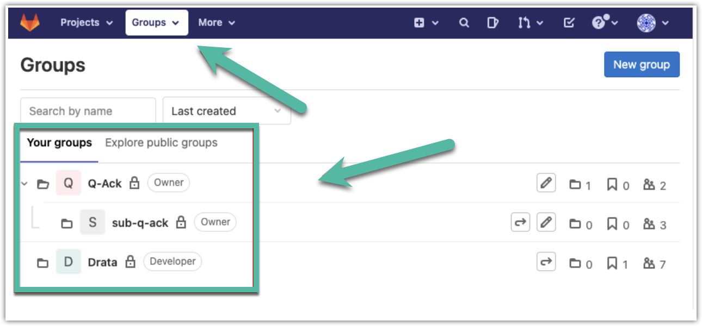
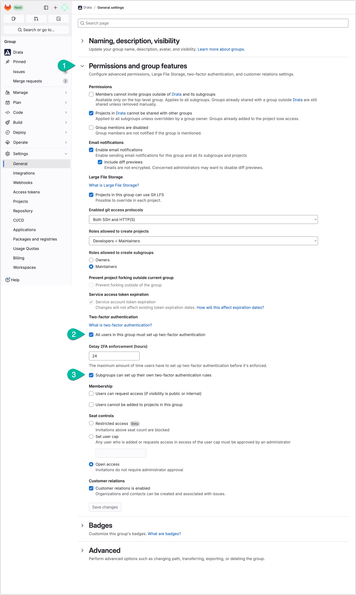
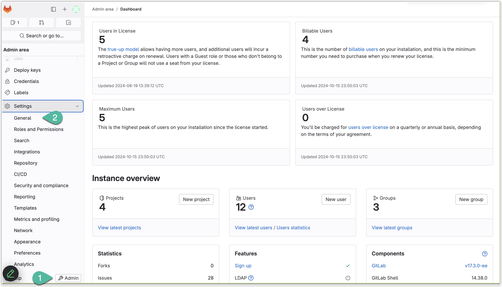
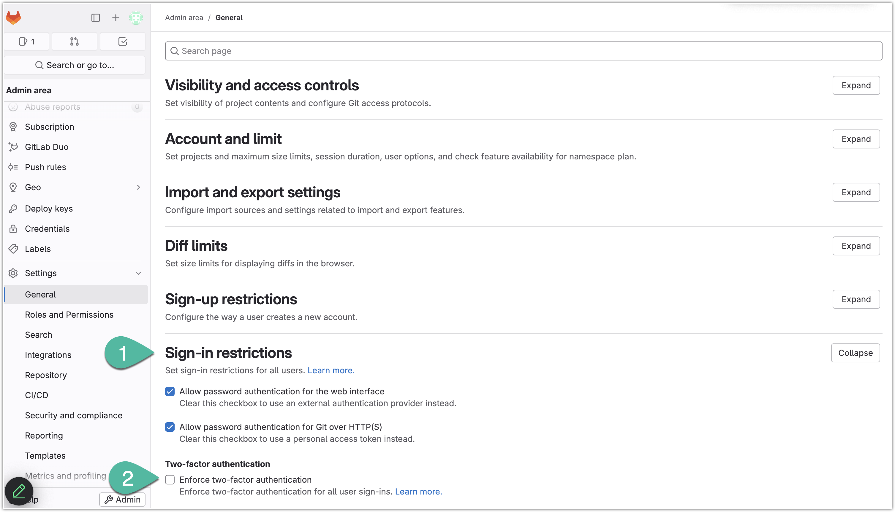

# GitLab MFA configurations

Source: https://help.drata.com/en/articles/5362488-gitlab-mfa-configurations
Collection: Understand the Drata Platform › Connections
Updated: 2026-08-05
Fetched: 2026-11-22
Description: GitLab MFA options for GitLab.com and Self-managed

## Article text

Drata can automatically map MFA data from GitLab to your users in Drata in the following ways.

### GitLab.com

**Option 1: **

MFA status can be enforced at the group level in GitLab. It can also be enforced at the subgroup level if the **"Subgroups can set up their own two-factor authentication rules"** option is selected.

- Select a group or subgroup from your dashboard.
   
- Then, navigate to your group's settings in the sidebar, scroll to and expand the "**Permissions and group features**" section.
   - Select the "**All users in this group must set up two-factor authentication**" and "**Subgroups can set up their own two-factor authentication rules**" options.
      

For more information, reference the [GitLab article](https://docs.gitlab.com/ee/security/two_factor_authentication.html#enforce-2fa-for-all-users-in-a-group) for more details.

### GitLab Self-managed

**Option 2:**

Drata can verify each user's MFA enablement settings through an API. To enable this APIs, the initial connection must be made by a user with an **administrator role**.

**Option 3:**

Drata can lookup the system level setting "Enforce two-factor authentication" to determine MFA for every user. Though in order for Drata to have access to these APIs, a user with an **administrator role** must have made the initial connection.

1. Select the **Admin **button on the bottom left corner of the system, and then select the general settings.
   
2. Navigate to and expand the "**Sign-in restrictions**" section. Then, select the "**Enforce two-factor authentication**" option.
   

## Images

- [image 01] ../../images/integrations/gitlab/gitlab-mfa-configurations--01.png
- [image 02] ../../images/integrations/gitlab/gitlab-mfa-configurations--02.png
- [image 03] ../../images/integrations/gitlab/gitlab-mfa-configurations--03.png
- [image 04] ../../images/integrations/gitlab/gitlab-mfa-configurations--04.png

## Related articles

- [Test 86: MFA on Identity Provider](test-86-mfa-on-identity-provider.md)
- [Test 87: MFA on Version Control System](test-87-mfa-on-version-control-system.md)
- [GitLab Integration Guide](gitlab-integration-guide.md)
- [GitLab self-managed Integration Guide](gitlab-self-managed-integration-guide.md)
- [GitLab Issues (Self-Managed) Integration Guide](gitlab-issues-self-managed-integration-guide.md)
