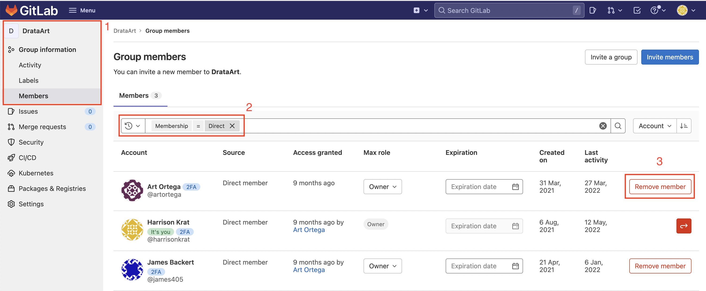
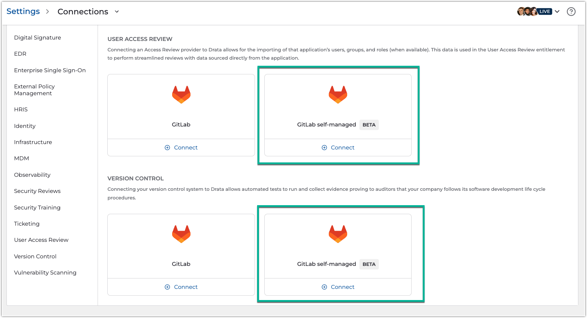

# GitLab self-managed Integration Guide

Source: https://help.drata.com/en/articles/9777474-gitlab-self-managed-integration-guide
Collection: Connection Support › Version Control Guidance
Updated: 2026-09-15
Fetched: 2026-11-22

## Article text

The **GitLab integration** allows **Engineering and Security teams** to automate evidence collection and monitoring of source control access, branch protection, and MFA compliance. By connecting GitLab to Drata, your organization can continuously prove adherence to software development lifecycle (SDLC) policies.

## Key Capabilities

- **Automated SDLC compliance verification:** Collects evidence for development and change control procedures.
- **Continuous monitoring:** Syncs users, projects, and access configurations for compliance tracking.

## Prerequisites & Data Access

- If your GitLab instance is not publicly available, please configure your network device with the following information.
   - Configure your network device to add the following IP address to port `443`. The configuration is based on your internal network layout.
      - Contact your IT team to configure and add the following IP addresses based on your region.
      - North America:
         - 54.190.125.76
         - 35.83.232.49
         - 35.164.233.77
         - 44.230.111.50
         - 3.132.55.182
         - 3.16.197.217
         - 3.18.141.25
         - 35.83.80.119
         - 18.119.62.253
         Europe:
         - 18.196.253.2
         - 3.73.237.1
         - 3.64.113.104
         - 46.51.157.29
         - 52.50.71.20
         - 52.211.226.244
         - 18.193.229.148
         - 52.210.236.236
         APAC:
         - 13.239.191.9
         - 3.105.164.211
         - 54.66.177.145
         - 16.51.144.163
         - 16.51.96.18
         - 16.26.10.156
         - 13.210.104.129
         - 16.50.132.11
      - To learn more, go to the following external resources:
         - [Control traffic to subnets using network ACLs](https://docs.aws.amazon.com/vpc/latest/userguide/vpc-network-acls.html)
         - [Control traffic to your AWS resources using security groups](https://docs.aws.amazon.com/vpc/latest/userguide/vpc-security-groups.html)
         - [NAT gateways](https://docs.aws.amazon.com/vpc/latest/userguide/vpc-nat-gateway.html)

---

- Make sure you have at [least 'Maintainer' access](https://docs.gitlab.com/ee/user/permissions.html) to your company's GitLab account, including your in-scope Groups and Projects.
- Ensure you provide a personal access token when connecting to GitLab. OAuth is not supported currently. The necessary permissions are:
   - **`read_api`**
   - **`read_user`**
- Officially supported GitLab versions are:
   - `17.x-ee`
   - `17.x-ce`
- Unofficially supported GitLab versions are:
   - `16.x-ee`
   - `16.x-ce`
- Note: For the **Community Edition (CE)**, for test 8: Formal Code Review Process & Test 9: Production Code Changes Restricted, these tests will always fail. This is a license and feature restriction of GitLab. We recommend to upgrade to a Premium/Ultimate version, or disable the tests.
   - Details on why there is a limitation on CE:
      - The REST endpoints that expose project/MR approval **settings** (for example `GET /projects/:id/approvals` and the Merge Request **approval settings** API) are **Premium/Ultimate-only** and were moved behind the paid tier starting with GitLab 13.9. They aren’t available in CE/Free, so there’s nothing to read via REST.
      - The related GraphQL fields (`approvalRules`, project/MR approval settings objects) are also tied to the same licensed feature set, so they won’t return data on CE either. (GitLab’s own MR adding those fields targets approvals features that are Premium.)
      - In CE/Free, “approvals” exist but are **optional**; you can’t set or enforce a required count, so the “required approvals” value is effectively **0**. That’s why there’s no CE API surface to fetch a non-existent required-approvals configuration.

---

- **MFA requirement**: For enabling MFA, please reference our [GitLab MFA configurations](gitlab-mfa-configurations.md) article.
   - If a user belongs to a group without MFA enabled, that user will appear as not having MFA in **Manage Connected Version Control Accounts** page in Drata.
   - This will also cause them to fail Test 87 - MFA on Version Control System.

- **Enforce MFA sync:**
   - If MFA is enforced at the parent group level and subgroups are not allowed their own MFA setting, remove the user’s direct membership from the subgroup (ensuring they remain a member through inherited membership). After the next user sync, the MFA status will update correctly.
      - This is because, even though the GitLab UI indicates that the subgroup MFA is inherited from the parent group, their API returns that the subgroup doesn't have MFA turned on. Even if 2-Factor Authentication (2FA) is enforced at the parent group level and subgroups are not allowed their own 2FA settings, the GitLab REST API will still incorrectly report that 2FA is not enabled for those subgroups.
   - If you allow subgroups to set their own MFA, users can have both direct and inherited membership, but you must ensure MFA is enabled for every subgroup. Any direct member of a subgroup without MFA will show as not having MFA, regardless of other settings or memberships.

**Verify members group membership:**

You can scroll through both the group members list to find direct membership, as well as perform an actual filter/search.

Drata syncs only users with direct group membership, not those who are only direct members of projects or with inherited group membership. To verify a member's group membership, follow these steps:

1. Navigate to the relevant Project.
2. In the left-hand menu under **Manage** select **Members.**
3. Verify "direct" or "inherited" under the **Source** column in the group member list.

## Connect GitLab self-managed

For GitLab self-managed, the process is similar to connecting to GitLab.

1. Go to the **Connections** page.
2. Select the **Available connections **tab, then search for "GitLab self-managed" and select connect.
   
3. Enter the two additional details:
   - **Hostname:** Enter the hostname for your self-managed GitLab instance. This is typically the URL of your GitLab server (for example, `https://gitlab.yourcompany.com`)
   - **Personal Access Token (PAT):** Generate a Personal Access Token (PAT) in your GitLab instance with the necessary permissions (listed below). Then, enter the token in the corresponding field in Drata.
      - Necessary permissions for PAT:
         - **`read_api`**
         - **`read_user`**

## Images

- [image 01] ../../images/integrations/gitlab-self-managed/gitlab-self-managed-integration-guide--01.png
- [image 02] ../../images/ux/connections/gitlab-self-managed-integration-guide--02.png

## Related articles

- [Microsoft 365 Integration Guide](microsoft-365-integration-guide.md)
- [GitLab Integration Guide](gitlab-integration-guide.md)
- [GitLab MFA configurations](gitlab-mfa-configurations.md)
- [GitLab Issues (Self-Managed) Integration Guide](gitlab-issues-self-managed-integration-guide.md)
- [GitLab VMS Integration Guide](gitlab-vms-integration-guide.md)
