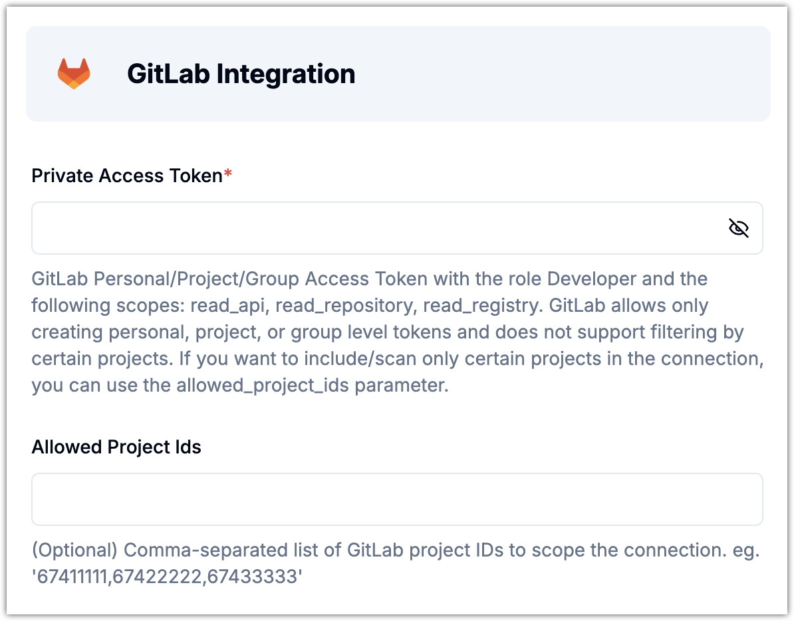

# GitLab VMS Integration Guide

Source: https://help.drata.com/en/articles/13563755-gitlab-vms-integration-guide
Collection: Connection Support › Other Guidance
Updated: 2026-07-27
Fetched: 2026-11-22
Description: Connection type: Vulnerability

## Article text

The **GitLab integration** enables security and compliance teams to automatically collect vulnerability data from GitLab projects. It connects Drata to GitLab so your team can continuously monitor code, dependency, secret, and container vulnerabilities and use this evidence to support ongoing compliance.

## Key Capabilities

- **Automated Data Retrieval**: Imports findings from supported scanning tools
- **Evidence support:** Provides vulnerability data used in Drata’s automated evidence collection for vulnerability scanning tests mapped to DCF-18.
- **Read-only access**: Retrieves vulnerability metadata without triggering or modifying scans

## Prerequisites & Data Access

- GitLab **Project, Group, or Personal Access Token**
- Required GitLab role: **Developer** (for the token’s associated user)
- Required GitLab scopes:
   - `read_api`
   - `read_repository`
   - `read_registry`
- Access to the GitLab projects you want Drata to monitor
- Must be assigned one of the following Drata roles: **Admin, Workspace Managers, DevOps Engineer**.
- If you have the **Access Reviewer** Drata role, you can only view the Connections page.

**Important Note about Sync duration:**

- The initial sync may take additional time depending on how many vulnerabilities exist in your environment.
- Drata retrieves up to **1,000 new findings per day**. If your environment contains more than 1,000 findings, only the first 1,000 will be included in each daily sync, based on the scope you configured when connecting.
- Any remaining findings are synced (up to a 1,000) during the next daily update. The order in which findings sync is determined by the scope you configured during the connection setup.

### Permissions & Data Table

| **Permission / Scope** | **Why It’s Needed** | **Data Accessed (Read Only)** |
|---|---|---|
| `read_api` | Retrieve vulnerability and project metadata | Vulnerability findings, project identifiers |
| `read_repository` | Analyze repository-level findings | Code, dependency, and secret findings |
| `read_registry` | Access container image metadata | Container vulnerability findings |

---

## Step-by-Step Setup

### Step 1: Create an Access Token

Create **one** of the following GitLab access tokens to authenticate the integration:

- **(Recommended) Project Access Token (Least Privilege)**
   - Limits access to a **single GitLab project**
   - Ideal when monitoring only one project
- **Group Access Token**: Grants access to all projects in the group
- **Personal Access Token**: Grants access to all projects the user is a member of

**Requirements**

- Role: Developer
- Scopes: `read_api`, `read_repository`, `read_registry`
- Set the expiration date to the **maximum allowed**
- Save the token securely — it will not be visible again

**Expected outcome:** You have a valid GitLab access token that Drata can use to connect to GitLab.

---

### Step 2: (Optional) Identify Project IDs

If you are using a Group or Personal Access Token and want to restrict scanning to specific projects, collect the **Project IDs**.

To find a Project ID:

1. Open the project in GitLab
2. Select **Actions (⋯)** on the project overview page
3. Click **Copy project ID **or navigate to **Settings → General**

Create a comma-separated list (example):

```
67411111,67422222,67433333
```

**Expected outcome:** You have a list of GitLab Project IDs that limit which projects Drata can access.

---

### Step 3: Connect inside Drata

1. In Drata, go to **Connections** .
2. Go to your available connections and search and choose to connect  GitLab. Ensure it is the correct type (Vulnerabilities) of connection.
3. Select the following configurations:
   - **Severity of vulnerabilities:** Choose the severity levels you want to import (Critical, High, Medium, Low).
   - **Date:** Select the date from which vulnerabilities should be pulled.
   - **Private Access Token**: Your GitLab access token
   - **Allowed Project Ids (optional)**: Comma-separated Project IDs to restrict access. If `allowed_project_ids` is not set, all projects accessible by the token will be scanned.



**Expected outcome:** The GitLab integration is connected using the access and project scope you specified.

---

### Step 4: Validate connection / test

1. Confirm the connection card shows **Connected** in Drata.
2. Navigate to **Vulnerabilities** to confirm findings are being populated.
3. Drata shows *findings*, which are instances of *vulnerabilities* (an individual but higher-level CVE) against specific resources. This may reflect as higher finding counts in Drata vs. your GitLab VMS dashboard.
4. Validate that only scoped resources appear, if you restricted the API token's access.

**Expected outcome:**
Vulnerabilities appear inside Drata and can be used to support applicable vulnerability scanning tests.

---

## Images

- [image 01] ../../images/integrations/gitlab/gitlab-vms-integration-guide--01.png

## Related articles

- [GitLab Integration Guide](gitlab-integration-guide.md)
- [GitLab Issues Integration Guide](gitlab-issues-integration-guide.md)
- [Aikido Integration Guide](aikido-integration-guide.md)
- [GitLab Issues (Self-Managed) Integration Guide](gitlab-issues-self-managed-integration-guide.md)
- [Orca Security Integration Guide](orca-security-integration-guide.md)
