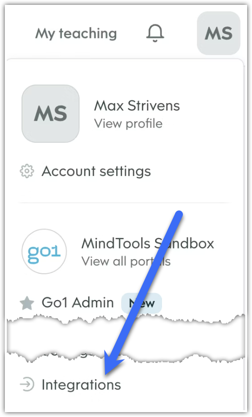

# GO1 Integration Guide

Source: https://help.drata.com/en/articles/12590635-go1-integration-guide
Collection: Connection Support › Other Guidance
Updated: 2025-10-19
Fetched: 2026-11-22

## Article text

## Prerequisites & Data Access

- **Account / Role Needed: **Admin privileges for your GO1 account.
- Client ID and Client Secret generated in GO1 Developer settings

## Step-by-Step Setup

### Step 1: Create Integrations App

1. Log in to your **GO1 account** using an Admin user.
2. Click User account and then **Integrations** from the dropdown
   
3. In the left navigation menu, click **Developers**
4. Click **Create App**
5. Enter:
   - App Name (e.g., “Drata Integration”)
   - Callback URL:

```
https://api.stackone.com/connect/oauth2/go1/callback
```

Click **Create Application **and record the **`Client ID`** and **`Client Secret`** .

### Step 2: Find GO1 Domain

- From your GO1 URL:
   ```
https://my-company.go1.com → Domain = my-company
   ```

### Step 3: Connect GO1 Account to Drata

1. In Drata go to **Connections page **and find **GO1.**
2. Enter:
   - Client ID
   - Client Secret
   - GO1 Domain

## Images

- [image 01] ../../images/integrations/go1/go1-integration-guide--01.png

## Related articles

- [Zelt Integration Guide](zelt-integration-guide.md)
- [Egnyte Integration Guide (UAR)](egnyte-integration-guide-uar.md)
- [RingCentral Integration Guide](ringcentral-integration-guide.md)
- [Databricks Integration Guide (UAR)](databricks-integration-guide-uar.md)
- [Docebo Integration Guide](docebo-integration-guide.md)
