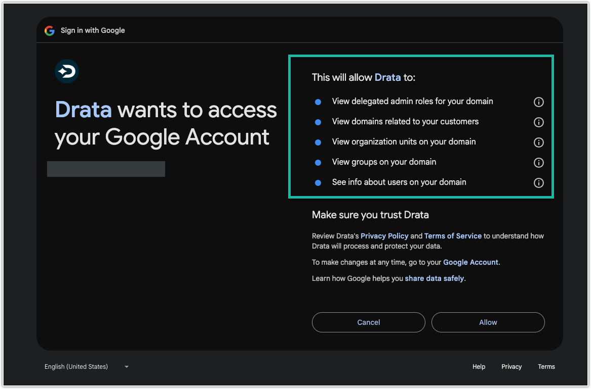

# Google Workspace Integration Guide

Source: https://help.drata.com/en/articles/4663303-google-workspace-integration-guide
Collection: Connection Support › Identity (IdP) Guidance
Updated: 2026-09-28
Fetched: 2026-11-22
Description: Learn how to connect Google Workspace to Drata as an Identity Provider (IdP).

## Article text

The Google Workspace integration enables your security and compliance teams to automate personnel syncing into Drata and monitor access-related identity controls. Connecting to Google Workspace establishes Drata’s source of truth for user identities and is required to enable SSO and access-based test automation.

## Key Capabilities

- **Personnel sync**: Continuously imports users and groups into Drata, populating the Personnel page with identity source-of-truth data.
- **Control support**: Enables authentication-related compliance controls (e.g., MFA enforcement, unique email)
- **Foundational for SSO**: Single Sign-On (SSO) cannot be configured until an IdP is connected

## Prerequisites

**Drata role requirement**

Admin, Workspace Manager, or DevOps Engineer. Access Reviewers can only view the Connections page

## Step-by-Step Setup

Choose the setup method that matches your organization’s admin model:

- **OAuth-based access** *(Recommended)*: If your organization can assign the following Google roles to user accounts, you can set up the connection using OAuth-based access scoped to these roles:
   - User Management Administrator
   - Group Admin
   - Directory Sync Admin
- **Super Admin access**: If your organization relies on a super admin, you can use the traditional service account method, which requires setting up domain-wide delegation.

Note: For either process, if the email domain used to sign in to Drata does not match your Google Workspace domain, contact Drata Support to enable personnel sync.

## Option 1: OAuth-Based Setup (Recommended)

This setup uses OAuth 2.0 and a user’s assigned admin roles to authorize Drata to access **read-only directory data** (users, groups, org units, and domains). This is the recommended approach for easier setup and least-privilege access.

### Prerequisites

- You must sign in with a **Google Workspace admin account** to authorize the connection.
- The user authorizing the connection must have the following **roles assigned** in Google Workspace:
   - **User Management Administrator**
   - **Group Admin**
   - **Directory Sync Admin**

**Optional: Custom role**

Instead of the predefined roles, you may utilize a custom role. It must include the following privileges:

- `user.read`
- `group.read`
- `organizational.read`
- `domain settings`

### Step 1: Verify Roles in Google Admin

1. Sign in to the [Google Admin console](https://admin.google.com/).
2. Go to **Directory > Users**.
3. Select the user who signs into and connects Drata.
4. Confirm that the user has the following roles assigned to them. You can verify this within Google's **Admin roles and privileges** section.
   - **User Management Administrator**
   - **Group Admin**
   - **Directory Sync Admin**
5. If the user has a custom role, ensure they have the
   - `user.read`
   - `group.read`
   - `organizational.read`
   - `domain settings`

### Step 2: Enable the Google Workspace Connection in Drata

1. Navigate to the available connections on your Connections page
2. Filter by Identity category.
3. Search for **Google Workspace** and start the connection process

You will be redirected to Google Workspace to sign in and accept the permissions shown in the next section.

### Step 3: Permissions Requested During OAuth Connection

When authorizing, Google presents the permissions requested by Drata. All are **read-only** and used solely for syncing identity and domain data.

Here’s what each permission means and why it’s requested:

| **Permission** | **Access Request** | **Benefit** |
|---|---|---|
| **View delegated admin roles for your domain** | Read data from users used in the Identity sync process. | Drata displays and persists the data on the Personnel page. |
| **View domains related to your customers** | Enable Drata to read verified domains in your Google Workspace account. | Drata uses this to support domain-based personnel filtering. |
| **View organization units on your domain** | Enable Drata to read OrgUnit assignments in your Google Workspace. | Drata uses this to support OrgUnit-based personnel filtering. |
| **View groups on your domain** | Enable Drata to read group membership data in your Google Workspace. | Drata uses this to support group-based personnel filtering. |

### More context: View domains related to your customers

Google’s API uses the term *“customers”* to describe both internal admins and external organizations. In Drata’s case, this permission only applies to **your verified Workspace domains**, not external accounts.

Drata uses this permission exclusively to:

- Identify and sync domains linked to your Workspace account.
- Support accurate user and identity mapping for compliance.

This permission is read-only; Drata does not modify your domain configuration. For more information, [view the Google API documentation](https://developers.google.com/identity/protocols/oauth2/scopes?utm_source).

---

## Option 2: Super Admin access

This setup uses a **Google Workspace super admin account** and **domain-wide delegation** to grant Drata access via a service account. This is a more traditional setup and provides persistent access across all users.

### Prerequisites

- Access to a **Google Workspace super admin account**
- Permission to configure **domain-wide delegation** in the Google Admin console

### Step 1: Set Up Domain-Wide Delegation

1. Sign in to the [Google Admin console](https://admin.google.com/) using a super admin account.
2. Go to **Security > Access and data control > API controls**.
3. Scroll to **Domain wide delegation** and select **Manage Domain Wide Delegation**.
4. Select **Add New**.
5. **Drata Autopilot client ID**: Copy and paste the client ID (`118095967747130880411`) into the Client ID field in Google. Google uses the client ID to verify if the client is registered within the Google workspace account.
6. Leave the **Overwrite existing client ID** checkbox un-checked.
7. **Google Read Only Scopes**: Copy and paste the following scopes into the OAuth Scopes field in Google. These give permission for Drata to sync users, groups that the users belong to, and the organization a project belongs to. Learn more about setting scopes through domain-wide delegation at [Create access credentials](https://developers.google.com/admin-sdk/directory/v1/guides/delegation) and [Control API access with domain-wide delegation](https://knowledge.workspace.google.com/admin/apps/control-api-access-with-domain-wide-delegation?visit_id=639184522877781322-687359861&rd=1).
   - `https://www.googleapis.com/auth/admin.directory.user.readonly`
   - `https://www.googleapis.com/auth/admin.directory.group.readonly`
   - `https://www.googleapis.com/auth/admin.directory.orgunit.readonly`
   - `https://www.googleapis.com/auth/admin.directory.domain.readonly`
8. Leave the **Overwrite existing client ID** box unchecked.
9. Select **Authorize**.

### Step 2: Enable the Google Workspace Connection in Drata

1. Navigate to the available connections on your Connections page
2. Filter by Identity category.
3. Search for **Google Workspace** and start the connection process
4. During the connection process, enter the **email address of the super admin** used in the previous step

You will be redirected to Google Workspace to sign in and accept the permissions shown in the next section.

---

## Syncing Personnel

After connecting Google Workspace to Drata, complete steps to configure which personnel should be synced into your Drata environment. By default, Drata performs silent syncing during personnel sync, ensuring that users are not notified unless explicitly prompted by an administrator. This feature helps maintain a seamless user experience during the sync process.

### Step 1: Resolve Email Mismatches (if prompted)

If any **Drata admins** are not found in your Google Workspace during the initial sync, you’ll see a prompt to resolve **email mismatches**.

### Step 2: Choose Which Domains to Sync

Choose whether to sync only users whose email matches your selected domain, or sync all users from your Google Workspace regardless of domain.

### Step 3: Choose Which Groups to Sync (Recommended)

Use group-based filtering to narrow the sync scope to specific organizational groups.

- **Specific Groups**: Select one or more groups by name.
   - Drata only syncs **top-level members** of the specified groups.
   - **Nested groups are not supported**. Subgroup members will not be synced.
   - Ensure the group includes your Drata administrator.
   - Any users not included in group(s) will not be synced to Drata
   - If personnel are already synced via this connection, removing a user from the group(s) can move them to Former Employee status.
- **All personnel**: Syncs all users matching the selected domain(s), without filtering by group.

### Step 4: Save and Sync

Once you’ve selected the domains and groups to sync:

- Click **Confirm** to save your configuration.
- Drata will begin syncing personnel based on your settings.
- Initial sync may take up to **1 hour** depending on the size of your organization.

## Images

- [image 01] ../../images/integrations/google-workspace/google-workspace-integration-guide--01.png

## Related articles

- [GCP Integration Guide (Script Setup)](gcp-integration-guide-script-setup.md)
- [GCP Integration Guide (Manual)](gcp-integration-guide-manual.md)
- [Google Workspace Integration Guide (User Access Reviews)](google-workspace-integration-guide-user-access-reviews.md)
- [PingOne Integration Guide](pingone-integration-guide.md)
- [Integrate Multiple Identity and HRIS Connections](integrate-multiple-identity-and-hris-connections.md)
