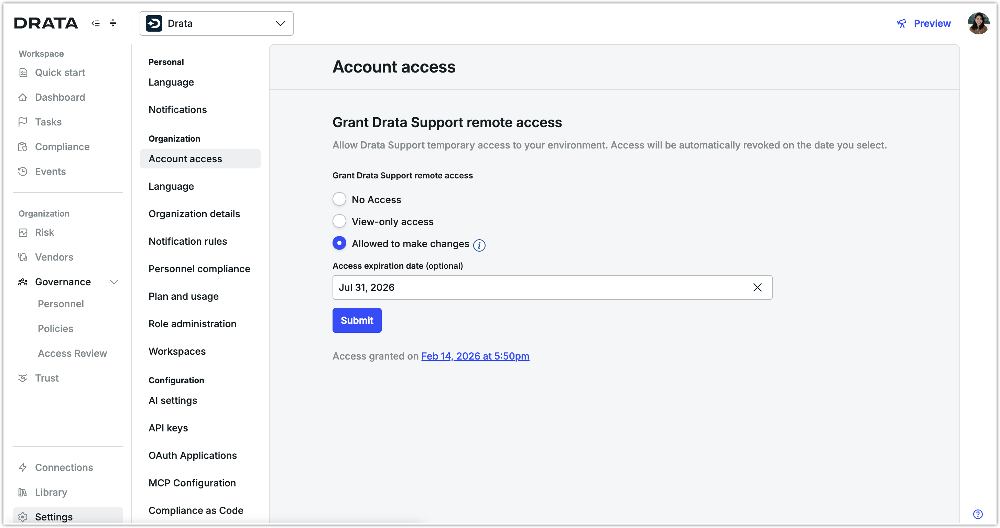

# Grant remote access to Drata Support

Source: https://help.drata.com/en/articles/13604233-grant-remote-access-to-drata-support
Collection: Getting Started › Helpful Resources › How to Get Support at Drata
Updated: 2026-11-09
Fetched: 2026-11-22
Description: Allow temporary access for troubleshooting.

## Article text

Remote access is:

- **Temporary** (time-bound)
- **Explicitly scoped** (view-only or limited edit access)
- **Used only for troubleshooting issues you report**

Remote access automatically expires based on the date and time you select.

## Prerequisites

Only Admins can manage remote access. This action is not available to other roles.

## Grant remote access

1. In the Drata app, go to **Settings**.
2. Under **Organization**, select **Account access**.
   
3. Select the **access level**.
4. Choose the **expiration date and time**.
5. Select **Submit**.

**Result:** Remote access is enabled until the selected expiration time.

## Access levels

Choose one of the following access levels when granting access:

### View only

Allows authorized Drata team members to **view your tenant** to help investigate questions or issues.

Use this when:

- You need help reviewing configurations
- You want Support to observe behavior without making changes

### Allowed to make changes

Allows a **small, authorized group** of specially trained Drata team members to **view and perform limited actions** strictly for troubleshooting.

This may include:

- Reproducing reported errors
- Validating configurations
- Investigating integration or data issues

**Important rules**

- Access is limited to troubleshooting only.
- Drata Support cannot perform routine administrative tasks on your behalf.
- Drata does not provide professional services through this access.
- Response times may take **24–48 hours** (excluding weekends and holidays) due to limited authorization.

---

## After troubleshooting

Once your issue is resolved:

- Confirm the access level is set back to **No access**, **or**
- Verify the expiration date is set appropriately

**Best practice:** Revoke access as soon as troubleshooting is complete.

---

## Security notes

- Only authorized Drata team members can use remote access.
- All activity is restricted to issue investigation.
- Access cannot be used to complete standard tasks you can perform yourself.

## Images

- [image 01] ../../images/ux/settings/grant-remote-access-to-drata-support--01.png

## Related articles

- [Resolve Authorization Errors in Drata](resolve-authorization-errors-in-drata.md)
- [Set up OAuth for the Drata API](set-up-oauth-for-the-drata-api.md)
- [Get support from Drata](get-support-from-drata.md)
- [Drata Support: Conversations vs. Tickets](drata-support-conversations-vs-tickets.md)
- [Troubleshooting Identity Sync Issues in Drata](troubleshooting-identity-sync-issues-in-drata.md)
