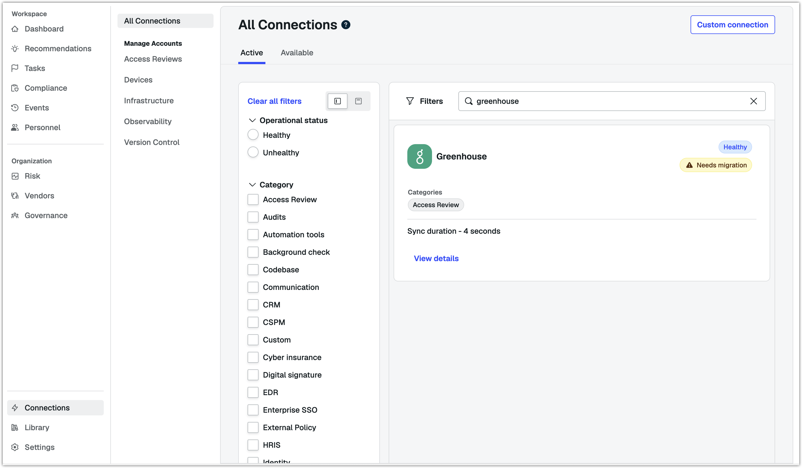
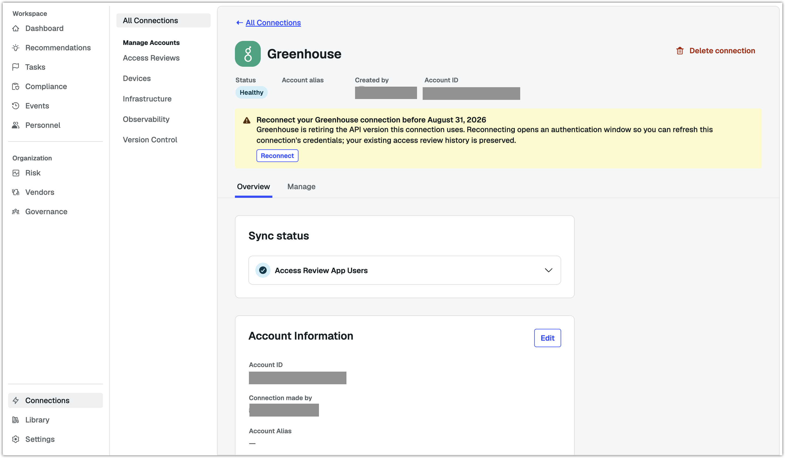
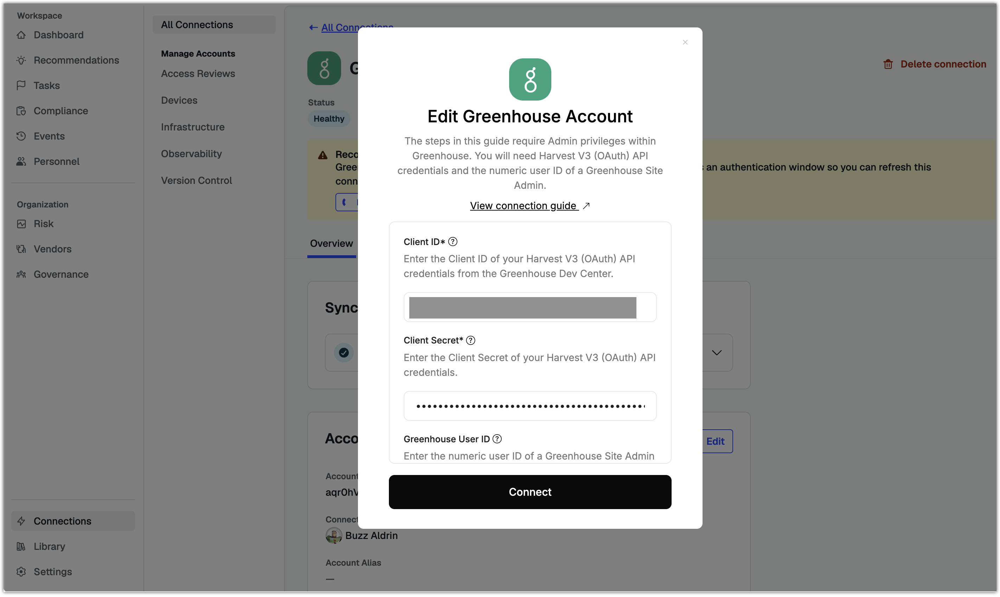

# Greenhouse Integration Guide

Source: https://help.drata.com/en/articles/9300574-greenhouse-integration-guide
Collection: Connection Support › Other Guidance
Updated: 2026-11-10
Fetched: 2026-11-22
Description: Learn how to reconnect your Greenhouse connection in Drata using Harvest v3 (OAuth). This connection supports the following types: User Access Reviews (UAR).

## Article text

Greenhouse is retiring its Harvest v1/v2 API on **August 31, 2026** and replacing it with Harvest v3, which uses OAuth 2.0 (a Client ID and Client Secret) instead of an API key. To keep your User Access Review data flowing after that date, reconnect your existing Greenhouse connection with new Harvest v3 (OAuth) credentials.

Reconnecting updates your **existing** connection in place. Your connection and your user access review history are preserved — you do **not** need to delete and recreate the connection, and you will not lose past or in-progress reviews.

## Before You Begin

> ⚠️ **Complete this before August 31, 2026.** 
> After that date, Greenhouse turns off the older API version, and a Greenhouse connection that has not been reconnected will stop syncing user and role data into Drata. 
>
> Greenhouse recommends being on Harvest v3 by **August 28, 2026**, a few days ahead of the cutoff.

Your existing connection keeps working normally until you reconnect, so you can complete this at any time before the deadline.

> 🔑 **Prerequisite: you must be on the new Drata experience**

## Who Can Complete This

This process spans two systems and may require **two different people** — coordinate ahead of time if the Greenhouse administrator and the Drata administrator are not the same person.

**Greenhouse access requirements**

- You must have **Site Admin** privileges in Greenhouse to create Harvest v3 (OAuth) API credentials. Only a Greenhouse administrator can generate these credentials; Drata cannot create them on your behalf.

**Drata role requirements**

- To reconnect a connection, you must have one of the following Drata roles with write access: **Admin**, **Workspace Manager**, or **DevOps Engineer**.
- **Access Reviewers** can view the connection page but cannot reconnect or modify connections.

## About User Access Reviews and Reconnecting

The Greenhouse integration automates **User Access Reviews (UAR)** by syncing Greenhouse user accounts and their assigned roles into Drata, so you can review who has access and support your access-control compliance evidence.

Because reconnecting updates your existing connection in place rather than creating a new one:

- **Your review history is preserved.** Completed access reviews and their evidence remain intact and attached to the same connection.
- **In-progress reviews are not interrupted.** You do not need to complete, pause, or restart an active review before reconnecting.
- **Role data continues to sync.** Harvest v3 returns the same user and role information as before, so access-level monitoring keeps working.

If you reconnect before your current review finishes, the review continues normally against the same connection.

## Permissions & Data

| **Permission / Scope** | **Why It's Needed** |
|---|---|
| Users | Allows Drata to retrieve user account information |
| User Roles | Allows Drata to retrieve role assignments for access review monitoring |
| Client ID & Client Secret (Harvest v3 OAuth) | Authenticates the integration under Harvest v3 |

**Note:** Under Harvest v3, the Greenhouse User ID that the previous version required is no longer needed.

## Step-by-Step: Reconnect Greenhouse

### Step 1: Create Harvest v3 (OAuth) credentials in Greenhouse

Greenhouse maintains the authoritative, up-to-date steps for creating API credentials. Follow their guide and use the settings below when you get there:

- **Greenhouse support (recommended):** [Harvest API overview](https://support.greenhouse.io/hc/en-us/articles/360029266032-Harvest-API-overview)
- **Greenhouse developer documentation:** [Harvest v3 documentation](https://harvestdocs.greenhouse.io)

When you create the credential in Greenhouse:

- Choose the **Harvest v3 (OAuth)** API type.
- Copy the **Client ID** and **Client Secret** that Greenhouse generates and store them somewhere secure. The secret may be shown only once — capture it before leaving the page.
- Grant the two permissions Drata requires: **Users** and **User Roles**.

**Expected outcome:** You have a Harvest v3 (OAuth) Client ID and Client Secret, with the Users and User Roles permissions granted.

### Step 2: Reconnect in Drata

1. Log in to Drata and go to the **Connections** page. Then, search for your Greenhouse connection.
   
2. Open your existing **Greenhouse** connection.
3. Select **Reconnect**. (A banner on the connection prompts you to reconnect before August 31, 2026.)
   
4. When prompted, enter your new **Client ID** and **Client Secret** from Step 1.
   
5. Confirm to complete the reconnection.

**Expected outcome:** Greenhouse is reconnected on Harvest v3, the "action needed" banner clears, and your user access data continues syncing without any loss of connection or review history.

## Important Notes

- **Deadline:** Reconnect before **August 31, 2026**. Your existing connection continues to work until then, but will stop syncing afterward if it is still on the older API version.
- **No re-setup required:** Reconnecting preserves your existing connection, its settings, and your user access review history. Do not delete and recreate the connection.
- **Credential handling:** Store your Client Secret securely. If it is lost, create a new Harvest v3 (OAuth) credential in Greenhouse and reconnect again.
- **Network restrictions:** If your organization uses a Web Application Firewall (WAF), ensure the required Drata IP addresses remain allowlisted so the connection can be established.
- **Harvest integration:** If you also use a separate "Harvest" integration, it is unrelated to this Greenhouse change and is not affected.

## Need More Help?

If you have questions about reconnecting your Greenhouse connection, contact Drata Support. For questions about creating Harvest v3 (OAuth) credentials inside Greenhouse, refer to [Greenhouse support](https://support.greenhouse.io/hc/en-us/articles/360029266032-Harvest-API-overview).

## Images

- [image 01] ../../images/ux/connections/greenhouse-integration-guide--01.png
- [image 02] ../../images/integrations/greenhouse/greenhouse-integration-guide--02.png
- [image 03] ../../images/integrations/greenhouse/greenhouse-integration-guide--03.png

## Related articles

- [Webex Integration Guide](webex-integration-guide.md)
- [Zelt Integration Guide](zelt-integration-guide.md)
- [Bullhorn Integration Guide](bullhorn-integration-guide.md)
- [Smartsheet Integration Guide](smartsheet-integration-guide.md)
- [Box Integration Guide](box-integration-guide.md)
