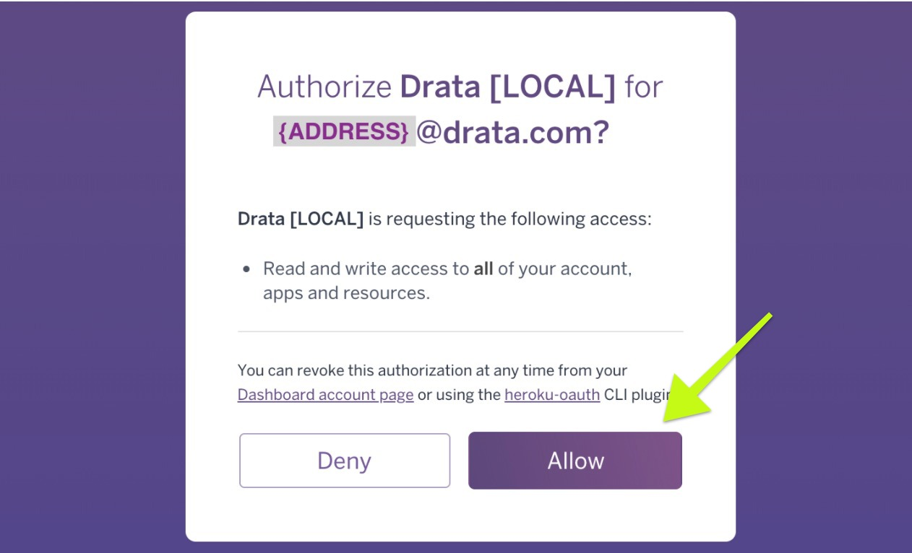

# Heroku  Integration Guide

Source: https://help.drata.com/en/articles/5155248-heroku-integration-guide
Collection: Connection Support › Infrastructure Guidance
Updated: 2026-11-14
Fetched: 2026-11-22
Description: Making the initial connection to Heroku

## Article text

Connecting Heroku to Drata allows for the automated, continuous monitoring and evidence collection of the dozens of infrastructure security controls required for compliance.

## Prerequisites & Data Access

- You must have a Heroku Enterprise plan. Your Heroku account must be on the Enterprise tier to enable Drata to retrieve multi-factor authentication (MFA) data.
- Make sure you have **Admin** access to your company's Heroku account.

## Step-by-Step Setup

### Step 1: Connect Heroku to Drata

1. In Drata, go to the **Connections** page
2. Search for and select Heroku within your available connections.
3. Start the connections process.
4. You will be taken to the Heroku app. If you're not logged in, login with your company email address.
5. Allow Drata to access your Heroku account.

## Images

- [image 01] ../../images/integrations/heroku/heroku-integration-guide--01.jpg

## Related articles

- [Test 88: MFA on Infrastructure Console](test-88-mfa-on-infrastructure-console.md)
- [DigitalOcean Integration Guide](digitalocean-integration-guide.md)
- [MongoDB Atlas Integration Guide](mongodb-atlas-integration-guide.md)
- [Azure Repos (DevOps) Integration Guide](azure-repos-devops-integration-guide.md)
- [GitHub Issues Enterprise Integration Guide](github-issues-enterprise-integration-guide.md)
