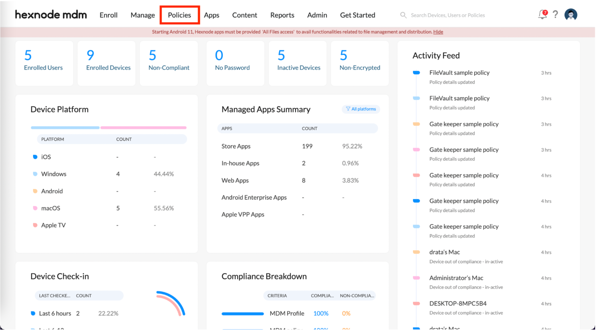
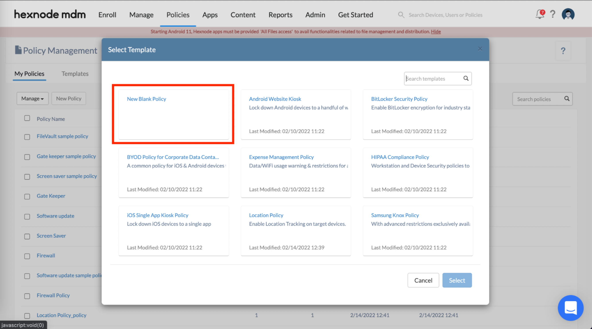
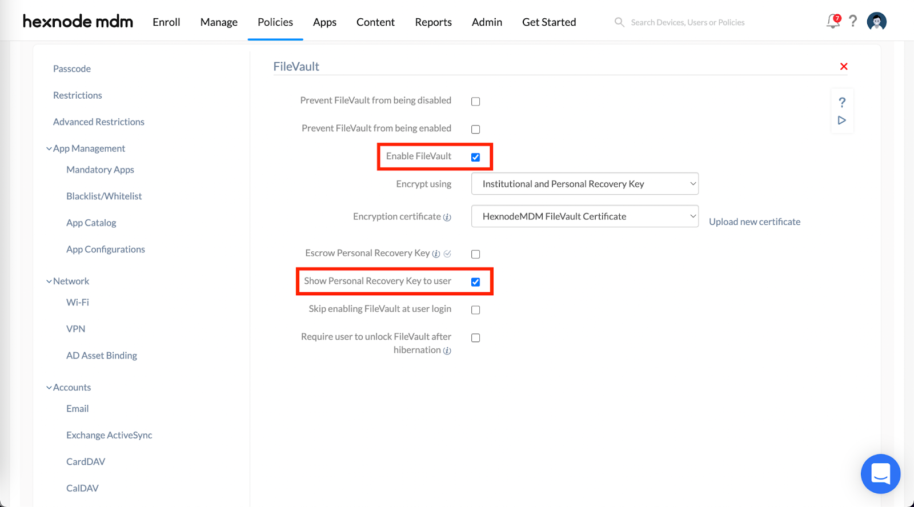

# Hexnode UEM (macOS) Integration Guide

Source: https://help.drata.com/en/articles/6063710-hexnode-uem-macos-integration-guide
Collection: Connection Support › Other Guidance
Updated: 2026-08-05
Fetched: 2026-11-22
Description: This article covers setting up Hexnode UEM and connecting that to Drata

## Article text

The Hexnode UEM integration enables security and compliance teams to monitor device compliance for macOS endpoints. It connects Drata to Hexnode so your team can verify device security configurations and collect evidence that devices meet compliance requirements.

## Key Capabilities

- Device compliance monitoring: Verify that macOS security policies are configured and applied
- Endpoint policy verification: Confirm that required policies exist and are mapped to enrolled devices
- Automated evidence collection: Sync device compliance data into Drata

This integration is used to automate tests related to endpoint security configuration, helping prove compliance with device security and endpoint protection policies.

## Prerequisites & Data Access

- **Admin access** to your organization’s Hexnode account
- **APN configured for macOS devices** in Hexnode
- Devices must be **enrolled through the Hexnode application**
- Access to the following values from Hexnode:
   - **Server URL** (used as the API URL)
   - **API Key**
- Required Drata Role with Write access: Admin, Workspace Managers, DevOps Engineer
- Access Reviewers (Access Reviewers can only Read the connection page they can’t make changes)

Important limitations:

- Currently **only desktop devices are supported**. Mobile phones and tablets cannot be imported.
- **Pre-approved enrolled devices cannot be synced**.
- Hexnode **cannot detect browser extension password managers**. If password managers are required for compliance, users must install the **desktop application** so it appears in the device’s Application List.
- The **Gatekeeper policy requires Hexnode Ultra Plan**, but this is **not required for Drata’s default checks**.

### Permissions & Data Table

| Permission/Scope | Why It’s Needed |
|---|---|
| Hexnode Admin access | Allows configuration of policies and API access |
| API Key | Allows Drata to authenticate and retrieve device compliance data |
| Server URL (API URL) | Identifies the Hexnode instance for the connection |

## Step-by-Step Setup

### Step 1: Configure Required macOS Security Policies in Hexnode

Policies must exist in Hexnode for Drata to validate compliance checks.

Drata verifies the following for each policy:

- The policy exists with the expected name or type
- The policy is assigned to the device
- The device is compliant with the policy

Policies should be created in **Hexnode → Policies → New Policy → New Blank Policy**.

### FileVault Policy

1. Log in to **Hexnode Admin**.
2. Navigate to **Policies → My Policies → New Policy**.
   
3. Select **New Blank Policy**.
   
4. Create a policy name and description.

Important:
Include **“FileVault”** in the policy name so Drata can detect it.

1. Navigate to **macOS → Security → FileVault**.
2. Select **Configure**.
3. Enable:
   - **Enable FileVault**
   - **Show Personal Recovery Key to user**
   

Expected outcome: A FileVault encryption policy exists and can be applied to devices.

---

### Firewall Policy

1. Navigate to **Policies → My Policies → New Policy**.
2. Select **New Blank Policy**.
3. Create a policy name including **“Firewall”**.
4. Navigate to **macOS → Security → Firewall**.
5. Select **Configure**.
6. Enable:
   - **Enable Firewall**
   - **Allow incoming connections**

Expected outcome: Devices have firewall protection enabled through Hexnode.

---

### Screensaver Policy

1. Navigate to **Policies → My Policies → New Policy**.
2. Select **New Blank Policy**.
3. Create a policy name including **“Screensaver”**.
4. Navigate to **macOS → Screensaver**.
5. Select **Configure**.
6. Enable:
   - **Enable Screensaver**
   - **Require Password to unlock screen**

Recommended settings:

- Login window screensaver idle time: **1 minute**
- Screensaver idle time: **1 minute**
- Password prompt delay: **Immediately**

Expected outcome: Devices lock automatically when idle.

---

### Software Update Policy

1. Navigate to **Policies → My Policies → New Policy**.
2. Select **New Blank Policy**.
3. Create a policy name including **“Software Update”**.
4. Navigate to **macOS → OS Updates**.
5. Configure **Choose your OS update settings** to **Install**.

Expected outcome: Devices automatically install OS updates.

---

### Gatekeeper Policy (Optional)

Gatekeeper configuration requires **Hexnode Ultra Plan**.

1. Navigate to **Policies → My Policies → New Policy**.
2. Select **New Blank Policy**.
3. Create a policy name including **“Gate Keeper”**.
4. Navigate to **macOS → Advanced Restrictions**.
5. Select **Configure**.

Recommended configuration:

- Device Functionality and Personalization
   - Enable all options
- Security and Privacy
   - Enable all options except **Activation lock**
- App Store
   - Leave all options unselected
- App Installation From
   - Select **Mac App Store and Identified Developers**

Expected outcome: Gatekeeper settings restrict applications to trusted sources.

## Step-by-Step Setup (Connection)

### Step 2: Retrieve Hexnode API Credentials

1. Log in to your **Hexnode Admin account**.
2. Select **Enroll** and note the **Server URL**.
   This will be used as the **API URL** in Drata.
3. Navigate to **Admin → API**.
4. Click the **lock icon** to reveal your **API Key**.
5. Copy the API Key.

Expected outcome: You have the Hexnode **Server URL** and **API Key** required for authentication.

### Step 3: Connect Hexnode in Drata

1. Log in to **Drata**.
2. Select your **company name** in the lower-left corner.
3. Navigate to **Connections**.
4. Search for **Hexnode** and start the connection process.
5. Enter the following when prompted:
   - **API URL** (include `https://`)
   - **API Token** (your Hexnode API Key)
6. Select **Save & Test Connection**.

Expected outcome:
Hexnode is successfully connected and device compliance data begins syncing to Drata.

## Step-by-Step Setup (Enable Device Automation)

### Step 4: Enable Hexnode as the Device Compliance Source

1. In Drata, navigate to **Company Settings → Internal Security**.
2. Enable **Automated via Hexnode MDM**.
3. Disable **Automated via Drata Agent** if you want Hexnode to be the primary compliance source.

Important behavior:

If **both Hexnode and the Drata Agent are enabled**, the **Drata Agent takes precedence**. Device compliance data will be sourced from the Agent instead of Hexnode.

Expected outcome: Device compliance data is collected from Hexnode MDM.

## Important Notes

- Hexnode data is synced **daily after Drata Autopilot runs**.
- Devices must be **enrolled in Hexnode** to be monitored.
- Only **macOS desktop devices** are supported at this time.
- Policy names must include expected keywords (FileVault, Firewall, Screensaver, Software Update, Gate Keeper) for Drata to detect them correctly.
- Browser extension password managers cannot be detected by Hexnode; users must install the **desktop version** for compliance checks to pass.

## Images

- [image 01] ../../images/integrations/hexnode/hexnode-uem-macos-integration-guide--01.png
- [image 02] ../../images/integrations/hexnode/hexnode-uem-macos-integration-guide--02.png
- [image 03] ../../images/integrations/hexnode/hexnode-uem-macos-integration-guide--03.png

## Related articles

- [Kandji (now Iru) Integration Guide (MDM)](kandji-now-iru-integration-guide-mdm.md)
- [JumpCloud Integration Guide (MDM)](jumpcloud-integration-guide-mdm.md)
- [Hexnode UEM (Windows) Integration Guide](hexnode-uem-windows-integration-guide.md)
- [1Password Device Trust (Kolide) Integration Guide](1password-device-trust-kolide-integration-guide.md)
- [Microsoft Intune Integration guide](microsoft-intune-integration-guide.md)
