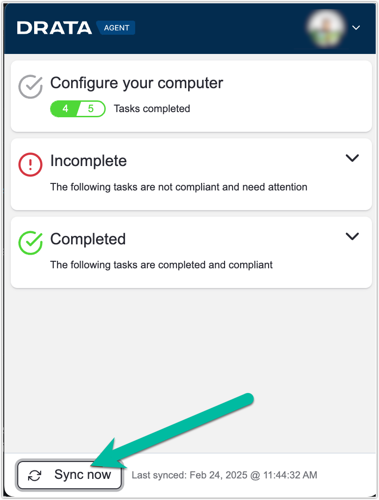

# How does the Drata agent work?

Source: https://help.drata.com/en/articles/4742932-how-does-the-drata-agent-work
Collection: Personnel Management › Drata Agent
Updated: 2026-11-14
Fetched: 2026-11-22
Description: Once installed, how does the Drata agent work on your computer?

## Article text

The Drata agent is a lightweight, **read-only** application that lives in your computer's toolbar. It's built with ElectronJS following their best practices for architecture and security. The application uses OSQuery (open source project by Facebook) to read your system information to help ensure proper security configurations are set - such as hard drive encryption, screensaver locking, antivirus software, password manager, and automatic updates are enabled. These security configurations are recommended for SOC 2.

Note, to locate antivirus and password manager details, the agent does pull a list of apps and Chrome, Firefox, and Internet Explorer browser extensions from the employee's device. The agent also recognizes the operating system and serial number of the machine for asset management purposes.

The application runs every day on your employees' computers. The agent does not modify any files or folders on your employees' machines.

The synchronization process occurs automatically on the first network connection if the device was previously turned off and 24 hours after the last successful sync. This schedule is not configurable, ensuring minimal manual intervention.

The Drata agent is now open sourced starting from June 16, 2023. You can conduct your own security assessments on the agent and the code if needed. Refer to the [Drata agent's repository](https://github.com/drata/drata-agent/) for more information.

## Synchronization Process

Drata synchronizes daily to maintain up-to-date compliance data. The synchronization typically occurs:

- On the first network connection if the device was previously turned off
- 24 hours after the last successful sync

This automated process is designed to minimize the need for manual intervention.

### Resync the Drata Agent

If you notice your device status isn’t updating, you can manually trigger a resync of the Drata Agent. If your device displays an "Unable to get data" status or fails to sync, this may indicate a syncing issue. Attempt the manual resync process described below before proceeding to other troubleshooting steps.

1. Go to your machine's menu bar and select the Drata Agent application which should be displayed by a Drata logo.
   
2. Select **Sync now** button.
   

## Images

- [image 01] ../../images/ux/devices/how-does-the-drata-agent-work--01.png
- [image 02] ../../images/ux/devices/how-does-the-drata-agent-work--02.png

## Related articles

- [Drata Agent not reporting system updates](drata-agent-not-reporting-system-updates.md)
- [Why active employees may appear as former employees in Drata? (Concept Guide)](why-active-employees-may-appear-as-former-employees-in-drata-concept-guide.md)
- [Install the Drata Agent](install-the-drata-agent.md)
- [Troubleshoot employment status issues in Drata](troubleshoot-employment-status-issues-in-drata.md)
- [Troubleshooting Identity Sync Issues in Drata](troubleshooting-identity-sync-issues-in-drata.md)
