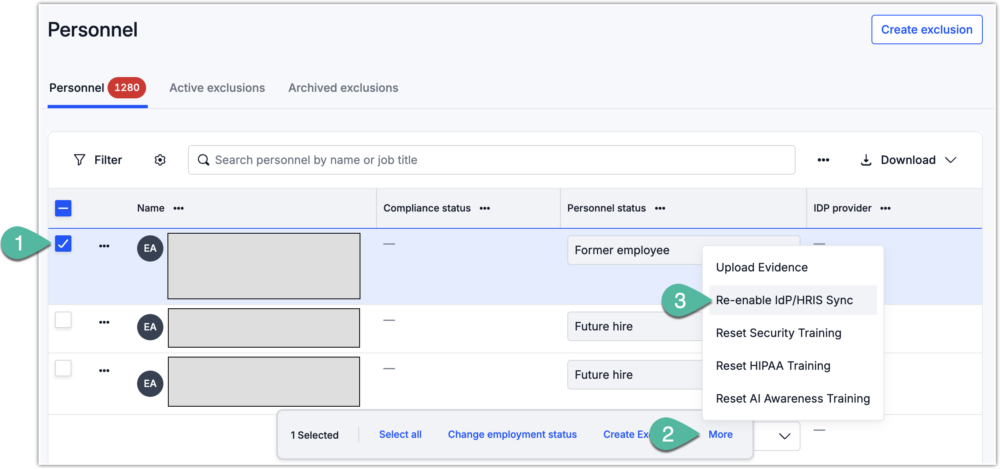
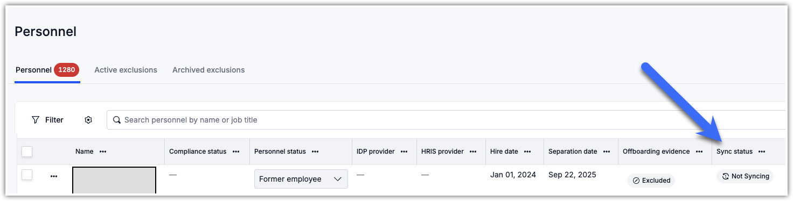

# How Drata Uses HRIS Data

Source: https://help.drata.com/en/articles/13344234-how-drata-uses-hris-data
Collection: Understand the Drata Platform › Connections
Updated: 2026-11-09
Fetched: 2026-11-22
Description: This article explains how Drata connects to HRIS systems, what employee data is accessed, how that data is stored and used, and what options are available if no HRIS integration is in place.

## Article text

Connecting an HRIS to Drata allows Drata to accurately determine which employees are in scope for compliance by tracking employment status, start dates, and separation dates.

Drata uses this information to support compliance workflows such as onboarding, offboarding, access reviews, and audit readiness. HRIS data is read-only and is never modified by Drata.

## How Drata Communicates With HRIS Systems

1. The initial HRIS connection in Drata establishes secure authentication.
2. Once connected, Drata makes a limited number of API requests every 24 hours using a standardized data model that is intentionally limited to a small set of employee data points.
3. The HRIS system returns the requested data to Drata.

### Data Points Drata Access

Drata is granted **read-only access** to HRIS data. The exact fields available depend on the HRIS provider, but may include:

- First and last name
- Work email
- Personal email
- Employment status
- Start date / hire date
- Separation or termination date
- Job title
- Manager
- Team or group information
- Employee identifier (such as employee number)

#### Provider-specific note: ADP Workforce

The ADP Workforce integration requires elevated API permissions (Practitioner Role) to generate reports. While this increases the scope of accessible data at the API level, **the data Drata actually uses remains the same** as with other HRIS integrations.

## Data Drata does not access

Drata never requests, receives, or stores the following data:

- Social Security numbers
- Date of birth
- Gender or ethnicity
- Home address or location
- Marital status
- Phone number
- Pay group or compensation data
- Work location

## How Drata stores HRIS data

Drata uses a **single-tenant database architecture**, meaning each customer’s data is stored in a fully isolated environment.

Only the minimum required employee attributes are stored, such as:

- Name
- Work email
- Personal email (when applicable)
- Employment start and end dates
- Job title
- Employment status

## HRIS and identity provider (IdP) record mapping

When both an HRIS and an identity provider (IdP) are connected, Drata maps records between the two systems.

Mapping is performed automatically using:

- Matching email addresses, or
- Matching first and last names when email matching is not possible

If Drata cannot confidently match a record, the personnel entry is marked with an employment status of **Unknown** on the Personnel page.

## Why HRIS data matters for compliance

HRIS data serves as the **source of truth** for:

- Employment status (current vs. former)
- Hire dates
- Separation or termination dates

These fields are critical for audit readiness and personnel compliance. For example:

- Hire and termination dates determine who is in scope during an audit period
- Employment status determines onboarding and offboarding requirements
- Former employees are evaluated to confirm access removal and offboarding completion

Any updates to these values should originate in the HRIS whenever possible.

## What happens if no HRIS is connected

If no HRIS integration is connected, Drata relies on identity provider (IdP) data to infer employment status:

- Account activation date → hire date
- Account deactivation date → separation date

If these dates do not align with official HR records, manual adjustments may be required.

**Note:** Contractor status is not inferred automatically and must be managed manually.

## Options for managing employee data without HRIS

If an HRIS is not connected, you can manage employee data using one of the following approaches.

### Option 1: Manual updates in Drata

Update employment status, start date, or separation date directly on the **Personnel page**.

- Manual updates usually stop syncing with the IdP.
- A Drata admin can restore syncing if needed.
- To restore syncing:
   1. Select the checkmark next to the user.
   2. Select **More > Re-enable IdP/HRIS sync**.

Sync status is visible on the Personnel page

### Option 2: Bulk import

Upload a spreadsheet containing employee details such as name, email, start date, separation date, and employment status. Important considerations:

- This is a manual, ongoing process
- Uploads may take time to process
- Manual updates stop IdP syncing unless reverted

### Option 3: Custom automation using the API

Build an internal automation that updates personnel records using the Drata API. Important considerations:

- Requires development resources
- API-driven updates are treated as manual updates
- IdP syncing is paused for affected records

Learn more in the **[Drata API documentation](https://developers.drata.com/)**.

### Option 4: Okta custom attributes (Okta only)

If Okta is your IdP, HR teams can manage employment data using custom attributes:

- `drataStartDate` (string): employee start date
- `drataContractor` (boolean): contractor vs employee

Drata automatically ingests these attributes without breaking Okta syncing.

**Limitation:** Separation date is not supported in this configuration. Separation is inferred from Okta account deactivation.

## Images

- [image 01] ../../images/ux/personnel/how-drata-uses-hris-data--01.png
- [image 02] ../../images/ux/personnel/how-drata-uses-hris-data--02.png

## Related articles

- [Populating and Managing Personnel Data in Drata (Concept Guide)](populating-and-managing-personnel-data-in-drata-concept-guide.md)
- [Connect your HRIS to Drata](connect-your-hris-to-drata.md)
- [Integrate Multiple Identity and HRIS Connections](integrate-multiple-identity-and-hris-connections.md)
- [Troubleshoot employment status issues in Drata](troubleshoot-employment-status-issues-in-drata.md)
- [Troubleshooting Identity Sync Issues in Drata](troubleshooting-identity-sync-issues-in-drata.md)
