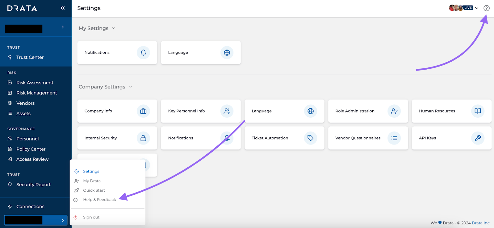

# Information security leads overview

Source: https://help.drata.com/en/articles/8863846-information-security-leads-overview
Collection: Settings › Role Administration
Updated: 2026-11-11
Fetched: 2026-11-22
Description: Learn more about information security lead role, permissions, and functionality in Drata.

## Article text

In this help article, learn and discover the functionalities available to information security lead roles within Drata.

### Information security leads access

The side navigation of the Drata app is divided into several sections, each containing pages you can access based on your role.

Note: If your role has the read-only permissions enabled, you can only view, filter, and download the data on the pages available to the role. You cannot modify the data or do certain actions available on that page.

- Dashboard
- Tasks
- Compliance
- Trust
- Risk
- Governance
- Settings
- Help Menu

### Dashboard

The Dashboard page provides a holistic view about your organization's risk and compliance posture. To learn more, go to[Operational Compliance Dashboard](https://help.drata.com/en/articles/7963882-operational-compliance-dashboard).

### Tasks

Access all the tasks on the Tasks page. To learn more about Tasks, go to[Task](manage-risk-tasks-in-drata-new-experience.md).

### Compliance

Access the following pages under the Compliance section on the navigation bar:

- Controls page:[View control details](https://help.drata.com/en/articles/5330111-control-details),[change the scope of controls](https://help.drata.com/en/articles/5329662-marking-controls-in-and-out-of-scope), and[create controls](https://help.drata.com/en/articles/5465358-create-a-control).
- Frameworks page: [Modify requirements](framework-requirements.md),[change scopes](https://help.drata.com/en/articles/6164108-marking-requirements-in-and-out-of-scope),and [create custom frameworks](custom-framework.md). Learn about [Frameworks](frameworks.md).
- Monitoring page: Run tests, manage test notification, and map controls to tests on the Monitoring page. Learn about [Monitoring](https://help.drata.com/en/articles/4790546-monitoring).
- Event Tracking page: View all events and download raw evidence. Learn about[Event Tracking](https://help.drata.com/en/articles/4790526-event-tracking).
- Evidence Library page: Edit details or add evidence. Learn about [Evidence Library](evidence-overview.md).

### Risk

Access the following pages under the Risk section on the navigation bar:

- Risk Assessment page: Complete and assign assessments. Learn more about[Risk Assessment](https://help.drata.com/en/articles/4770255-how-does-the-risk-assessment-process-work-in-drata).
- Vendors page: Edit vendor details, complete report reviews, and add vendors. Learn more about [Vendors](https://help.drata.com/en/articles/4755823-vendor-directory-profiles).
- Assets page: Edit assets details and complete report reviews. Learn more about[Assets](assets.md).

### Governance

Access the following pages under the Governance section on the navigation bar:

- Personnel page: Edit personnel details and take actions related to personnel.  To learn more, go to[Personnel Overview](https://help.drata.com/en/articles/4785655-personnel-overview).
- Policy Center page: View, download, create, or edit policies. To learn more, go to[Policy Center: Link your policies to your controls](https://help.drata.com/en/articles/8746925-policy-center-link-your-policies-to-your-controls).

### Settings

The Settings page can be found as an option under the user menu. Information security leads have access to 'My Settings'.

### Help Menu

Select the help icon or Help & Feedback option to access the Help & Feedback drawer.

This drawer displays sections containing the help center, upcoming features, and community. You can also grant or revoke remote support access for all personnel on the Help & Feedback drawer.

### Additional resources

- [Role Administration & RBAC](role-administration-rbac.md)

## Images

- [image 01] ../../images/ux/settings/information-security-leads-overview--01.png

## Related articles

- [Risk managers overview](risk-managers-overview.md)
- [Access reviewer overview](access-reviewer-overview.md)
- [Control managers overview](control-managers-overview.md)
- [Personnel compliance managers overview](personnel-compliance-managers-overview.md)
- [Policy managers overview](policy-managers-overview.md)
