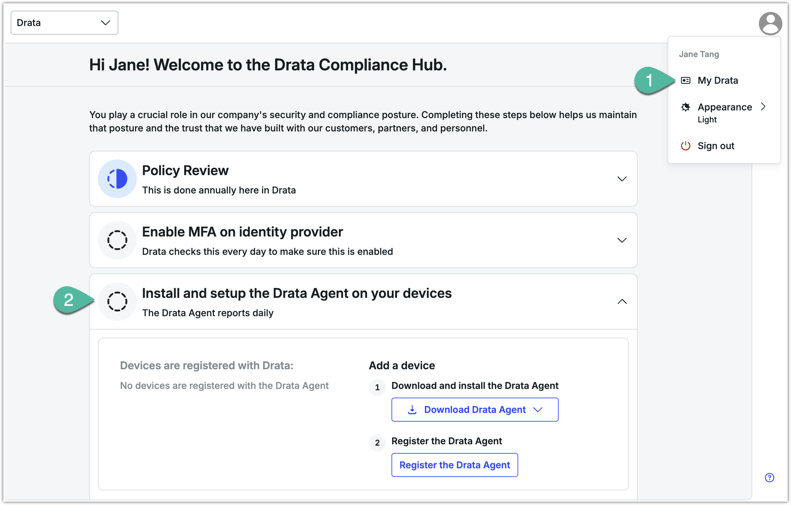

# Install the Drata Agent

Source: https://help.drata.com/en/articles/13612377-install-the-drata-agent
Collection: Personnel Management › Drata Agent
Updated: 2026-11-09
Fetched: 2026-11-22
Description: Learn how to install and verify the Drata Agent to report device security settings during employee onboarding.

## Article text

The Drata Agent is a lightweight application. It has **read-only access** to specific system settings so Drata can verify required security configurations, such as disk encryption, screen lock, antivirus, and automatic updates.

The agent runs daily and helps your organization meet device-related compliance requirements.

## Prerequisites

To ensure your devices remain compliant and secure, the Drata Agent supports the most recent stable versions of major operating systems.

- **macOS**
   - **Current Supported Versions:** macOS 26 (Tahoe) and macOS 15 (Sequoia).
   - **Requirement:** Drata Agent version **3.9.0 or higher** is required for these versions.
- **Windows**
   - The Drata Agent supports the two most recent stable versions of Windows that Microsoft actively maintains.
- **Linux**
   - The Drata Agent supports Linux distributions that offer Long-Term Support (LTS) versions.
   - We do not support non-LTS or short-term releases (for example, Ubuntu 25.10).

**Ubuntu Linux requirements:**

- Drata supports **Debian-based Ubuntu 22.04 and 24.04**
- Hard drive encryption evidence must be **uploaded manually** for Ubuntu devices
- You must be able to install applications on your device
- Ubuntu 24.04 LTS enables **AppArmor** by default

## Install the Drata Agent

During employee onboarding on the My Drata page, one of the tasks is to **Install the Drata Agent**.

1. Log in to Drata and navigate to the **My Drata** page.
2. Locate **Install the Drata Agent** and expand the task.
   
3. Select the installer file that fits your needs the best.
4. Open the downloaded file and follow the installation prompts.
5. Return to Drata and select **Register Drata Agent**.
6. Check and select your **email** for the **Verify Drata Agent** message.

Once verified, the agent runs automatically in the background.

**Expected outcome:** The Drata Agent is installed, registered to your account, and begins reporting device security status.

---

## What the agent does (and does not do)

✔ Reads system configuration settings required for compliance

✔ Runs automatically once installed

✖ Does not modify system settings

✖ Does not monitor personal activity or files

### Automatic updates

The Drata Agent stays up to date with the latest required version.

- The agent updates automatically
- Updates are required
- You may be prompted for permission during an update

---

## Additional Resources

### Ubuntu Linux

**Hard drive encryption (manual evidence)**

- [Full_Disk_Encryption_Howto_2019](https://help.ubuntu.com/community/Full_Disk_Encryption_Howto_2019)
- [Encrypting disks on Ubuntu 19.04](https://medium.com/@chrishantha/encrypting-disks-on-ubuntu-19-04-b50bfc65182a)

**Anti-Virus software**

- [Ubuntu antivirus overview](https://help.ubuntu.com/community/Antivirus)
- [Avast for Linux](https://www.avast.com/business/products/linux-antivirus) (cost associated)
- [ClamAV](http://www.clamav.net/) (free)

## Images

- [image 01] ../../images/ux/personnel/install-the-drata-agent--01.png

## Related articles

- [Configure your computer for installing  Anti-Virus Software](configure-your-computer-for-installing-anti-virus-software.md)
- [How does the Drata agent work?](how-does-the-drata-agent-work.md)
- [Drata Agent not reporting system updates](drata-agent-not-reporting-system-updates.md)
- [Drata Agent Installation Link](drata-agent-installation-link.md)
- [1Password Device Trust (Kolide) Integration Guide](1password-device-trust-kolide-integration-guide.md)
