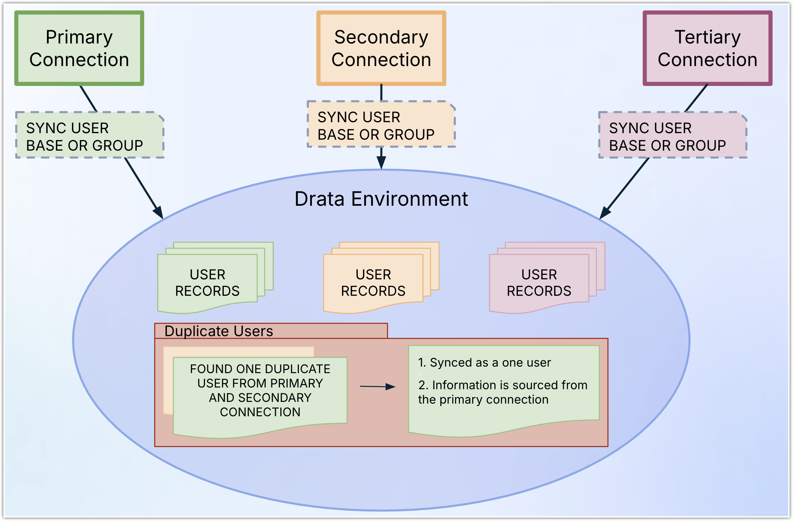
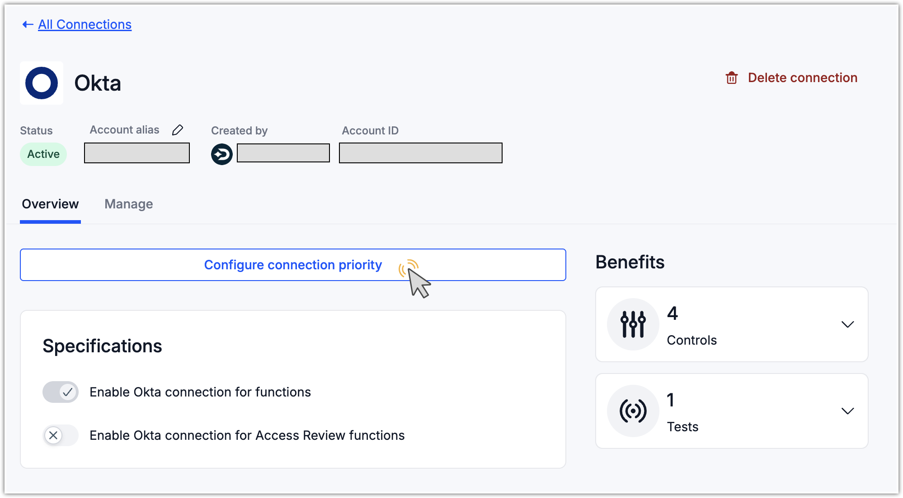
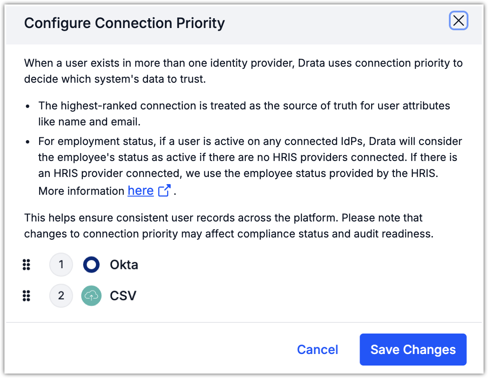
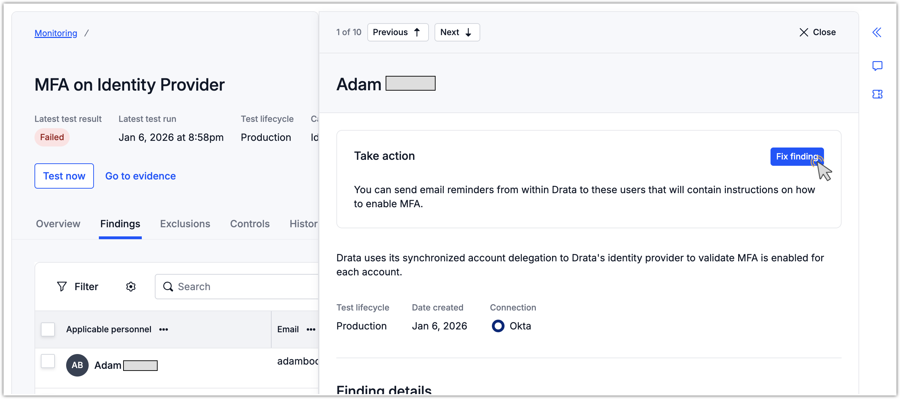
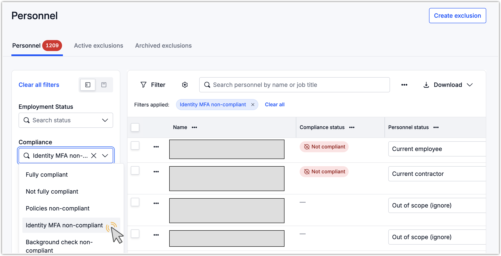
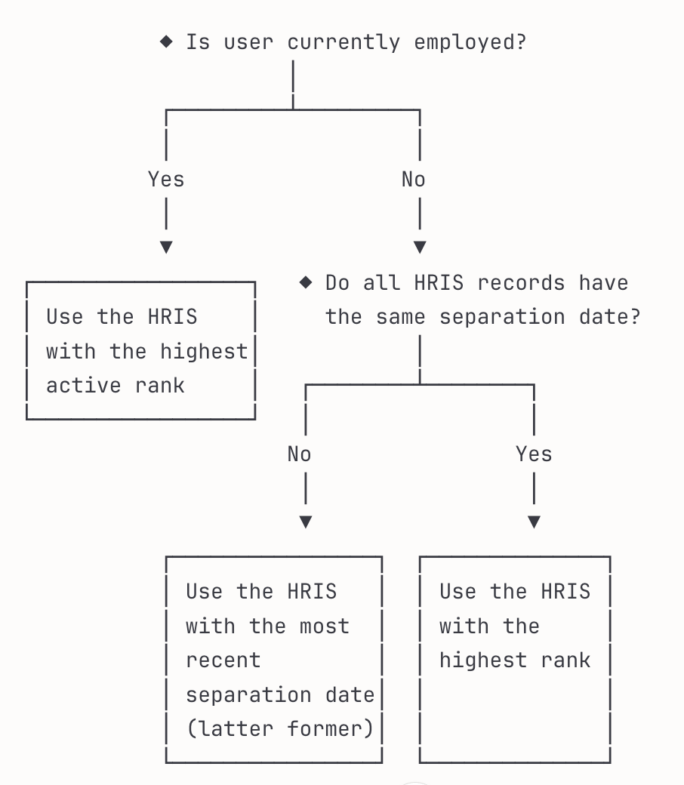
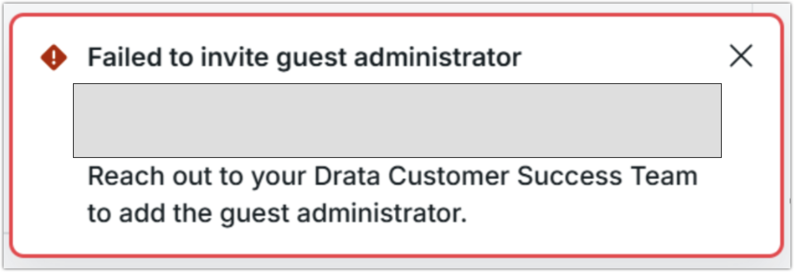

# Integrate Multiple Identity and HRIS Connections

Source: https://help.drata.com/en/articles/13337738-integrate-multiple-identity-and-hris-connections
Collection: Understand the Drata Platform › Connections
Updated: 2026-11-09
Fetched: 2026-11-22
Description: In this article, you learn how to integrate multiple identity and HRIS connections in Drata.

## Article text

You can connect and sync all your IdPs and HRIS systems into Drata. When the same user exists across more than one IdP or HRIS system, you can define a connection priority to determine which provider serves as the primary source of truth for attributes like name and email.

Use the **Configure Identity Priority** or **Configure HRIS Priority** option to set this order and ensure Drata references the correct provider when syncing user attributes. You can reorder the connections at any time. However, the best practice is to connect your IdPs and HRIS systems in the desired priority order, starting with the provider that holds the most authoritative user data.

***EXAMPLE DIAGRAM***

## Prerequisites

To connect multiple identity providers (IdPs) or HRIS providers in Drata, make sure you have the following in place:

- **Plan availability**: Available on all Drata plans
- **RBAC roles**: You must have the Admin, Workspace Manager, or DevOps Engineer role in Drata
- **Workspace awareness**: This feature is not workspace-aware. All synced personnel will appear in every workspace.
- **Identity provider or HRIS access**: Make sure you meet the connection requirements so you can successfully complete the connection process in Drata. You can find these in the relevant Help Center articles.

### Best Practices Before You Begin

1. **Determine your primary IdP or HRIS**: Identify which provider should act as the source of truth for user attributes like name and email. Connect that first.
2. **Connect in order of importance**: Add your remaining IdPs/HRIS in the order you want Drata to prioritize them. If you're unsure which one to start with, choose the provider that has the most complete and consistently updated user data.

**To Avoid Duplicate Records**

- **Use consistent email addresses across systems**: Drata matches users by exact email. Even small differences (e.g., [sally@domain.com](mailto:sally@domain.com) vs. [sally.smith@domain.com](mailto:sally.smith@domain.com)) will create separate records.
- **Avoid syncing the same users from multiple systems**: If possible, scope each IdP or HRIS to bring in distinct user groups (e.g., by region or department).

If there are duplicate users after you connected all of your IdPs or HRIS systems, you can mark the duplicates as out of scope and note which email is being used for compliance tracking. Marking accounts as "out of scope" ensures that historical compliance data is retained while excluding these accounts from active monitoring. This approach is particularly useful for orphaned accounts that are no longer present in the current IdP but need to be preserved for audit purposes.

---

## End-to-End Workflow

Here’s how the full setup process works when connecting multiple providers:

1. **Connect your primary connection**. Then, connect the rest of your connections.
   - **For Identity connections**: Sync specific **user groups from each IdP connection**. This helps ensure that access is clearly defined and limited to the right users, improving both security and manageability.
2. **Configure identity priority (Optional): **Set the order in which Drata should reference each connection.
   - **For Identity connections**: The order of connections determines which IdP provides the user's name and email in Drata.
   - **For HRIS connections: **The order of connections determines which HRIS provides the user's name, email, start date, and employment status in Drata.
3. **Review synced personnel: **After syncing, review the **Personnel page** to confirm users are consolidated correctly.
4. **Identify and resolve duplicates: **On the** Personnel page**, if duplicate records exist, mark one as **out of scope**.

We’ll guide you through each of these steps in the sections below.

---

## Step 1: Connect your Connections

1. Navigate to the **Connections** page > **Available **tab.
2. Connect your **primary connection first**. This will act as the initial source of truth for user attributes.
3. If applicable, during the connection process, assign a clear connection alias to help differentiate providers.
4. Repeat this process to connect any additional providers.

## Step 2: Configure Connection Priority

After connecting your second provider, you can configure connection priority during the setup drawer step.

If priority is not manually set, Drata applies a default order based on the sequence of connections. You can update the order at any time by selecting **Configure Identity Priority** in the connection settings.

**Example Scenario**

Connection priority determines which IdP controls user attributes like name and email.

1. Sally has an account in IdP 1 and 2.
   - **Name:** Sally Socpilot
   - **Email:** [sally@nasa.com](mailto:sally@nasa.com) from IdP 1 (IdP 1 is set as Primary Connection)
   - **Email:** [sally@nasa.com](mailto:sally@nasa.com) from IdP 2
2. Sally's email is later updated to [sallyride@nasa.com](mailto:sallyride@nasa.com) in IdP 1.
3. Drata will update her Personnel record to [sallyride@nasa.com](mailto:sallyride@nasa.com).
4. Compliance tracking will continue under the new email ([sallyride@nasa.com](mailto:sallyride@nasa.com)), and activity under the former email will still be preserved.

If that same change were made in **IdP 2**, Drata would ignore it, because IdP 1 is the designated source of truth.

### To set the order

1. Select the connection you already integrated with Drata. Make sure that you have multiple connections connected.
2. Select an already connected identity or HRIS provider. You will be redirected to the full connection detail page. There you can select **Configure Connection Priority button.**
   
3. Drag and arrange the icons to define the hierarchy (Primary, Secondary, etc.).
   
4. Drata will use the highest-priority as the source of truth for syncing name and email attributes.
   - **For Identity connections**: The order of connections determines which IdP provides the user's name and email in Drata.
   - **For HRIS connections: **The order of connections determines which HRIS provides the user's name, email, start date, and employment status in Drata.

**Note**: Changing connection priorities may affect personnel compliance and can result in duplicate records. Updates may take up to 24 hours to reflect in Drata.

## Step 3: Verify Sync and Remove Duplicate Users

Drata matches users by exact email address only. First and last names are not used. If a user appears across multiple IdPs or HRIS systems with the same email, they are synced as a single user. **If emails differ slightly, Drata creates separate records.**

After connecting your identity providers or HRIS systems and configuring connection priority, verify that user records have synced correctly:

1. Go to the **Governance** > **Personnel** page in Drata to review the full list of synced users.
2. (Optional) Filter and select all the applicable IdP or HRIS groups.
3. If two records refer to the same person, identify which record you want Drata to track for compliance.
4. For the duplicate record you don’t want Drata to use for compliance tracking, update the personnel status to **Out of scope (ignore)**. This ensures that compliance records remain intact while preventing clutter in your active user list. It is a best practice to periodically review and manage these records to maintain data integrity.

---

## MFA on Identity Provider test (IdP Only)

All email addresses synced from your connected identity providers must have MFA enabled **in the identity provider they are sourced from**. If MFA is not enabled for one or more users, the **MFA on Identity Provider** test may fail until those accounts are updated.

When the **MFA on Identity Provider** test is failing, you can take action directly from the Monitoring experience to identify affected users and prompt remediation.

### Resolve MFA findings

1. Go to **Compliance → Monitoring** in Drata.
2. Search for the **[MFA on Identity Provider](test-86-mfa-on-identity-provider.md)** test and review its status.
3. If the test is failing, select the test to open the details view.
4. In the **Findings** tab, select a personnel record from the table.
5. A side panel opens showing the selected user and available actions.
6. From here, select **Fix finding** to send an email reminder with instructions for enabling MFA.

MFA must still be enabled in the identity provider itself, but Drata helps you identify impacted users and take action quickly.

Drata automatically checks each connected IdP for multi-factor authentication (MFA) coverage.

You can also go to the Personnel Page and filter by Compliance filtered to Identity MFA non-compliant and send a reminder to each user to enable their MFA.

**Tip**: Re-sync your IdP connections after updating MFA settings to refresh compliance status in Drata.

---

## Troubleshoot

### Employment Status Resolution (HRIS Only)

When a **user exists in multiple connected HRIS systems**, Drata applies the following logic to determine which system serves as the source of truth:

1. **For currently employed users**: Drata selects the HRIS connection with the highest configured priority (rank).
   - This ensures that the most authoritative system (aka the primary connection) provides the user's employment data, including name, email, start date, and employment status.
2. **For separated/former employees**: The logic depends on separation dates across the HRIS systems.
   - If all connected HRIS systems show different separation dates for the same user, Drata selects the system with the most recent separation date (the "latter former"), provided that connection is still active.
   - This approach captures the most up-to-date employment record.
   - However, if all HRIS systems show the same separation date, Drata defaults to using the highest-ranked connection (aka the primary connection) based on your configured priority order.

This hierarchical approach ensures data consistency while accommodating scenarios where employment records may be managed across different systems during transitions, acquisitions, or regional organizational structures.

***EXAMPLE DIAGRAM***

---

### Connecting Secondary IdP With No Shared Users

When your primary and secondary IdPs have no overlapping users, you can invite a user from the secondary IdP as a guest admin so that they can create the connection.

1. IdP1 is connected to Drata, so all IdP2 users are locked out. They have no way to log in and create the IdP2 connection.
2. An IdP1 admin invites an IdP2 user as a [guest admin in Drata](manage-guest-administrators.md).
   - If the email domain of the user you want to invite as a guest admin isn't already approved in Drata, reach out to the Drata support team to add the new domain before sending the invitation.
   - If you try to invite a user as a guest admin whose email domain isn't already approved in Drata, you'll receive an error message.
      
3. The IdP2 guest admin logs in and connects IDP2.
4. Once the sync completes, Drata syncs users from IDP2 and automatically detects the connecting user's record and adjusts their role from guest admin to standard admin.
5. All IdP2 users can now log in.

---

## Single Connection ↔ Multiple Connections

When switching between a single provider to multiple provider (or vice versa), take the following steps to maintain clean, accurate personnel records in Drata.

**Single Connection to Multiple Connections**

1. Assign a **primary connection** to act as the source of truth for user attributes.
2. (If applicable) Configure connection priority immediately after adding your second connection.
3. Mark duplicate records as **out of scope** if users exist in multiple connections with unmatched email addresses.

**What to Be Aware Of**

- Users not found in any connected IdPs will be automatically marked as **former**.
- Conflicting user data across connections may lead to duplicates based on email.

**Multiple Connections to Single Connection**

1. Ensure that **all users** from deprecated connections are present in the remaining connection.
2. Verify that each user has **one consistent email address** used for compliance tracking.

**What to Be Aware Of**

- Any personnel no longer found in the connected connection will be marked as **former**.
- Inconsistent email addresses may cause duplicate records or loss of compliance history.

---

## Changing the Priority Order

After setting up your connections, you can change the priority order at any time.

- Please note that **duplicates may appear** if you adjust the order of your connections.
- Depending on the size of your organization or the number of users being synced, **updates may take some time** to appear in Drata.
- If you don’t see the changes reflected after **24 hours**, please contact **Drata Support** for assistance.

---

## Limitations

- Please make sure to allow enough time **before your audit period** to address any issues that might come up during the transition.
- **CSV IdP connections currently do not support multi-domain configurations.**

## Images

- [image 01] ../../images/documentation/integrate-multiple-identity-and-hris-connections--01.png
- [image 02] ../../images/ux/connections/integrate-multiple-identity-and-hris-connections--02.png
- [image 03] ../../images/ux/connections/integrate-multiple-identity-and-hris-connections--03.png
- [image 04] ../../images/ux/monitoring/integrate-multiple-identity-and-hris-connections--04.png
- [image 05] ../../images/ux/personnel/integrate-multiple-identity-and-hris-connections--05.png
- [image 06] ../../images/documentation/integrate-multiple-identity-and-hris-connections--06.png
- [image 07] ../../images/ux/connections/integrate-multiple-identity-and-hris-connections--07.png

## Related articles

- [Populating and Managing Personnel Data in Drata (Concept Guide)](populating-and-managing-personnel-data-in-drata-concept-guide.md)
- [Connect your HRIS to Drata](connect-your-hris-to-drata.md)
- [How Drata Uses HRIS Data](how-drata-uses-hris-data.md)
- [Resume IdP and HRIS syncs for personnel](resume-idp-and-hris-syncs-for-personnel.md)
- [Troubleshooting Identity Sync Issues in Drata](troubleshooting-identity-sync-issues-in-drata.md)
