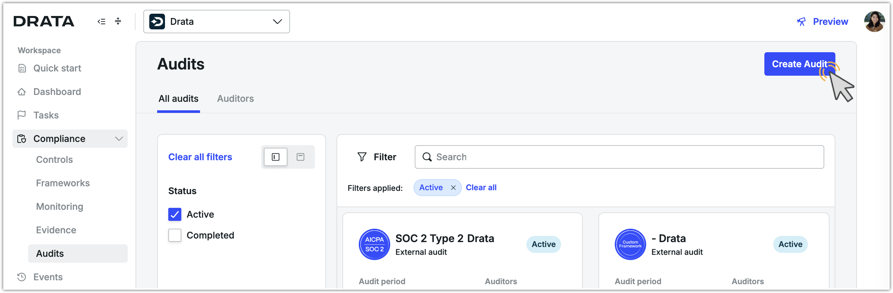
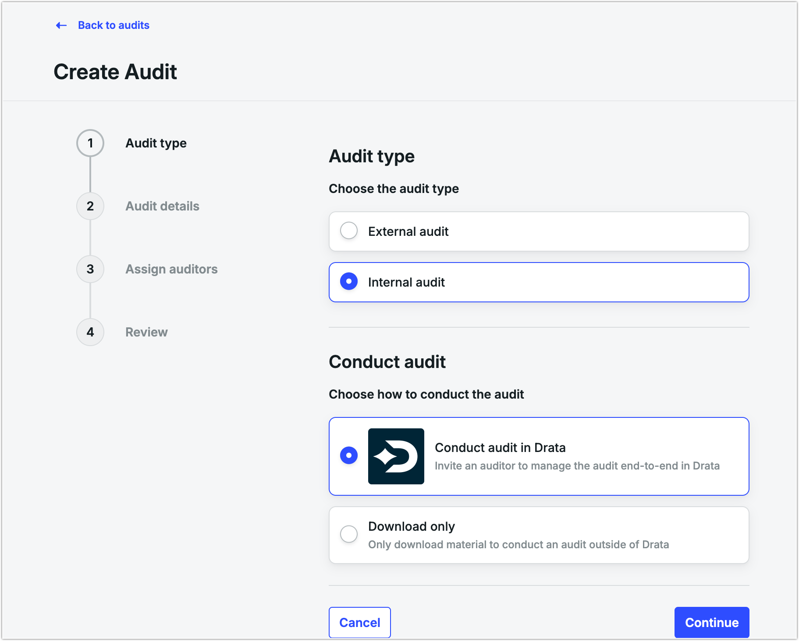

# Internal audits in Drata (New Experience)

Source: https://help.drata.com/en/articles/13893566-internal-audits-in-drata-new-experience
Collection: The Auditor Experience
Updated: 2026-06-02
Fetched: 2026-11-22

## Article text

Internal audits allow you to plan, run, and manage internal audits directly in Drata using the same workflow used for external audits. This keeps audit requests, evidence, and collaboration in one place and eliminates the need to export to spreadsheets or use a separate tool.

With internal audits, you can:

- **Create** an internal audit.
- **Assign** Internal Auditors from your synced user directory.
- **Manage** requests and evidence using the same workflow as external audits.
- **Clearly distinguish** internal audits from external audits at a glance.

**Required Drata roles:** Drata Admin; Internal Auditor

## Roles and permissions

**Drata Admin**

- **Creates** internal audits.
- **Assigns** Internal Auditors.
- **Manages** audit configuration.
- **Uploads and manages** evidence.

**Internal Auditor**

- **Has access only** to internal audits they are assigned to.
- **Can create and manage** requests within those audits.
- **Can collaborate** in the Messages panel the same way an external auditor would in an external audit.
- **Can view** evidence attached to requests.
- **Cannot upload or delete** evidence in this phase.

## Create an internal audit

1. In the left navigation, go to **Compliance**, then select **Audits**.
2. Select **Create audit**.
   
3. Under **Audit type**, select **Internal audit** and **Conduct audit in Drata**
   
4. Under **Audit details**:
   - Select the **Framework**.
   - Set the **Audit period**.
   - Select **Continue**.
5. On the **Assign internal auditors** step:
   - Select one or more users to assign.
   - Only users synced through your identity provider (IDP) appear as options for Internal Auditors.
   - If you select **Add new auditor**, you can add only auditors outside your organization. Internal personnel must be selected from your IDP-synced users.
6. When finished, select **Continue**.
7. On the **Review** step, confirm:
   - Audit type: Internal
   - Framework
   - Audit period
   - Assigned internal auditors (names and email addresses)
8. Select Continue to create the audit.

After creation, the audit appears on the Audits list as a card labeled Internal audit under the framework name.

Select **Start audit or Open audit** to begin working through requests.

---

## Manage an internal audit

Internal audits reuse the existing request list, Messages panel, and evidence workflow from external audits.

During the audit:

- Internal Auditors create and manage requests within audits they are assigned to.
- Admins and other authorized users upload evidence to requests.
- Internal Auditors review evidence and collaborate in the Messages panel.
- Internal Auditors cannot upload or delete evidence in this phase.

Internal audits are labeled as Internal on audit cards and in the audit header so you can easily distinguish them from external audits.

## Images

- [image 01] ../../images/ux/audits/internal-audits-in-drata-new-experience--01.png
- [image 02] ../../images/ux/audits/internal-audits-in-drata-new-experience--02.png

## Related articles

- [Pre-Audit Checklist: How to Prepare for Your Audit with Drata](pre-audit-checklist-how-to-prepare-for-your-audit-with-drata.md)
- [Using the Drata Audit Portal (New Experience)](using-the-drata-audit-portal-new-experience.md)
- [Audits page overview (New Experience)](audits-page-overview-new-experience.md)
- [Pre-audit evidence packages in Drata (New Experience)](pre-audit-evidence-packages-in-drata-new-experience.md)
- [Section 5: Drata for Auditors](section-5-drata-for-auditors.md)
