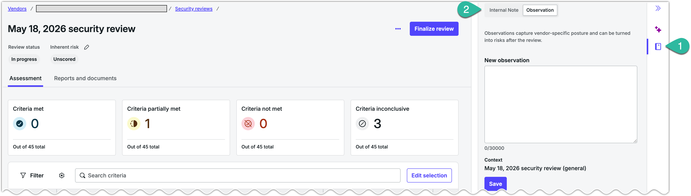
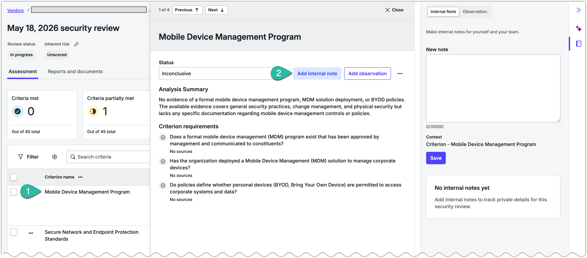
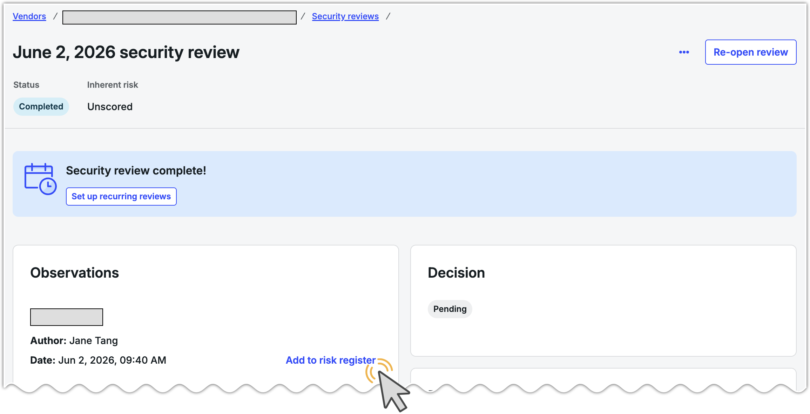

# Internal Notes and Observations in Security Reviews (New Experience)

Source: https://help.drata.com/en/articles/15349349-internal-notes-and-observations-in-security-reviews-new-experience
Collection: Understand the Drata Platform › Vendors
Updated: 2026-06-02
Fetched: 2026-11-22

## Article text

When conducting a vendor security review using the TPRM Agent, you can document your findings and reasoning directly on each criterion using two types of annotations: Internal Notes and Observations.

These help your team maintain audit defensibility and capture vendor-specific context without exposing internal reasoning to the vendor.

## Understand Internal Notes and Observations

- **Internal Note**: Private notes visible only to your organization. Use these to document your reasoning, especially when overriding an AI-generated assessment. Internal notes are never shared with vendors and support audit defensibility.
- **Observation**: Vendor-specific findings that capture posture details surfaced during the review. Observations are visible to review participants but are never shared externally with the vendor.
   - For current vendors, observations can be converted into risks after the review is finalized.
   - For prospective vendors, observations are recorded but cannot be converted into risks, as risks cannot be assigned to prospective vendors.

## Add an Internal Note or Observation

There are two ways to add an internal note or observation, and which one you use affects how the Context field is pre-populated.

### Option 1: Not tied to a specific criterion

Use this when your note or observation applies to the review generally rather than to a specific criterion.

1. From an in-progress security review, select the book icon in the right-side panel.
2. Select either the **Internal Note** tab or the **Observation** tab.
   
3. Enter your text.
4. The **Context** field will be pre-populated with the security review name followed by *(general)*.
5. Select **Save**. The entry is saved with your name and a timestamp.

### Option 2: Tied to a specific criterion

Use this when your note or observation is directly related to a specific criterion in the review.

1. From an in-progress security review, select a criterion.
2. In the criterion panel, select either the **Add internal note** or the **Add observation** button.
   
3. Enter your text.
4. The **Context** field will be pre-populated with the criterion name.
5. Select **Save**. The entry is saved with your name and a timestamp.

Important notes:

- Notes can be up to 30,000 characters.
- Select **Save**. The note is saved with your name and a timestamp.

| 💡  Internal notes are ideal for documenting override rationale — for example, explaining why you changed an AI-generated status, or noting additional context from a vendor call that isn’t captured in the questionnaire. |
|---|

| 💡  Observations capture vendor-specific posture and can be converted into risks **after the review is finalized**. They are visible to review participants but are not shared externally with the vendor.  |
|---|

## Finalize a security review

Once you have completed your assessment across all criteria, you can finalize the review.

1. From the security review, select **Finalize review** in the top-right corner.
2. In the **Finalize Security Review** dialog, select a **Decision** (for example, Approved).
3. Optionally, add a **Note** to summarize your overall assessment or finalization rationale. Closing the criteria details panel will change the notes context automatically to the Security review.
4. Select **Mark review as complete**. The review status updates and a confirmation toast is shown.

| 💡  After finalizing, criteria statuses, internal notes, and observations are locked as part of the review record. Observations can be added to your risk register from the finalized review. |
|---|

## Images

- [image 01] ../../images/ux/vendors/internal-notes-and-observations-in-security-reviews-new-experience--01.png
- [image 02] ../../images/ux/vendors/internal-notes-and-observations-in-security-reviews-new-experience--02.png
- [image 03] ../../images/ux/vendors/internal-notes-and-observations-in-security-reviews-new-experience--03.png

## Related articles

- [Conducting a Security Review (Legacy)](conducting-a-security-review-legacy.md)
- [Residual Risk in Security Reviews](residual-risk-in-security-reviews.md)
- [Training Video: Conducting an End-to-End Vendor Review with the Drata TPRM Agent (New Experience)](training-video-conducting-an-end-to-end-vendor-review-with-the-drata-tprm-agent-new-experience.md)
- [TPRM Agent: Create a Criteria](tprm-agent-create-a-criteria.md)
- [Conducting a Security Review](conducting-a-security-review.md)
