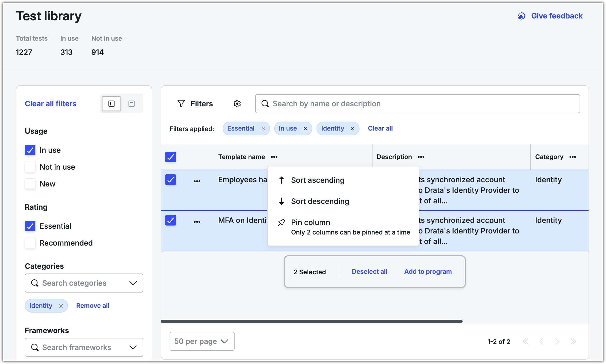
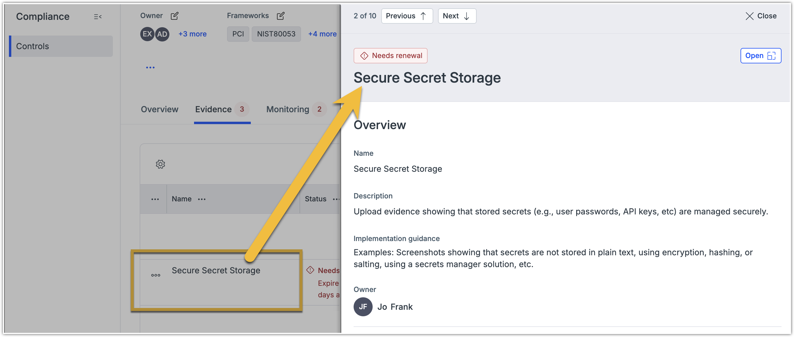
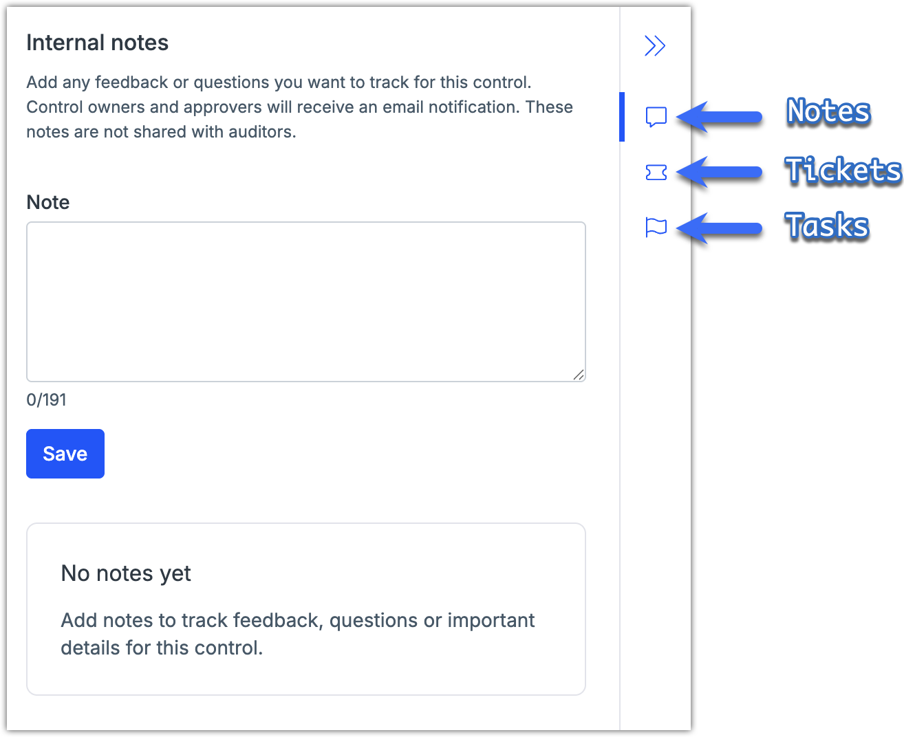

# Introducing the New Drata Experience

Source: https://help.drata.com/en/articles/12440551-introducing-the-new-drata-experience
Collection: Getting Started › Helpful Resources
Updated: 2026-11-11
Fetched: 2026-11-22
Description: Drata has launched a unified experience that streamlines compliance workflows, improves usability, and scales with your team’s needs.

## Article text

The New Drata Experience is a foundational UX layer that reduces friction in day-to-day tasks while supporting enterprise scale, structured data, and future AI-driven automation.

---

## What’s New in the New Experience

This article explains the key UI changes so you can quickly get oriented.

### Header overview

The redesigned header improves orientation and workspace management:

- **Company logo** appears prominently in the top-left
- **Workspace menu **(if enabled) appears in the top-left so you can toggle between environments
- **User profile menu** appears in the top-right for account-related actions

---

### Tables overview (consistent enterprise-grade tables)

Tables are now consistent across the platform, offering a standardized interface designed for large datasets.

Common improvements include:

- **Pinning and reordering columns** to prioritize what matters most
- **Column resizing** for better readability
- **Real-time filtering** to quickly narrow results
- **Inline actions and dropdowns** to complete tasks without opening multiple pages

**Why this matters:**
These improvements make it easier to work with large datasets, understand what needs attention at a glance, and take action without switching contexts.

---

### Panels overview

Panels and full detail pages replace drawers, improving visibility into object relationships (controls, evidence, tests, and risks) while maintaining user context. In many cases, you can also perform quick actions directly from the preview.

**Benefits:**

- Fewer clicks to validate context
- Faster decision-making when reviewing items
- Less page-switching when triaging work

**Example use cases:** Preview key evidences while reviewing a list of evidences for a specific control.

---

### Utilities bar overview (right-side tool access)

The new **utilities bar** appears on the right-hand side in areas where it applies, giving you quick access to helpful tools.

- **Notes**: Add comments per item/object (such as a control) to capture context for teammates.
- **Tickets**: If you’re connected to a ticket integration, create tickets directly from the context of an object.
- **Tasks**: View or create assigned actions or due dates in context.

**Why this matters:**
You can do more “in place” while reviewing work, rather than navigating into separate pages to create tickets or tasks.

---

## Images

- [image 01] ../../images/ux/monitoring/introducing-the-new-drata-experience--01.png
- [image 02] ../../images/ux/controls/introducing-the-new-drata-experience--02.png
- [image 03] ../../images/ux/controls/introducing-the-new-drata-experience--03.png

## Related articles

- [Create Workflow for Control](create-workflow-for-control.md)
- [View and Manage Test Details (New Experience)](view-and-manage-test-details-new-experience.md)
- [Manage tasks in Drata](manage-tasks-in-drata.md)
- [Drata Platform Overview Training Video (New Experience)](drata-platform-overview-training-video-new-experience.md)
