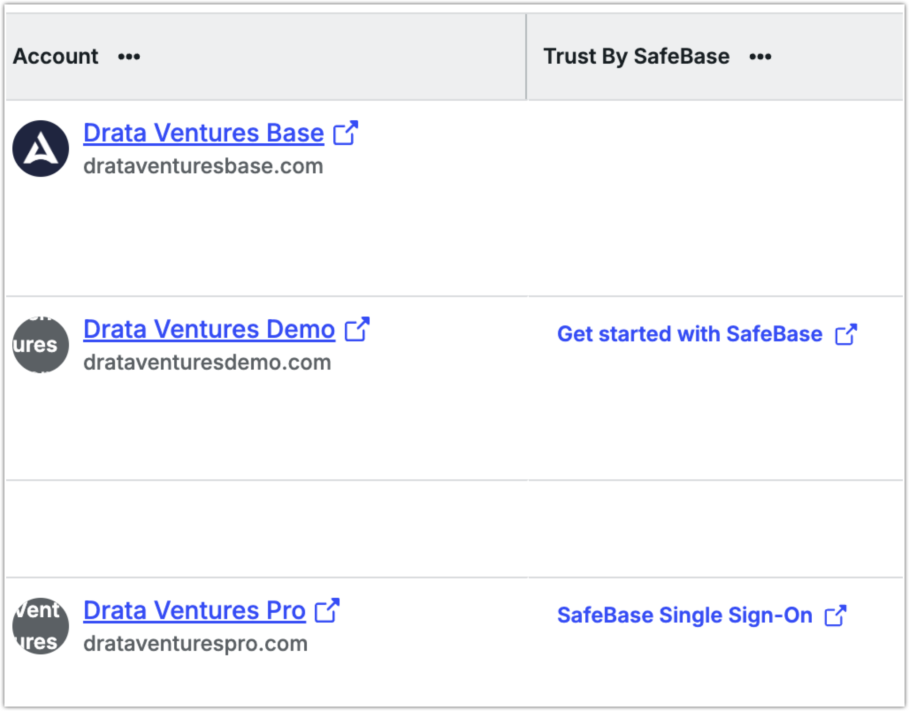
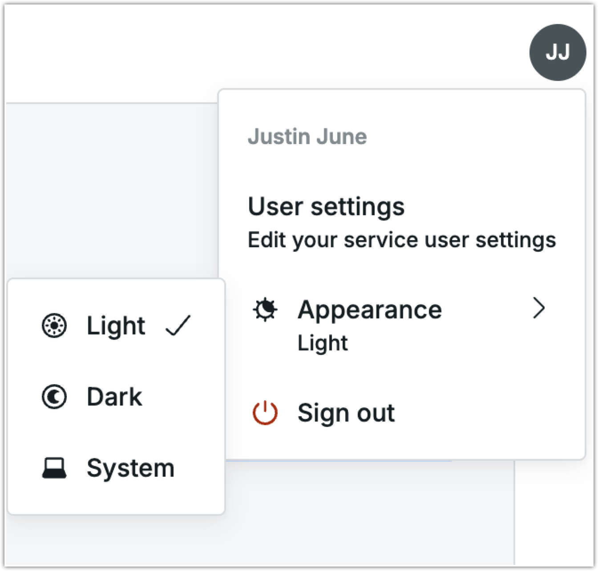

# Introducing the updated Multi-instance Management Portal

Source: https://help.drata.com/en/articles/13756061-introducing-the-updated-multi-instance-management-portal
Collection: Getting Started › MIM
Updated: 2026-11-10
Fetched: 2026-11-22

## Article text

As part of rolling out an updated experience for Drata accounts, we have also refreshed the experience for a Managed Security Service Provider (MSSP), virtual CISO, or manager of multiple Drata accounts.

## What's New

When you log in, you will see a refreshed **accounts table**. This updated view provides improved clarity on the status of your synced accounts and the results of your monitoring tests.

### SafeBase Accounts

You can also use single sign-on (SSO) for SafeBase tenants linked to a Drata account.

- **Status Indicators:** The Get Started with SafeBase link will appear for accounts where SafeBase is available but not yet created
   - You can configure the SafeBase tenant for these accounts by clicking this button, logging into the Drata account and navigating to the **Trust** section.

If the SSO option is not visible, it indicates that your account does not currently have the configurations required to set up SafeBase. To gain access, please contact your Customer Team to initiate the setup process.

### Customize Table Columns

Select the Gear icon near the left side of the search bar to reorder and customize your columns.

### Dark Mode

With this update, we are bringing Dark mode to the Multi-instance Management portal as well.

Select your **User Profile (top right header) > Appearance > Dark**. You can always change your appearance back here.

## Open an account

To manage an account, select the account name. The account opens in a new window.

## Go back to the Multi-instance Management portal

To return to your list of accounts while in the new experience, open the user profile menu by selecting your initials in the top-right corner of the header. From there, select **Go to accounts**.

## Images

- [image 01] ../../images/ux/workspaces/introducing-the-updated-multi-instance-management-portal--01.png
- [image 02] ../../images/ux/settings/introducing-the-updated-multi-instance-management-portal--02.png

## Related articles

- [Okta Integration Guide (Identity Management Provider)](okta-integration-guide-identity-management-provider.md)
- [Working with an MSSP (Managed Security Service Provider)](working-with-an-mssp-managed-security-service-provider.md)
- [Drata Evidence Library Sync](drata-evidence-library-sync.md)
- [Manage guest administrators](manage-guest-administrators.md)
- [Signing In to Drata (New Experience)](signing-in-to-drata-new-experience.md)
