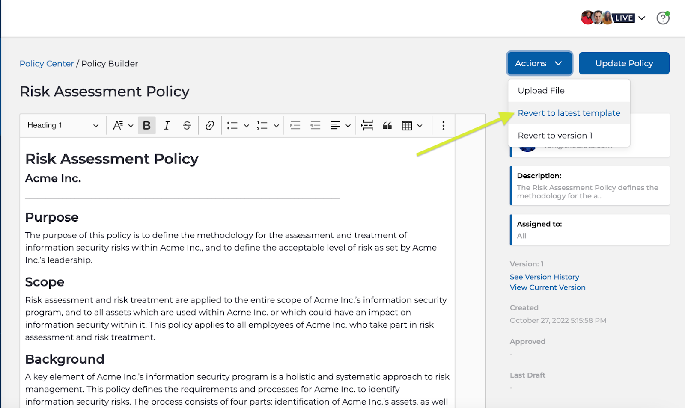

# ISO 27001:2022 Updates as of 5/7/2024

Source: https://help.drata.com/en/articles/9266246-iso-27001-2022-updates-as-of-5-7-2024
Collection: Framework Information › ISO 27001
Updated: 2026-08-17
Fetched: 2026-11-22

## Article text

## Long story short…

We know this is a long article, so we’re going to give you the bottom line, up front.

This article applies to you if you manage ISO 27001:2022 in Drata. We applied these changes in your account on 5/7/2024.

This update will not impact your framework readiness upon release.

The only action we urge you to perform is to implement some additional language (outlined below) to the ISMS Plan template as soon as you are able. (Once you update the document, your readiness will change until the document update is approved.)

We also gave you some additional controls, updated the control details, and refined some of our control to requirement mappings. However, you are not required to implement these updates to achieve or maintain compliance with ISO 27001:2022. If you want to take advantage of our new control details or control mapping, use the functionality outlined in [this article](https://help.drata.com/en/articles/8840054-revert-to-drata-s-latest-control-template-on-any-control-in-the-dcf-library) and [this article.](https://help.drata.com/en/articles/9201136-apply-default-mapping-between-controls-and-requirements) (Do be aware that if you apply our default mappings, your readiness is likely to change.)

Why do you have more controls in your account if you aren’t required to implement them? Because we wanted to give you all the latest information that we had in the spirit of continuous improvement. We don’t want to hold anything back from you.

## Why are we doing this?

**Amendment 1: Climate Action Changes to ISO 27001:2022 from February 2024.**

ISO has published an amendment to all management system standards for the incorporation of climate change considerations into the organizational context analysis of the management system. For ISO 27001:2022, the amendment was published in February 2024 and includes the following updates to the text of the original document:

AMENDMENT 1: Climate action changes

4.1 Add the following sentence at the end of the subclause: The organization shall determine whether climate change is a relevant issue.

4.2 Add the following note at the end of the subclause: NOTE 2 Relevant interested parties can have requirements related to climate change.

Per ISO: “It should be emphasized that the focus of the changes is not to introduce new requirements for organizations to address climate change adaptation and/or mitigation in all of their management system components. Instead, the changes are intended to highlight the fact that climate change CAN affect an organization’s context and its ability to achieve the intended results of its management system, and that SOME relevant interested parties can have specific requirements related to climate change that the organization will have to consider.”

**DCF control library improvements**

We have updated the ISO 27001:2022 DCF control library to align with the updated authoritative source document. Additionally, we’ve used this as an opportunity to iterate on the DCF control library as a result of:

- Realignment of DCF Controls with other connected Drata features (e.g., monitoring tests, policies, etc.)
- Administrative maintenance and standardization
- Alignment with evolving industry standards and best practices
- Industry developments and emerging technologies (e.g., AI)
- Scope calibration and removal of redundancies
- Feedback from stakeholders (customers, certification bodies, technology partners, etc.)

For more information on how Drata manages the DCF control library and control ↔ requirement mapping, refer to **[this article](https://help.drata.com/en/articles/8705808-the-drata-control-framework)**.

## What changed

**Requirement updates**

Under the ISO clauses 4.1 and 4.2 (requirements), the text has been updated to reflect the amended descriptions.

**ISMS Plan Updates**

We updated the ISMS Plan template to include explicit references to climate change considerations to align with the new amendment. Drata **strongly recommends** incorporating these updates into any existing ISMS Plans before your next surveillance/certification audit in order to demonstrate to the certification auditors that climate change considerations were included in the context analysis for the ISMS. We anticipate certification bodies will have evaluating how the organization addressed the changes to the standard within their existing ISMS as a key area of focus in upcoming audits. The changes are as follows:

- *Under section 4.1. Understanding the organization and its context,* added a template paragraph for organizations to indicate whether there are any relevant issues related to climate change relevant for the ISMS.
   - [COMPANY NAME] has determined that climate change is not a relevant issue. **<OR>** [COMPANY NAME] has determined that issues related to climate change are relevant for the ISMS, including:
      *<EXAMPLE> Impacts on natural resources and greenhouse gas emissions due to increased power consumption of computational resources.*
      *<+>*
- Under section *4.2. Understanding the needs and expectations of interested parties,* included a template statement on whether there are any requirements from interested parties related to climate change.
   - ***<IF APPLICABLE> ***[COMPANY NAME] did not identify any requirements from interested parties related to climate change.

We have made other changes to the ISMS plan template. These were made based on feedback from stakeholders (customers, certification bodies, technology partners, etc.). Customers with an existing ISMS plan may find these updates to the template useful. However, they are **entirely optional** as they are driven by Drata’s continuous improvement processes and not by changes to ISO requirements. These include:

- Added bulleted lists for the different ISO standards supported by Drata that could be included in the scope of the ISMS (ISO 27001, ISO 27018, ISO 27017) to assist customers in explicitly defining the boundaries of ISMS implementation.
- Included a list of possible laws and regulations that could be relevant to an ISMS based on the jurisdiction to assist customers in identifying the needs and expectations of regulatory bodies.
- Added examples and instructions to guide users when completing the sections about internal and external interested parties, scope of the ISMS covering inclusions and exclusions, skills matrix, information security objectives, communication plan, mandatory records, KPI metrics, statement of applicability.
- Included additional annotations in Appendix A - Statement of Applicability (SOA) to guide customers in completing the (SOA), added a statement for justification of inclusions of controls, and changed the table structure to omit irrelevant information and simplify the contents of the SOA. Included addendums to the SOA for controls related to ISO 27017 and ISO 27018 if applicable.
- Changed the structure of Appendix B - Management Review Agenda and Minutes template to mirror a standard meeting agenda. Added examples and guidance on how to use the template to document this required ISO 27001 process.
- Removed the Appendix for Internal Audit Report. The rationale is that the internal audit is generally conducted by an independent third party not connected to the ISMS implementation (e.g., third party provider, in-house internal audit team) and therefore a report of audit results would not be part of the ISMS plan.
- Added guidance on how to use Appendix C - Corrective Action Report template.
- General revisions throughout the document to provide more clarity and to highlight placeholder sections that customers need to update.

**How do I update to the latest policy templates?**

As previously stated, the only document we updated for ISO 27001:2022 was the ISMS Plan. We have outlined above the changes we strongly encourage you to implement, as well as the other optional changes we made to the ISMS plan. To view the latest template updates, follow the steps outlined below.

Go to **Policy Center** and click on the edit icon next to each of the policies listed above. From here, click on the **'Actions'** button, and select '**Revert to Latest Template**' (or '**Restart with Latest Template**' if you had uploaded a custom document). Review and edit the document as you see fit, then follow the usual document approval workflow.

**Control Updates**

Below is a summary of the updates we made to the DCF control library.

Please note that these control updates are **not mandatory** to maintain an ISO 27001:2022 compliance program as:

- ISO 27001 does not prescribe a specific set of controls.
- The changes are driven by Drata’s continuous improvement initiatives and not by material changes to the ISO 27001:2022 requirements.

You are encouraged to evaluate these updates and determine whether you want to incorporate these. For example:

- You may determine that some of Drata’s new controls added to the ISO 27001 library are not applicable to your organization, or are not necessary to mitigate a risk and therefore not relevant for your ISO 27001 program. In this case, you can choose to mark these new controls out of scope.
- You may determine some of Drata’s new controls added to the ISO 27001 catalog align with activities that you are already performing in your organization, or are activities that you would like to implement to mitigate risk and enhance your security posture and compliance program. In these cases, you may decide you want to formally manage these controls for your ISO 27001 implementation, so you keep these new controls in scope.
- You may have made customizations to control descriptions that you wish to keep, so you may choose not to apply updates to descriptions based on Drata’s latest template. Alternatively, you may wish to align your control details to Drata’s latest recommendations, so you apply the latest updates to the control name and description to match Drata’s current version.

If you were an existing customer when we made these updates, you will see that we added new controls to your account. However, we did not pre-map them on your behalf because we didn’t want to negatively impact your readiness when we released these updates. This means you are able to review these new controls, and either apply Drata’s default mappings yourself, or you can mark them out of scope if you don’t want to include them in your compliance program.

We make it easy to map your controls and requirements according to our suggestions. Learn how to do that in [this article](https://help.drata.com/en/articles/9201136-apply-default-mapping-between-controls-and-requirements).

## Controls currently in the ISO 27001:2022 control library that will no longer be mapped to the framework

These controls were in the control library mapped to one or more ISO 27001:2022 requirements. The default mappings associated with ISO 27001:2022 are now removed. However, if you were an existing customer at the time of the release, we did not remove these mappings on your behalf. If you reset your framework to use the default mappings, then you will see these mappings removed.

| Code | Legacy Name | Change Log |
|---|---|---|
| DCF-1 | Customer Data Policies | Remove mapping from SOC 2 and ISO 27001. Consolidated in DCF-37 and DCF-45. |
| DCF-2 | Least-Privileged Policy for Sensitive Data Access | Remove mapping from SOC 2 and ISO 27001. Replaced with DCF-69. |
| DCF-3 | Encryption of Web-Based Management Interfaces | Name update. Control description structure or format update. Removed mapping from SOC 2 and ISO 27001. Generalized in DCF-59. |
| DCF-8 | External Communication Channels | Name update. Evolving control requirement. Removed mapping to the Responsible Disclosure Policy. Removed mappings to ISO 27001. |
| DCF-21 | Architectural Diagram | Evolving control requirement. Removed mappings to ISO 27001. Removed from ISMS Plan. |
| DCF-23 | Security Issues are Prioritized | Remove mapping from SOC 2 and ISO 27001. Replaced by DCF-28. |
| DCF-24 | SLA for Security Bugs | Remove mappings from SOC 2 and ISO 27001. Replaced by DCF-28. |
| DCF-34 | Security Team/Steering Committee | Removed mappings to SOC 2 and ISO 27001. Replaced with DCF-42. |
| DCF-35 | Security Team Communicates in a Timely Manner | Removed mappings to SOC 2 and ISO 27001. Deprecated control. |
| DCF-38 | Performance Evaluations | Name update. Control description structure of format update. Added mapping to CC1.1 for SOC 2. Removed mapping to ISO 27001. |
| DCF-40 | Contractor Requirements | Removed SOC 2 and ISO 27001 Mappings. Control replaced by DCF-32, DCF-39, and DCF-44. |
| DCF-43 | Termination/Offboarding Checklist | Removed SOC 2 and ISO 27001 Mappings. Control replaced by DCF-70 and DCF-688. |
| DCF-53 | Cryptography Policies | Removed mappings for SOC 2 and ISO 27001. Redundant with DCF-181. |
| DCF-58 | Authentication Protocol | Removed mapping to SOC 2 and ISO 27001. Replaced by DCF-68, DCF-69, and DCF-747. |
| DCF-61 | Customer Data Segregation | Control description structure or format update. Removed mappings to ISO 27001. Removed mapping to CC6.7 and added CC6.1 for SOC 2. |
| DCF-63 | Terms of Service | Name update. Control description structure or format update. Evolving control requirement. Removed mapping to CC6.2 for SOC 2. Removed ISO 27001 mappings. Not required for ISO 27001. |
| DCF-64 | Commitments Communicated to Customers | Name update. Control description structure or format update. Evolving control requirement. Added mapping to CC3.1 for SOC 2. Removed ISO 27001 mappings. Not required for ISO 27001. |
| DCF-66 | Master Service Agreements | Name update. Control description structure or format update. Removed ISO 27001 mappings. Not required for ISO 27001. |
| DCF-74 | Communication of System Changes | Name update. Evolving control requirement. Removed ISO 27001 mappings. Not required for ISO 27001. |
| DCF-80 | Log Management System | Removed mapping to SOC 2 and ISO 27001. Replaced by DCF-79 and DCF-28. |
| DCF-81 | Databases Monitored and Alarmed | Removed mapping to SOC 2 and ISO 27001. Consolidated in DCF-86. |
| DCF-82 | Messaging Queues Monitored and Alarmed | Removed mapping to SOC 2 and ISO 27001. Consolidated in DCF-86. |
| DCF-83 | NoSQL Database Monitored and Alarmed | Removed mapping to SOC 2 and ISO 27001. Consolidated in DCF-86. |
| DCF-84 | Servers Monitored and Alarmed | Removed mapping to SOC 2 and ISO 27001. Consolidated in DCF-86. |
| DCF-89 | Cloud Infrastructure Linked to Drata | Removed mapping to SOC 2 and ISO 27001. Consolidated in DCF-160 |
| DCF-93 | Credential Keys Managed | Removed mapping to SOC 2 and ISO 27001. Redundant with DCF-181. |
| DCF-98 | Daily Backup Statuses Monitored | Removed mapping to SOC 2 and ISO 27001. Redundant with DCF-99. |
| DCF-113 | Review Privacy Notice Annually | Removed SOC 2 and ISO 27001 mapping. Redundant with DCF-120. |
| DCF-114 | Privacy Policy Publicly Available | Removed SOC 2 and ISO 27001 mapping. Redundant with DCF-65. |
| DCF-115 | Privacy Policy Content | Name update. Minor control description update. Removed mapping to P2.1 and added mapping to P3.2 and P4.1 for SOC 2. Not required for ISO 27001. |
| DCF-116 | Acknowledge The Privacy Policy | Removed SOC 2 and ISO 27001 mapping. Redundant with DCF-112. |
| DCF-117 | Minimal Information Required | Removed SOC 2 and ISO 27001 mapping. Deprecated control. |
| DCF-118 | Third Party Reliability | Removed SOC 2 and ISO 27001 mapping. Replaced by DCF-507. |
| DCF-119 | Allowable Use and Disclosure | Removed SOC 2 and ISO 27001 mapping. Redundant with DCF-115. |
| DCF-121 | Purposeful Use Only | Removed SOC 2 and ISO 27001 mapping. Deprecated control. |
| DCF-124 | Require Authentication for Access | Removed SOC 2 and ISO 27001 mapping. Redundant with DCF-126. |
| DCF-125 | Users Can Access All Their Information | Removed SOC 2 and ISO 27001 mapping. Redundant with DCF-126. |
| DCF-126 | Personal Information Accessible Through System Authentication | Name update. Control description structure of format update. Added mapping to P4.3 and P5.2 for SOC 2. Not required for ISO 27001. |
| DCF-127 | Privacy Requirements Communicated to Third parties | Name update. Control description structure of format update. Added mapping to P6.4 and P6.5. Not required for ISO 27001. |
| DCF-128 | Disclosure with 3rd Parties | Removed SOC 2 and ISO 27001 mapping. Redundant with DCF-132. |
| DCF-129 | PII with 3rd Parties and Vendors | Removed SOC 2 and ISO 27001 mapping. Redundant with DCF-136. |
| DCF-130 | Documentation of Breaches or Unauthorized Disclosures of PII | Name update. Evolving control requirement. Added mapping to P6.4, P6.5, P6.6, P8.1 for SOC 2. Not required for ISO 27001. |
| DCF-131 | Incident Report Template and Process | Removed SOC 2 and ISO 27001 mapping. Redundant with DCF-159. |
| DCF-133 | Unauthorized Disclosures by 3rd Parties | Removed SOC 2 and ISO 27001 mapping. Redundant with DCF-127. |
| DCF-134 | 3rd Parties and Vendors Given Instructions on Breach Reporting | Removed SOC 2 and ISO 27001 mapping. Redundant with DCF-127. |
| DCF-136 | Use of Subprocessors Communicated | Name update. Evolving control requirement. Removed mapping to P6.7 and added mapping to CC2.3 for SOC 2. Not required for ISO 27001. |
| DCF-142 | Quarterly Review of Privacy Compliance | Removed SOC 2 and ISO 27001 mapping. Redundant with DCF-146. |
| DCF-143 | Board Oversight Briefings Conducted | Removed SOC 2 and ISO 27001 mapping. Redundant with DCF-146. |
| DCF-145 | Board Expertise Developed | Removed SOC 2 and ISO 27001 mapping. Replaced by DCF-41. |
| DCF-147 | Physical Access to Facilities is Protected | Removed SOC 2 and ISO 27001 mapping. Redundant with DCF-94. |
| DCF-148 | Regression Testing in Place | Removed SOC 2 and ISO 27001 mapping. Redundant with DCF-155. |
| DCF-151 | FIM (File Integrity Monitoring) Software in Place | Removed SOC 2 and ISO 27001 mapping. Replaced by DCF-478. |
| DCF-153 | Conduct Control Self-Assessments | Removed SOC 2 and ISO 27001 mapping. Redundant with DCF-165. |
| DCF-158 | MFA Available for External Users | Removed SOC 2 and ISO 27001 mappings. Replaced by DCF-747. |
| DCF-172 | Organizational Change Management | Removed ISO 27001 mapping. Redundant with DCF-305 and DCF-567. |
| DCF-174 | Telework and Endpoint Devices | Removed ISO 27001 mapping. |
| DCF-177 | Event Logging | Removed ISO 27001 mapping. Replaced by DCF-741. |
| DCF-187 | Configuration Management Plan | Removed ISO 27001 mapping. Replaced by DCF-12. |
| DCF-193 | Breach Notification | Removed ISO 27001 mapping. Not required for ISO 27001. |
| DCF-283 | Secure and Encrypted Data Transmission | Removed ISO 27001 mapping. Redundant with DCF-55. |
| DCF-292 | Periodic Evaluation of Malware Threats | Evolving control requirement. Added mapped policy. Removed ISO 27001 mapping. Not required for ISO 27001. |
| DCF-313 | Application Development based on Secure Coding Guidelines | Removed ISO 27001 mapping. Replaced by DCF-637. |
| DCF-357 | Shared Authentication Methods are Prohibited | Removed ISO 27001:2022 mapping. Addressed within DCF-71. |
| DCF-535 | Organizational Context | Removed ISO 27001 mapping. Redundant with DCF-161. |
| DCF-559 | Deny-by-Exception Rule for Unauthorized Applications | Removed ISO 27001 mapping. Replaced by DCF-558. |
| DCF-560 | Baselines for Detecting Anomalous Behavior | Removed ISO 27001 mapping. Not required for ISO 27001. |
| DCF-561 | System Protection During Audits | Removed ISO 27001 mapping. Replaced by DCF-760. |
| DCF-563 | Environment Identification | Removed ISO 27001 mapping. Redundant with DCF-7. |
| DCF-564 | Secure Development and Test Environments | Removed ISO 27001 mapping. Redundant with DCF-7. |
| DCF-565 | Managing Test Information | Removed ISO 27001 mapping. Redundant with DCF-104. |
| DCF-568 | Records of Competence | Removed ISO 27001 mapping. Redundant with DCF-179 |

## New controls in the database that will be mapped to ISO 27001:2022

These controls do not currently exist in our database. They will be added to the database and mapped to an ISO 27001:2022 requirement. However, if you were an existing customer we did not pre-map them for you upon release. We gave these controls to you, but it’s up to you if you want to apply Drata’s default mappings to put them to use.

| Code | Control Name |
|---|---|
| DCF-569 | Information Labeling |
| DCF-570 | Disciplinary Process |
| DCF-571 | Fire Detection and Suppression |
| DCF-572 | Temperature Monitoring Systems |
| DCF-573 | Uninterruptible Power Supply |
| DCF-574 | Mobile Device Management Software |
| DCF-684 | Redundancy of Processing |
| DCF-748 | Segmentation of Networks |
| DCF-749 | Leak Detection System |
| DCF-744 | Contact with Authorities |
| DCF-745 | Segregation of Duties |
| DCF-760 | Control of Audit Activities |
| DCF-762 | Managing Changes to Supplier Services |
| DCF-763 | Requirements for Protection of Intellectual Property Rights |
| DCF-775 | Cloud Deletion Protection |
| DCF-776 | Principle of Least Privilege |
| DCF-777 | Cloud Resource Tagging |
| DCF-779 | Key Rotation |
| DCF-780 | Web Filtering |
| DCF-781 | Secure Login Procedures |
| DCF-782 | Cloud Storage Lifecycle |
| DCF-783 | Secret Rotation |
| DCF-784 | Software Composition Analysis (SCA) |
| DCF-785 | Secure Runtime Configurations |
| DCF-789 | Expectations of Interested Parties |

## Existing controls in the database that will be mapped to ISO 27001:2022

These controls already exist in our catalogue but are not mapped to ISO 27001:2022 (for example, they currently support other frameworks). They will now be mapped to an ISO 27001:2022 requirement. However, if you were an existing customer, we did not pre-map them for you upon release. We gave these controls to you, but it’s up to you if you want to apply Drata’s default mappings to put them to use.

| Code | Control Name |
|---|---|
| DCF-90 | Root Infrastructure Account Monitored |
| DCF-229 | Vendor Default Accounts Disabled, Removed or Changed |
| DCF-253 | Data Secure Disposal |
| DCF-271 | Key Storage Locations Limited |
| DCF-273 | Strong Key Generation Policies and Procedures |
| DCF-284 | Key and Certificate Validation |
| DCF-293 | Anti-Malware Capabilities and Automatic Updates |
| DCF-294 | Anti-Malware Tools Behavior |
| DCF-305 | Production Components Change Control Procedures |
| DCF-326 | Need-to-Know Principle |
| DCF-350 | Password History Enforcement |
| DCF-363 | Entry Controls in Place |
| DCF-369 | Restricted Physical Access to Network Components |
| DCF-374 | Visitors Authorized and Escorted |
| DCF-375 | Personnel and Visitor Badges |
| DCF-378 | Visitor Log |
| DCF-381 | Media Physically Secured or Encrypted |
| DCF-384 | Media Classification |
| DCF-385 | Media Transferred Securely |
| DCF-386 | Management Approval for Media Transfer |
| DCF-388 | Media Inventory Logs |
| DCF-390 | Media Destruction |
| DCF-406 | Audit Logging |
| DCF-407 | Audit Logs Data Points |
| DCF-409 | Audit Trail for Privileged Access |
| DCF-411 | Audit Trail for Invalid Access Attempts |
| DCF-412 | Audit Trail for Identification and Authentication Mechanism Changes |
| DCF-414 | Audit Trail of System-Level Object Changes |
| DCF-421 | Clock Synchronization |
| DCF-422 | Time-related System Parameters |
| DCF-423 | Time Server Peering |
| DCF-424 | System Time Source |
| DCF-429 | Limited Access to Audit Trails |
| DCF-430 | Audit Trail Files Protected |
| DCF-434 | Policies and Procedures for Logging |
| DCF-441 | Audit Log Retention Period |
| DCF-503 | Multiple Methods for Security Awareness |
| DCF-507 | Vendor Due Diligence |
| DCF-527 | Designated Data Protection Officer |
| DCF-611 | Obscured Authentication Feedback |
| DCF-619 | Media Sanitization |
| DCF-637 | Secure Development Process |
| DCF-678 | Network Security Policy |
| DCF-681 | Phishing Simulations |
| DCF-687 | Phishing Detection Mechanisms |
| DCF-688 | Return of Assets |
| DCF-689 | On-Call Team |
| DCF-694 | Use of Unencrypted Portable Storage |
| DCF-698 | Automated Mechanisms for Audit Log Reviews |
| DCF-707 | Credentials for System Accounts Not Hard-Coded |
| DCF-708 | Software and Third Party Libraries Inventory |
| DCF-712 | Static Application Security Testing |
| DCF-741 | Logging and Monitoring Policy |

## Complete ISO 27001:2022 Control Catalog as of May 7, 2024

In case anything above is lacking, we also wanted to provide you with a complete list of controls that are mapped to ISO 27001:2022 as of the date of the release.

| Code | Name | ISO 27001:2022 Clause | Annex A Control |
|---|---|---|---|
| DCF-4 | Version Control System |  | A.8.19, A.8.4, A.8.28 |
| DCF-5 | Change Review Process |  | A.5.3, A.8.30 |
| DCF-6 | Production Changes Restricted |  | A.8.4, A.8.31 |
| DCF-7 | Separate Environments |  | A.8.31 |
| DCF-9 | Internal Communication Channels |  | A.6.8, A.5.4, A.5.24 |
| DCF-10 | Access Control Policy |  | A.5.15, A.6.7 |
| DCF-11 | Periodic Access Reviews |  | A.8.2, A.5.16, A.5.18, A.7.2 |
| DCF-12 | System Security Configuration and Hardening Standards |  | A.8.9 |
| DCF-13 | Information Security Policies | 5.2, 7.3 | A.5.1, A.6.8 |
| DCF-14 | Organizational Chart | 5.3 | A.5.2 |
| DCF-15 | Risk Assessment Policy | 6.1.1, 6.1.2, 6.1.3, 8.2, 8.3 |  |
| DCF-16 | Periodic Risk Assessment | 6.1.1, 6.1.2, 6.1.3, 8.2, 8.3 |  |
| DCF-17 | Risk Treatment Plan | 6.1.2, 6.1.3, 8.1, 8.3 |  |
| DCF-18 | Vulnerability Scans |  | A.8.8 |
| DCF-19 | Penetration Tests |  | A.8.8 |
| DCF-20 | Asset Inventory |  | A.5.9 |
| DCF-22 | Network Diagram |  | A.8.22, A.8.20 |
| DCF-25 | Disaster Recovery Plan |  | A.5.29, A.5.30 |
| DCF-26 | BCP/DR Tests |  | A.5.30 |
| DCF-27 | Region or Zone Redundancy |  | A.8.14 |
| DCF-28 | Security Events Tracked and Evaluated |  | A.5.25, A.5.26 |
| DCF-29 | Incident Response Team |  | A.5.24 |
| DCF-30 | Incident Response Lessons Learned Documented |  | A.5.28, A.5.27, A.5.26 |
| DCF-31 | Software Development Policies |  | A.8.28, A.8.25, A.8.30 |
| DCF-32 | Security Policies | 5.2, 7.3 | A.5.1, A.6.2, A.5.4 |
| DCF-33 | Periodic Policy Reviews |  | A.5.1, A.5.4 |
| DCF-36 | Periodic Security Training | 7.3 | A.6.3, A.8.7 |
| DCF-37 | Acceptable Use Policy |  | A.5.32, A.6.7, A.5.10, A.5.14 |
| DCF-39 | Background Checks |  | A.6.1 |
| DCF-42 | Defined Roles and Responsibilities | 5.1, 5.3 | A.5.2 |
| DCF-44 | Code of Conduct | 7.3 | A.6.2 |
| DCF-45 | Data Protection Policy | 7.5.3 | A.5.33 |
| DCF-46 | Formal Screening Process | 7.2 | A.6.1 |
| DCF-47 | Job Descriptions | 5.3 | A.5.2 |
| DCF-48 | Screen Lockout |  | A.6.7, A.7.7, A.7.9 |
| DCF-49 | Password Manager |  | A.5.17 |
| DCF-50 | Antimalware Software on Devices |  | A.6.7, A.8.1, A.8.7 |
| DCF-51 | Automated Updates on Devices |  | A.8.8, A.8.1 |
| DCF-52 | Hard-Disk Encryption |  | A.6.7, A.8.1 |
| DCF-54 | Encryption at Rest |  | A.5.33, A.8.24 |
| DCF-55 | Encryption in Transit |  | A.8.24, A.5.14 |
| DCF-56 | Vendor Register and Agreements |  | A.5.20, A.5.22, A.5.19, A.5.21 |
| DCF-57 | Vendor Compliance Monitoring |  | A.5.22, A.5.19, A.5.21 |
| DCF-59 | Privileged Access Restricted |  | A.8.2, A.8.3 |
| DCF-62 | Inactivity and Browser Exit Logout |  | A.8.5 |
| DCF-65 | Public Privacy Policy |  | A.5.34 |
| DCF-67 | Multi-Factor Authentication |  | A.8.21, A.8.5 |
| DCF-68 | Authentication Configurations |  | A.5.17, A.8.5 |
| DCF-69 | Access Provisioning |  | A.5.3, A.8.2, A.5.15, A.5.16, A.5.18, A.8.3, A.7.2 |
| DCF-70 | Access Deprovisioning |  | A.5.16, A.5.18 |
| DCF-71 | Unique User IDs |  | A.5.16, A.8.2 |
| DCF-72 | Root Access Control |  | A.5.16 |
| DCF-73 | Access to Remote Server Administration Ports Restricted |  | A.8.20, A.8.21 |
| DCF-75 | Restricted Public Access |  | A.8.20, A.8.21 |
| DCF-76 | Critical Change Management |  | A.8.32 |
| DCF-77 | Database Backups |  | A.8.13 |
| DCF-78 | Storage Bucket Versioning |  | A.5.33, A.8.13 |
| DCF-79 | Logging System |  | A.8.16, A.8.15 |
| DCF-85 | Network Security Controls |  | A.8.21, A.8.16, A.8.22, A.8.20 |
| DCF-86 | Operational Monitoring |  | A.8.16 |
| DCF-87 | Threat Detection System |  | A.8.21, A.8.16 |
| DCF-88 | Web Application Firewall |  | A.8.16 |
| DCF-90 | Root Infrastructure Account Monitored |  | A.8.2, A.8.16 |
| DCF-91 | Intrusion Detection/Prevention System |  | A.8.21, A.8.16 |
| DCF-92 | Encrypted Remote Production Access |  | A.6.7, A.8.21 |
| DCF-94 | Physical Security Policy |  | A.7.1, A.7.6 |
| DCF-95 | Monitoring Processing Capacity and Usage |  | A.8.6, A.8.16 |
| DCF-96 | Load Balancer |  | A.8.6, A.8.14 |
| DCF-97 | Autoscaling |  | A.8.6 |
| DCF-99 | Backup Monitoring |  | A.8.13 |
| DCF-100 | Backup Restore Testing |  | A.8.13 |
| DCF-101 | Data Retention Policy | 7.5.3 | A.5.33, A.5.14 |
| DCF-102 | Data Classification Policy | 7.5.3 | A.5.12, A.5.13, A.5.33, A.8.24 |
| DCF-103 | Customer Data Deletion Upon Termination |  | A.8.10 |
| DCF-104 | Test Data |  | A.8.33, A.8.27 |
| DCF-105 | Personnel Non-Disclosure Agreements (NDA) |  | A.6.2, A.6.5, A.6.6 |
| DCF-106 | Clean Desk and Clear Screen Policies and Procedures |  | A.7.7, A.5.14 |
| DCF-107 | Disposal of Sensitive Data on Paper |  | A.8.10 |
| DCF-108 | Secure Storage Mechanisms |  | A.7.7, A.7.8 |
| DCF-109 | Disposal of Sensitive Data on Hardware |  | A.7.14, A.8.10 |
| DCF-112 | Notice and Acknowledgement of Privacy Practices |  | A.5.34 |
| DCF-120 | Periodic Review of Privacy Policy |  | A.5.34 |
| DCF-123 | Procedures for Information Disposal |  | A.8.10 |
| DCF-132 | Privacy and Security Requirements in Third-Party Agreements |  | A.6.6, A.5.20, A.5.14 |
| DCF-135 | Notification of Incidents or Breaches |  | A.5.5, A.5.26 |
| DCF-149 | Removable Media Device Encryption |  | A.7.10 |
| DCF-150 | Data Loss Prevention (DLP) Mechanisms |  | A.8.12, A.8.16, A.5.14 |
| DCF-152 | Automated Security Updates |  | A.8.19, A.8.8 |
| DCF-154 | Incident Response Test |  | A.5.24 |
| DCF-155 | Testing of Changes |  | A.8.29, A.8.19, A.8.31, A.8.30 |
| DCF-156 | Change Releases Approved |  | A.8.32 |
| DCF-159 | Incident Response Plan |  | A.5.24 |
| DCF-160 | Continuous Control Monitoring | 8.1, 9.1 | A.5.36 |
| DCF-161 | Management System Scope | 4.1, 4.2, 4.3 |  |
| DCF-162 | Statement of Applicability | 6.1.3 |  |
| DCF-163 | Interested Parties and Legal Requirements | 4.2 | A.5.31 |
| DCF-164 | Management System Management Review | 5.1, 9.3.1, 9.3.2, 9.3.3, 10.1, 6.3 | A.5.36 |
| DCF-165 | Periodic Independent Assessments | 9.1, 9.2.1, 9.2.2 | A.5.35, A.5.36 |
| DCF-166 | Business Continuity Plan |  | A.5.29, A.5.30 |
| DCF-167 | Business Impact Analysis |  | A.5.30 |
| DCF-168 | Vendor Management Policy |  | A.5.19, A.5.23, A.5.21 |
| DCF-169 | Backup Policy |  | A.8.13 |
| DCF-170 | Management System Objectives | 5.1, 5.2, 6.2, 7.1, 8.1 |  |
| DCF-171 | Documented Operating Procedures |  | A.5.37 |
| DCF-173 | Employment Terms & Conditions | 5.3 | A.5.2, A.6.2, A.6.5, A.5.4 |
| DCF-175 | Communications Plan | 7.4 | A.5.5 |
| DCF-176 | Measurement and Monitoring Plan | 9.1 |  |
| DCF-178 | Record Management and Control | 7.5.1, 7.5.2, 7.5.3 |  |
| DCF-179 | Competence Records | 7.2 |  |
| DCF-180 | Secure Information Transfer |  | A.5.14 |
| DCF-181 | Encryption Policy |  | A.8.24 |
| DCF-182 | Asset Management Policy |  | A.6.7, A.8.1 |
| DCF-183 | Vulnerability Management Policy |  | A.8.8 |
| DCF-184 | Management System Plan | 4.1, 4.4, 5.1, 5.2, 5.3, 6.1.1, 6.2, 7.1, 8.1, 9.1, 4.3, 10.1, 10.2, 6.3 | A.5.2 |
| DCF-185 | Threat Intelligence |  | A.5.7 |
| DCF-186 | Data De-identification |  | A.8.11 |
| DCF-188 | Communication with Advisories and Special Interest Groups |  | A.5.6, A.5.7 |
| DCF-229 | Vendor Default Accounts Disabled, Removed or Changed |  | A.5.17 |
| DCF-253 | Data Secure Disposal |  | A.5.14, A.8.10 |
| DCF-271 | Key Storage Locations Limited |  | A.8.24 |
| DCF-273 | Strong Key Generation Policies and Procedures |  | A.8.24 |
| DCF-284 | Key and Certificate Validation |  | A.8.24 |
| DCF-293 | Anti-Malware Capabilities and Automatic Updates |  | A.8.7 |
| DCF-294 | Anti-Malware Tools Behavior |  | A.8.7 |
| DCF-305 | Production Components Change Control Procedures |  | A.8.19, A.8.32, A.8.26, A.5.8 |
| DCF-312 | Secure Code Development Training |  | A.8.28 |
| DCF-326 | Need-to-Know Principle |  | A.8.2, A.8.3 |
| DCF-350 | Password History Enforcement |  | A.5.17 |
| DCF-352 | Unique First-time Passwords With One-Time Use |  | A.5.17 |
| DCF-356 | Communication of Authentication Best Practices |  | A.5.17, A.8.5 |
| DCF-363 | Entry Controls in Place |  | A.7.2, A.7.1, A.7.3 |
| DCF-365 | Secure Physical Access Control Mechanisms |  | A.7.2, A.7.4, A.7.1, A.7.3 |
| DCF-369 | Restricted Physical Access to Network Components |  | A.7.12 |
| DCF-374 | Visitors Authorized and Escorted |  | A.7.2 |
| DCF-375 | Personnel and Visitor Badges |  | A.7.2 |
| DCF-378 | Visitor Log |  | A.7.2 |
| DCF-381 | Media Physically Secured or Encrypted |  | A.7.10 |
| DCF-384 | Media Classification |  | A.7.10 |
| DCF-385 | Media Transferred Securely |  | A.7.9, A.7.10 |
| DCF-386 | Management Approval for Media Transfer |  | A.7.10 |
| DCF-388 | Media Inventory Logs |  | A.7.10 |
| DCF-390 | Media Destruction |  | A.7.14 |
| DCF-406 | Audit Logging |  | A.8.16 |
| DCF-407 | Audit Logs Data Points |  | A.8.15, A.8.16 |
| DCF-409 | Audit Trail for Privileged Access |  | A.8.15, A.8.16 |
| DCF-411 | Audit Trail for Invalid Access Attempts |  | A.8.16 |
| DCF-412 | Audit Trail for Identification and Authentication Mechanism Changes |  | A.5.16, A.8.16 |
| DCF-414 | Audit Trail of System-Level Object Changes |  | A.8.16 |
| DCF-421 | Clock Synchronization |  | A.8.17 |
| DCF-422 | Time-related System Parameters |  | A.8.17 |
| DCF-423 | Time Server Peering |  | A.8.17 |
| DCF-424 | System Time Source |  | A.8.17 |
| DCF-429 | Limited Access to Audit Trails |  | A.8.15 |
| DCF-430 | Audit Trail Files Protected |  | A.8.15 |
| DCF-434 | Policies and Procedures for Logging |  | A.8.15 |
| DCF-441 | Audit Log Retention Period |  | A.8.15 |
| DCF-478 | Change Detection Mechanism |  | A.8.15 |
| DCF-503 | Multiple Methods for Security Awareness | 7.3, 7.4 | A.6.3 |
| DCF-507 | Vendor Due Diligence |  | A.5.19, A.5.20, A.5.23, A.5.21 |
| DCF-527 | Designated Data Protection Officer |  | A.5.34 |
| DCF-557 | Shared Account Management |  | A.8.2, A.5.16 |
| DCF-558 | Restrictions on Software Installation |  | A.5.32, A.8.7, A.8.19 |
| DCF-562 | Management of Utility Programs |  | A.8.18 |
| DCF-566 | Management of Nonconformities | 10.1, 10.2 | A.5.36 |
| DCF-567 | Change Management Policy |  | A.8.32, A.5.8 |
| DCF-569 | Information Labeling |  | A.5.13 |
| DCF-570 | Disciplinary Process |  | A.6.4 |
| DCF-571 | Fire Detection and Suppression |  | A.7.5, A.7.13 |
| DCF-572 | Temperature Monitoring Systems |  | A.7.8, A.7.5, A.7.11, A.7.13 |
| DCF-573 | Uninterruptible Power Supply |  | A.7.11, A.7.5, A.7.13 |
| DCF-574 | Mobile Device Management Software |  | A.6.7, A.8.1, A.7.9 |
| DCF-611 | Obscured Authentication Feedback |  | A.8.5 |
| DCF-619 | Media Sanitization |  | A.7.14 |
| DCF-637 | Secure Development Process |  | A.8.25, A.8.28, A.8.30, A.8.27 |
| DCF-678 | Network Security Policy |  | A.8.22, A.8.20, A.8.21 |
| DCF-681 | Phishing Simulations |  | A.6.3 |
| DCF-684 | Redundancy of Processing |  | A.7.11, A.8.14 |
| DCF-687 | Phishing Detection Mechanisms |  | A.5.14 |
| DCF-688 | Return of Assets |  | A.5.11, A.6.5 |
| DCF-689 | On-Call Team |  | A.5.24 |
| DCF-694 | Use of Unencrypted Portable Storage |  | A.7.10 |
| DCF-698 | Automated Mechanisms for Audit Log Reviews |  | A.8.15 |
| DCF-707 | Credentials for System Accounts Not Hard-Coded |  | A.8.28 |
| DCF-708 | Software and Third Party Libraries Inventory |  | A.8.8, A.8.19, A.8.28 |
| DCF-712 | Static Application Security Testing |  | A.8.29, A.8.8, A.8.28 |
| DCF-741 | Logging and Monitoring Policy |  | A.8.15, A.8.16 |
| DCF-744 | Contact with Authorities | 7.4 | A.5.5 |
| DCF-745 | Segregation of Duties |  | A.5.3 |
| DCF-748 | Segmentation of Networks |  | A.8.22, A.8.21 |
| DCF-749 | Leak Detection System |  | A.7.5 |
| DCF-760 | Control of Audit Activities |  | A.8.34 |
| DCF-762 | Managing Changes to Supplier Services |  | A.5.22 |
| DCF-763 | Requirements for Protection of Intellectual Property Rights |  | A.5.32 |
| DCF-775 | Cloud Deletion Protection |  | A.5.33 |
| DCF-776 | Principle of Least Privilege |  | A.8.3, A.8.2 |
| DCF-777 | Cloud Resource Tagging |  | A.5.9, A.5.12 |
| DCF-779 | Cryptographic Key Rotation |  | A.8.24 |
| DCF-780 | Web Filtering |  | A.8.23 |
| DCF-781 | Secure Login Procedures |  | A.8.5 |
| DCF-782 | Cloud Storage Lifecycle |  | A.8.10 |
| DCF-783 | Credentials Rotation |  | A.5.17 |
| DCF-784 | Software Composition Analysis (SCA) |  | A.8.8, A.8.19, A.8.28, A.8.9 |
| DCF-785 | Secure Runtime Configurations |  | A.8.9 |
| DCF-789 | Expectations of Interested Parties | 4.2 |  |

## Images

- [image 01] ../../images/ux/policies/iso-27001-2022-updates-as-of-5-7-2024--01.png

## Related articles

- [ISO 27001:2022 Checklist](iso-27001-2022-checklist.md)
- [ISO 27001:2022](iso-27001-2022.md)
- [Example Evidence for Not Monitored Controls Linked to Policies](example-evidence-for-not-monitored-controls-linked-to-policies.md)
- [DCF Library Updates on 1/18/2024](dcf-library-updates-on-1-18-2024.md)
- [SOC 2 Updates as of 5/7/2024](soc-2-updates-as-of-5-7-2024.md)
