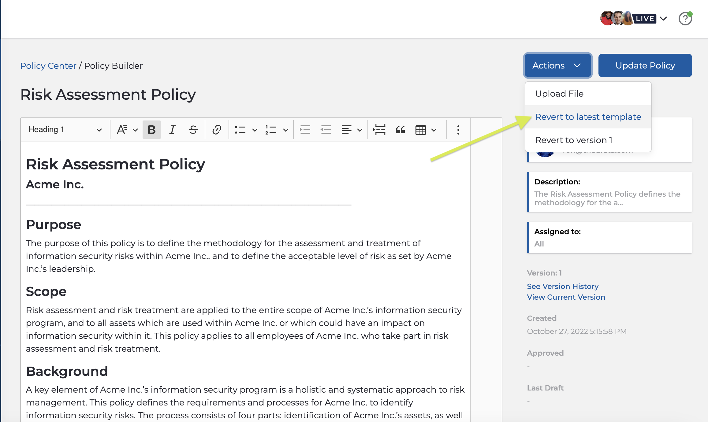

# ISO 27001:2022

Source: https://help.drata.com/en/articles/6854626-iso-27001-2022
Collection: Framework Information › ISO 27001
Updated: 2026-08-17
Fetched: 2026-11-22
Description: What you need to know about the latest version of ISO 27001

## Article text

## What do I need to know about the newest version of ISO 27001?

In October 2020, the International Organization for Standardization (ISO) published a new and updated version of its 27001 standard for information security. The changes in the new version, ISO/IEC 27001:2022, include:

- A title change: the new title is “Information security, cybersecurity and privacy protection”
- Minor requirement re-organization: Clause 9.2 and 9.3 were split into smaller subsections (9.2.1, 9.2.2, 9.3.1, 9.3.2., and 9.3.3), with no material content change; and the order of clauses 10.1 and 10.2 was flipped
- One extra requirement, Clause 6.3
- Overhaul of Annex A

The Annex A overhaul is the major change in the new version. Previously, Annex A had 114 controls distributed among 14 areas. The new version has 93 Annex A controls under 4 areas. 11 of the 93 controls are new, over 50 controls combine previous controls, and the rest are the same as before.

## How do these changes affect me?

All DCF controls and policies tied to the 2013 version will remain the same and continue to be reflected in your new 2022 framework.

The changes to be aware of are as follows:

1. ***16 new DCF Controls have been added to your DCF Controls Library to cover the new requirement (Clause 6.3), and the 11 newly-added Annex A controls.***
2. ***A new policy template–*Change Management Policy–*and a new ISMS Plan aligned with the 2022 version have been added to the Policy Center to cover all requirements.***
3. ***The 4 new Areas for the Annex A controls are reflected as category filters on the framework page for ease of navigation.***
4. ***Some existing DCF controls and policy templates have been revised for proper alignment. ***
   1. ***3 DCF controls had minor, non-material updates ***
      1. ***DCF-28 Follow-Ups Tracked***
      2. ***DCF-30 Lessons Learned***
      3. ***DCF-159 Incident Response Plan***
   2. ***3 DCF controls have added Control Activities***
      1. ***DCF-20 Asset Inventory***
      2. ***DCF-43 Termination/Offboarding Checklist***
      3. ***DCF-155 Code Changes are Tested***
   3. ***9 policy templates have 2022 updates***

## What’s next?

ISO 27001:2022 is a separate framework within Drata, and for those currently managing the 2013 version in Drata, it will be enabled for your account as soon as it is available. It will also be added to the Audit Hub.

To be compliant with the requirements for the 2022 version, we suggest taking the following steps:

1. Review the changes between the two versions and conduct a gap analysis
2. Apply necessary changes to the new ISMS Plan and your ISMS, particularly the Statement of Applicability
3. Update your risk register and treatment plan, if applicable
4. Implement the new or revised DCF controls that are within your ISMS scope
5. Update your policies, and implement the additions made to your policies

## How do I update to the latest policy templates?

The following policy templates have been updated for ISO 27001:2022:

1. Acceptable Use Policy
2. Business Continuity Plan
3. Data Classification Policy
4. Data Protection Policy
5. Incident Response Plan
6. Password Policy
7. Vendor Management Policy
8. Risk Assessment Policy
9. Software Development Lifecycle Policy

To update to the latest policy templates, go to **Policy Center **and click on the edit icon next to each of the above policies. From here, click on the **'Actions'** button, and select **'Revert to Latest Template' **(or **'Restart with Latest Template'** if you had uploaded a custom policy). Review and edit the policy as you see fit, then follow the usual policy approval workflow.

## How long do I have before I can transition from the 2013 to the 2022 version?

ISO’s guideline for transition has been set for 36-months from the month of publication of the new version. That means the transition period began on October 31, 2022 and will end on October 30, 2025, at which time all ISO 27001:2013 certifications will expire or are withdrawn.

For those not yet certified in ISO 27001, there’s an option to certify against either the 2013 or 2022 version until April 30, 2024. Beginning in November 2023, initial certifications can only be done for ISO 27001:2022.

Certifying bodies can conduct transition audits:

- in conjunction with a scheduled surveillance audit;
- In conjunction with a recertification review; or,
- In a separate audit

**IMPORTANT NOTE:** Regardless of the above guidelines set for transition or certification, you must keep in mind that **you can only be certified for ISO 27001:2022 by a certifying body that has already been accredited to conduct audits against the 2022 version**. Certifying bodies have until October 30, 2023 to get accredited to conduct ISO 27001:2022 audits. **Please discuss these timelines with your certifying body to ensure that you go through the process appropriately**.

## Images

- [image 01] ../../images/ux/policies/iso-27001-2022--01.png

## Related articles

- [ISO 27001:2022 Checklist](iso-27001-2022-checklist.md)
- [ISO 27001:2022 Example ISMS Plan](iso-27001-2022-example-isms-plan.md)
- [Control Mapping Updates for Policies - 4/13/2023](control-mapping-updates-for-policies-4-13-2023.md)
- [Example Evidence for Not Monitored Controls Linked to Policies](example-evidence-for-not-monitored-controls-linked-to-policies.md)
- [ISO 27001:2022 Updates as of 5/7/2024](iso-27001-2022-updates-as-of-5-7-2024.md)
