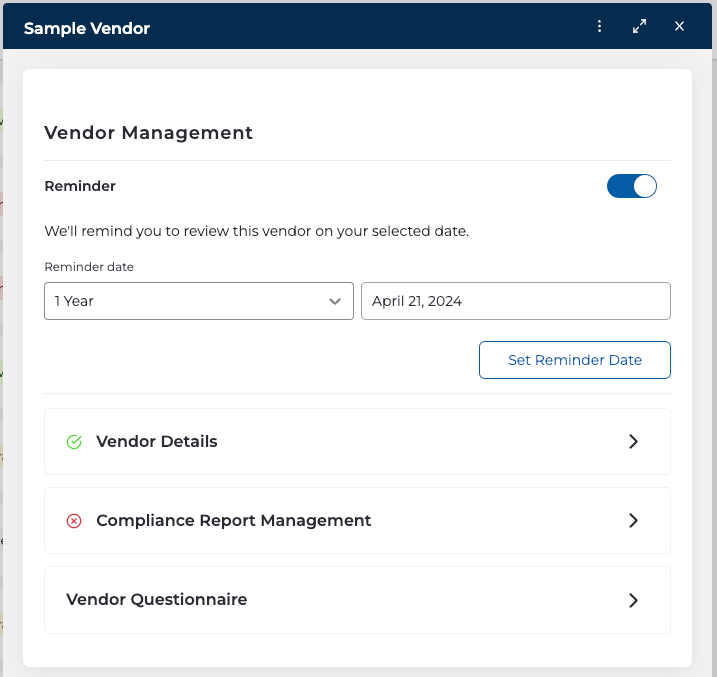
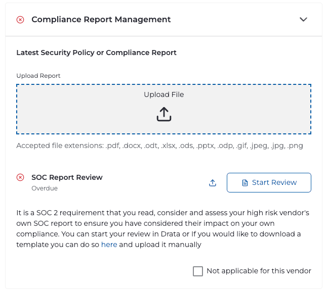
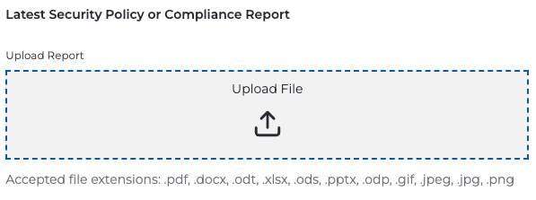
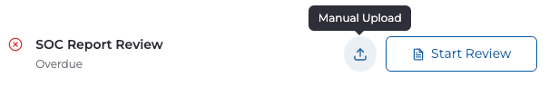
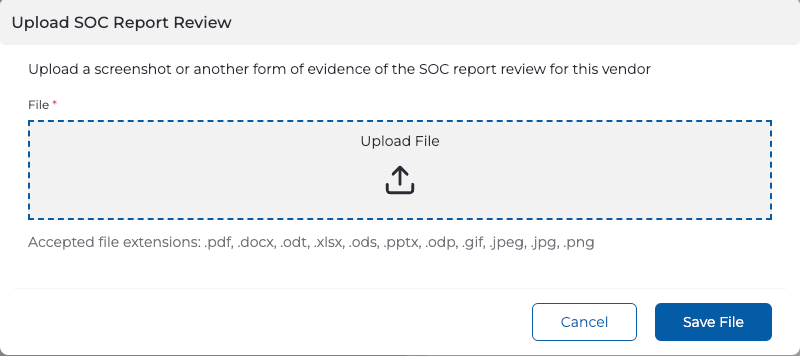

# ISO 27001 Certification Review Template

Source: https://help.drata.com/en/articles/7792143-iso-27001-certification-review-template
Collection: Framework Information › ISO 27001
Updated: 2026-08-05
Fetched: 2026-11-22

## Article text

**Background**

It is advised that you obtain and review your key vendors’ SOC 2 report as it contains detailed assessment of a vendor’s controls related to security, availability, processing integrity, confidentiality, and privacy of its systems and processes. However, SOC 2 reports are not always available. In these cases, you may determine that reviewing your vendors’ ISO 27001 certification can still be a valuable indicator of your vendor’s commitment to security.

**How do I review my vendor’s ISO 27001 Certificate?**

Below is a template that you can use to review your vendor’s ISO 27001 Certification. Here are the fields you would need to fill out:

- **Reviewer** - the person responsible for reviewing the vendor’s ISO 27001
- **Review Date** - the date on which the review of the vendor’s ISO 27001 certificate was conducted
- **Vendor** - the name of the vendor whose ISO 27001 certificate is being reviewed
- **ISO 27001 Certificate #** - the unique identification number assigned to the vendor’s ISO 27001 certificate
- **Certification Body** - the independent third-party organization that conducted the certification audit and issued the ISO 27001 certificate
- **Certification Status** - the current status of the vendor’s ISO 27001 certificate, such as “Active” or “Expired”
- **Accreditation Body - **The organization that accredited the certification body, if applicable
- **Accreditation Body Accredited by International Accreditation Forum? - **whether the Certification Body that issued the ISO 27001 certificate is accredited by the International Accreditation Forum (IAF). Please refer to the [International Accreditation Forum (IAF)](https://iaf.nu/en/accreditation-bodies/) website to search and verify the Accreditation Body. If the accreditation body is not accredited by the IAF, then the vendor has an unaccredited ISO 27001 certificate. You will have to decide if this is acceptable to your company,
- **Date of Issuance** - the date on which the vendor’s ISO 27001 certificate was issued by the certification body
- **Date of Expiration **- the date on which the vendor’s ISO 27001 certificate will expire
- **Scope of Certification** - the scope of the vendor’s ISO 27001 certification, which defines the specific information security management systems (ISMS) and processes that are covered by the certificate
- **Locations in Scope** - the specific locations or business units that are covered by the vendor’s ISO 27001 certificate

**ISO 27001 Certificate Review Template (copy this template to a word document and then upload to the corresponding vendor record)**

| **Reviewer:** |  | **Review Date:** |  |
|---|---|---|---|
| **Vendor:** |  | **ISO 27001 Certificate #:** |  |
| **Certification Body** |  | **Certification Status:** | ☐Active ☐Expired |
| **Accreditation Body** |  | **Accreditation Body Accredited by International Accreditation Forum (IAF)?** | ☐Yes ☐No |
| **Date of Issuance:** |  | **Date of Expiration:** |  |
| **Scope of Certification:** |  | **Locations in Scope:** |  |

**How will I upload our completed ISO Report Review to Drata?**

On your Drata’s [Vendor module](https://app.drata.com/risk/vendors), select the appropriate vendor to open the Vendor Management drawer

On the Vendor Management drawer, expand the **Compliance Report Management** tab

Upload your vendor’s ISO 27001 certificate under **Latest Security Policy or Compliance Report**

Finally, to upload your completed ISO 27001 Certificate Review, select the  **Manual Upload **icon under **SOC Report Review**

This will popup a window where you can upload your completed ISO 27001 Certificate Review

## Images

- [image 01] ../../images/ux/vendors/iso-27001-certification-review-template--01.png
- [image 02] ../../images/ux/vendors/iso-27001-certification-review-template--02.png
- [image 03] ../../images/ux/vendors/iso-27001-certification-review-template--03.png
- [image 04] ../../images/ux/vendors/iso-27001-certification-review-template--04.png
- [image 05] ../../images/ux/vendors/iso-27001-certification-review-template--05.png

## Related articles

- [ISO 27001:2022 Checklist](iso-27001-2022-checklist.md)
- [ISO 27001:2022](iso-27001-2022.md)
- [Transition Guidance for ISO 27001:2013 to ISO 27001:2022](transition-guidance-for-iso-27001-2013-to-iso-27001-2022.md)
- [Questions to ask a Potential ISO 27001 Certification Body (i.e. Auditor)](questions-to-ask-a-potential-iso-27001-certification-body-i-e-auditor.md)
- [ISO 27001:2022 Updates as of 5/7/2024](iso-27001-2022-updates-as-of-5-7-2024.md)
