# Jamf Integration Guide

Source: https://help.drata.com/en/articles/5456409-jamf-integration-guide
Collection: Connection Support › Other Guidance
Updated: 2026-10-02
Fetched: 2026-11-22
Description: This article walks through the details of configuring Jamf to connect to Drata.

## Article text

Jamf can verify that your employees’ workstations adhere to the Security Policies monitored by Drata.

Connecting to Jamf Pro will turn on the MDM option in Workstation Configuration Monitoring on your Company's Internal Security settings. If the Drata Agent is not present and active, it will then proceed to obtain workstation configuration info from the Jamf Pro instance for compliance purposes.

## Prerequisites & Data Access

- Must have **Administrator access** to your company’s **Jamf Pro** account.
- Drata will prioritize data from the **Drata Agent** if both the Agent and Jamf are active on the same device.

### Permissions & Data Table

| Permission/Scope | Why It’s Needed | Data Accessed (Read Only) |
|---|---|---|
| Auditor Privilege Set | Grants Drata read-only access to Jamf data | Device compliance, policies, and inventory data |
| API Access | Enables retrieval of extension attribute values and inventory data | Workstation configuration and status |
| Extension Attributes | Used to verify compliance for Screen Lock and Auto Updates | Custom script results mapped to compliance tests |

### LIMITATIONS

- Jamf cannot natively pick up browser extensions, so if those are being used as a password manager, that compliance check will fail. Your users will need to use the equivalent installed desktop application. Ensure that this app shows on the device's Application List.
- Jamf Now is not supported, because that product version does not expose all of the device compliance information Drata requires.

## Step-by-Step Setup

1. Create (or use existing) Jamf Pro Standard Account with a Privilege Set of Auditor.
2. Upload to your Jamf instance the scripts necessary to check for Screen Saver Lock and Automatic Update compliance.
3. Set Inventory Refresh to an appropriate Execution Frequency.
4. Ensure required User and Location values are set on all managed machines.
5. Connect to your Jamf instance.

---

### Step 1: Create a Jamf Pro Standard Account (Auditor Role)

Note: If you would like to use the credentials of an existing auditor account, you can skip this section and go to the [Upload Scripts section](#h_0fceced51b).

Learn how to create a new account with auditor privileges.

1. Log into Jamf Pro with the administrator account.
2. In the left navigation pane, select **Settings (the gear icon). **
3. Select 'User accounts & groups'.
   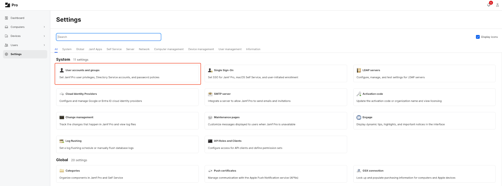
4. Select '+ New'.
5. Select 'Create Standard Account' and 'Next'.
6. Enter the account credentials, additional options and select 'Auditor' for the 'Privilege Set' field.
7. Do not force the user to change passwords on the next login.
   1. Remember the account username and password. You need to enter these in Drata in a later step.
8. 'Save' the account details.
   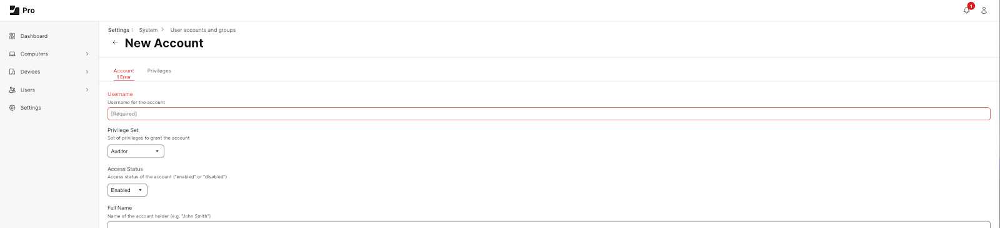

### Step 2: Upload Extension Attribute Scripts

1. Using an administrator account, under the  'Computer management' tab in Settings, select 'Extension attributes'.

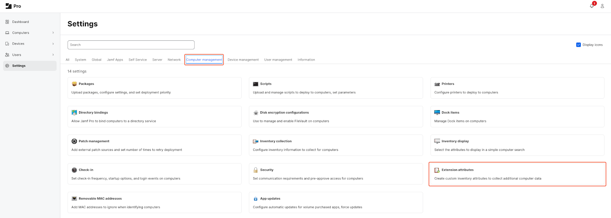

2. Select '+ New'.

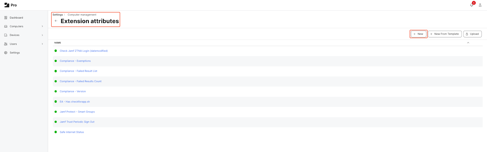

3. Create the 2 scripts:

1. [Screen Saver Lock](#h_2c977232f7) settings
2. [Automatic updates](#h_11cfa63118)

**The following sections display the values for each field. All the fields are required and should be entered exactly as defined below.**

#### Screen Saver Lock

- Display Name: `Screen Saver Lock`
- Enabled (script input type only): Select the checkbox.
- Description: `This attribute displays the current Screen Saver Lock time. The value to be verified is the time before the password is required to unlock the machine, as specified in System Preferences -> Security & Privacy -> General. Example: 'screenLock delay is 60 seconds' verifies that a password will be required after the machine is idle for 1 minute.`
- Data Type: `String`
- Inventory Display: `Extension Attributes`
- Input Type: `Script`
- Code (be sure to preserve line breaks as shown below): `Shell`  `Default Theme`

**NOTE: use this code for any devices running Catalina OS version 10.15.4 or earlier.**

```
#!/bin/bash
askForPassword=$(sysadminctl -screenLock status 2>&1 | awk '{split($0,a,"]"); print a[2]}' | xargs)
idle_time=$(ioreg -c IOHIDSystem | awk '/HIDIdleTime/ {print int($NF/1000000000); exit}')

if [[ ! -z "$askForPassword" && $idle_time -le 900 ]]; then
    echo " $askForPassword "
else
    echo "Disabled"
fi 
```

**NOTE: use this code for any devices running Big Sur OS version 10.16 or later.**

- Apple [deprecated](https://developer.apple.com/documentation/kernel/iohidsystem) `IOHIDSystem` after 10.15.4
- **NOTE*: *If the following script does not work, try replacing the line of code for `idle_time` with this line of code: `idle_time=$(defaults read /Library/Managed\ Preferences/com.apple.screensaver idleTime)`

```
#!/bin/sh
askForPassword=$(sysadminctl -screenLock status 2>&1 | awk '{split($0,a,"]"); print a[2]}' | xargs)
user=$( ls -la /dev/console | cut -d " " -f 4 )
idle_time=$(sudo -u $user defaults -currentHost read com.apple.screensaver idleTime)

if [[ ! -z "$askForPassword" && $idle_time -le 900 ]]; then
    echo " $askForPassword "
else
    echo "Disabled"
fi
```

The following image shows the Screen Saver Lock setting with the entered fields.

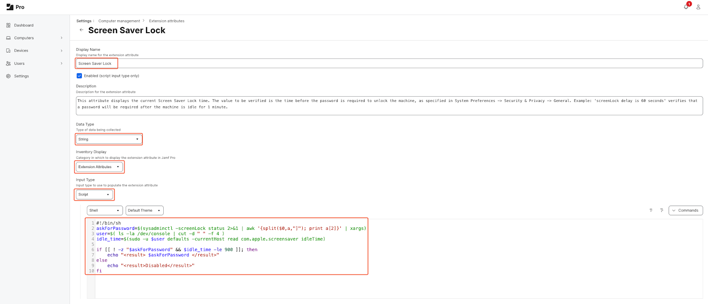

For more information on screen lock settings, go to [Auto-Lock your Workstation with Screensaver](auto-lock-your-workstation-with-screensaver.md) and review the MacOS section.

**NOTE:** Regardless of which script version you use, the script's correct operation will produce an output value of either `Enabled` or `Disabled`. `Enabled` means the script found the expected settings on the machine, whereas `Disabled` means the script did not find the expected settings. It doesn't mean that the entire extension attributer script is turned off or not working.

#### Automatic Updates

- Display Name: `Automatic Updates Enabled`
- Enabled (script input type only): Select the checkbox.
- Description: `Auto updates on OS.`
- Data Type: `String`
- Inventory Display: `Extension Attributes`
- Input Type: `Script`
- Code (be sure to preserve line breaks as shown below): `Shell`  `Default Theme`

```
#!/bin/bash
automaticUpdatesScheduled="$(softwareupdate --schedule 2> /dev/null)"

if [[ "$automaticUpdatesScheduled" == *"turned on"* ]]; then
    echo "Enabled"
else
    echo "Disabled"
fi
```

The following image shows Automatic Updates settings with the entered fields.

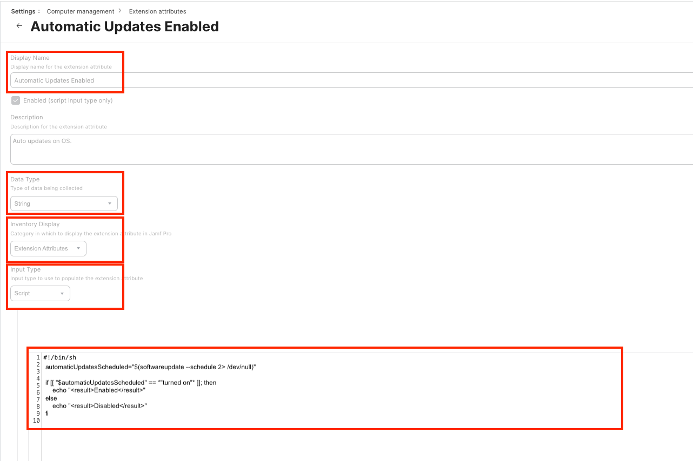

### Step 3: Set Inventory Refresh Frequency

1. Select 'Computers', 'Policies' and then 'Update Inventory'.
   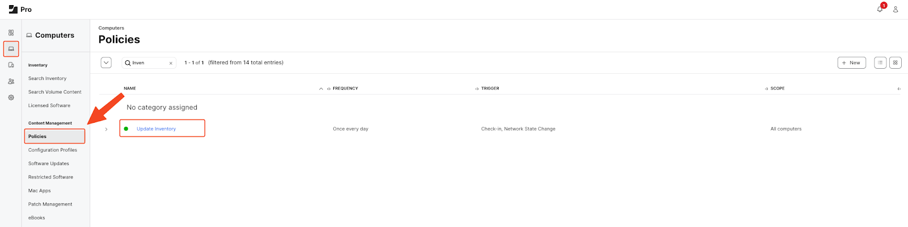
2. Select 'Edit' and add your preferred frequency under 'Execution Frequency' and 'Save'.
   1. We recommend a frequency of 'Once every day' to ensure continuous compliance.

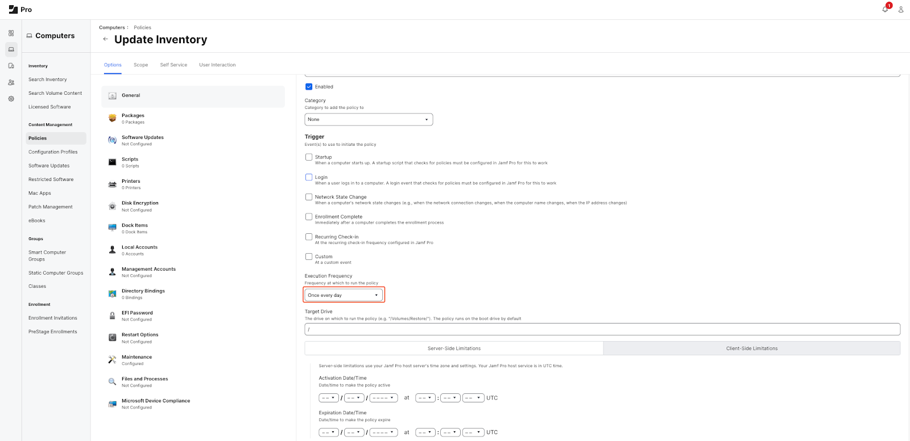

### Step 4: Verify User and Location Information

Drata will update workstation configuration compliance values based on the email address of the user matching to your Personnel records. For each managed machine in Jamf, ensure the Username, Full Name, and Email Address are filled out in the User and Location tab.

1. Select 'Computers' and 'Search' at the top right to bring up the list of managed machines.

2. Select the name of a given computer.

3. Select 'User and Location' in the left sidebar under 'Inventory.'

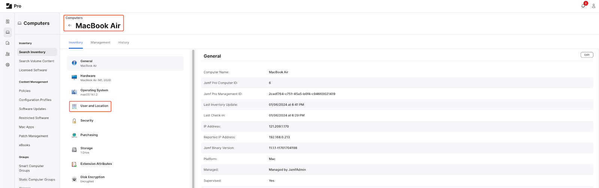

4. If there are no values in the Username, Full Name, and Email Address fields, select 'Edit' at the top right to fill in these values. ***Ensure the value for Email Address matches the Personnel email record in Drata.*** Only if email is null, then Drata will try to sync according to the value in the Username field.

- **NOTE: If an invalid email is entered in the Email Address field, the device will not sync to the Personnel record in Drata**.

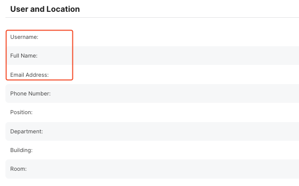

### Step 5: Connect Jamf Pro to Drata

1. In Drata, go to **Connections → Available Connections**.
2. Search for **Jamf Pro** and click **Connect**.
   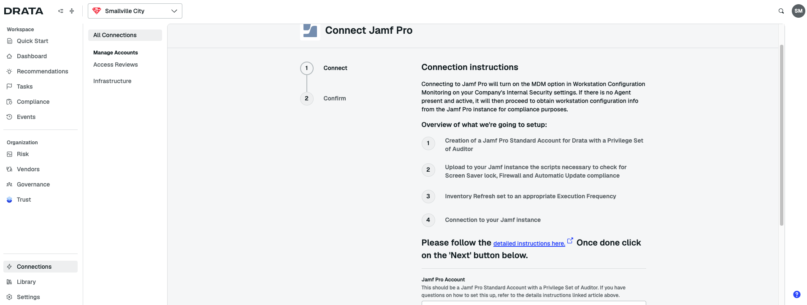
3. In the setup drawer, enter the following:
   - **Jamf Pro URL:** (omit the trailing slash)
   - **Username:** Auditor account username
   - **Password:** Auditor account password
4. Click **Save & Test Connection.**

**NOTE:** Drata does not sync Jamf device data immediately upon connection. Device data [syncs nightly when all user syncs run on your account](identity-sync-updates-in-drata.md).

### Step 6: Configure Jamf as the Compliance Source

1. Go to your Settings page > Personnel Compliance page > Internal Security tab.
   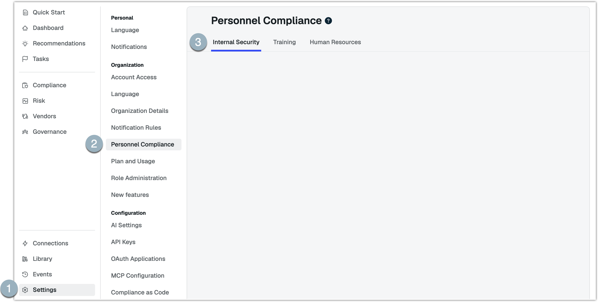
2. Within the Automation section, select 'Automated via Jamf MDM' and toggle off 'Automated via Drata Agent' to disable the Drata agent.
   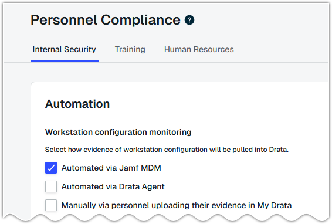
   - If both remain on, and the Drata agent is installed on an employee computer, the Drata agent will take precedence.
   - Meaning, employee compliance checks will come from the agent.

## Images

- [image 01] ../../images/integrations/jamf/jamf-integration-guide--01.png
- [image 02] ../../images/integrations/jamf/jamf-integration-guide--02.png
- [image 03] ../../images/integrations/jamf/jamf-integration-guide--03.png
- [image 04] ../../images/integrations/jamf/jamf-integration-guide--04.png
- [image 05] ../../images/integrations/jamf/jamf-integration-guide--05.png
- [image 06] ../../images/integrations/jamf/jamf-integration-guide--06.png
- [image 07] ../../images/integrations/jamf/jamf-integration-guide--07.png
- [image 08] ../../images/integrations/jamf/jamf-integration-guide--08.png
- [image 09] ../../images/integrations/jamf/jamf-integration-guide--09.png
- [image 10] ../../images/integrations/jamf/jamf-integration-guide--10.png
- [image 11] ../../images/integrations/jamf/jamf-integration-guide--11.png
- [image 12] ../../images/ux/personnel/jamf-integration-guide--12.png
- [image 13] ../../images/ux/personnel/jamf-integration-guide--13.png

## Related articles

- [Legacy: Microsoft Intune Integration Guide (Windows)](legacy-microsoft-intune-integration-guide-windows.md)
- [JumpCloud Integration Guide (MDM)](jumpcloud-integration-guide-mdm.md)
- [Snyk Integration Guide](snyk-integration-guide.md)
- [Semgrep Integration Guide](semgrep-integration-guide.md)
- [NinjaOne Integration Guide](ninjaone-integration-guide.md)
