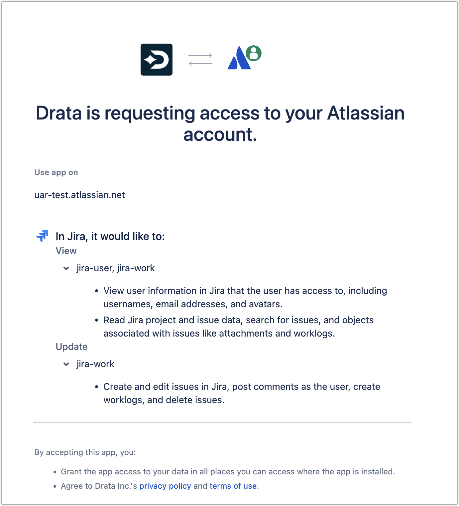

# Jira Integration Guide

Source: https://help.drata.com/en/articles/4663378-jira-integration-guide
Collection: Connection Support › Ticketing Guidance
Updated: 2026-08-05
Fetched: 2026-11-22

## Article text

The Jira Cloud integration enables security and engineering teams to automate ticket monitoring and evidence collection for vulnerability management controls. It connects Drata to Jira Cloud so your team can track, create, and link security-related tickets directly within Drata.

To learn more about Jira Data Center, go [here](jira-data-center-integration.md).

## Key Capabilities

- **Security Ticket Monitoring:** Continuously monitors and syncs Jira issues relevant to vulnerability and security management.
- **Automated Evidence Collection:** Pulls ticket data for compliance tests, including issue prioritization and remediation tracking.
- **Ticket Creation (Optional):** Allows Drata to create and update Jira tickets directly within Jira Cloud.
- **Ticket Automation Support:** Fully supported for Jira Cloud.

## Prerequisites

- Must have **[Admin access](https://community.atlassian.com/t5/Atlassian-Account-questions/How-do-I-know-if-I-am-a-Jira-Admin/qaq-p/1911856)**[to your organization’s **Jira account**](https://community.atlassian.com/t5/Atlassian-Account-questions/How-do-I-know-if-I-am-a-Jira-Admin/qaq-p/1911856).
- Permission to install and authorize apps in Jira
- (Optional) Project-level permissions if enabling ticket creation
- You can connect multiple Jira Cloud accounts to Drata

### Permissions & Data Table

| **Permission/Scope** | **Why It’s Needed** | **Data Accessed** |
|---|---|---|
| **view:jira-user** | Allows Drata to read Jira user details for ticket ownership and assignment. | User data (Read) |
| **view:jira-work** | Enables Drata to read issues, projects, and workflows for evidence collection. | Issue and project data (Read) |
| **update:jira-work** | Enables Drata to create and edit issues in Jira, post comments as the user, create worklogs, and delete issues. | Issue data (Update) |

## Step-by-Step Setup

### Step 1: Open the Jira Connection

1. In Drata, navigate to **Connections → Available connections → Jira**
2. Start the connection process.

---

### Step 2: Configure the Integration

Complete the integration form:

1. Select the workspace.
2. **Account Alias:** Name the connection (useful for multiple Jira accounts).
3. **Source:** Choose how Drata identifies relevant tickets:
   - **Label** – Enter the Jira label used for security tickets.
   - **JQL** – Enter a JQL query that returns the expected tickets. Drata does not validate JQL queries. Test your query in Jira before saving.
4. **Write Access (Optional):** Enable to allow Drata to create Jira tickets directly.

---

### Step 3: Authenticate

1. You will be redirected to Jira.
2. Review and grant the requested permissions.
   `view:jira-user`
   `view:jira-work`
   `update:jira-work`
   
3. Confirm access.

You will automatically return to Drata after approval.

---

### Step 4: Verify the Connection

1. Save your configuration.
2. Test the connection.
3. Confirm it appears under **Active Connections**.

Once verified, Jira Cloud issues begin syncing automatically.

---

### Important Notes

- Drata verifies the **Priority** field only. Missing or customized Priority fields may impact compliance tests (such as Test 26).
- Ticket Automation and automatic ticket creation are supported for Jira Cloud only.
- You can create ticket automation rules within the Settings page. Learn more at [Ticket Automation (Jira-only) (New experience)](ticket-automation-jira-only-new-experience.md).

## Images

- [image 01] ../../images/integrations/jira/jira-integration-guide--01.png

## Related articles

- [Jira security tickets: Label vs JQL](jira-security-tickets-label-vs-jql.md)
- [HR Cloud Integration Guide](hr-cloud-integration-guide.md)
- [Aikido Integration Guide](aikido-integration-guide.md)
- [GitHub Issues Enterprise Integration Guide](github-issues-enterprise-integration-guide.md)
- [Jira Data Center Integration](jira-data-center-integration.md)
