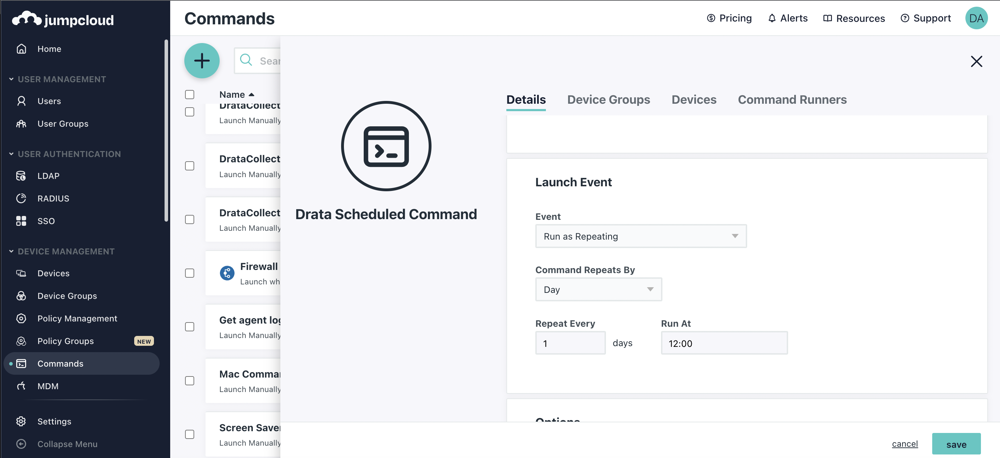
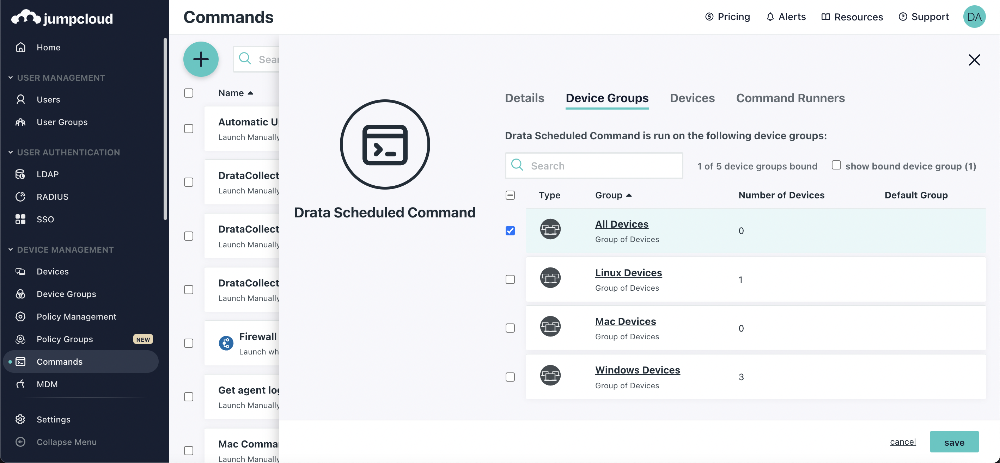
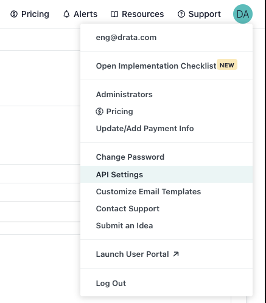

# JumpCloud Integration Guide (MDM)

Source: https://help.drata.com/en/articles/5872265-jumpcloud-integration-guide-mdm
Collection: Connection Support › Other Guidance
Updated: 2026-10-28
Fetched: 2026-11-22
Description: This article walks through the details of configuring JumpCloud MDM to connect to Drata.

## Article text

Having secure devices plays a major role in meeting compliance requirements. We want to support as many Mobile Device Management solutions (MDMs) as possible, in addition to providing our agent. We have heard from many of you that you use JumpCloud's MDM solution. This article goes over how to sync & bring all of your compliance-related information from JumpCloud to Drata.

## Prerequisites & Data Access

1. Must have **Admin access** to your company’s **JumpCloud account**.
2. Your JumpCloud account must have **API access enabled**.
3. **System Insights** endpoints must be available (check under [JumpCloud Features](https://console.jumpcloud.com/#/settings/features)).
4. The **JumpCloud Agent** must be installed on all computers you wish to monitor.
5. Supported device type: **Computers only** (macOS, Windows, Linux).
   - **Mobile and tablet devices are not supported.**

**Compliance checks**

At this time, Drata’s device compliance checks using the JumpCloud MDM connection confirms the following:

1. Does the policy of the required name and/or type exist?
2. Is that policy mapped to the device?
3. Is that device compliant with that policy?

> **NOTE:** Drata supports Apple's new DDM protocol through the JumpCloud integration. In certain cases, JumpCloud will report a device's auto-update policy as `pending`, which means the organization's policy is waiting to be applied to the device. When Drata reads this status, the following logic applies:
>
> 1. If the device has already synced a prior compliance status, Drata will continue to show that status until `pending` moves to a new value, such as `success` or `failed`.
>    1. i.e. a device that shows as `PASS` or `FAIL` in Drata for automatic updates will continue to show this status while `pending` is read from JumpCloud
> 2. If `pending` is the first/only device status Drata has read from JumpCloud, Drata will render a device compliance status of `FAIL`. Drata will render an updated compliance status once `pending` moves to a new value, such as `success` or `failed`.

### Current Limitations

- **Browser Extensions:** Only **Chrome extensions** are detectable. If Chrome extensions are used as password managers, the related compliance check will fail. Users should instead use the equivalent **desktop application**.
- **Linux Devices:** JumpCloud APIs do **not expose installed applications** on Linux. Linux users must **manually upload evidence** for antivirus and password manager compliance.
- **Serial Number: **Ensure that you understand the discrepancy between the serial number displayed in Drata and the hostname in JumpCloud. Details on how to verify the device’s serial number in JumpCloud are provided below.

> **NOTE: **For monitoring test 63, Password Manager Records on Employee Computers, Drata supports JumpCloud's Password Vault (see documentation [here](https://jumpcloud.com/blog/moving-to-the-new-password-vault-what-changes-and-how-to-migrate) and [here](https://jumpcloud.com/support/migrating-to-password-vault-from-jumpcloud-legacy-password-manager) and [here](https://jumpcloud.com/support/faq-migrating-from-jumpcloud-password-manager-to-password-vault)).
>
> JumpCloud's recommended migration path is to uninstall the standalone Password Manager desktop app and move to the JumpCloud Go extension. JumpCloud Go is required to use the Vault, so every Vault user has it. At the same time, JumpCloud Go is also used just for login (SSO), so having it alone doesn't mean someone uses the Vault.
>
> Drata users will pass that test according to the following two-part logic; both conditions must be met:
>
> 1. **User is active in Password Vault, and**
> 2. **Device has the JumpCloud Go extension installed**

### Permissions & Data Table

| **Permission/Scope** | **Why It’s Needed** | **Data Accessed (Read Only)** |
|---|---|---|
| API Token | Authenticates Drata’s connection to JumpCloud | Device, policy, and compliance data |
| System Insights | Provides detailed system-level evidence | Device status, disk encryption, lock screen, firewall, and updates |
| Commands (DrataCollectorLinux) | Executes system scripts for compliance verification | Firewall, updates, encryption status |

## Step-by-Step Setup

### Step 1: Configure JumpCloud Device Policies and Commands

Before connecting to Drata, ensure that device policies and command scripts are properly configured in JumpCloud.

**Supported Device Policies**

| **Device** | **Supported Device Policies** |
|---|---|
| Windows | - BitLocker Full Disk Encryption<br>- Configure Windows Updates<br>- Lock Screen |
| macOS | - FileVault 2<br>- Lock Screen<br>- Automatic macOS Updates (under **Patch Management**) or Software Update Preferences<br>**Note:** Only **Automatic macOS Updates** are supported for Patch Management compliance. |
| Linux | - Check Disk Encryption<br>- Lock Screen |

Drata makes use of the following **Device Policies **in our compliance checks. To learn more about JumpCloud Device Policies, please [follow these instructions](https://support.jumpcloud.com/support/s/article/getting-started-policies-2019-08-21-10-36-47). During evaluation, Drata will check individual devices for a connected policy or that the device belongs to a **Policy Group** containing the policy:

#### Commands Setup

For other checks, we utilize the **JumpCloud Commands** functionality to run scripts on the system. These scripts can be found below, and then copy and pasted into your JumpCloud console.

We recommend you configure JumpCloud to run these scripts at a set daily interval, and Drata will gather evidence from the latest runs of these commands when we run our daily compliance checks.

Like Policies, these Commands should be attached either directly to devices or to device groups containing every device you want to run compliance checks on.





1. You can create new Commands starting from here: [https://console.jumpcloud.com/#/commands/new](https://console.jumpcloud.com/#/commands/new)
2. **DrataCollectorLinux **(Linux Shell Script)

```
#!/bin/sh

if which ufw > /dev/null && ufw status | grep -q "Status: active"; then
  firewall='true';
else
  firewall='false';
fi

graphics=`lspci | grep VGA | head -1`;

if which apt-config > /dev/null && apt-config dump APT::Periodic::Unattended-Upgrade | grep -q 'APT::Periodic::Unattended-Upgrade "1";'; then
  autoUpdate='true';
else
  autoUpdate='false';
fi

echo "{"
echo "  \"firewallEnabled\": $firewall,"
echo "  \"macAddress\": null,"
echo "  \"graphics\": \"$graphics\","
echo "  \"autoUpdateEnabled\": $autoUpdate,"
echo "  \"gateKeeperEnabled\": null,"
echo "  \"fileVaultEnabled\": null,"
echo "  \"winServicesList\": null"
echo "}"
```

### Step 2: Locate and Copy the JumpCloud API Key

1. Log into the [JumpCloud Admin Console](https://console.jumpcloud.com/)
2. Click your **username dropdown** in the top-right corner.
3. Click **API Settings**.
4. Copy your **API Key**.



**Important Notes:**

- Each administrator has a unique API key.
- To revoke access, **reset your API key** in the same menu. This will immediately invalidate previous keys.
- Keep your API key **confidential**, as it provides full access to your JumpCloud console data.

### Step 3: Connect JumpCloud MDM to Drata

1. In Drata, navigate to **Connections** from the side navigation menu.
2. Select the **Available Connections** tab.
3. Search for **JumpCloud MDM** and click **Connect**.
4. In the connection drawer, enter the following details

| **Drata Field** | **JumpCloud MDM Value** |
|---|---|
| API Key | The API key copied from JumpCloud Admin Console |
| Exclusion Group ID | (Optional) ID of JumpCloud device group to exclude from monitoring |
| Organization ID | (Optional) Organization ID for multi-tenant environments |

Click **Save & Test Connection** to complete setup.

### Step 4: Enable JumpCloud MDM

1. In Drata, navigate to **Settings → Internal Security**.
2. Under **Workstation Configuration Monitoring**, select **Automated via JumpCloud MDM**.
3. *(Optional)* Disable **Automated via Drata Agent** if you want Drata to rely only on JumpCloud MDM for workstation data.

### Step 5: Verify the Assets

1. Navigate to **Assets**.
2. Use the **All Providers** filter and select **JumpCloud MDM**.
3. Use additional filters to narrow the device list. Select a device to open additional details.

For each device, verify:

- **Serial Number** matches the device’s serial number in JumpCloud
- **Owner** matches the assigned user in JumpCloud

## Images

- [image 01] ../../images/integrations/jumpcloud/jumpcloud-integration-guide-mdm--01.png
- [image 02] ../../images/integrations/jumpcloud/jumpcloud-integration-guide-mdm--02.png
- [image 03] ../../images/integrations/jumpcloud/jumpcloud-integration-guide-mdm--03.png

## Related articles

- [Jamf Integration Guide](jamf-integration-guide.md)
- [Legacy: Microsoft Intune Integration Guide (Windows)](legacy-microsoft-intune-integration-guide-windows.md)
- [Kandji (now Iru) Integration Guide (MDM)](kandji-now-iru-integration-guide-mdm.md)
- [CrowdStrike Falcon Exposure Management Integration Guide](crowdstrike-falcon-exposure-management-integration-guide.md)
- [NinjaOne Integration Guide](ninjaone-integration-guide.md)
