# Kandji (now Iru) Integration Guide (MDM)

Source: https://help.drata.com/en/articles/5831405-kandji-now-iru-integration-guide-mdm
Collection: Connection Support › Other Guidance
Updated: 2026-08-05
Fetched: 2026-11-22
Description: This article covers how to connect Kandji to Drata.

## Article text

Having secure devices plays a major role in meeting compliance requirements. We want to support as many Mobile Device Management solutions (MDMs) as possible, in addition to providing our agent. We have heard from many of you that you use Kandji for macOS. This article goes over how to sync and bring all of your compliance-related information from Kandji to Drata.

## Prerequisites & Data Access

1. Make sure you have admin access to your company's Kandji account.
2. Your Kandji account has access to Kandji APIs (available for accounts with 500+ devices or can be purchased separately - [learn more](https://support.kandji.io/api)).
3. We currently support computers. Mobile and tablet devices are not supported.
4. Kandji is currently available only for macOS
5. Only one configuration source per machine will be read, with the Drata agent taking precedence.
6. For firewall compliance, the Kandji blueprint should include a **configuration profile** with the `com.apple.security.firewall` payload type.
7. Kandji cannot natively pick up browser extensions, so if those are being used as a password manager, that compliance check will fail. Your users will need to use the equivalent installed desktop application. Ensure that this app shows on the device's Application List.

### Permissions & Data Table

| **Permission/Scope** | **Why It’s Needed** | **Data Accessed (Read Only)** |
|---|---|---|
| Device details | Retrieve complete compliance information for each device | Disk encryption, OS version, policy compliance |
| Device list | Provide the list of all enrolled devices | Device inventory |
| Application list | Retrieve all installed applications per device | Installed software verification |
| Device library items | Access device library policies and compliance status | Firewall, FileVault, and password settings |

**Compliance Note**

Drata’s device compliance checks that use the Kandji connection confirm the following:

1. Does the policy of the required name and/or type exist?
2. Is that policy mapped to the device?
3. Is that device compliant with that policy?

## Step-by-Step Setup

### Step 1. Configure Kandji Blueprints - Templates 

To use Kandji, you need to ensure that your devices have been enrolled with the app and you have configured blueprints. To learn more about Kandji Blueprints, please [follow these instructions](https://support.kandji.io/gsdefine). We recommend using **Level 1 from Kandji’s templates** since it has all the required compliance components except for the screen saver. To add the screen saver, please follow these steps:

Click on the **Kandji Level 1** blueprint:

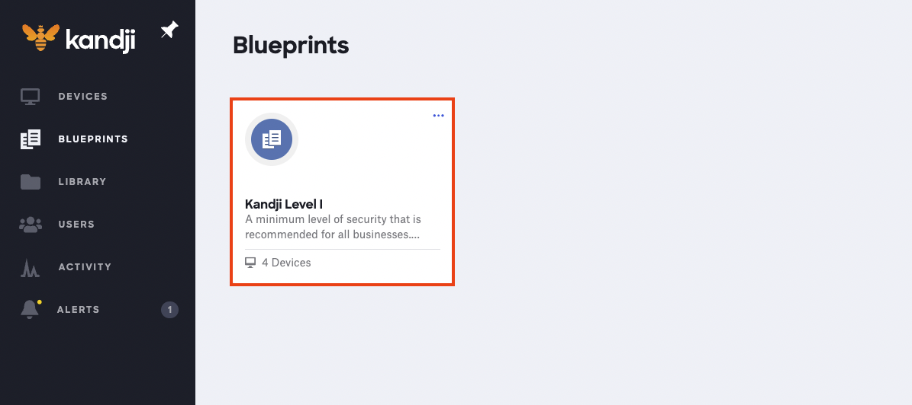

Click on the **Edit Library **button:

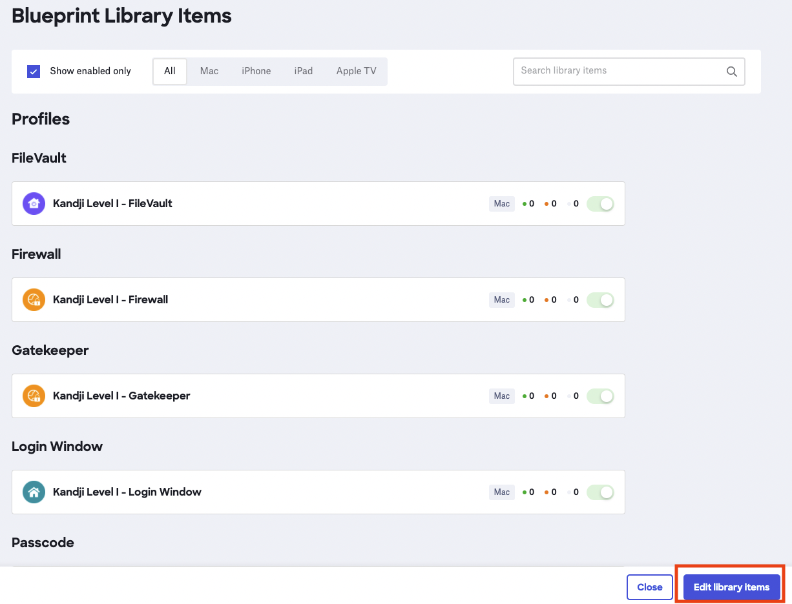

Enable the **Screen Saver **toggle and save your changes:

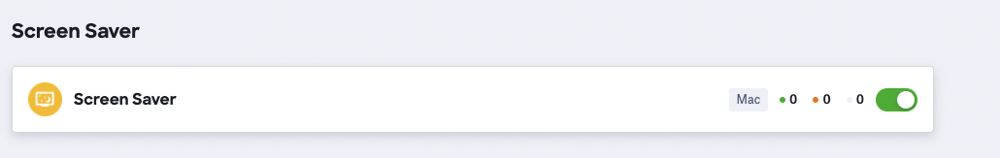

### Step 1A. Configure Kandji Blueprints - Custom

If you prefer to use your own blueprints, make sure the following library items are configured.

**⚠️ Important**: The blueprint name **must include the required keyword** for each item listed below. **Without these keywords, Drata cannot detect the configurations.** Drata’s compliance check involves verifying that the library item name includes specific keywords, such as "Firewall," and that configurations are properly set. If these conditions are not met, Drata flags the device as non-compliant.

### Required Library Items and Keywords

- `FileVault` (This ensures that the device disk is encrypted)
- `Firewall` (Ensuring to restrict external connections)
- `Passcode` (This ensures that devices are password protected)
- `Screen Saver` (Ensures requiring password if user is inactive)
- `Software Update` (Manage automatic update settings)

### Step 2: Configure the Kandji API

In the next step, you will be setting up an API Token with the following permissions.

- Device details (Get the full details for a specific device).
- Device list (Get a list of all devices in the Kandji instance).
- Application list (List all installed applications for a specific device).
- Device library items (Get library items for the device).

To set up an API token, go to Settings > Access > API Token. There are three parts to this step:

1. Copy and modify your Kandji API URL
2. Create and copy your API Token
3. Set the API token's permissions

##### Step 2A. Copy and modify your Kandji API URL

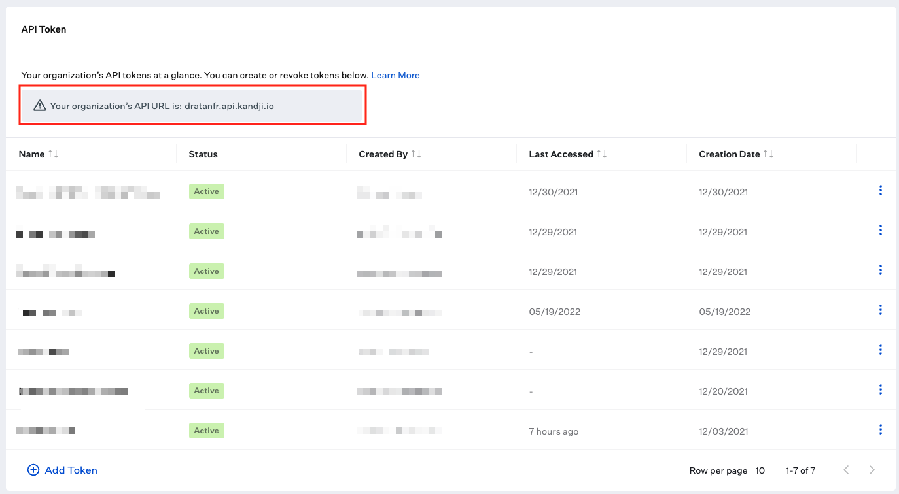

In this **API Token **page, you will see your organization’s API URL, which is needed when connecting to Drata. In the example screenshot above, the raw URL provided by Kandji is [`dratanfr.api.kandji.io`](https://dratanfr.api.kandji.io/). However, Kandji requires additional syntax to make successful API calls. Using this example URL, **the format you enter into the Drata connection drawer should be` [https://dratanfr.api.kandji.io/api/v1/](https://dratanfr.api.kandji.io/api/v1/)`**`.` Note the following additions to the URL syntax:

- `https://` is prepended
- `/api/v1/` is appended

Drata will show an error if the provided syntax is not correct.

**Note:** If you are an EU Kandji customer, your example API URL would be `dratanfr.api.eu.kandji.io`. That is, `eu` will come after `api.` and before `.kandji` in your specific URL. You must still make the two required syntax changes before entering your URL into the Drata connection drawer.

##### Step 2B. Create and copy your API token

When you click on **Add Token**, you will see the screen below. Add a name and description for your token and click on **Create**.

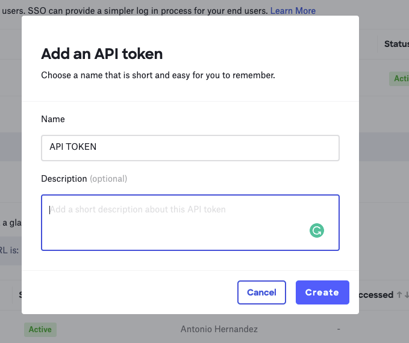

Copy your token and click on** Next**. You will not be able to view this API token again.

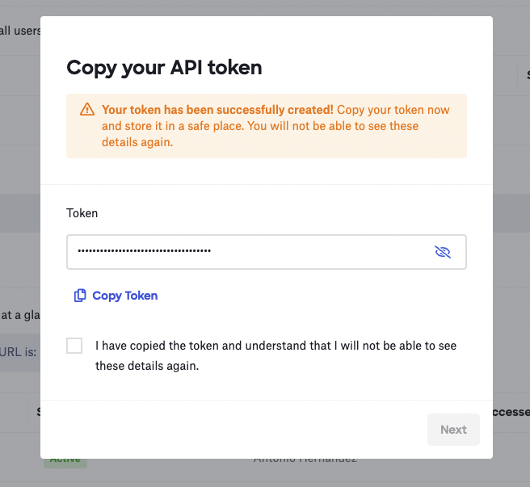

Note: You will need this token along with the API URL when connecting to Drata so please make sure to copy the token and click on **Next**.

In the next step, we are going to add the required access permissions to your token.

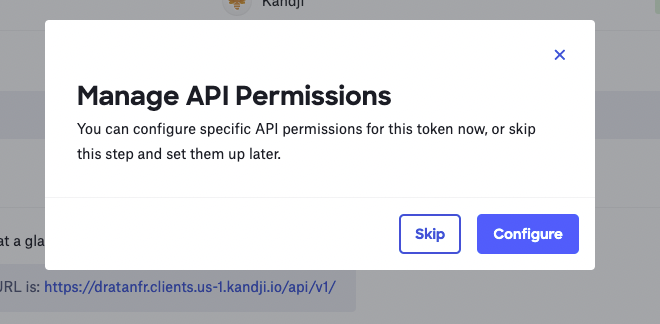

##### Step 2C. Set the API token's permissions

Make sure that the following permissions are granted to the token you will be using.

1. Device details
2. Device list
3. Application list
4. Device Library items

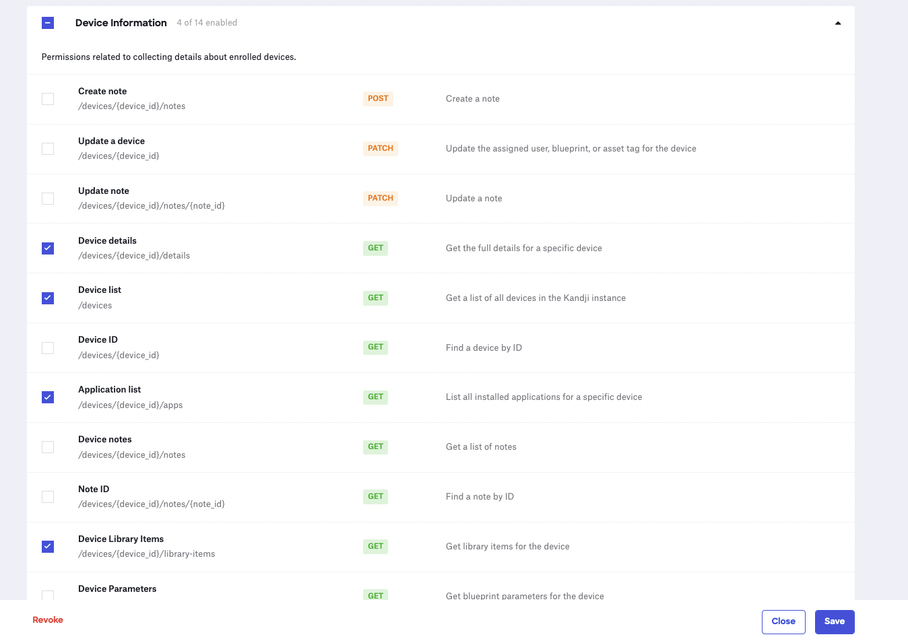

Once you click **Save**, you will be able to verify the proper set up in the next screen.

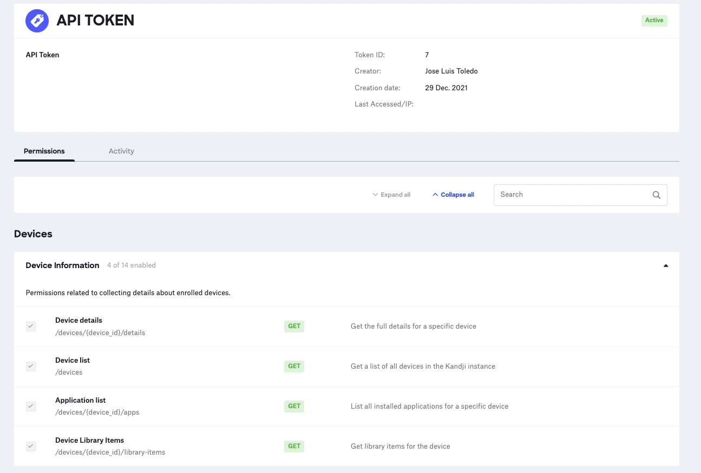

### Step 3: Connect your User Directory

Your Kandji account should be connected to a user directory. This feature can be accessed under Settings > Integrations > User Directory. It is important to use the same account as the identity provider (IdP) used in Drata (Google, Okta, Microsoft 365) to ensure users are synced between Kandji and Drata. If your Drata IdP is not available in Kandji, ensure the email addresses in your Kandji user directory match exactly to the ones in your Drata IdP.

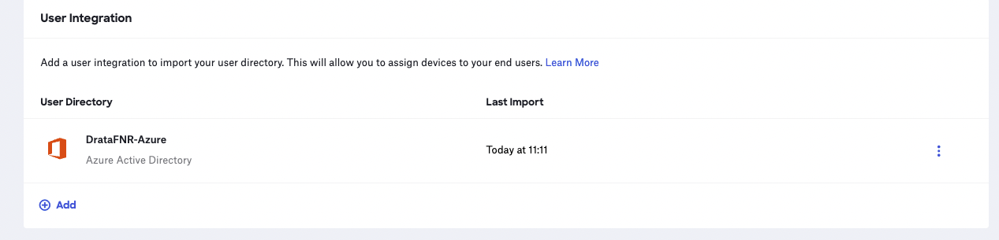

### Step 4: Connect Kandji to Drata

1. In Drata, go to **Connections** from the left-side navigation menu.
2. Select the **Available Connections** tab.
3. Search for **Kandji** and click **Connect.**
4. Enter the following connection details:
   - **API URL:** (formatted with `https://` prefix and `/api/v1/` suffix)
   - **API Token:** The token created in Step 2.
5. Click **Save & Test Connection.**

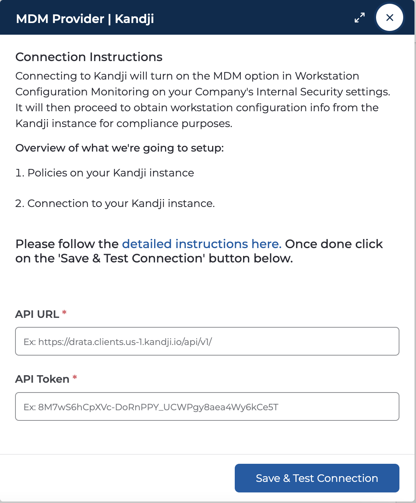

### Step 5: Enable Kandji and Verify the Connection

1. In Drata, navigate to **Settings → Internal Security.**
2. Under **Workstation Configuration Monitoring**, toggle:
   - **Automated via Kandji MDM:** ON
   - **Automated via Drata Agent:** OFF (optional)

**Note:** If both are ON, Drata Agent data takes precedence.

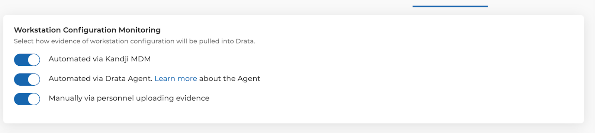

## Images

- [image 01] ../../images/integrations/kandji/kandji-now-iru-integration-guide-mdm--01.png
- [image 02] ../../images/integrations/kandji/kandji-now-iru-integration-guide-mdm--02.png
- [image 03] ../../images/integrations/kandji/kandji-now-iru-integration-guide-mdm--03.png
- [image 04] ../../images/integrations/kandji/kandji-now-iru-integration-guide-mdm--04.png
- [image 05] ../../images/integrations/kandji/kandji-now-iru-integration-guide-mdm--05.png
- [image 06] ../../images/integrations/kandji/kandji-now-iru-integration-guide-mdm--06.png
- [image 07] ../../images/integrations/kandji/kandji-now-iru-integration-guide-mdm--07.png
- [image 08] ../../images/integrations/kandji/kandji-now-iru-integration-guide-mdm--08.png
- [image 09] ../../images/integrations/kandji/kandji-now-iru-integration-guide-mdm--09.png
- [image 10] ../../images/integrations/kandji/kandji-now-iru-integration-guide-mdm--10.png
- [image 11] ../../images/integrations/kandji/kandji-now-iru-integration-guide-mdm--11.png
- [image 12] ../../images/ux/personnel/kandji-now-iru-integration-guide-mdm--12.png

## Related articles

- [Jamf Integration Guide](jamf-integration-guide.md)
- [JumpCloud Integration Guide (MDM)](jumpcloud-integration-guide-mdm.md)
- [Hexnode UEM (macOS) Integration Guide](hexnode-uem-macos-integration-guide.md)
- [Hexnode UEM (Windows) Integration Guide](hexnode-uem-windows-integration-guide.md)
- [SentinelOne (EDR) Integration Guide](sentinelone-edr-integration-guide.md)
