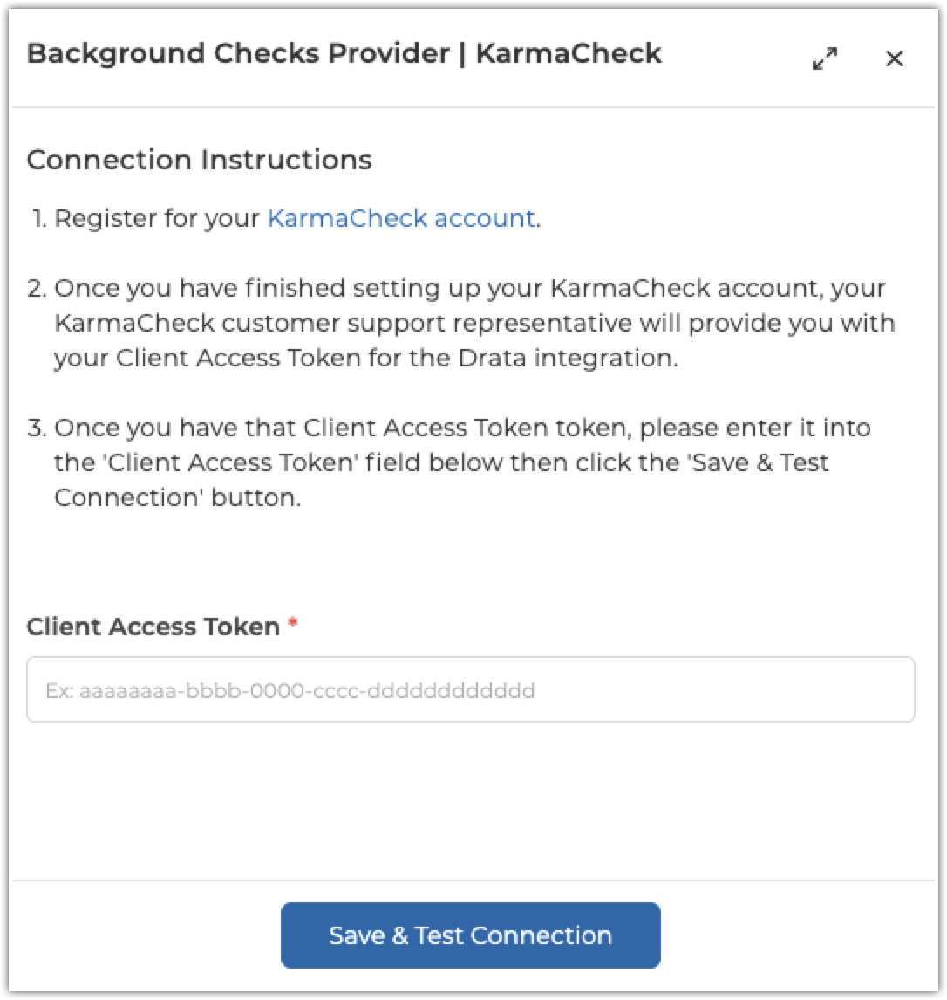

# KarmaCheck Integration Guide

Source: https://help.drata.com/en/articles/4663387-karmacheck-integration-guide
Collection: Connection Support › Other Guidance
Updated: 2026-08-05
Fetched: 2026-11-22
Description: Making the initial connection to KarmaCheck (BG Checks)

## Article text

Connecting KarmaCheck to Drata  allows for new hires to conduct their background check via Drata's onboarding at a preferred partner rate. This will also link background check summaries to personnel for providing streamlined audit evidence.

## Prerequisites & Data Access

- Must have an active **KarmaCheck account**.
- Register for a KarmaCheck account before beginning setup.
- Obtain your **Client Access Token** from your **KarmaCheck Customer Support Representative**.
- Must have **Admin** access in Drata to configure connections.

Permissions & Data Table

| **Permission/Scope** | **Why It’s Needed** | **Data Accessed** |
|---|---|---|
| **Client Access Token** | Authenticates your KarmaCheck account with Drata. | Background check data |
| **Personnel Data (Drata)** | Links background check results to personnel for compliance reporting. | Employee identifiers |

## Step-by-Step Setup

### Step 1: Register with KarmaCheck

1. Go to [KarmaCheck](https://www.karmacheck.com/) and create your account.
2. Complete setup of your KarmaCheck organization.
3. Once your account is active, your **KarmaCheck Customer Support Representative** will provide you with a **Client Access Token**.
4. Keep this token secure — you will use it to authenticate your Drata integration.

**Expected outcome:** You have a valid Client Access Token ready for integration.

### Step 2: Connect KarmaCheck in Drata

1. In Drata, click your **company name** in the lower-left corner.
2. Select **Connections**.
3. Under **Available Connections**, find **KarmaCheck** and click **Connect**.
4. In the connection drawer, paste your **Client Access Token** into the field labeled **Client Access Token**.
   
5. Click **Save & Test Connection**.

**Expected outcome:** Drata validates the token and confirms a successful connection.

| **Drata Field** | **KarmaCheck Value** |
|---|---|
| **Client Access Token** | Token provided by KarmaCheck Support |

### Step 3: Enable KarmaCheck in Drata HR Settings

1. In Drata, go to your **Settings page >Human Resources**.
2. Under **Background Checks**, select the option:
   **“Use Drata’s partner KarmaCheck for background checks.”**
3. Save your settings.

See [this help article](https://help.drata.com/en/articles/4779292-human-resources) for more details.

**Expected outcome:** KarmaCheck is now configured as your default background check provider in Drata.

## Important Notes

- **Partner Integration:** Managed by KarmaCheck. All background check operations occur within KarmaCheck’s platform.
- **Data Access:** Drata receives only summary information for evidence purposes — no sensitive personal data is stored in Drata.
- **Security:** Drata uses your Client Access Token for authentication only.
- **Disconnection:** To disconnect, go to **Company Settings → Connections → KarmaCheck → Disconnect**.

## Images

- [image 01] ../../images/integrations/karmacheck/karmacheck-integration-guide--01.png

## Related articles

- [Gusto Integration Guide](gusto-integration-guide.md)
- [BambooHR Integration Guide](bamboohr-integration-guide.md)
- [Freshteam Integration Guide](freshteam-integration-guide.md)
- [Checkr Integration Guide](checkr-integration-guide.md)
- [TriNet Integration Guide](trinet-integration-guide.md)
