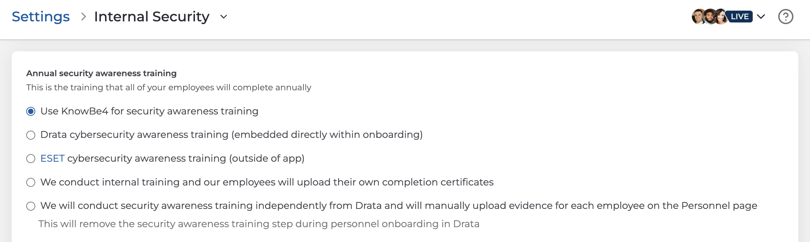
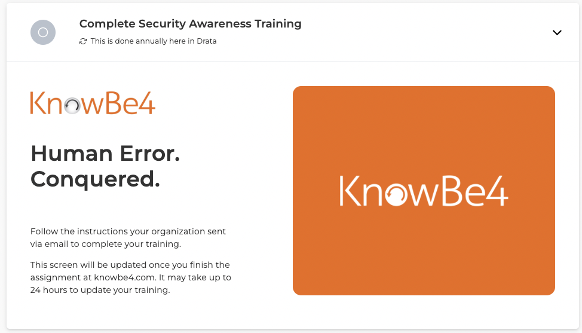
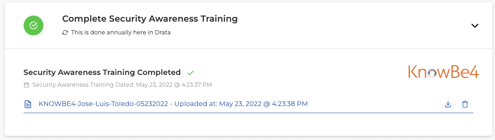

# KnowBe4 Integration Guide

Source: https://help.drata.com/en/articles/6204182-knowbe4-integration-guide
Collection: Connection Support › Other Guidance
Updated: 2026-11-14
Fetched: 2026-11-22
Description: This article covers steps to connect KnowBe4 security training to Drata.

## Article text

The KnowBe4 integration enables compliance and HR teams to automate the collection of training evidence for personnel. It connects Drata to KnowBe4 so your team can automatically retrieve completion data for assigned campaigns—such as Security Awareness, HIPAA, or AI Awareness training—and use it as verified compliance evidence.

## Key Capabilities

- **Automated Evidence Collection:** Retrieve completion data from selected KnowBe4 campaigns to track personnel training compliance.
- **Campaign Mapping:** Assign campaigns in KnowBe4 to specific training categories (e.g., Security Awareness, HIPAA, AI Awareness) directly from Drata.
- **Compliance Synchronization:** Drata determines compliance based on campaign enrollment and completion status and syncs only for users not yet marked compliant.

## Prerequisites & Data Access

- Must have **Admin**, **Information Security Lead**, **DevOps Engineer**, or **Workspace Manager** roles in Drata.
- Access to KnowBe4's Reporting API is available for Advanced and Foundation (SAT-F) customers. Learn more about [KnowBe4's Reporting API](https://developer.knowbe4.com/rest/reporting).
- At least one **KnowBe4 campaign** in an active state. Drata supports the following campaign statuses:
   - Created
   - Enrolling
   - In Progress
   - Completed
   - Canceled
   - Closed
- Ensure all personnel are enrolled in the correct KnowBe4 campaigns before connecting.
- API Token and server details (US, EU, or CA) from KnowBe4 are required to complete the connection.

**Important note**
While KnowBe4 offers comprehensive AI Awareness training, Drata currently requires the NIST AI RMF framework to be enabled for automated import and tracking. Organizations that have only ISO 42001 do not have the option to automatically sync training completions through KnowBe4 for AI Awareness training.

## How Drata Determines Training Compliance

For each personnel, Drata determines training compliance based on campaign selection, enrollment, and completion status.

### Campaign Selection

Select the campaigns under the "Security Training Campaigns" in the KnowBe4 connection drawer.

If you have the HIPAA or NIST AI frameworks enabled, you can select the campaigns related to each training. If you are not using KnowBe4 for a specific training, you do not need to select the campaigns for it. Drata considers campaigns that are selected within the connection drawer.

**Example with Security Training:**

Security Campaigns

**☑ **Campaign A

**☑ **Campaign B

☐ Campaign C

### Enrollment and completion status

Drata maps the selected campaigns to Security Awareness Training requirements and verifies who is enrolled in the campaigns. Each individual is required to complete all the selected campaigns they are enrolled in to count towards completion of Security Awareness Training.

Drata Compliance Example:

|  | (Selected) Campaign A | (Selected) Campaign B | (Not selected) Campaign C |
|---|---|---|---|
| Enrollment | 👩‍🚀🧙‍♀️🦸‍♀️ | 👩‍🚀🧙‍♀️🥷 | 👩‍🚀🧙‍♀️🦸‍♀️🥷 |
| Completion | 🟢🛑🟢 | 🟢🟢🛑 | 🟢🛑🟢🛑 |

In the previous table, we have 4 representative individuals.

- 👩‍🚀 : Enrolled in both selected campaigns for Security Awareness Training and has completed both. They will be marked as compliant in Drata for Security Training.
- 🧙‍♀️: Enrolled in both selected campaigns for Security Awareness Training, but has only completed one. They will not be marked as compliant in Drata for Security Training.
- 🦸‍♀️: Enrolled in one selected campaign for Security Training and has completed it. They will be marked as compliant in Drata for Security Training.
- 🥷: Enrolled in one selected campaign for Security Training, but has not completed it. They will not be marked as compliant in Drata for Security Training.

**Note**: While all 4 individuals are enrolled in Campaign C, it is not selected and is ignored by Drata.

| Character | Campaign A | Campaign B | Campaign C | Overall Status for Security Training |
|---|---|---|---|---|
| 👩‍🚀 | Enrolled: 🟢 | Enrolled: 🟢 | *Not Selected* | 🟢 2 |
| 🧙‍♀️ | Enrolled: 🛑 | Enrolled: 🟢 | *Not Selected* | 🛑 1/2 |
| 🦸‍♀️ | Enrolled: 🟢 | *Not Enrolled* | *Not Selected* | 🟢 |
| 🥷 | *Not Enrolled* | Enrolled: 🛑 | *Not Selected* | 🛑 |

The same applies for HIPAA and AI Awareness training. If there is a campaign shared across multiple trainings, completion of that campaign will count towards respective training requirements accordingly.

### Persistence

Drata only syncs training for individuals that are not yet compliant.

Once individuals are marked compliant for a training, Drata stops syncing their status from KnowBe4. This ensures that changes in KnowBe4 do not errantly overwrite that individual’s compliant status in Drata.

To reset one or more individual’s security awareness, go to [https://help.drata.com/en/articles/5832422-reset-security-awareness-training](https://help.drata.com/en/articles/5832422-reset-security-awareness-training)

## Step-by-Step Setup

### Step 1: Prepare your KnowBe4 Reporting API Token

**Note**: Access to KnowBe4’s Reporting API is available for Platinum and Diamond customers. Learn more about [KnowBe4's Reporting API](https://support.knowbe4.com/hc/en-us/articles/115016090908).

1. Navigate to the KnowBe4 portal and open ‘Account Settings’ from under your username at the top right of the screen.
2. On the left side of your screen, select on ‘Account Integrations’ -> ‘API’.
3. Under ‘Reporting API’, select ‘Enable Reporting API Access’.
4. Select ‘Save Changes’ at the bottom of the screen.
   1. **Note**: Failure to complete this step results in an inactive API token and inability to sync KnowBe4 data to Drata.
5. Under ‘Reporting API’ copy the ‘API Token,’ you will need this in your clipboard for the next section
6. Save the[base url](https://developer.knowbe4.com/rest/reporting#tag/Base-URL) of your KnowBe4 portal in your browser’s address bar, you will need to know this for the next section.

## Complete the Connection

In Drata’s Connections page, enter the following information:

| **Drata Field** | **KnowBe4 Value** |
|---|---|
| Security Training Campaigns | Select the training campaigns. |
| API Token | Paste the KnowBe4 Reporting API Token. |
| Server | Select the server depending on the base url you noted previously: - US for `training.knowbe4.com` - EU for `eu.knowbe4.com` - CA for `ca.knowbe4.com` |

Once Drata has established a connection with KnowBe4, you will need to select which campaigns belong to which training.

## Verify Settings

After connecting KnowBe4 to Drata, you will need to specify which training(s) will be automated by KnowBe4 from your Internal Security Setting. Go to Settings page and then select Internal Security. 

On the Internal Security page, you can select "Use KnowBe4 for security awareness training".

## My Drata: Employee Onboarding

Once connected, your personnel will see a KnowBe4 branded screen during their onboarding in My Drata, asking them to complete their training in KnowBe4. Below is an example of when KnowBe4 is enabled through internal security settings for Security Awareness Training.

We will update the personnel’s activity nightly and generate the completion certificates for anyone that has completed the assigned training.

## Partner Offers & Discounts

Drata has a direct partnership and discounted pricing for **first time and new customers** of KnowBe4 by visiting [https://info.knowbe4.com/drata](https://info.knowbe4.com/drata).

- Get 25% off a 1 or 3 year subscription of KnowBe4 Security Awareness Training
- 15% Discount on SecurityCoach
- 15% Discount on PhishER
- 15% Discount on Compliance Plus (HIPAA training)

Check out [more partner offers and discounts](https://drata.com/partner/find/tech-directory?collections=partner-discountoffers,partner-offers-discounts-pod).

## Images

- [image 01] ../../images/ux/personnel/knowbe4-integration-guide--01.png
- [image 02] ../../images/ux/personnel/knowbe4-integration-guide--02.png
- [image 03] ../../images/ux/personnel/knowbe4-integration-guide--03.png

## Related articles

- [Showing completion of Security Awareness Training](showing-completion-of-security-awareness-training.md)
- [Test 42: Policies for Security Awareness Training](test-42-policies-for-security-awareness-training.md)
- [Huntress (Security Training) Integration Guide](huntress-security-training-integration-guide.md)
- [Hexnode UEM (macOS) Integration Guide](hexnode-uem-macos-integration-guide.md)
- [Hexnode UEM (Windows) Integration Guide](hexnode-uem-windows-integration-guide.md)
