# Legacy: Microsoft Intune Integration Guide (Mac Devices)

Source: https://help.drata.com/en/articles/5899473-legacy-microsoft-intune-integration-guide-mac-devices
Collection: Connection Support › Other Guidance
Updated: 2026-11-14
Fetched: 2026-11-22
Description: This article covers setting up Intune for macOS devices.

## Article text

> This guide describes the legacy Intune connection flow for customers who connected Intune before May 27, 2026. This legacy Intune integration supports both Discovered Apps and Managed Apps. If you migrate to the new Intune integration, Discovered Apps monitoring will no longer be available. Instead, app deployment is monitored through Managed Apps and policy selection.
>
> If you are setting up the Intune integration for the first time, or connected Intune on or after May 27, 2026, use the updated [Intune integration guide](microsoft-intune-integration-guide.md).

The Intune (Mac) integration enables IT and security teams to enforce and monitor macOS device compliance via MDM. It connects Drata to Microsoft Intune so your team can synchronize policies and device posture to meet compliance requirements.

When the connection is complete, you can enable **Workstation Configuration Monitoring** on your Company's Internal Security settings. If the Drata Agent is not present and active, it will then proceed to obtain workstation configuration info from the Intune instance for compliance purposes.

## Key Capabilities

- **Device compliance posture (macOS):** Syncs compliance results (e.g., FileVault, firewall, lock screen, software updates).
- **Policy existence & assignment checks:** Confirms policies are mapped to devices and devices are compliant with those policies.

## Prerequisites & Data Access

- Must have **Admin**, **Information Security Lead**, **DevOps Engineer**, or **Workspace Manager** roles in Drata.
- Devices to be monitored must be enrolled through Intune Company Portal website or app (multiple enrollment methods supported).
   - Devices can be enrolled by any of [these methods](https://docs.microsoft.com/en-us/mem/intune/enrollment/macos-enroll).
   - If your employees are already enrolled, it is not necessary for them to install the Company Portal application.
- Make sure that your Entra (formerly Azure) account has already been populated with users.
- A Microsoft Endpoint Manager (Intune) group containing all users to be monitored (both “Microsoft 365” and “Security” group types supported).
- Each device must have the user’s email address in the **User Principal Name** field, matching the Personnel email in Drata.
- A **Global Administrator** account is required to set up in Entra/Intune.
- Drata only supports one active intune connection concurrently at a time.

### Important Notes

**Device Note**

- This article is for macOS devices. For Windows devices, refer to Intune (Windows) Connection help article.
- The integration supports only computers. iOS and iPadOS devices are not supported.
- The application list for each device can take up to seven days to sync. This is because [Intune updates the discovered apps list once every seven days](https://docs.microsoft.com/en-us/mem/intune/apps/app-discovered-apps) after Intune was installed.

**Compliance Note**

At this time, Drata’s device compliance checks using the Intune connection directly verify Hard Disk Encryption settings. For all other checks, Drata confirms the following:

- Does the policy of the required name and/or type exist?
- Is that policy mapped to the device?
- Is that device compliant with that policy?

If all three of the above criteria are met, Drata will show that device as passing for the other device compliance checks.

**Additional Considerations**

- 1Password is only detected when it is installed via Intune.
- Intune cannot natively pick up browser extensions, so if those are being used as a password manager, that compliance check will fail. Your users will need to use the equivalent installed desktop application. Ensure that this app shows on either [Intune's discovered apps list](https://docs.microsoft.com/en-us/mem/intune/apps/app-discovered-apps) or [Intune's Managed Apps list](https://learn.microsoft.com/en-us/mem/intune/apps/app-configuration-policies-managed-app).
- Drata supports both the[Intune Discovered Apps list](https://learn.microsoft.com/en-us/mem/intune/apps/app-discovered-apps) and [Intune Managed Apps list](https://learn.microsoft.com/en-us/mem/intune/apps/app-configuration-policies-managed-app) natively.

### Permissions & Data Table

| **Permission/Scope** | **Why It’s Needed** | **Data Accessed (Read Only)** |
|---|---|---|
| `DeviceManagementManagedDevices.Read.All` | Read device compliance and inventory for macOS devices | Managed device details & compliance states |
| `DeviceManagementConfiguration.Read.All` | Read compliance & configuration policy definitions | Policies and their assignments |
| `DeviceManagementApps.Read.All` | Read discovered and managed apps for compliance checks | App inventory (Discovered Apps, Managed Apps) |
| `User.Read.All` | Map devices to users and groups for assignments | Basic user directory info |
| `DeviceManagementScripts.Read.All` | Read device management scripts relevant to posture | Script metadata associated with device management |

## Step-by-Step Setup

1. Create compliance policies on Microsoft Endpoint Manager. These are necessary for:
   - MacOS Auto Updates,
   - Firewall,
   - Disk Encryption,
   - Lock Screen, and
   - Antivirus compliance data.
2. Sync devices to get the latest policies and actions from Intune.
3. Create an Intune OAuth app on Entra ID and obtain the app’s Application ID (client ID), Tenant ID, and app secret.
4. Grant permissions to the app.
5. Connect to your Intune instance in Drata.

### Step 1: Create a macOS Compliance Policy (Intune)

1. Sign in to **[Microsoft Endpoint Manager admin center](https://endpoint.microsoft.com/#home)** → **Devices > Compliance Policies > Policies > Create Policy**.
   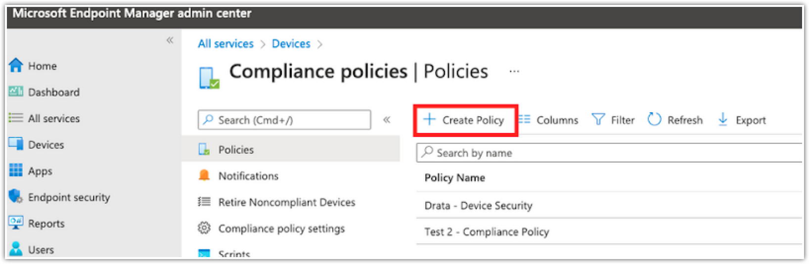
2. Select **macOS** as the platform.
3. Name and describe the policy (e.g., “Drata – macOS Compliance”).
   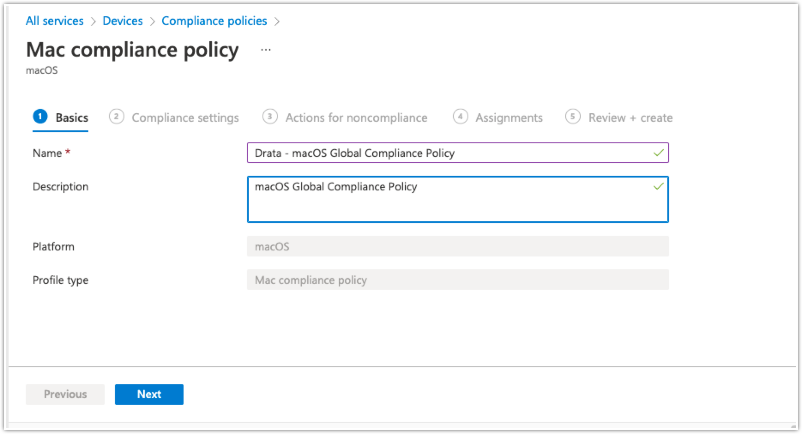
4. Configure **Compliance settings**:
   - **Device Health** → **Require system integrity protection**: **Require**.
      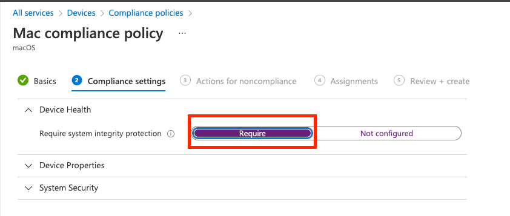
   - **System Security** → **Require a password to unlock devices**: **Require**.
   - **System Security** → **Maximum minutes of inactivity before password is required**: **15 minutes**.
      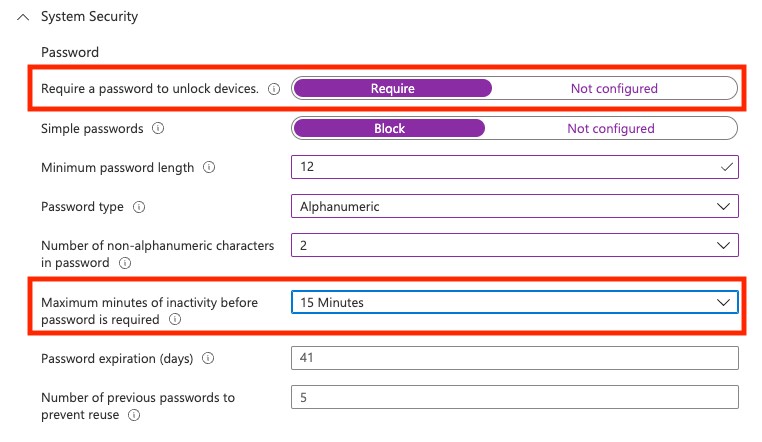
   - **Encryption** → **Require encryption of data storage on device**: **Require**.
      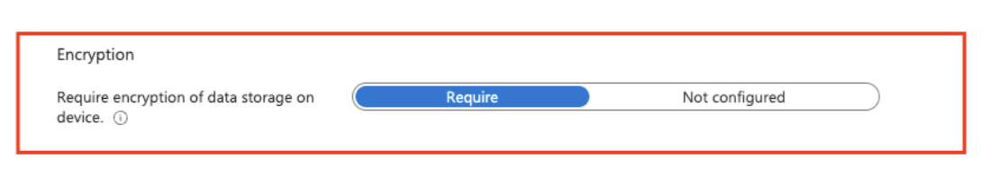
   - **Device Security** → **Firewall**: **Enable**.
   - **Gatekeeper → Allow apps downloaded from these locations: Mac App Storeand identified developers**.
      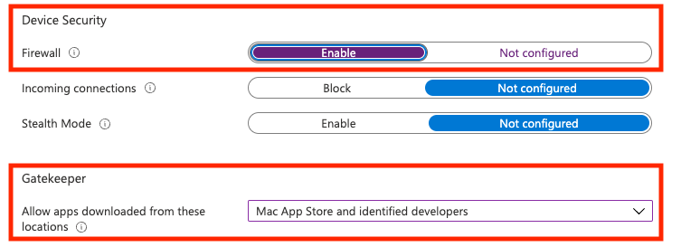
   - Configure any additional settings per business requirements.
   - Learn more about [Microsoft compliance settings](https://learn.microsoft.com/en-us/intune/intune-service/protect/compliance-policy-create-mac-os).
5. (Optional) Configure **Actions for noncompliance**.
6. **Assign** to the appropriate user groups (or All users).
   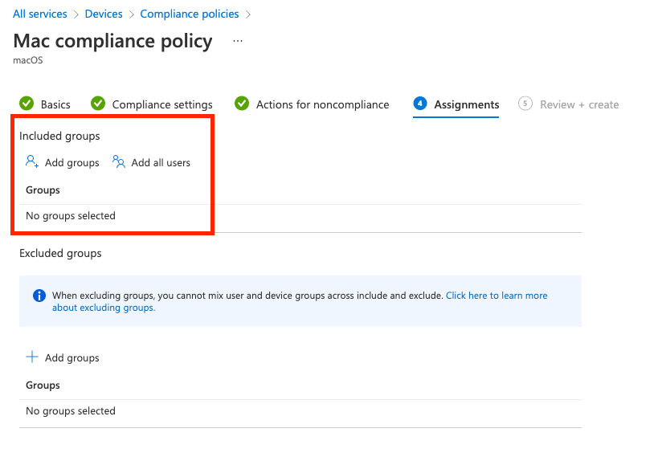
7. After assignment of policy to the users, you should see the '**Review + Create**' section. Click on the '**Create' **buttonto complete this step.

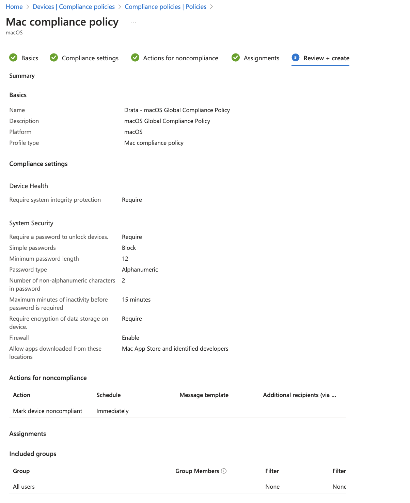

### Step 2: Create a macOS Updates Configuration Profile

**Note**: If you already have an existing MacOS Updates profile, you may submit that profile's name to our Support team and Drata will apply it after your connection is made.

1. **Devices > Configuration Profiles > Create profile**.
   - **Platform:** macOS
   - **Profile Type:** Templates
   - **Template name:** Custom
   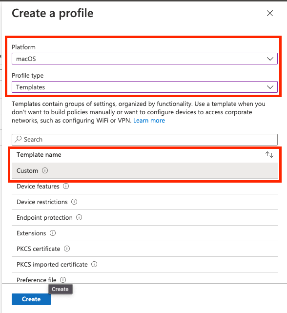
2. On the '**Basics'** page, enter the following name **exactly** as provided:
   - **`Drata - Software Updates`**
3. Add an optional description → **Next**.
4. **Configuration settings**:
   - **Custom configuration profile name:** `Drata - Software Updates` (match the overall profile name).
   - **Deployment Channel:Device Channel**.
   - Create a local XML file (e.g., `any-name.xml`) with the following contents and upload it as the **Configuration profile file**:
   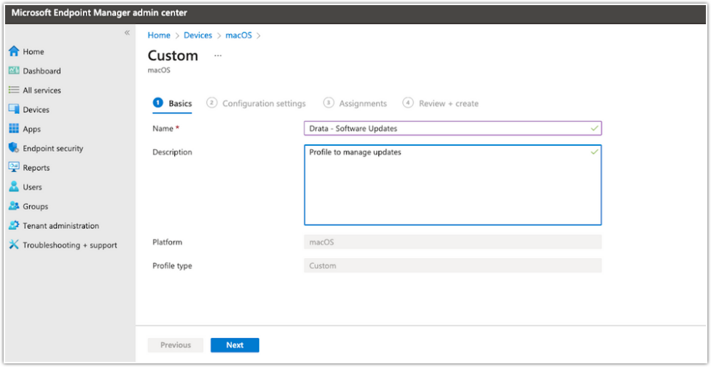
5. On the '**Configuration settings'** tab:
   - **Custom configuration profile name:** `Drata - Software Updates` (match the overall profile name).
   - **Deployment Channel:** Device Channel.
6. Create a local XML file (e.g., `any-name.xml`) with the following contents and upload it as the **Configuration profile file**:
   ```

	
		PayloadContent
		
			
				AutomaticallyInstallMacOSUpdates
				
				AutomaticallyInstallAppUpdates
				
				AutomaticCheckEnabled
				
				CriticalUpdateInstall
				
				PayloadDisplayName
				Software Update
				PayloadIdentifier
				com.apple.SoftwareUpdate.4bb5aca5-cd0c-4562-bac4-e87c835b29cf
				PayloadType
				com.apple.SoftwareUpdate
				PayloadUUID
				de247aa4-10db-4f48-8dda-91aff64fcdfe
				PayloadVersion
				1
			
		
		PayloadDisplayName
		Software Update
		PayloadIdentifier
		Software&amp;SecurityUpdates1.0.cf7e812a-9415-47e9-909b-f1560532d5ce
		PayloadType
		Configuration
		PayloadUUID
		da7e79e8-6311-4266-9621-c1b7b3496893
		PayloadVersion
		1
	

   ```
7. Once the file has been created, upload it to t**he Configuration profile file**.
   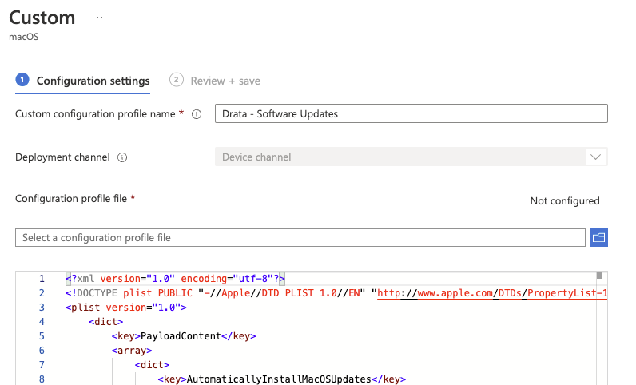
8. Assign to the appropriate groups/devices. You can do so by selecting 'Add groups,' 'Add all users,' or 'Add all devices' based on your company’s configuration.
9. Go to 'Review + create' tab, review your settings, and click '**Create'** when ready to save your new profile.

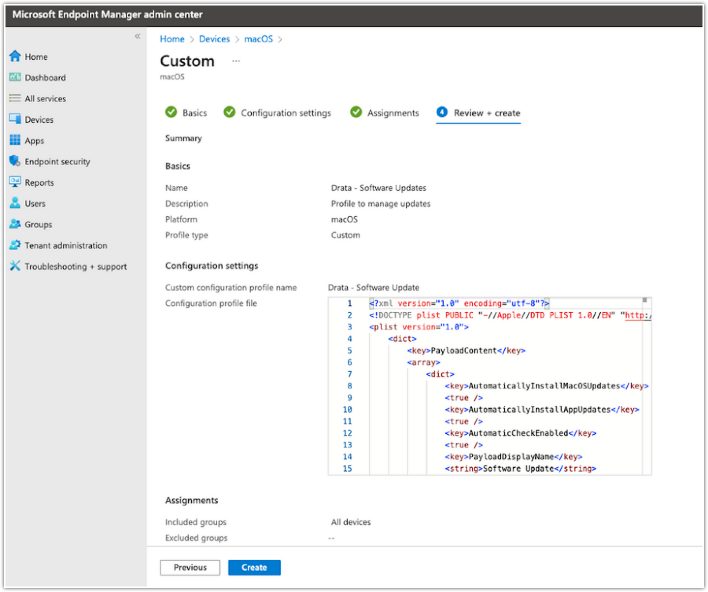

### Step 3: Create a Lock Screen (Screen Saver) Profile

**Note**: If you already have an existing one you may submit that profile's name to our Support team and Drata will apply it after your connection is made.

1. **Devices > Configuration profiles > Create profile**.
   - **Platform:** macOS
   - **Profile Type:** Templates
   - **Template name:** Custom
2. Name it **`Drata - Screen Saver`** (exactly) → optional description → **Next**.
3. **Configuration settings**:
   - **Deployment Channel:Device Channel**.
   - Upload your xml file to the '**Configuration Profile File'** section and verify your configuration matches the image below. Create and upload an XML file with 10-minute (600s) timeouts:
   ```

    PayloadContent
    
    
      idleTime
        600
        loginWindowIdleTime
        600
        PayloadType
        com.apple.screensaver
        PayloadIdentifier
  com.apple.screensaver.4bb5aca5-cd0c-4562-bac4-e87c835b29cf
        PayloadUUID
        ba9abec1-ee44-413d-b75f-63748644ca71
        PayloadVersion
        1
     
    
    PayloadDisplayName
    Screen Saver Device
    PayloadType
    com.apple.screensaver
    PayloadUUID
    4ffe721a-f2e6-4191-a3fe-1d1a463fbbac
    PayloadVersion
    1

   ```
   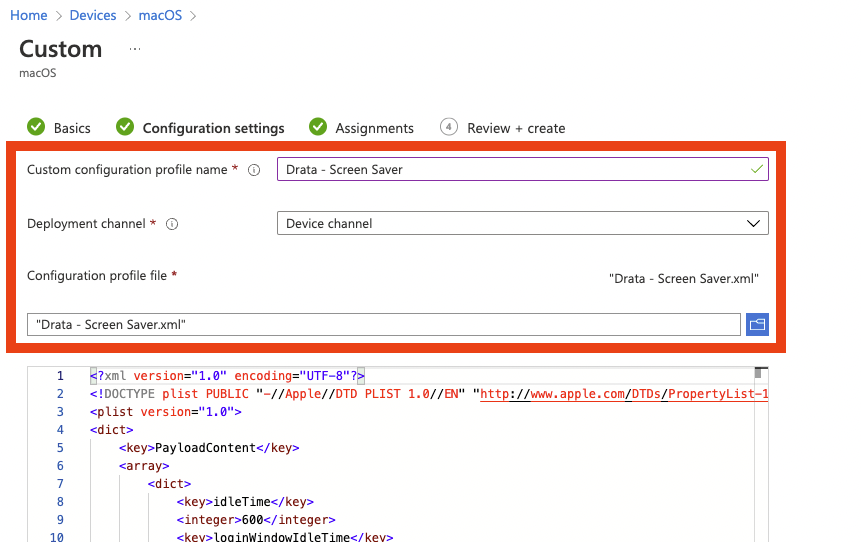
4. Assign to the appropriate groups/devices. You can do so by selecting 'Add groups,' 'Add all users,' or 'Add all devices' based on your company’s configuration.
5. Go to 'Review + create' tab, review your settings, and click '**Create'** when ready to save your new profile.
   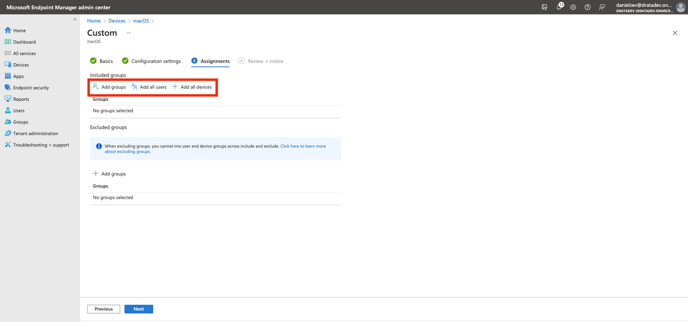
6. Finally, go to '**Review + create'** tab to review and click on '**Create'**.

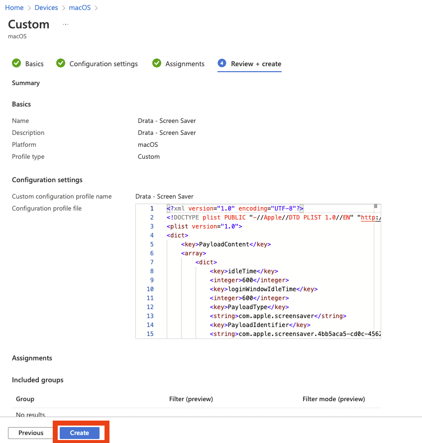

### Step 4: Create a FileVault Profile

1. In Intune: **Endpoint security > Disk Encryption > + Create Policy**.
   - **Platform:** macOS
   - **Profile:** FileVault
2. **Create**, then name/describe. We recommend using **`Drata - FileVault` **for the name.
3. Select '**Yes'** for '**Enable FileVault'**.
4. Configuration settings:
   - **Escrow location description of personal recovery key**: Add guidance for users on [how to retrieve the recovery key](https://docs.microsoft.com/en-us/mem/intune/protect/encrypt-devices-filevault#retrieve-a-personal-recovery-key) for their device.
      - For example: “You can retrieve the personal recovery key for your macOS device from the Microsoft Intune app or Company Portal.”
      - Note: This information can be useful for your users when you use the setting for personal recovery key rotation, which can automatically generate a new recovery key for a device periodically.
   - Configure any other settings per business requirements.
   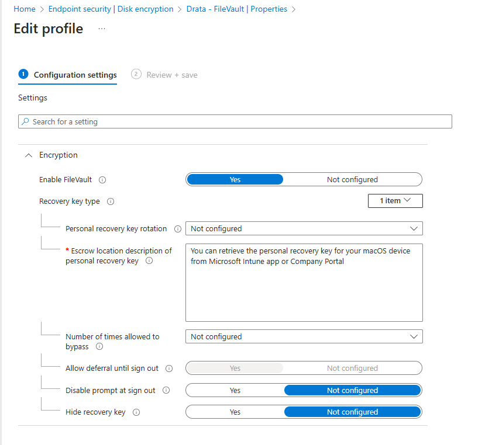
5. Assign this new profile to users. You can do so by selecting 'Add groups,' 'Add all users,' or 'Add all devices' based on your company’s configuration.
6. Go to Review and Create and verify your configuration.

### Step 5: Sync Devices (Bulk) in Intune

The Sync device action forces the selected device(s) to immediately check in with Intune. When a device checks in, it receives any pending actions or policies that have been assigned to it.

This feature can help you immediately validate and troubleshoot policies you've assigned, without waiting for the next scheduled check-in.

**Sync devices to get the latest policies and actions with Intune:**

1. Select **Devices > All devices > Bulk Device Actions**.
   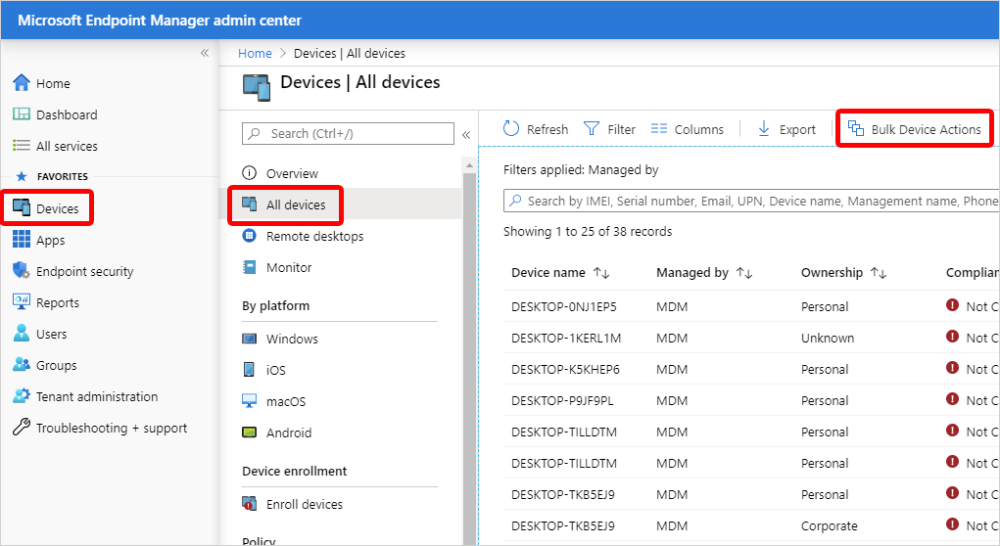
2. On the '**Basics'** page, enter the following:
   - Select **macOS** for** OS**
   - Select **Sync** for Device action
   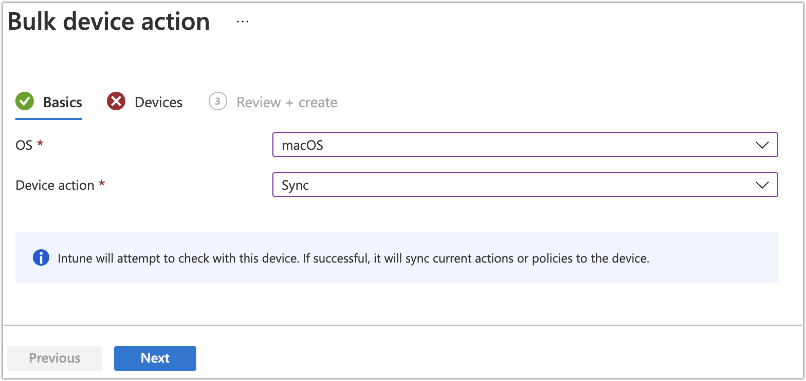
3. On the '**Devices'** page, select from 1 to 100 devices.
4. Go to '**Review + create'** page, ensure your settings are correct, and click '**Create'**. You will be taken back to the Devices page.

### Step 6: Create an App Registration in Entra ID

**Could not display content**

1. From the Microsoft Intune admin center: Select **All services > Microsoft Entra** (opens Entra admin center).
   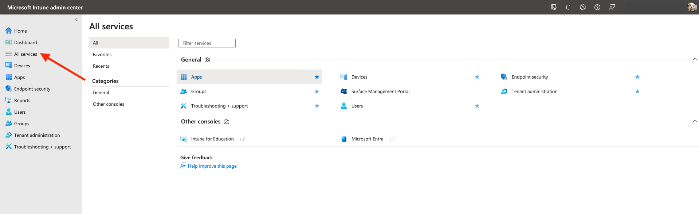
2. Select **Identity** > **Applications** > **App registrations**.
   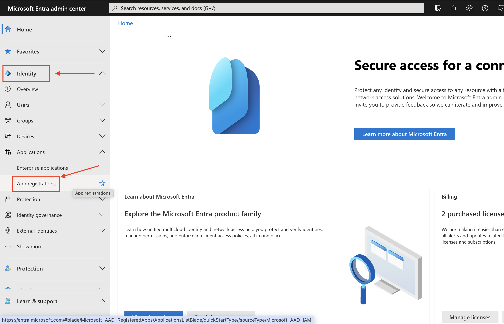
3. Select **+ New registration**.
   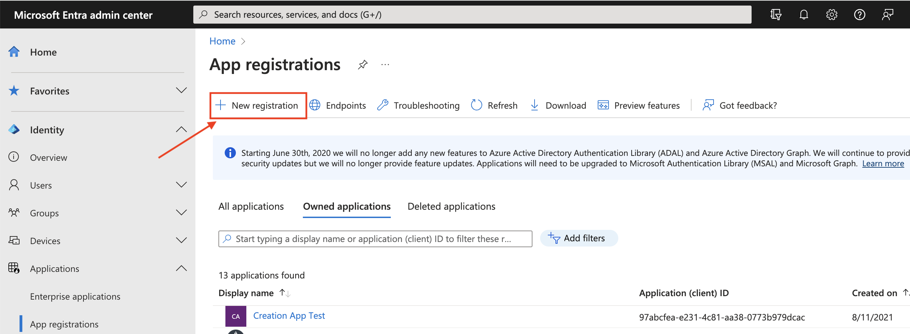
   - **Name:`Drata - Intune App`** (exactly).
   - **Supported account types:** '**Accounts in this organizational directory only (<directory name> only - Single tenant)**.
4. Click '**Register'**. You are taken back to the app's Overview page.
5. From the app **Overview**, copy **Application (client) ID** and **Directory (tenant) ID**. Save these for the Drata connection step later.
6. Click '**Add a certificate or secret'**.
   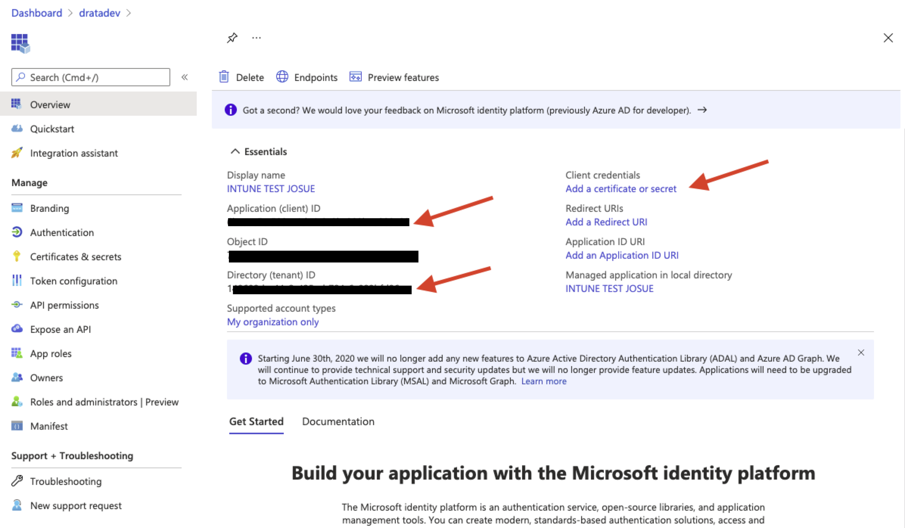
7. Go to **Certificates & secrets** �� **+ New client secret**.
   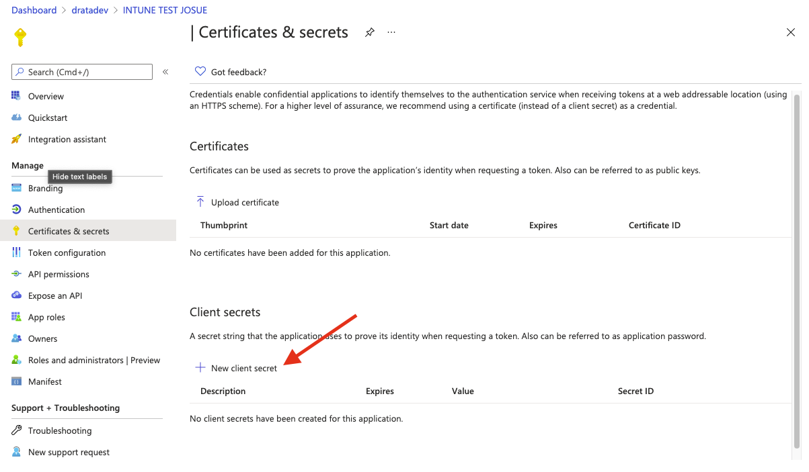
8. Add **Description**, set **Expires = 24 months**, **Add**.
9. Note the expiration date for future rotation.
   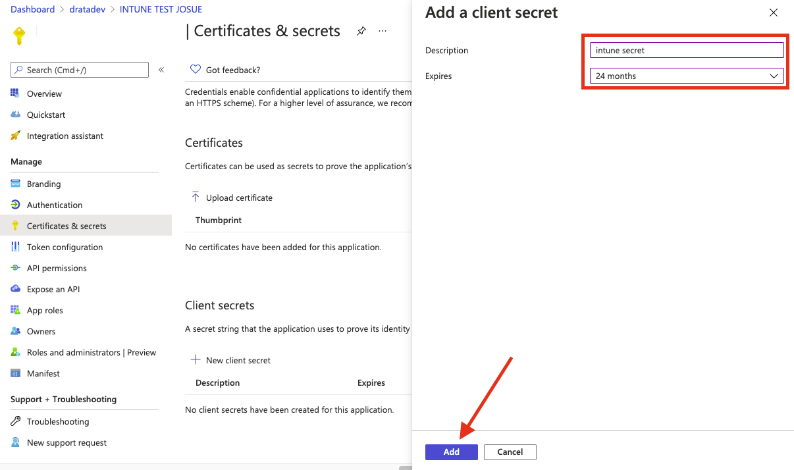
10. Copy the **Value** and refresh the page to activate the value. This value will be entered in the **Application Secret** field within Drata during the connection process.
   - ⚠️ Do NOT copy the Secret ID.
      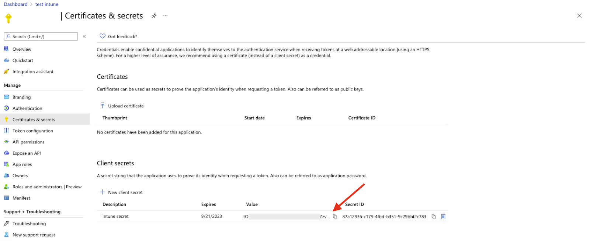
11. Be sure to refresh the Azure Certificates and Secrets screen to make the secret ***Value*** useable (Microsoft holds it in a pending state until the screen is refreshed).

### Step 7: Grant Microsoft Graph Application Permissions

Microsoft Graph has two types of permissions: Delegated and Application. The Drata OAuth app needs Application permissions.

1. In the app: **API permissions**
   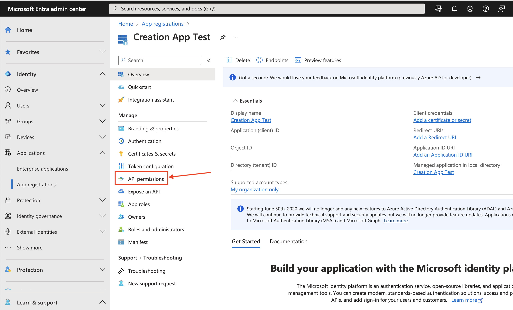
2. Select **+ Add a permission.**
   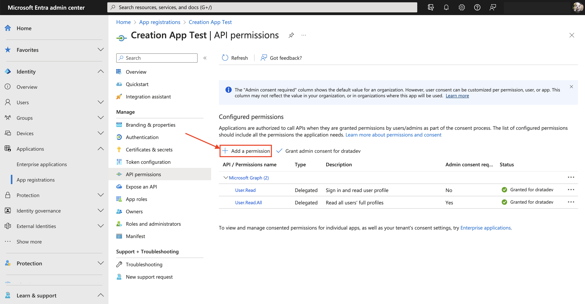
3. Then, **Microsoft Graph.**
   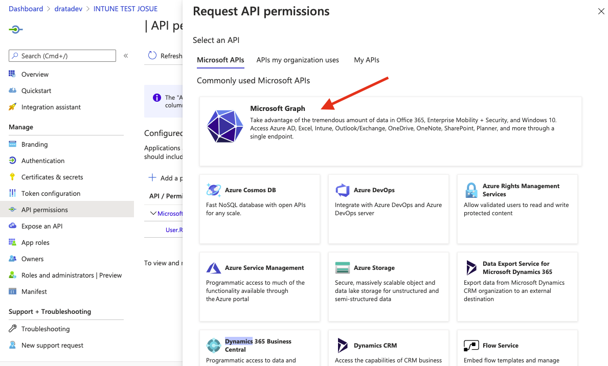
4. Then, **Application permissions**.
5. Add these permissions:
   - `DeviceManagementManagedDevices.Read.All`
   - `DeviceManagementConfiguration.Read.All`
   - `DeviceManagementApps.Read.All`
   - `User.Read.All`
   - `DeviceManagementScripts.Read.All`
6. Click **Add permissions**.
   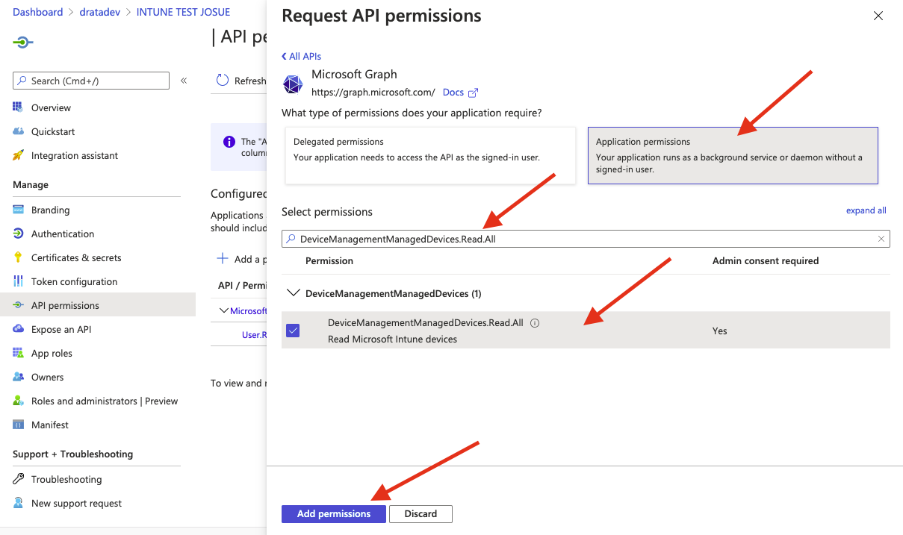
7. Click **Grant admin consent** and confirm. Ensure **Status = Granted** for all five.
   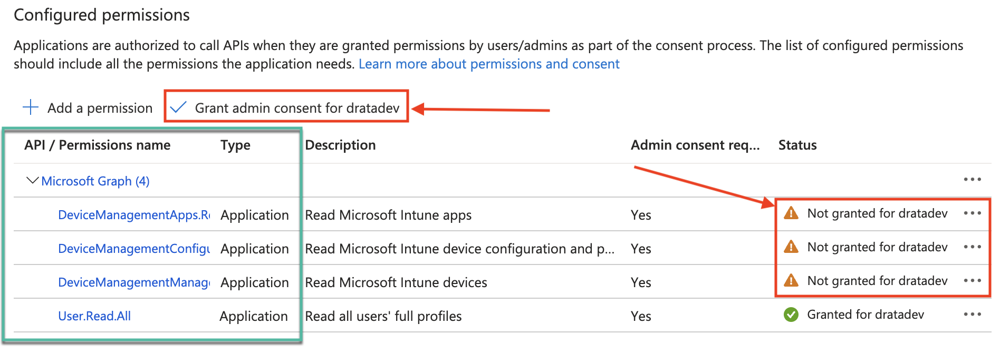
8. Click '**Yes'** in the '**Grant admin consent confirmation'** popup.
   
9. Once the grant consent is successful, confirm that the **Status** column now says **Granted**.

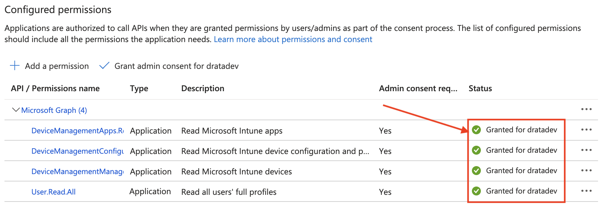

## Complete the Connection

In Drata’s Connections page, enter the following information:

| **Drata Field** | **Intune (Mac) Value** |
|---|---|
| Directory (tenant) ID | Directory (tenant) ID from Entra App Registration |
| Application (client) ID | Application (client) ID from Entra App Registration |
| Application Secret | **Value** of the client secret (copied at creation time) |

For steps on accessing and using the Connections page in Drata, refer to [The Connections Page in Drata](https://help.drata.com/en/articles/12305645-the-connections-page-in-drata).

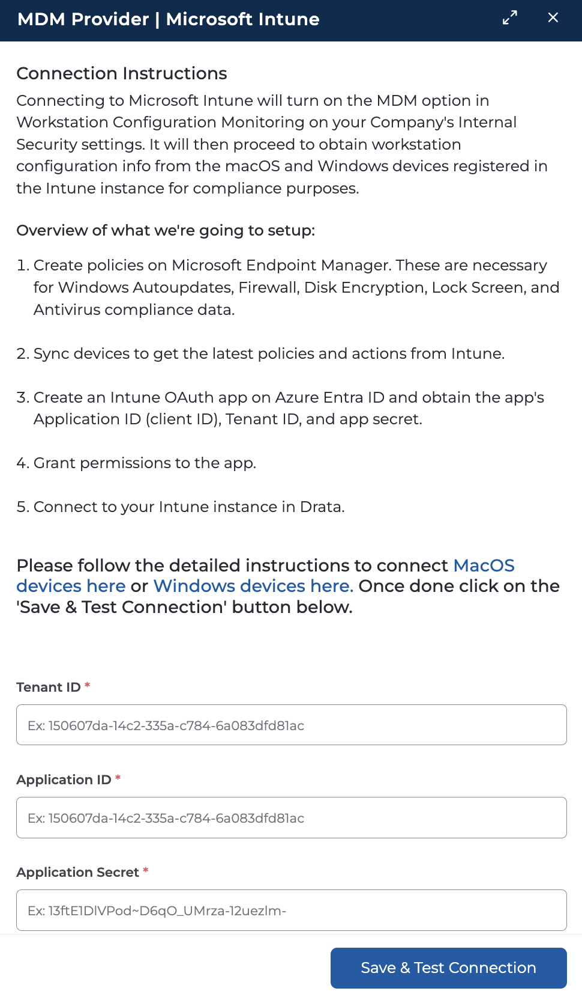

## Configure Intune as the MDM Source in Drata

1. In Drata: go to your **User Profile** → **Settings** → **Internal Security**.
2. Toggle **Automated via Intuneon**
3. Toggle **Automated via Drata Agentoff** (agent takes precedence if both are on).

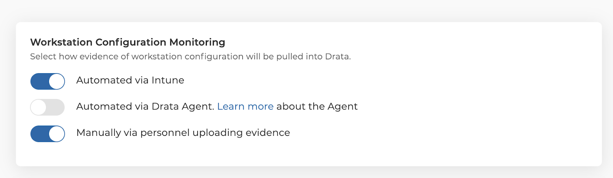

**NOTE:** If both remain on, and the Drata agent is installed on an employee computer, the Drata agent will take precedence; meaning, employee compliance checks will come from the agent.

## Government Support for Microsoft Intune GCC High

Drata supports Microsoft Intune GCC High for your MDM Connection. All of the same support and services as Microsoft Intune (outlined above) carry over to the GCC High connection as well. See image below to better understand standards for usage of the varied Microsoft Intune solutions.

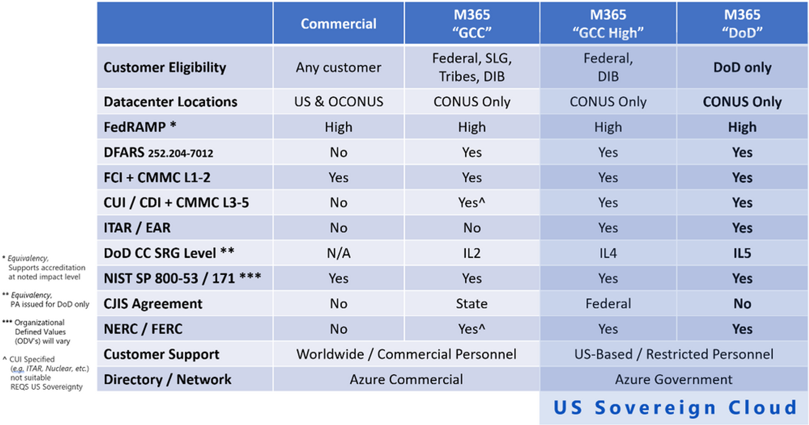

## Images

- [image 01] ../../images/integrations/intune/legacy-microsoft-intune-integration-guide-mac-devices--01.png
- [image 02] ../../images/integrations/intune/legacy-microsoft-intune-integration-guide-mac-devices--02.png
- [image 03] ../../images/integrations/intune/legacy-microsoft-intune-integration-guide-mac-devices--03.png
- [image 04] ../../images/integrations/intune/legacy-microsoft-intune-integration-guide-mac-devices--04.png
- [image 05] ../../images/integrations/intune/legacy-microsoft-intune-integration-guide-mac-devices--05.png
- [image 06] ../../images/integrations/intune/legacy-microsoft-intune-integration-guide-mac-devices--06.png
- [image 07] ../../images/integrations/intune/legacy-microsoft-intune-integration-guide-mac-devices--07.png
- [image 08] ../../images/integrations/intune/legacy-microsoft-intune-integration-guide-mac-devices--08.png
- [image 09] ../../images/integrations/intune/legacy-microsoft-intune-integration-guide-mac-devices--09.png
- [image 10] ../../images/integrations/intune/legacy-microsoft-intune-integration-guide-mac-devices--10.png
- [image 11] ../../images/integrations/intune/legacy-microsoft-intune-integration-guide-mac-devices--11.png
- [image 12] ../../images/integrations/intune/legacy-microsoft-intune-integration-guide-mac-devices--12.png
- [image 13] ../../images/integrations/intune/legacy-microsoft-intune-integration-guide-mac-devices--13.png
- [image 14] ../../images/integrations/intune/legacy-microsoft-intune-integration-guide-mac-devices--14.png
- [image 15] ../../images/integrations/intune/legacy-microsoft-intune-integration-guide-mac-devices--15.png
- [image 16] ../../images/integrations/intune/legacy-microsoft-intune-integration-guide-mac-devices--16.png
- [image 17] ../../images/integrations/intune/legacy-microsoft-intune-integration-guide-mac-devices--17.png
- [image 18] ../../images/integrations/intune/legacy-microsoft-intune-integration-guide-mac-devices--18.png
- [image 19] ../../images/integrations/intune/legacy-microsoft-intune-integration-guide-mac-devices--19.png
- [image 20] ../../images/integrations/intune/legacy-microsoft-intune-integration-guide-mac-devices--20.png
- [image 21] ../../images/integrations/intune/legacy-microsoft-intune-integration-guide-mac-devices--21.png
- [image 22] ../../images/integrations/intune/legacy-microsoft-intune-integration-guide-mac-devices--22.png
- [image 23] ../../images/integrations/intune/legacy-microsoft-intune-integration-guide-mac-devices--23.png
- [image 24] ../../images/integrations/intune/legacy-microsoft-intune-integration-guide-mac-devices--24.png
- [image 25] ../../images/integrations/intune/legacy-microsoft-intune-integration-guide-mac-devices--25.png
- [image 26] ../../images/integrations/intune/legacy-microsoft-intune-integration-guide-mac-devices--26.png
- [image 27] ../../images/integrations/intune/legacy-microsoft-intune-integration-guide-mac-devices--27.png
- [image 28] ../../images/integrations/intune/legacy-microsoft-intune-integration-guide-mac-devices--28.png
- [image 29] ../../images/integrations/intune/legacy-microsoft-intune-integration-guide-mac-devices--29.png
- [image 30] ../../images/integrations/intune/legacy-microsoft-intune-integration-guide-mac-devices--30.png
- [image 31] ../../images/integrations/intune/legacy-microsoft-intune-integration-guide-mac-devices--31.png
- [image 32] ../../images/integrations/intune/legacy-microsoft-intune-integration-guide-windows--11.png
- [image 33] ../../images/integrations/intune/legacy-microsoft-intune-integration-guide-windows--12.png
- [image 34] ../../images/ux/personnel/legacy-microsoft-intune-integration-guide-mac-devices--34.png
- [image 35] ../../images/documentation/microsoft-365-integration-guide--02.png

## Related articles

- [Legacy: Microsoft Intune Integration Guide (Windows)](legacy-microsoft-intune-integration-guide-windows.md)
- [Kandji (now Iru) Integration Guide (MDM)](kandji-now-iru-integration-guide-mdm.md)
- [Hexnode UEM (macOS) Integration Guide](hexnode-uem-macos-integration-guide.md)
- [Multi-Device Support](multi-device-support.md)
- [Microsoft Intune Integration guide](microsoft-intune-integration-guide.md)
