# Legacy: Microsoft Intune Integration Guide (Windows)

Source: https://help.drata.com/en/articles/5604949-legacy-microsoft-intune-integration-guide-windows
Collection: Connection Support › Other Guidance
Updated: 2026-11-14
Fetched: 2026-11-22
Description: This article walks through the details of configuring Intune to connect to Drata.

## Article text

> This guide describes the legacy Intune connection flow for customers who connected Intune before May 27, 2026. This legacy Intune integration supports both Discovered Apps and Managed Apps. If you migrate to the new Intune integration, Discovered Apps monitoring will no longer be available. Instead, app deployment is monitored through Managed Apps and policy selection.
>
> If you are setting up the Intune integration for the first time, or connected Intune on or after May 27, 2026, use the updated [Intune integration guide](microsoft-intune-integration-guide.md).

## HERE'S WHY

Connecting to Intune will turn on the MDM option in Workstation Configuration Monitoring on your Company's Internal Security settings. If the Drata Agent is not present and active, Drata will obtain workstation configuration information from the Intune instance for compliance purposes.

## BEFORE DIVING IN

1. Make sure that the devices you wish to monitor are enrolled through the Intune Company Portal website or app. Devices can be enrolled by any of [these methods](https://docs.microsoft.com/en-us/mem/intune/enrollment/windows-enrollment-methods). If your employees are already enrolled, it is not necessary for them to install the Company Portal application.
2. Make sure that your Entra (formerly Azure) account has already been populated with users.
3. Make sure you have an existing Microsoft Endpoint Manager group containing all users that need to be monitored. Both types of "Microsoft 365" and "Security" are supported.
4. Make sure that all devices that need to be synced have the user's email address entered into the device's User Principal Name field. Also ensure the User Principal Name (UPN) matches the Personnel email address in Drata.
5. You will need a Global Administrator account in order to set everything up in Entra/Intune.
6. At this time, while Drata’s device compliance checks using the Intune connection check device settings directly for Hard Disk Encryption, the rest of Drata’s device compliance checks confirm the following:
   - Does the policy of the required name and/or type exist?
   - Is that policy mapped to the device?
   - Is that device compliant with that policy?
   If all three of the above criteria are met, Drata will show that device as passing for the other device compliance checks.

## Current Limitations

- Drata only supports one active intune connection concurrently at a time.
- The integration supports Microsoft Windows 10 and 11 Pro and Enterprise devices only. Windows 10 and 11 Home devices are not supported.
- Drata's Autopilot (nightly automated testing) must run before the application list from Intune can be shown.
- **The application list for each device can take up to seven days to sync. This is because [Intune updates the discovered apps list once every seven days](https://docs.microsoft.com/en-us/mem/intune/apps/app-discovered-apps) after Intune was installed.**
- Drata supports both the [Intune Discovered Apps list](https://learn.microsoft.com/en-us/mem/intune/apps/app-discovered-apps) and [Intune Managed Apps list](https://learn.microsoft.com/en-us/mem/intune/apps/app-configuration-policies-managed-app) natively.
- The Intune API doesn't return the version of the Intune Agent used.
- Only one configuration source per machine will be read, with the Drata agent taking precedence. To sync Intune data, ensure the Drata agent is uninstalled.
- 1Password is only detected when it is installed via Intune.
- Intune cannot natively pick up browser extensions, so if those are being used as a password manager, that compliance check will fail. Your users will need to use the equivalent installed desktop application. Ensure that this app shows on either [Intune's discovered apps list](https://docs.microsoft.com/en-us/mem/intune/apps/app-discovered-apps) or [Intune's Managed Apps list](https://learn.microsoft.com/en-us/mem/intune/apps/app-configuration-policies-managed-app).
   - You may choose to upload manual evidence as an alternative.
- Currently, Endpoint Security policies (required for Disk Encryption and Firewall settings) set up using [Security Baselines](https://learn.microsoft.com/en-us/mem/intune/protect/security-baselines-configure) are not supported. In order for compliance data to sync, you must use the policy and configuration profile types defined in this help article.

## Overview of what we're going to set up

- [Create an Intune OAuth app on Entra ID](#h_5ac893960b) and obtain the app’s Application ID (client ID), Tenant ID, and app secret.
- Create policies on Microsoft Endpoint Manager. These are necessary for [Windows Autoupdates](#h_d4148e8c97), [Lock Screen](#h_93036e873d), [Firewall](#h_27c0d013b0), [Disk Encryption](#h_47fa65c6f1), and [Antivirus](#h_d4148e8c97) compliance data.
- [Sync devices](#h_d4148e8c97) to get the latest policies and actions from Intune.
- Grant permissions to the app.
- Connect to your Intune instance in Drata.

## Create Intune App on Entra ID

### Create new App Registration

1. You can start from the Microsoft Intune admin center or [portal.azure.com](http://portal.azure.com/). Start from step 3 if you would like to start at portal.azure.com. Depending on your starting point, the instructions to do certain actions may differ.
2. If you start from **[Microsoft Intune admin center](https://intune.microsoft.com/#allservices/category/All)**,
   1. Select **All services** and then search for and select **Microsoft Entra**. A new tab will open the Microsoft Entra admin center.
   2. On the Microsoft Entra admin center tab, expand **Identity** and then **Applications**. Then, select **App registrations**.
      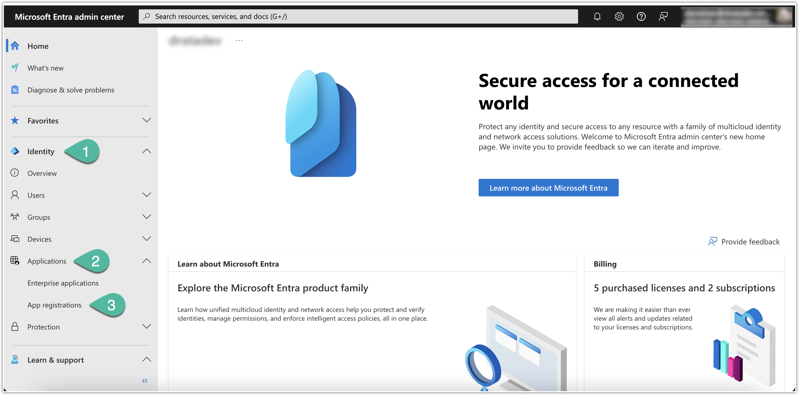
3. If you start from [portal.azure.com](http://portal.azure.com/),
   - Search and select **App registrations**. Ensure it is under Services.
      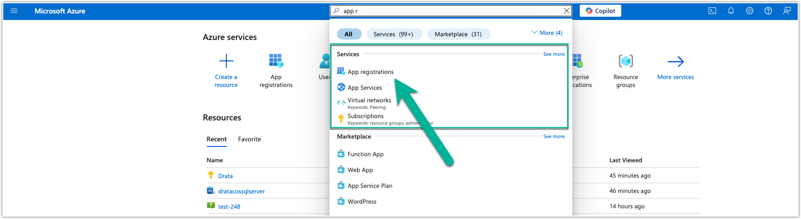
4. On the **App Registration** page, select **+ New registration**.
   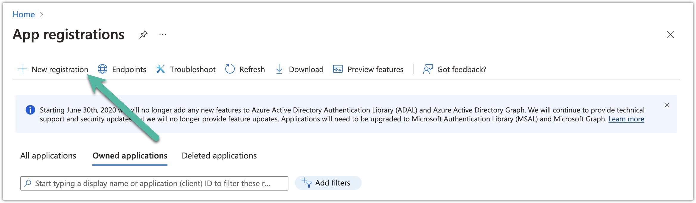
5. On the **Register an application** page, enter or select the following values exactly as provided:
   - **Name: **`Drata - Intune App`
   - **Supported account types: **Accounts in this organizational directory only (`<directory name>` only - Single tenant)
6. Select **Register**. You are taken back to the app's Overview page.
7. Copy the **Application (client) ID **and **Directory (tenant) ID**. You will use the IDs to connect to your Intune instance in Drata.
   - You may have to select the newly registered app to view the IDs.
8. Select **Add a certificate or secret **or **<#>certificate, <#> secret**. If you do not see this option, you may have to select the newly registered app.
   - The following screenshot displays the number of created values. If you do not have any values created, it will showcase Add a certificate or secret instead. Select that instead it will lead to the same page.
      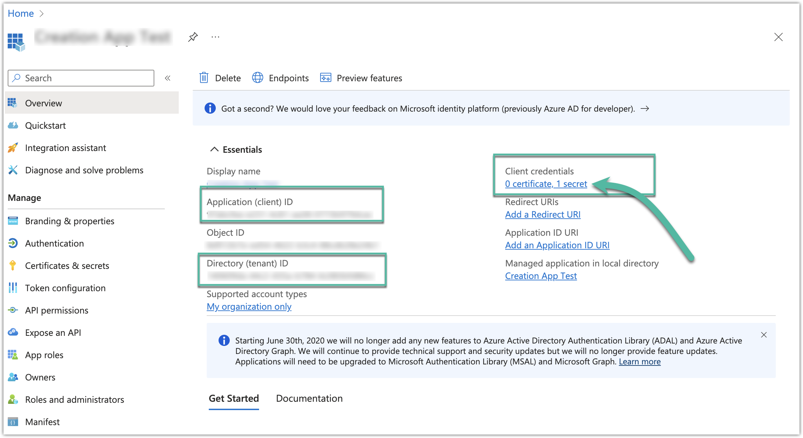
9. Select **+ New client secret**.
   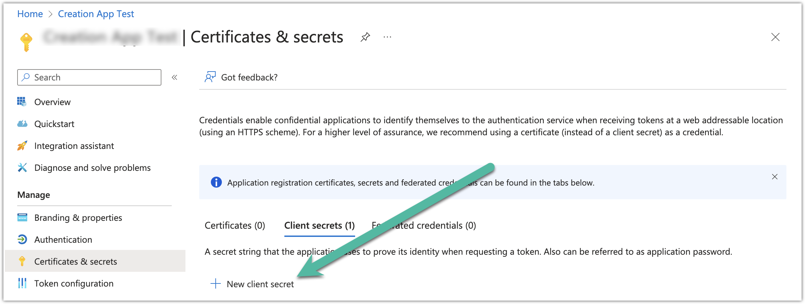
10. Enter the details for the **Description**, select **24 months** for **Expires, **and then select** Add.**
11. Copy the **Value** (not the Secret ID) of the new secret to paste it into the **Application Secret** text field on the Drata slide-out panel.
   - **Note**: This will be the only time you can copy this secret key.
12. Refresh the Azure Certificates and Secrets screen to make the secret **Value** useable. Microsoft holds it in a pending state until the screen is refreshed.
   - **Note**: Ensure to update before the expiration date so the connection remains active.

### API Permissions

Microsoft Graph has two types of permissions: Delegated and Application. The Drata OAuth app needs **Application **permissions.

1. Select **API permissions**. Utilize the search bar if you cannot find this option.
   - Ensure you have selected the app. The following image showcases the app **Creation App Test**. From there, we are able to select API permissions.
   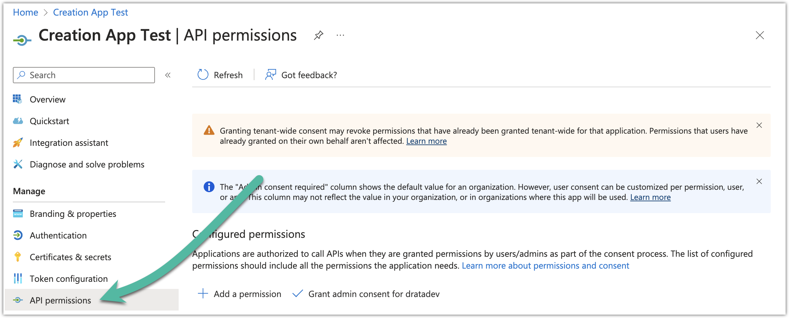
2. Select **+ Add a permission**.
   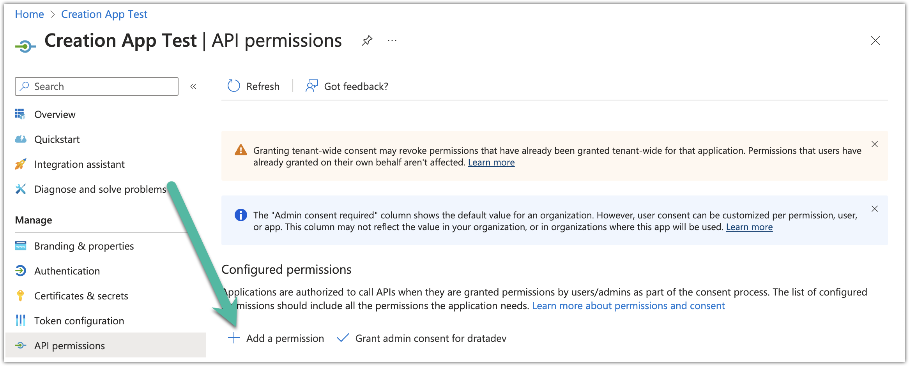
3. Select **Microsoft Graph**.
   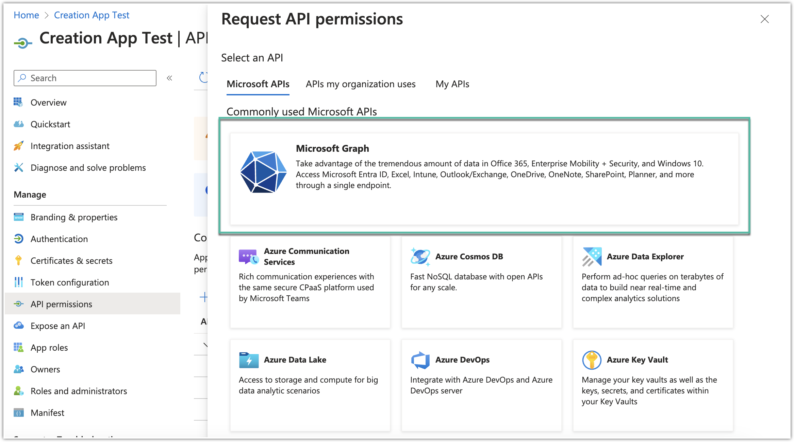
4. Select **Application permissions**.
5. Search and select the following five permissions:
   - `DeviceManagementManagedDevices.Read.All`
   - `DeviceManagementConfiguration.Read.All`
   - `User.Read.All`
   - `DeviceManagementApps.Read.All`
   - `DeviceManagementScripts.Read.All`
6. Select **Add permissions**.
7. The five new permissions status displays as **Not granted**. Select **Grant admin consent** to grant the app these new permissions.
   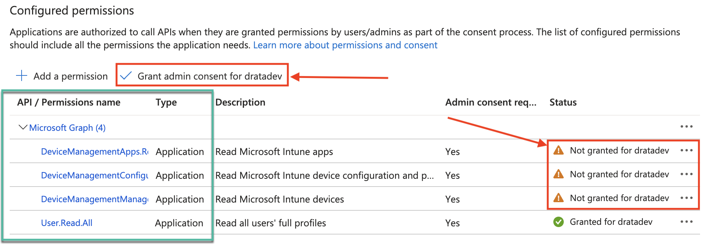
8. Select **Yes** in the **Grant admin consent confirmation** popup.
   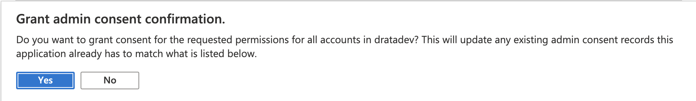
9. Confirm that the status displays **Granted**.

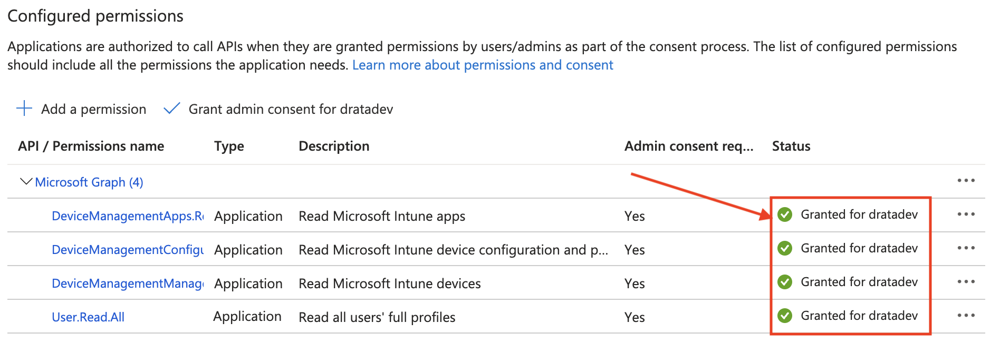

To grant the "DeviceManagementScripts.Read.All" application permission, follow these troubleshooting steps:

1. Go to **App registrations** in the **Azure Portal** and locate the **Drata Intune app registration**.
2. Under the **Manage** section, select **API permissions**.
3. Click on **+ Add a permission**, choose **Microsoft Graph** > **Application permissions**.
4. Expand **DeviceManagementScripts** and check the box for **DeviceManagementScripts.Read.All**.
5. Select **Add permissions**. If prompted, retain any existing permissions.
6. Grant admin consent by selecting **Grant admin consent for your tenant** and confirming with **Yes**.
7. Ensure the permission status displays as **Granted for your tenant** for **DeviceManagementScripts.Read.All**.

## Connect to your Intune instance in Drata

1. Go to the Drata app and navigate to the **Connections** page.
2. Search and select **Connect** for the **Intune** integration.
3. In the extended drawer, enter the details you saved in the previous steps: **Directory (tenant) ID**, **Application (client) ID, and Application Secret**.
   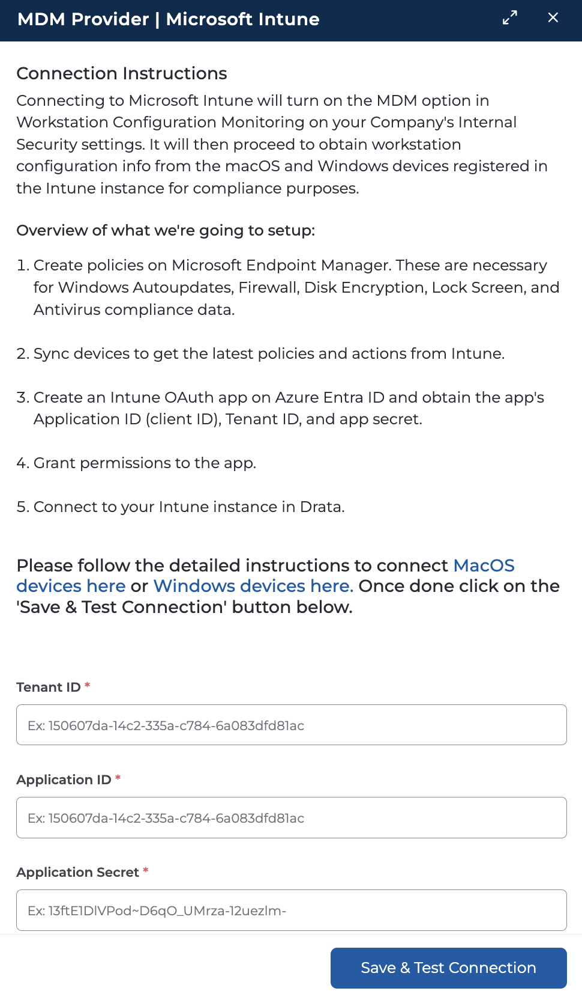
4. Select **Save & Test Connection**.

### Configure Intune in Drata for employee onboarding

1. Go to **Settings **and then **Internal Security**.
   - To go to Settings, select your username and then you can select Settings
   - 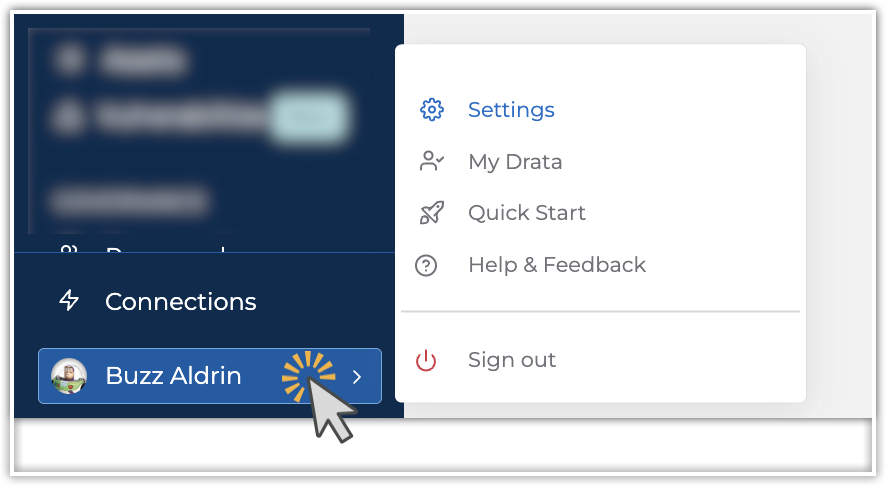
2. Toggle on **Automated via Intune** on and toggle off **Automated via Drata Agent** to disable the Drata agent.
3. Note: If both remain on, and the Drata agent is installed on an employee computer, the Drata agent will take precedence; meaning, employee compliance checks will come from the agent.

1. If devices are not syncing correctly with Microsoft Intune in Drata, perform a **personnel re-sync** following these steps:

- Log in to your Drata account.
- Navigate to the relevant personnel or device compliance section.
- Run a **personnel re-sync** operation to pull the latest data from Intune.

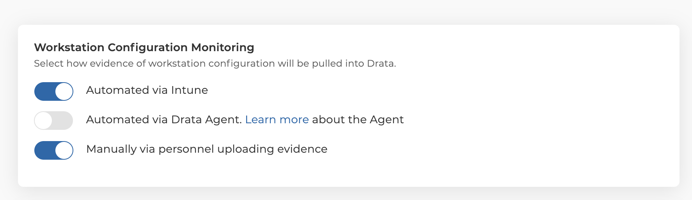

### Lock Screen and Password Configuration Profile

Create a new Configuration Profile with a Device Restriction Policy to get the Lock Screen and Password information according to the following steps. The Screen Lock Configuration Profile ensures that devices automatically lock after a specified period of inactivity. Drata's compliance check verifies that screensaver timeout policies are properly enforced, requiring both a password to unlock and an appropriate timeout setting.

**NOTE: If you already have an existing Lock Screen and Password Configuration Profile, you may submit that profile's name to our Support team to apply it after your connection is made.** If you use custom naming conventions for your profiles, you must share these with Drata Support so we can configure the backend to recognize your custom names. This applies to all profile types including Windows Update Rings and configuration profiles.

1. Sign in to the [Microsoft Endpoint Manager admin center](https://go.microsoft.com/fwlink/?linkid=2109431).
2. Select **Devices **on the left side navigation menu.
3. Then, search and select **Configuration **under Manage devices. Then, select **Create** and **New Policy**.
   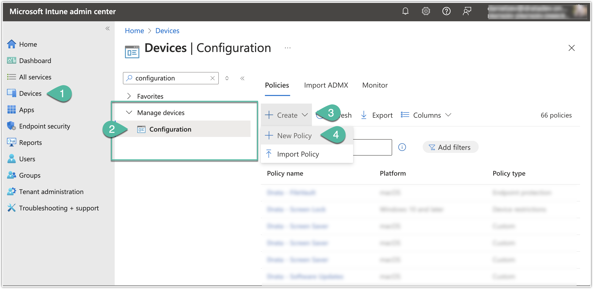
4. Enter the following properties:
   - **Platform**: Choose **Windows 10 and later**
   - **Profile**: Choose **Templates**
      - **Template name**: **Device restrictions**
   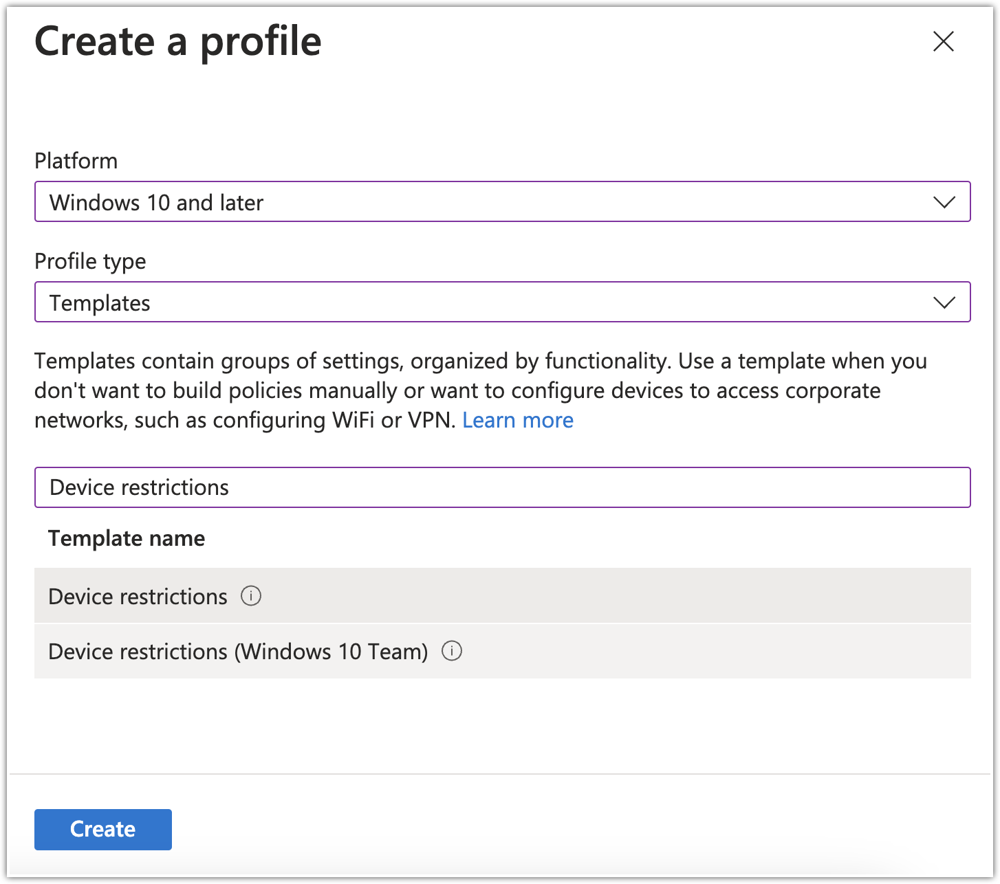
5. Select **Create**.
6. You will be redirected to a **Device restrictions **page where there are multiple steps or tabs to fill out.
7. On the **Basics **tab, enter the following name exactly as provided: **`Drata - Screen Lock` **and description is optional. Select **Next**.
8. On the **Configuration settings** tab, expand each group of settings, and configure the settings you want to manage with this profile. You must configure the two permissions. After setting these required permissions, select **Next**.
   - Select** Require **for** Password**.
   - Select** 15 Minutes **for** Maximum minutes of inactivity until screen locks** (Optional: You can make this shorter).
   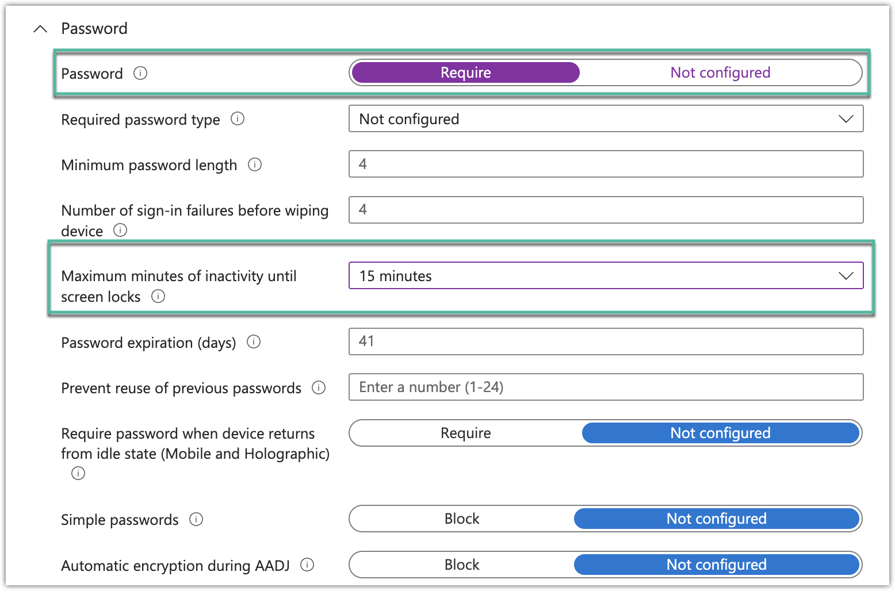
9. On the **Assignments **tab, under **Included groups **section, select **Add groups **to choose to assign the profile to one or more groups. Under **Excluded groups** section, select **Add groups** to fine-tune the assignment. Select **Next**.
   - Note: The Security group is the only selectable option for the Screen Lock profile.
10. **Applicability Rules** are optional. Select **Next**.
11. On the **Review + create** page, ensure your settings are correct, and select **Create**.

You are taken back to the profile's Overview page.

## Common Screen Lock Compliance Issues and Resolutions

- **Custom Configuration Profiles Not Recognized:** If Drata is unable to read your custom-named Intune profiles, you can either rename them to match the naming convention outlined above or contact Drata Support with the profile names so we can update your connection metadata.
- **Profile Type Mismatch:** For Windows devices, ensure you are using Device Restriction Profiles as outlined above. For macOS devices, use a Custom Configuration Profile instead, as this is the only profile type Drata can evaluate for macOS.
- **Unfulfilled Policy Settings:** Verify that your Intune profiles explicitly require a password and enforce a 15-minute or less screen lock inactivity timeout.
- **Sync Issues:** If policies appear correctly configured but devices still fail compliance checks, ensure you've performed a sync operation as outlined in the "Sync devices" section below.
- **'1 Minute Screen Saver' Profile Not Synced:** If compliance issues persist after adding the '1 Minute Screen Saver' profile, ensure that the profile has been correctly applied and a synchronization process has been completed.
- **Unsupported Intune Settings:** Avoid using alternative Intune settings for screen lock other than those specified in the help article, as they may lead to configuration or compliance errors.

### Device Security Policy

Create a new compliance policy to sync the BitLocker, Secure Boot, and Antivirus settings with the following steps.

1. Select **Devices **on the left side navigation menu. Then, search and select **Compliance **under Manage devices. Then, select **Create policy**.
   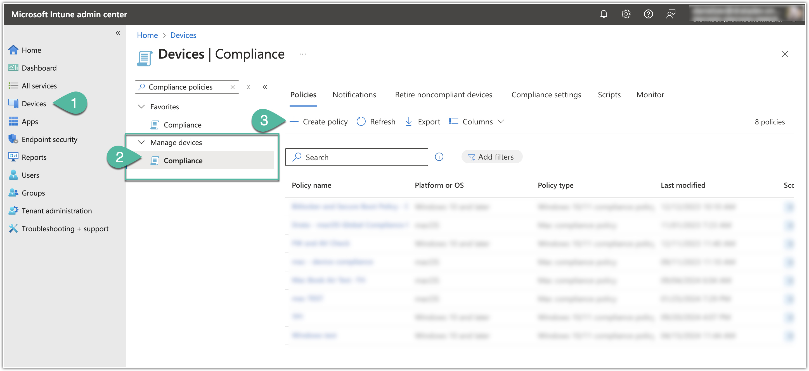
2. Enter the following property
   - **Platform**: Windows 10 and later
3. Select **Create**.
4. You will be redirected to a **Windows 10/11 compliance policy **page where there are multiple steps or tabs to fill out.
5. On the **Basics** tab, enter the following name (the following name is recommended, but Drata can read an existing policy with these settings): **`Drata - Device Security` **and description is optional. Select **Next**.
6. On the **Compliance settings** tab, expand each group of settings, and configure the settings you want to manage with this policy. The settings below must be set at a minimum.
   - Expand the **Device Health** option.
      - Select** Require **for** BitLocker**
      - Select** Require **for** Secure Boot**
   - Expand the **System Security** and then scroll down to the **Device Security** section.
      - Select** Require **for** Antivirus**.
   - Scroll down to the **Defender** section.
      - Select** Require **for** Microsoft Defender Antimalware**
      - Select **Require** for **Microsoft Defender Antimalware security intelligence up-to-date**.
      - Select **Require** for **Real-time protection**
   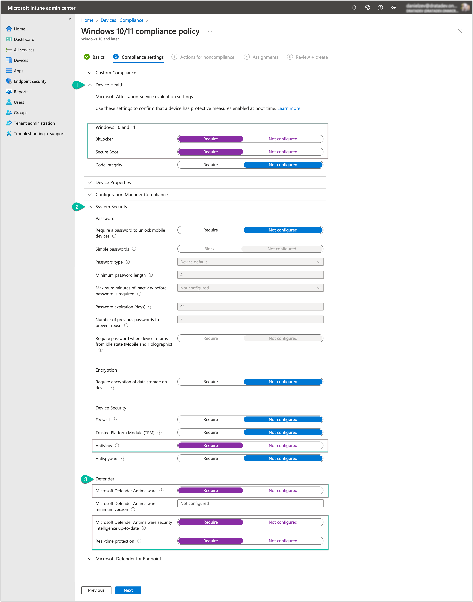
7. The **Actions for noncompliance** section is optional. Select **Next**.
8. On the **Assignments **tab, under **Included groups **section, select **Add groups **to choose to assign the profile to one or more groups. Under **Excluded groups** section, select **Add groups** to fine-tune the assignment. Select **Next**.
9. On the **Review + create** page, ensure your settings are correct, and click **Create**.

You are taken back to the profile's Overview page.

### Windows Updates Profile

Create a new policy to sync Windows Autoupdate settings with the following steps.

**NOTE: If you already have an existing Windows Update Ring profile, you may submit that profile's name to our Support team and Drata will apply it after your connection is made.**

1. Select **Devices **on the left side navigation menu. Then, search and select **Windows updates **under Manage updates. Then, select **Create profile**.
   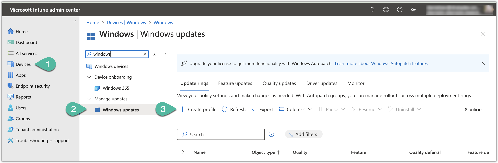
2. You will be redirected to a **Create Update ring for Windows 10 and later **page where there are multiple steps or tabs to fill out.
3. On the **Basics** tab, enter the following name exactly as provided: **`Drata - Windows Updates` **and description is optional. Select **Next**.
4. On the **Update ring settings** tab, configure the settings you want to manage with this profile. For information about the available settings, refer to [Windows update settings](https://docs.microsoft.com/en-us/mem/intune/protect/windows-update-settings). Select **Next**.
5. On the **Assignments **tab, under **Included groups **section, select **Add groups **to choose to assign the profile to one or more groups. Under **Excluded groups** section, select **Add groups** to fine-tune the assignment. Select **Next**.
   - Note: The Security group is the only selectable option for the Windows Update profile. While update rings can deploy to both device and user groups (i.e. a Security group can have both as members), consider using only device groups [when you also use feature updates](https://docs.microsoft.com/en-us/mem/intune/protect/windows-10-feature-updates#limitations-for-windows-10-feature-updates-policy).
6. On the **Review + create** page, ensure your settings are correct, and select **Create**. Your new update ring is displayed in the list of update rings.

## Create Security Policies

### Disk Encryption Security Policy

1. Sign in to the [Microsoft Endpoint Manager admin center](https://endpoint.microsoft.com/#home).
2. Select **Endpoint security**.
3. Search and select the **Disk encryption **policy type, and then select **Create Policy**.
4. Enter the following properties and then select **Create**.
   - **Platform**: Choose **Windows**
   - **Profile**: Choose **BitLocker**
   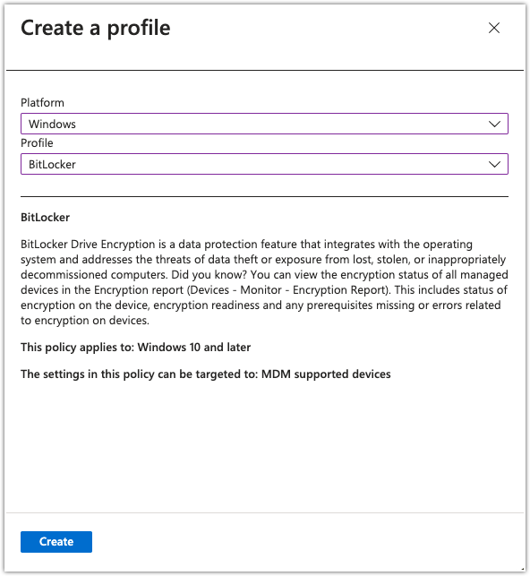
5. On the **Basics** page, the following name is recommended, but Drata can read an existing policy with these settings: **`Drata - Disk Encryption`**
6. Description is optional. Select **Next**.
7. On the **Configuration settings** page, configure the settings you want to manage with this policy. For the Drata connection, the following permissions must be enabled. You may have to expand these sections if they are closed, and you can also utilize the search bar to find these permissions more easily.
   - Under the **BitLocker **section,
      - **Require Device Encryption: **Enabled
      - **Allow Warning For Other Disk Encryption:** Enabled
   - Under the **BitLocker Drive Encryption **section:
      - **Choose drive encryption method and cipher strength (Windows 10 [Version 1511] and later): **Enabled
         - Once you enable the previous permission, enable the following permissions:
         - **Select the encryption method for fixed data drives:** XTS-AES 256-bit
         - **Select the encryption method for operating system drives:** XTS-AES 256-bit
         - **Select the encryption method for removable data drives:** AES-CBC 128-bit
   - Under the **Operating System Drives **section:
      - **Enforce drive encryption type on operating system drives:** Enabled
         - Once you enable the previous permission, enable the following permissions:
         - **Select the encryption type: (Device):** Use Space Only encryption
   - Under the **Fixed Data Drives** section:
      - **Enforce drive encryption type on fixed data drives:** Enabled
         - Once you enable the previous permission, enable the following permissions:
         - **Select the encryption type: (Device):** Allow user to choose
   - Configure other settings as your business requires.
8. When you're done configuring settings, select **Next**.
9. Scope tags are optional. Select **Next**.
10. Under **Assignments**, choose **+ Add groups under Included Groups** and then assign the policy to one or more groups. Use **+ Add groups to Excluded Groups** to fine-tune the assignment as necessary. For more information on assigning profiles, see [Assign user and device profiles](https://docs.microsoft.com/en-us/mem/intune/configuration/device-profile-assign).
   - Note: The Security group is the only selectable option for the Disk Encryption policy.
11. On the **Review + create** page, ensure your settings are correct, and select **Create**. The new policy is displayed in the list when you select the type for the policy you created.

### Firewall Security Policy

1. Go to **Endpoint security**.
2. Select the **Firewall** policy type, and then select **Create Policy**.
3. Enter the following properties:
   - **Platform**: Choose **Windows**
   - **Profile**: Choose **Windows Firewall**
4. Select **Create**.
   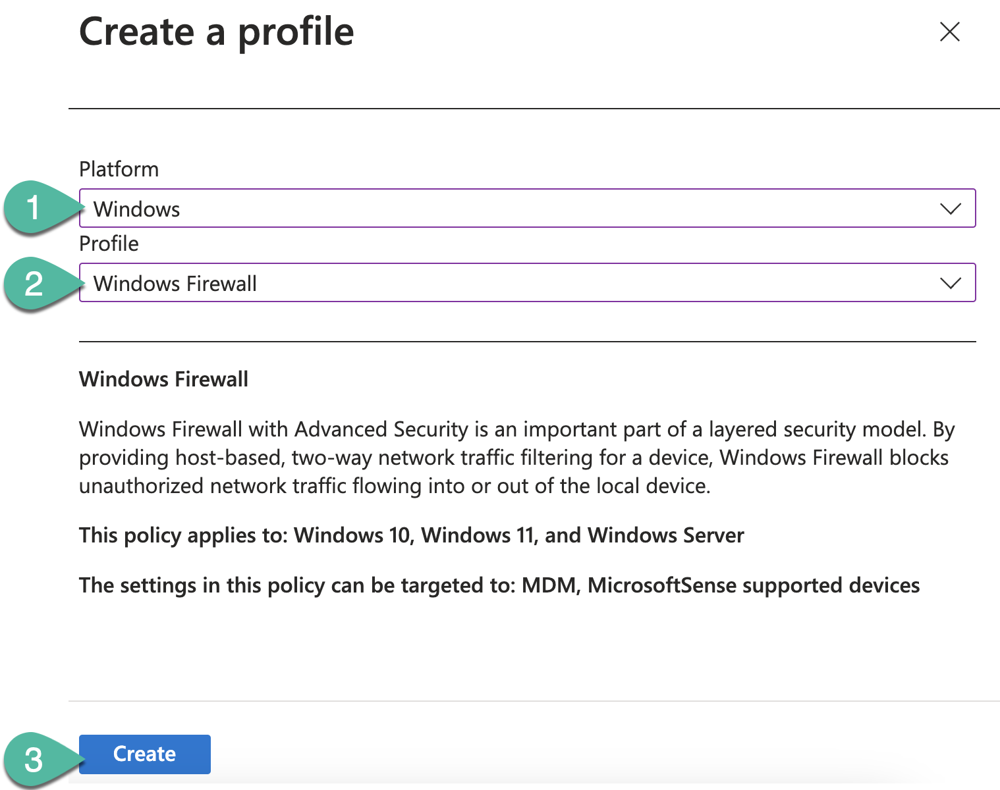
5. On the **Basics** page, the following name is recommended, but Drata can read an existing policy with these settings: **`Drata - Firewall`**
6. Description is optional. Select **Next**.
7. On the **Configuration settings** page, configure the settings you want to manage with this policy.
   - The three settings below must be set at a minimum. You can search for these configurations as well.
      - Select **True** for **Enable Domain Network Firewall**
      - Select **True** for **Enable Private Network Firewall**
      - Select **True** for** Enable Public Network Firewall**
      - Configure other settings as your business requires
8. When you're done configuring settings, select **Next**.
9. Scope tags are optional. Select **Next**.
10. Under **Assignments**, choose **+ Select groups to include** and then assign the policy to one or more groups. Use **+ Select groups to exclude** to fine-tune the assignment. For more information on assigning profiles, see [Assign user and device profiles](https://docs.microsoft.com/en-us/mem/intune/configuration/device-profile-assign).
   - The Security group is the only selectable option for the Firewall policy.
11. On the **Review + create** page, ensure your settings are correct, and select **Create**. The new policy is displayed in the list when you select the type for the policy you created.

Note: There is a [known Intune bug](https://docs.microsoft.com/en-us/troubleshoot/mem/intune/win10-devices-show-incorrect-compliance-status) where **Firewall** compliance could have** False/Positive results**.

## Sync devices to get the latest policies and actions with Intune

The Sync device action forces the selected devices to immediately check in with Intune. When a device checks in, it receives any pending actions or policies that have been assigned to it. This feature can help you immediately validate and troubleshoot policies you've assigned, without waiting for the next scheduled check-in.

### Sync bulk devices

1. Select **Devices** > **All devices** > **Bulk Device Actions**.
   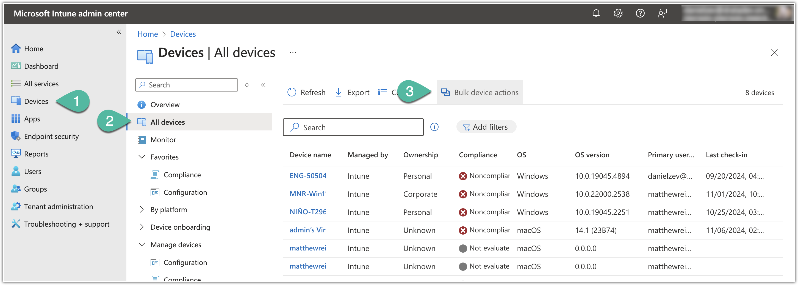
2. Enter the following configurations:
   - Select **Windows** for** OS**
   - Select **Sync** for Device action
3. On the **Devices** page, select from 1 to 100 devices. Select **Next**.
4. On the **Review + create** page, ensure your settings are correct, and select **Create**.

You are taken back to the Devices page.

**Note**: If the device has just enrolled, the check-in frequency will be more frequent. Windows PCs will check in every 3 minutes for 30 minutes, and then every 8 hours. **Best Practices for Maintaining Compliance**

- Regularly review your Intune Configuration Profiles to ensure they continue to meet Drata's compliance criteria
- Notify Drata of any changes to custom naming conventions or unique configurations in your environment
- Test compliance settings on representative devices before deploying across your organization
- After major updates to either Intune or device operating systems, verify that compliance settings are still being applied correctly- Regularly review and update credentials to prevent expiration.
- Ensure that users managing connections have the necessary admin permissions in both Drata and Microsoft environments.
- Stay informed about updates to Microsoft Graph API permissions and adjust configurations accordingly.

## Government Support for Microsoft Intune GCC High

Drata supports Microsoft Intune GCC High for your MDM Connection. All of the same support and services as Microsoft Intune (outlined above) carry over to the GCC High connection as well. See image below to better understand standards for usage of the varied Microsoft Intune solutions.

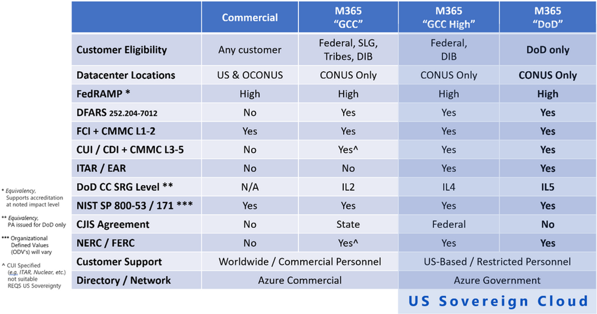

## Troubleshooting Microsoft Intune and Microsoft 365 Connection Issues in Drata

If you're experiencing issues with your Microsoft Intune or Microsoft 365 connections in Drata, such as expired credentials, access setup problems, or missing data compliance information, follow these guidelines to resolve the most common problems.

### Expired Microsoft Intune Credentials

If the client secret keys for your Microsoft Intune application are expired, you'll need to update them and reconfigure the connection in Drata. Follow these steps: For detailed instructions on creating or locating the client secret key, refer to this [help article](microsoft-intune-integration-guide.md).

1. **Generate a New Client Secret Key**:
   - Log in to your Microsoft Intune application.
   - Create a new client secret key in the application settings.
2. **Update Drata with the New Credentials**:
   - Navigate to the Drata platform and reset the Intune connection using the updated credentials.
3. **Verify the Configuration**:
   - Ensure that the connection is reconfigured successfully.

### Access Issues After Setting Up Microsoft 365 Identity Connector

If your Drata administrators cannot access the portal after setting up the Microsoft 365 identity connector, it may be due to a permissions mismatch when deploying the OAuth application. To resolve the issue: Ensure that these steps are completed by a user who is both a Drata admin and a Microsoft global admin.

**Remove the Existing Application**:

- Log in to [portal.azure.com](https://portal.azure.com) with a global admin or application admin account.
- Navigate to **Enterprise Applications** → **Drata** → **Properties**, then delete the application.

**Reconnect the Microsoft 365 Connector in Drata**:

- Log out of all Azure/Microsoft sessions.
- Go to Drata, refresh or reconnect the Microsoft 365 connection.3. Log out of Drata and log back in with the global admin account before proceeding to grant consent.

**Grant Organizational Consent**:

- When prompted, check the box for “Consent on behalf of your organization” and accept.- Ensure you are under the Admin Consent tab when verifying permissions.

**Verify Permissions**:

- Log back into [portal.azure.com](https://portal.azure.com) with the admin account.
- Under **Enterprise Applications** → **Drata** → **Permissions**, ensure ‘User.Read’ appears as a delegated permission.5. Log out of all sessions and reconnect as needed.

### Missing Microsoft Intune Device Compliance Data

If Drata isn’t pulling device compliance data from Microsoft Intune, verify and update the required Graph API permissions by following these steps: Microsoft may have updated the required Graph API permissions, which could cause this issue.

**Update API Permissions in Entra (formerly Azure AD)**:

- Log in to Entra and go to **App Registrations**.
- Select your Drata Intune app under **Manage**.
- Open **API Permissions** and click on **+ Add a permission** → **Microsoft Graph** → **Application permissions**.
- Locate and select `DeviceManagementScripts.Read.All` from the list.
- Click **Add permissions**. Approve keeping existing permissions if prompted.

**Grant Admin Consent**:

- Approve the permissions if prompted and click on **Grant admin consent for your tenant** to confirm.

**Verify Changes**:

- Ensure that `DeviceManagementScripts.Read.All` shows a status of "Granted for your tenant."

## Images

- [image 01] ../../images/integrations/intune/legacy-microsoft-intune-integration-guide-windows--01.png
- [image 02] ../../images/integrations/intune/legacy-microsoft-intune-integration-guide-windows--02.png
- [image 03] ../../images/integrations/intune/legacy-microsoft-intune-integration-guide-windows--03.png
- [image 04] ../../images/integrations/intune/legacy-microsoft-intune-integration-guide-windows--04.png
- [image 05] ../../images/integrations/intune/legacy-microsoft-intune-integration-guide-windows--05.png
- [image 06] ../../images/integrations/intune/legacy-microsoft-intune-integration-guide-windows--06.png
- [image 07] ../../images/integrations/intune/legacy-microsoft-intune-integration-guide-windows--07.png
- [image 08] ../../images/integrations/intune/legacy-microsoft-intune-integration-guide-windows--08.png
- [image 09] ../../images/integrations/intune/legacy-microsoft-intune-integration-guide-windows--09.png
- [image 10] ../../images/integrations/intune/legacy-microsoft-intune-integration-guide-windows--10.png
- [image 11] ../../images/integrations/intune/legacy-microsoft-intune-integration-guide-windows--11.png
- [image 12] ../../images/integrations/intune/legacy-microsoft-intune-integration-guide-windows--12.png
- [image 13] ../../images/ux/settings/legacy-microsoft-intune-integration-guide-windows--13.png
- [image 14] ../../images/ux/personnel/legacy-microsoft-intune-integration-guide-windows--14.png
- [image 15] ../../images/integrations/intune/legacy-microsoft-intune-integration-guide-windows--15.png
- [image 16] ../../images/integrations/intune/legacy-microsoft-intune-integration-guide-windows--16.png
- [image 17] ../../images/integrations/intune/legacy-microsoft-intune-integration-guide-windows--17.png
- [image 18] ../../images/integrations/intune/legacy-microsoft-intune-integration-guide-windows--18.png
- [image 19] ../../images/integrations/intune/legacy-microsoft-intune-integration-guide-windows--19.png
- [image 20] ../../images/integrations/intune/legacy-microsoft-intune-integration-guide-windows--20.png
- [image 21] ../../images/integrations/intune/legacy-microsoft-intune-integration-guide-windows--21.png
- [image 22] ../../images/integrations/intune/legacy-microsoft-intune-integration-guide-windows--22.png
- [image 23] ../../images/integrations/intune/legacy-microsoft-intune-integration-guide-windows--23.png
- [image 24] ../../images/documentation/microsoft-365-integration-guide--02.png

## Related articles

- [Jamf Integration Guide](jamf-integration-guide.md)
- [JumpCloud Integration Guide (MDM)](jumpcloud-integration-guide-mdm.md)
- [Legacy: Microsoft Intune Integration Guide (Mac Devices)](legacy-microsoft-intune-integration-guide-mac-devices.md)
- [Hexnode UEM (Windows) Integration Guide](hexnode-uem-windows-integration-guide.md)
- [Microsoft Intune Integration guide](microsoft-intune-integration-guide.md)
