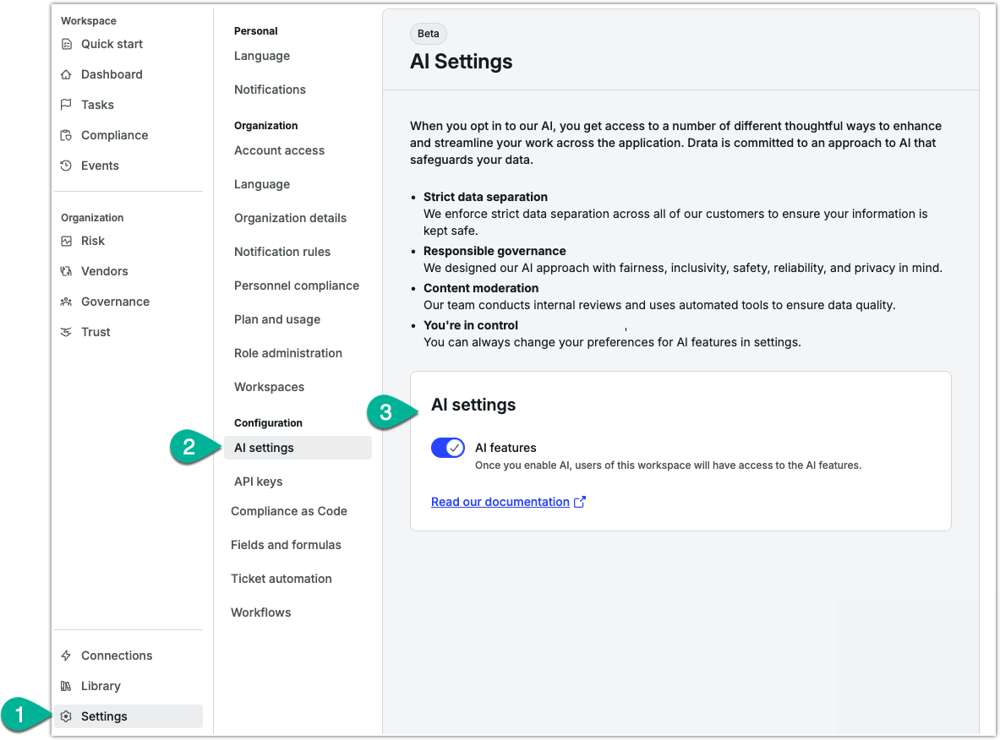
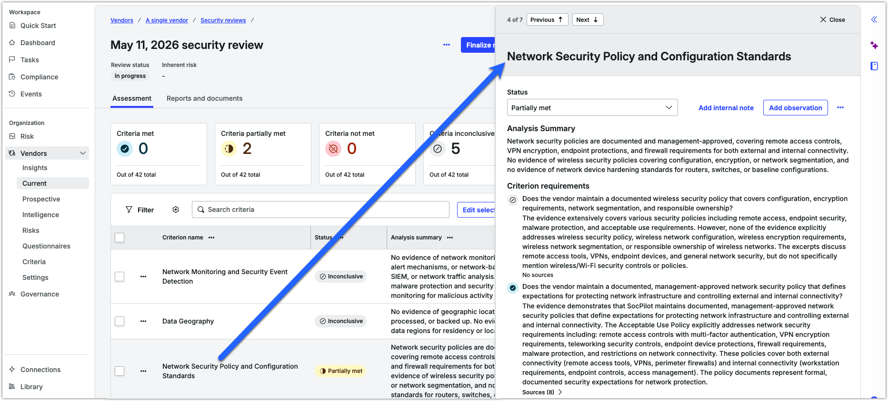
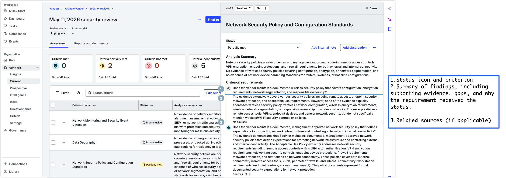

# (Legacy) TPRM Agent: Create a Criteria

Source: https://help.drata.com/en/articles/14446788-legacy-tprm-agent-create-a-criteria
Collection: Understand the Drata Platform › Vendors › TPRM Agent Legacy
Updated: 2026-09-15
Fetched: 2026-11-22

## Article text

## What is the TPRM Agent?

The TPRM Agent automates vendor security reviews by evaluating vendor documentation against your defined criteria.

Instead of manually reviewing hundreds of questionnaire responses, the agent analyzes uploaded documents — SOC 2 reports, policies, penetration test summaries, and more — and delivers a structured assessment with cited sources, so you can focus on decision-making rather than document review.

This article covers how to set up the agent, configure criteria, run a security review, and interpret results.

## Prerequisites

Before using the TPRM Agent, ensure the following are in place:

- **TPRM Agent entitlement is enabled on your account.**
   - Access to the TPRM Agent is not included with TPRM Pro alone — it requires a separate Agentic TPRM Assessment entitlement, either through a paid add-on or an eligible promotion (for example, the ‘100 Assessments’ program). If you're unsure whether your account is provisioned, reach out to your Drata representative.
- **TPRM Pro entitlement is active.**
   - Your account must have the TPRM Pro package enabled. This is a base requirement for accessing the TPRM Agent.
- **Drata AI Data Share is enabled.**
   - This is an account-level entitlement in site admin that allows your data to be sent to Drata's AI infrastructure. It is enabled by default for all customers. If your organization has explicitly opted out of AI data sharing, the TPRM Agent will not be available.
- **AI Experiences are turned on in the Settings page.**
   - Individual users must opt in under Settings > AI Settings page. This controls whether AI-powered features are visible to you.
      
- **Vendors are set up in Drata.**
   - You'll need at least one vendor configured with relevant details before starting a review.

## Configuring Evaluation Criteria & Inherent Risk

Understand how the Agent "thinks" and how to set your standards.

### What are Criteria?

Criteria are the evaluation standards the agent uses to assess a vendor's security posture. Each criterion groups one or more specific requirements — objective, measurable statements that the agent checks against the vendor's documentation.

For example, a criterion called AI Governance Framework and Policies might include three requirements:

- Documented AI governance policies exist
- A process for managing AI-related risks is in place
- The vendor discloses whether customer data is used for AI model training

This grouped structure helps you evaluate vendors at a higher level than individual questionnaire questions, while maintaining the specificity the agent needs to produce accurate results.

### Why use Criteria instead of Questionnaires?

Traditional questionnaire-based reviews can involve reviewing hundreds of self-reported answers. Criteria offer several advantages:

- **Faster time-to-decision.** Grouped requirements let you quickly see what matters, rather than scanning individual Q&A pairs.
- **More accurate assessments.** Specific, objective requirements give the agent clear targets to evaluate, reducing ambiguity.
- **Better alignment with how you actually use vendors.** Over time, criteria can be tailored to your organization's risk appetite and vendor context of use.

### Drata's default criteria

Every account with the agent enabled receives a default set of 45 criteria developed in collaboration with Drata's internal GRC team. These are inspired by the SIG Lite questionnaire and cover security, privacy, ESG, and other common evaluation domains.

All default criteria are mapped to every Inherent Risk out of the box. You can modify, delete, or restore the defaults at any time.

### Inherent Risk

Inherent Risk is how the agent determines which criteria to apply during a given assessment. When the agent runs a review, it looks at the vendor's assigned inherent risk and evaluates only the criteria mapped to that level.

When configuring criteria — whether using the defaults or custom criteria — make sure each criterion is mapped to at least one Inherent Risk. Criteria without an inherent risk assignment will not be used during assessments.

**Tip:** If your organization doesn't use Drata's inherent risk framework, you can select the **Unscored** option. This acts as a catch-all and applies the criterion to any vendor that hasn't been scored yet.

## Customizing criteria from questionnaires

If your organization already uses internal questionnaires, you can use them to generate custom criteria:

1. Navigate to the Criteria page and click **Get Started**.
2. Upload one or more completed questionnaires (or internal runbooks) that represent a good vendor response. Supported formats include CSV, DOCX, PDF, and XLSX.
3. The agent will extract questions and answers, group related items, and generate criteria with specific requirements.
4. This process may take 10–15 minutes depending on the size of the questionnaire. You can navigate away and return — progress is preserved.
5. Once generated, review each criterion:
   - **Assign Inherent Risk to every criterion.** This is required before saving.
   - **Edit requirements as needed.** You can modify names, add or remove requirements, or delete criteria entirely.
   - **Review the source.** Each AI-generated criterion includes the original question (and answer, if provided) that was used to create it, so you can verify the output.

When you save custom criteria, they replace your entire existing criteria set (including Drata defaults). If you need to re-add default criteria after saving a custom set, you can restore them at any time. You can also create criteria manually without uploading a questionnaire. Use the manual creation option on the Criteria page to define criteria and requirements from scratch.

After you save your criteria, those criterion requirements are used during a vendor’s Security Review. To view how the agent evaluated them, open a vendor’s Security Review and select a criterion in the Assessments tab.

If the vendor has not yet been assessed against those criteria, run the assessment first.

For each criterion requirement, there are three pieces of information:

1. The requirement’s status icon and criterion
2. A summary of what the agent found, including what the evidence supports, any gaps or limitations in coverage, and why the requirement received its status
3. Any related sources, if available

### Next Steps

Learn how to conduct a [security review with the TPRM Agent](conducting-a-security-review-legacy.md).

## Images

- [image 01] ../../images/ux/settings/legacy-tprm-agent-create-a-criteria--01.png
- [image 02] ../../images/ux/vendors/legacy-tprm-agent-create-a-criteria--02.png
- [image 03] ../../images/ux/vendors/legacy-tprm-agent-create-a-criteria--03.png

## Related articles

- [Training Videos: Review and Custom Vendor Criteria (New Experience)](training-videos-review-and-custom-vendor-criteria-new-experience.md)
- [Training Video: Conducting an End-to-End Vendor Review with the Drata TPRM Agent (New Experience)](training-video-conducting-an-end-to-end-vendor-review-with-the-drata-tprm-agent-new-experience.md)
- [TPRM Agent Autonomy Settings](tprm-agent-autonomy-settings.md)
- [TPRM Agent: Create a Criteria](tprm-agent-create-a-criteria.md)
- [Conducting a Security Review](conducting-a-security-review.md)
