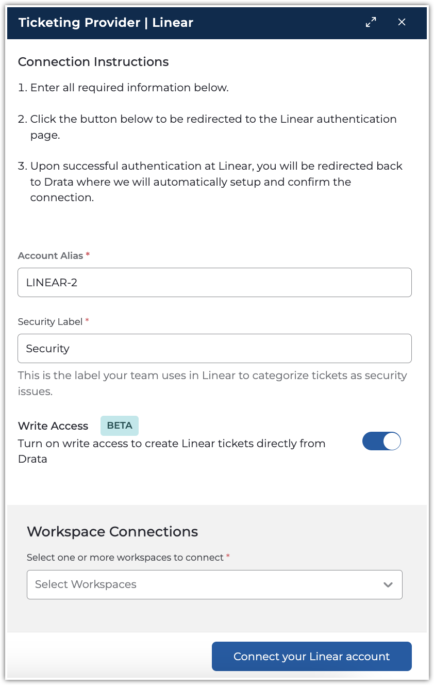
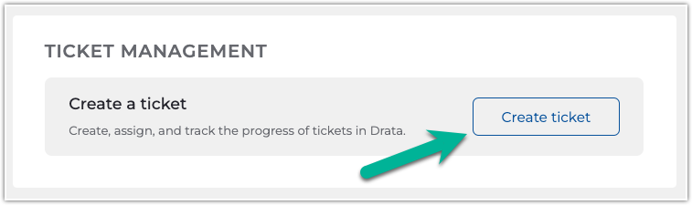
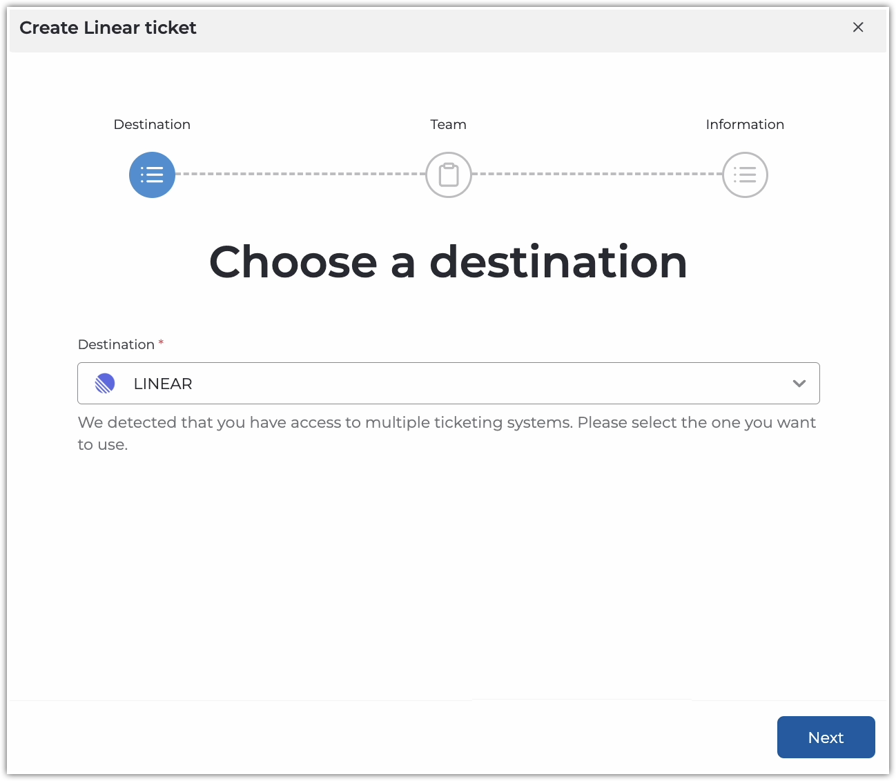
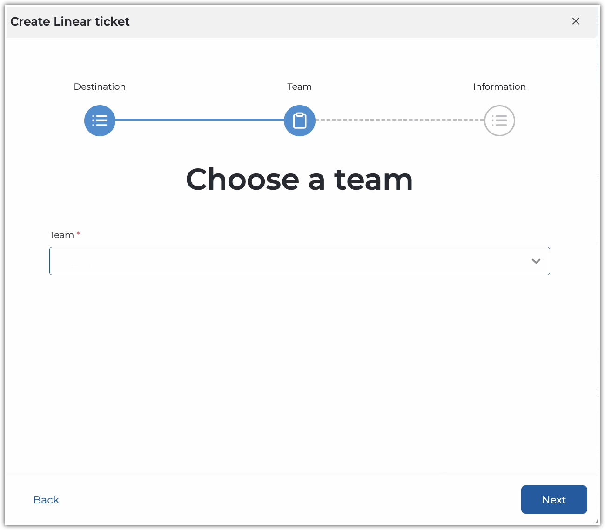
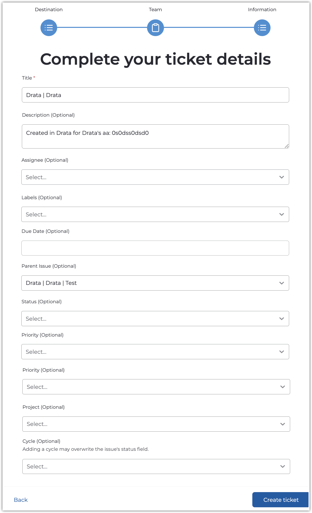

# Linear Integration Guide

Source: https://help.drata.com/en/articles/5224671-linear-integration-guide
Collection: Connection Support › Ticketing Guidance
Updated: 2026-11-14
Fetched: 2026-11-22
Description: Making the initial connection to Linear

## Article text

The Linear integration enables security and compliance teams to automate vulnerability management workflows. It connects Drata to Linear, allowing your team to automatically collect evidence and create or sync tickets that demonstrate adherence to your organization’s vulnerability management policies and procedures for audit readiness.

## Key Capabilities

- Automation: Automatically collects evidence and validates adherence to vulnerability management policies by connecting Linear to Drata.
- Customization: Supports 7 new optional fields for ticket creation—Status, Priority, Project, Cycle, Estimate, Labels, and Due Date—for enhanced tracking and reporting.
- User Access Control: Provides configurable write access and workspace selection to manage where and how tickets are created within Linear.

## Prerequisites & Data Access

- Must have **Admin**, **Information Security Lead**, **DevOps Engineer**, or **Workspace Manager** roles in Drata.

## Complete the Connection

1. Go to the Connections page and search for Linear.
2. Complete the required fields:
   - If you do not use 'Security' as the label within Linear to categorize tickets as security issues, be sure to update the 'Security Label' within the panel.
   - To create Linear tickets from Drata, enable Write Access.
3. After selecting 'Connect your Linear account,' you'll be redirected to Linear. Choose the workspace you wish to sync with Drata.
4. Once you've chosen the workspace, you'll return to Drata. For further steps, refer to the sections below.
   

## Create Linear tickets through Drata

**Note**: To create tickets, ensure that within the Linear connection that Write Access is enabled.

The places you can create tickets are:

- Control Details,
- Test Details, or
- Risk Details (in Risk Management) drawer.

If there are no tickets or tasks currently associated to a Control, Test, or Risk, you will be prompted to create one to get started. Select **Create ticket** to start the process.

Now, you will enter the ticket configurations and details. A multi-step modal will appear. Depending on your Linear configurations the following sections may differ.

### Step 1: Destination

If you use multiple ticketing systems, you will have to select Linear for the destination.

### Step 2: Team

Select the Linear team or workspace you would like to sync.

### Step 3: Ticket details

Lastly, enter the ticket details. Here are the available fields:

| **Fields** | **Descriptions** | **Optional?** | **Format** |
|---|---|---|---|
| Title | The name of the issue. Auto-populated but can be edited. | Required | Text |
| Description | Details about the issue. Auto-populated but can be edited. | Optional | Text |
| Assignee | Assigns the issue to a specific user. | Optional | Single Option Dropdown |
| Parent Issue | The Parent Issue field allows you to search for and select an existing issue. If a parent issue is added, the ticket will be created as a sub-issue under the selected parent. | Optional | Single Option Dropdown |
| Status | Indicates the current progress of the issue | Optional | Single Option Dropdown |
| Priority | Associates the importance of the issue | Optional | Single Option Dropdown |
| Project | Associates the issue with a specific project | Optional | Single Option Dropdown |
| Cycle | Links the issue to a time-boxed period, such as a sprint.   Cycles can fall into one of three time periods: Previous, Current, or Future.  **Note**: If the selected cycle and status are not aligned, the system will automatically overwrite the status to match the requirements of the chosen cycle when the issue is created. | Optional | Single Option Dropdown |
| Cycle → Previous | When an issue is added to a Previous cycle, its status will be updated to a status type equal to "Completed." | Optional | Single Option Dropdown |
| Cycle → Current or Future | When an issue is added to a Current or Future cycle, its status will be updated to a status type equal to "Ready." | Optional | Single Option Dropdown |
| Estimate | Indicates the estimated complexity or size of the issue (e.g., points or t-shirt sizes). The estimated values are determined by the settings the user sets in Linear.   Estimates can be customized in Team Settings > General > Estimates, where admins can enable zero values, extended point systems, count un-estimated issues or disable the field entirely. | Optional | Single Option Dropdown |
| Labels | Categorizes the issue using predefined labels | Optional | Multiple Option dropdown |
| Due Date | Indicates when the issue is expected to be completed | Optional | Date |

Once all necessary fields are filled out, you can proceed with creating the issue.

## Images

- [image 01] ../../images/integrations/linear/linear-integration-guide--01.png
- [image 02] ../../images/ux/tickets/linear-integration-guide--02.png
- [image 03] ../../images/ux/tickets/linear-integration-guide--03.png
- [image 04] ../../images/ux/tickets/linear-integration-guide--04.png
- [image 05] ../../images/ux/tickets/linear-integration-guide--05.png

## Related articles

- [Asana Integration Guide](asana-integration-guide.md)
- [Target Process Integration Guide](target-process-integration-guide.md)
- [Zoho Bug Tracker Integration Guide](zoho-bug-tracker-integration-guide.md)
- [Azure Boards (DevOps) Integration Guide](azure-boards-devops-integration-guide.md)
- [Fibery Integration Guide](fibery-integration-guide.md)
